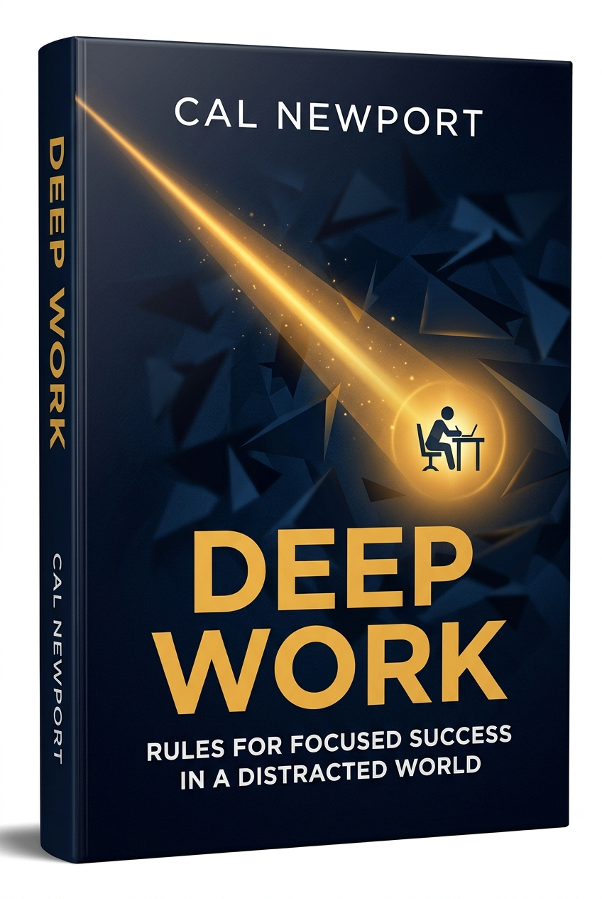
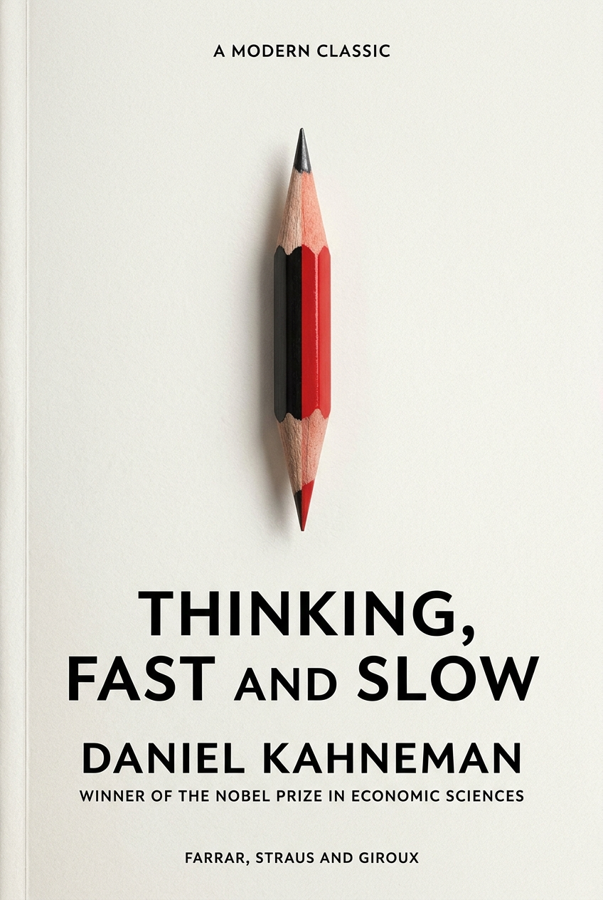
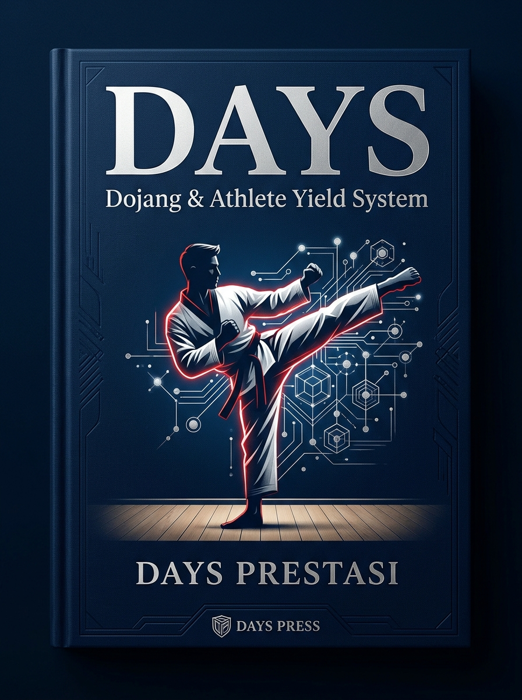
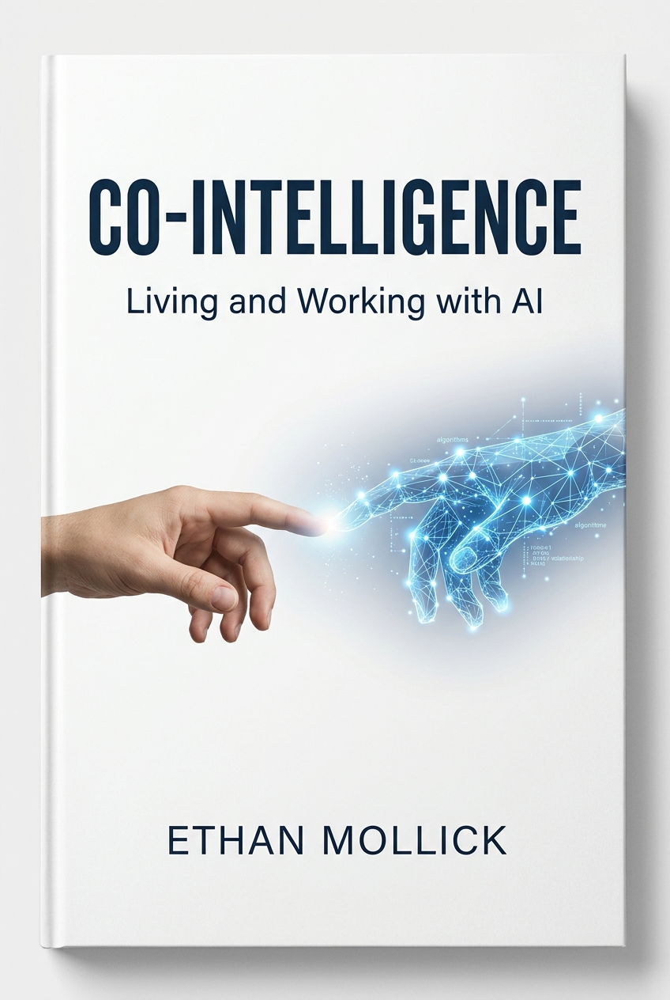
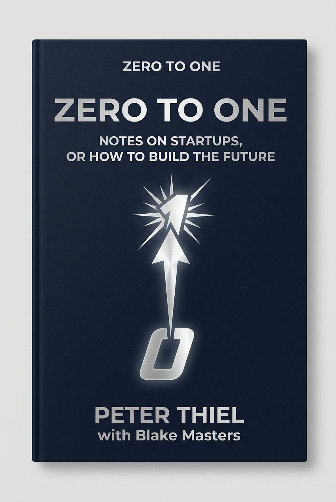
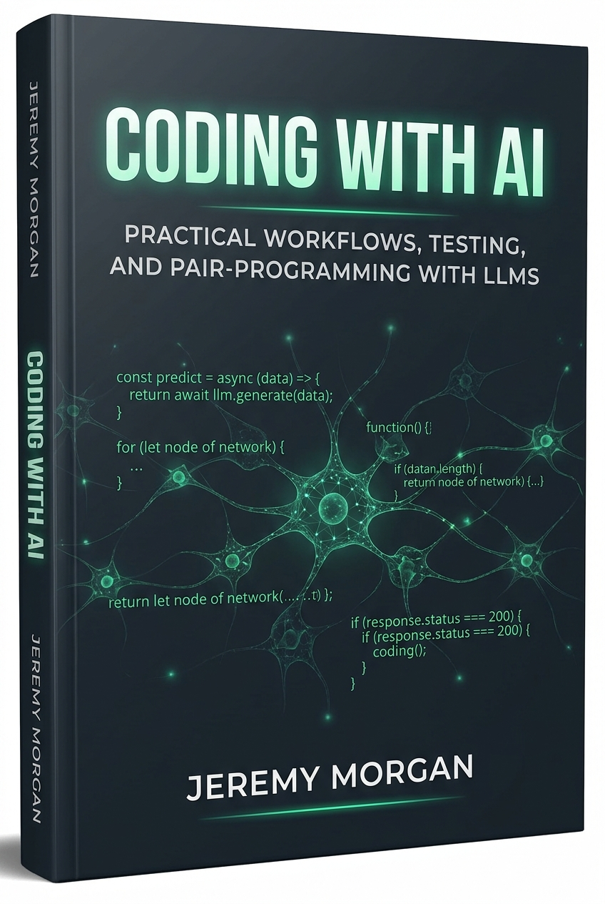
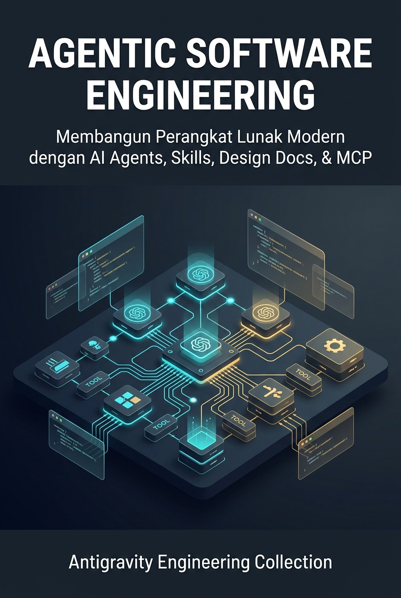
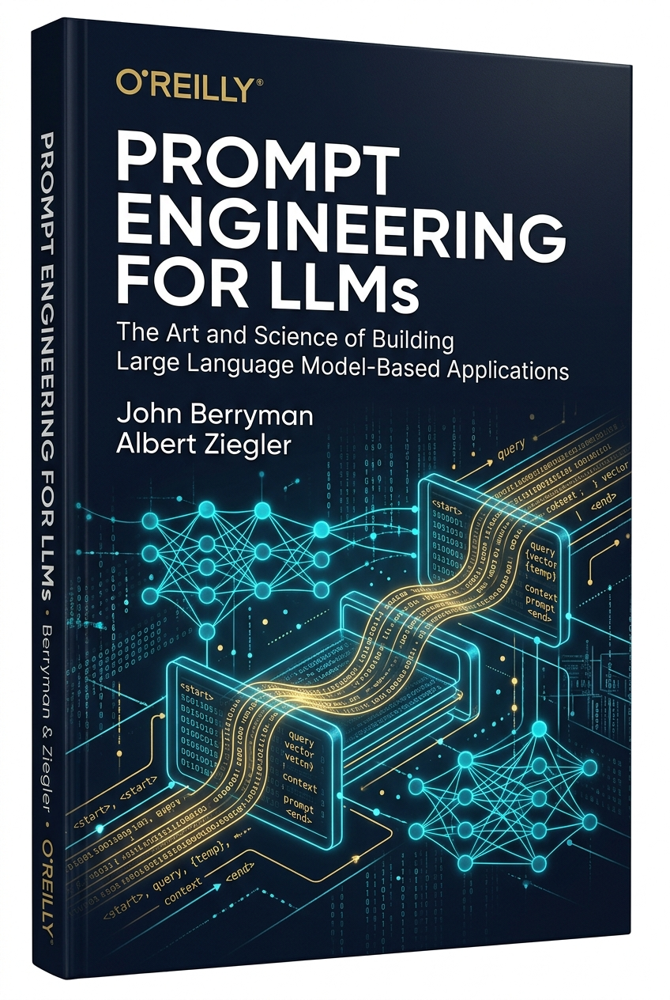
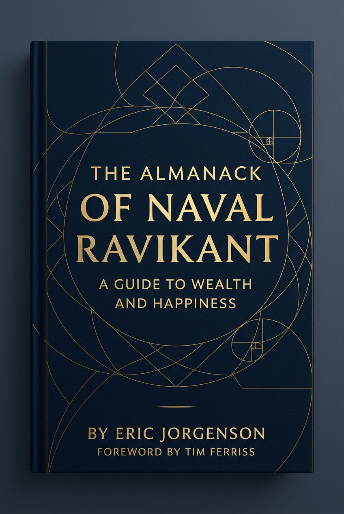
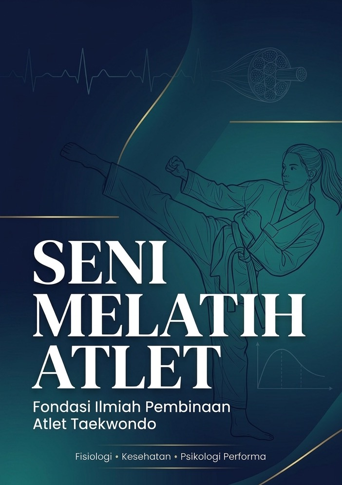

# 📚 Digital Book Hub & Knowledge Base

> Katalog terpusat koleksi buku pilihan, dilengkapi ringkasan eksekutif (*playbook*) dan bedah mendalam per bagian (*narrative teardown*) dengan studi kasus nyata.

[](#)
[-16a34a?style=for-the-badge&logo=checkmarx&logoColor=white)](#)
[](#)
[-0%20Buku%20(Kosong)-16a34a?style=for-the-badge&logo=bookstack&logoColor=white)](#-daftar-incaran--antrean-bedah-to-be-read)

---

## 🧭 Navigasi Cepat Kategori

- [🧠 Pengembangan Diri](#-pengembangan-diri)
- [💼 Bisnis & Teknologi](#-bisnis--teknologi)
- [📈 Finansial & Investasi](#-finansial--investasi)
- [🏆 Sains Olahraga & Pembinaan Atlet](#-sains-olahraga--pembinaan-atlet)
- [⏳ Daftar Incaran & Antrean Bedah (TBR: 0 Buku)](#-daftar-incaran--antrean-bedah-to-be-read)

---

## 🧠 Pengembangan Diri

### [Atomic Habits: Perubahan Kecil yang Menghasilkan Lompatan Raksasa](books/atomic-habits/index.md)

<div align="center">
  <a href="books/atomic-habits/index.md">
    
  </a>
  <br/>
  <sub>⭐⭐⭐⭐⭐ <b>5.0 / 5.0</b></sub>
</div>

> **Penulis**: James Clear &nbsp;|&nbsp; **Tahun**: 2018 &nbsp;|&nbsp; **Penerbit**: Avery (Penguin) &nbsp;|&nbsp; **Estimasi Baca**: ~45–60 Menit (6 Modul)  
> `🎯 Psikologi Perilaku` `⚡ Produktivitas` `🔄 Sistem & Habit` `🧬 Transformasi Identitas`

> **💡 The Big Idea:**  
> *"Kualitas hidup Anda saat ini bukan ditentukan oleh target besar yang Anda impikan, melainkan sistem kecil tanpa nama yang Anda ulangi setiap hari. Menjadi 1% lebih baik setiap hari akan melipatgandakan kapasitas Anda hingga 37 kali lipat dalam satu tahun."*

**🔑 Kerangka Berpikir Utama:**
- **The 4 Laws of Behavior Change**: Jadikan jelas (*obvious*), menarik (*attractive*), mudah (*easy*), dan memuaskan (*satisfying*).
- **Plateau of Latent Potential**: Menembus "Lembah Kekecewaan" sebelum hasil akumulasi eksponensial menampakkan wujudnya.
- **Identity-Based Habits**: Perubahan perilaku sejati berakar dari pembentukan identitas (*siapa diri Anda*), bukan sekadar target hasil (*apa yang Anda peroleh*).
- **Habit Stacking & The 2-Minute Rule**: Menempelkan kebiasaan baru pada rutinitas yang sudah mapan, dan memangkas tahap awalnya menjadi kurang dari 120 detik.

<br/>

### [Deep Work: Aturan Sukses Terfokus di Dunia yang Penuh Gangguan](books/deep-work/index.md)

<div align="center">
  <a href="books/deep-work/index.md">
    
  </a>
  <br/>
  <sub>⭐⭐⭐⭐⭐ <b>5.0 / 5.0</b></sub>
</div>

> **Penulis**: Cal Newport &nbsp;|&nbsp; **Tahun**: 2016 &nbsp;|&nbsp; **Penerbit**: Grand Central Publishing &nbsp;|&nbsp; **Estimasi Baca**: ~45–60 Menit (4 Modul)  
> `🎯 Manajemen Fokus` `⚡ Kinerja Puncak` `🧠 Neurosains Perhatian` `🚫 Detoks Digital`

> **💡 The Big Idea:**  
> *"Kemampuan untuk berkonsentrasi secara mendalam tanpa distraksi adalah keterampilan yang semakin langka justru di saat nilainya paling berharga dalam ekonomi modern. Menguasai Deep Work adalah satu-satunya jalan untuk memproduksi karya berkualitas elit dan menguasai hal-hal rumit dengan cepat di tengah dunia yang bising."*

**🔑 Kerangka Berpikir Utama:**
- **The Deep Work Hypothesis**: Nilai tinggi diciptakan oleh fokus tanpa jeda; multitasking memicu sisa perhatian (*attention residue*) yang melumpuhkan daya pikir.
- **4 Filosofi Penjadwalan Fokus**: Monastic (isolasi total), Bimodal (pembagian musim/bulan), Rhythmic (jadwal tetap setiap pagi), dan Journalistic.
- **The Craftsman Approach to Tools**: Menolak media sosial atau aplikasi kecuali dampak positifnya secara substansial melampaui kerugian fokus yang ditimbulkannya.
- **Fixed-Schedule Productivity & Shutdown Ritual**: Mengakhiri hari kerja pada jam yang pasti dan melakukan ritual penutupan untuk ketenangan mental malam hari.

<br/>

### [Thinking, Fast and Slow: Membongkar Dua Sistem Berpikir dan Jebakan Kognitif Manusia](books/thinking-fast-and-slow/index.md)

<div align="center">
  <a href="books/thinking-fast-and-slow/index.md">
    
  </a>
  <br/>
  <sub>⭐⭐⭐⭐⭐ <b>5.0 / 5.0</b></sub>
</div>

> **Penulis**: Daniel Kahneman (Nobel Ekonomi 2002) &nbsp;|&nbsp; **Tahun**: 2011 &nbsp;|&nbsp; **Penerbit**: Farrar, Straus and Giroux &nbsp;|&nbsp; **Estimasi Baca**: ~75–90 Menit (5 Modul)  
> `🧠 Psikologi Kognitif` `⚖️ Behavioral Economics` `🎯 Pengambilan Keputusan` `🎲 Teori Prospek`

> **💡 The Big Idea:**  
> *"Pikiran manusia bukanlah komputer rasional yang dingin, melainkan mesin lompat kesimpulan yang sangat percaya diri. Kita mengira diri kita adalah nakhoda logis yang memegang kendali penuh (Sistem 2), padahal sebagian besar persepsi dan keputusan kita sehari-hari sebenarnya didikte secara otomatis oleh dorongan emosional dan jalan pintas primitif dari bawah sadar (Sistem 1)."*

**🔑 Kerangka Berpikir Utama:**
- **Sistem 1 vs Sistem 2**: Pilot otomatis yang cepat, emosional, dan hemat energi vs nakhoda lambat yang analitis namun malas (*The Lazy Controller*).
- **Hukum WYSIATI (*What You See Is All There Is*)**: Pikiran hanya mengolah bukti yang tampak di depan mata dan mengabaikan informasi kritis yang belum diketahui demi merajut cerita yang koheren.
- **Heuristik & Bias Sistemik**: Jalan pintas mental yang memicu efek jangkar (*Anchoring*), ilusi ketersediaan (*Availability*), sesat pikir konjungsi Linda, dan buta regresi menuju rata-rata.
- **Teori Prospek & Dua Diri**: Rasa sakit kehilangan (*Loss Aversion*) terasa 2x lipat lebih tajam daripada kenikmatan menang, serta tirani Diri yang Mengingat (*Remembering Self*) yang hanya menilai peristiwa dari *Peak* dan *End*.

---

## 💼 Bisnis & Teknologi

### [DAYS: Dojang & Athlete Yield System](books/days-dojang-athlete-yield-system/index.md)

<div align="center">
  <a href="books/days-dojang-athlete-yield-system/index.md">
    
  </a>
  <br/>
  <sub>⭐⭐⭐⭐⭐ <b>5.0 / 5.0</b></sub>
</div>

> **Penulis**: Days Prestasi &nbsp;|&nbsp; **Tahun**: 2026 &nbsp;|&nbsp; **Penerbit**: Days Press &nbsp;|&nbsp; **Estimasi Baca**: ~120–140 Menit (7 Modul Lengkap)  
> `🥋 Manajemen Dojang` `⚡ Ekosistem Olahraga` `🏆 Atlet & Prestasi` `💼 Kemandirian Bisnis` `🧠 Sports Science`

> **💡 The Big Idea:**  
> *"Tragedi terbesar dalam pembinaan bela diri bukanlah kekalahan di atas matras, melainkan habisnya energi pelatih dan pemilik dojang di meja administrasi sebelum sempat mencurahkan jiwanya untuk melatih sang juara. DAYS hadir untuk mengembalikan sabam ke tatami dan atlet ke panggung juara dengan tata kelola digital terpadu."*

**🔑 Kerangka Berpikir Utama:**
- **The Administrative Debt**: Menghapus kebocoran kas 25% dan membebaskan sabam dari tugas canggung penagihan iuran di matras.
- **The Synergy Triangle**: Integrasi kedaulatan Owner, kepraktisan presensi Sabam (<30 detik), dan ketenangan orang tua murid.
- **Integrated Yield Pipeline**: Standardisasi pengujian sabuk UKT anti-bodong ber-QR code dan drawing turnamen digital adil.
- **Autonomous Economic Engine**: Official Dojang Store sebagai penggerak dana abadi beasiswa atlet duafa berprestasi.
- **Retention & Sports Science**: Menembus *Green Belt Plateau*, edukasi orang tua modern, dan manajemen rasio beban latihan (ACWR) pencegah cedera fatal.
- **The Young Coach Partnership**: Cetak biru replikasi ekspansi 10+ cabang melalui kemitraan bagi hasil adil tanpa pecah kongsi.

<br/>

### [AI for Small Business: Panduan Praktis Transformasi Usaha](books/ai-for-small-business/index.md)

<div align="center">
  <a href="books/ai-for-small-business/index.md">
    
  </a>
  <br/>
  <sub>⭐⭐⭐⭐⭐ <b>4.8 / 5.0</b></sub>
</div>

> **Penulis**: Phil Pallen &nbsp;|&nbsp; **Tahun**: 2024 &nbsp;|&nbsp; **Penerbit**: Entrepreneur Press &nbsp;|&nbsp; **Estimasi Baca**: ~40–50 Menit (4 Modul)  
> `🤖 Artificial Intelligence` `💼 Strategi UMKM` `⚙️ Otomasi Operasional` `🚀 Skalabilitas Bisnis`

> **💡 The Big Idea:**  
> *"Kecerdasan Buatan adalah penyetara peluang (the great equalizer) paling radikal dalam sejarah dunia usaha. AI bukan pengganti manusia, melainkan 'pengganda kekuatan' yang memungkinkan tim kecil berisi 3 orang memiliki kapasitas kerja setara divisi korporasi 30 orang tanpa anggaran IT mahal."*

**🔑 Kerangka Berpikir Utama:**
- **Virtual Intern Framework**: Memperlakukan AI seperti asisten magang yang sangat cerdas namun butuh panduan suara merek (*brand voice*) yang terarah.
- **Automation Matrix**: Mengidentifikasi tugas-tugas administratif rutin dan repetitif untuk didelegasikan sepenuhnya ke AI.
- **High-Converting Prompting**: Menyusun copywriting persuasif, artikel blog, dan konten media sosial bernilai konversi tinggi secara konsisten.
- **24/7 Smart Customer Service**: Mengotomatiskan respons layanan pelanggan secara cepat dan manusiawi kapan saja tanpa henti.

<br/>

### [Co-Intelligence: Hidup dan Bekerja Bersama AI](books/co-intelligence/index.md)

<div align="center">
  <a href="books/co-intelligence/index.md">
    
  </a>
  <br/>
  <sub>⭐⭐⭐⭐⭐ <b>5.0 / 5.0</b></sub>
</div>

> **Penulis**: Ethan Mollick &nbsp;|&nbsp; **Tahun**: 2024 &nbsp;|&nbsp; **Penerbit**: Portfolio / Penguin Random House &nbsp;|&nbsp; **Estimasi Baca**: ~45–60 Menit (4 Modul)  
> `🤖 Generative AI` `👥 Kolaborasi Manusia-Mesin` `🚀 Inovasi Kerja` `💡 Kreativitas Praktis`

> **💡 The Big Idea:**  
> *"AI bukanlah perangkat lunak kalkulator atau mesin pencari kaku, melainkan sebuah entitas sosial—rekan kerja (co-worker) cerdas dan eksentrik yang mampu melipatgandakan kecepatan dan kualitas kerja kita. Memenangkan era baru bukan tentang menjadi programmer ahli, melainkan menguasai seni 'Co-Intelligence': kemampuan berdialog, mendelegasikan, dan memverifikasi AI sebagai mitra berpikir yang setara."*

**🔑 Kerangka Berpikir Utama:**
- **The Jagged Frontier**: Batas kemampuan AI tidak rata; ia bisa menyelesaikan analisis strategi rumit dalam detik, namun rentan berhalusinasi pada hal sepele.
- **4 Aturan Emas Kolaborasi**: Selalu undang AI ke meja kerja, jadilah pengawas akhir (*Human-in-the-Loop*), perlakukan AI seperti manusia bertalenta spesifik, dan sadari ini adalah AI terburuk yang akan Anda gunakan.
- **Dua Model Integrasi (Centaur vs Cyborg)**: Memilih antara pembagian kerja makro yang tegas (Centaur) atau jalinan kerja mikro kalimat demi kalimat (Cyborg).
- **The Leveler Effect**: AI secara dramatis meningkatkan performa pekerja pemula hingga 43%, meruntuhkan hierarki lama dan mendesentralisasi kekuatan inovasi.

<br/>

### [Zero to One: Catatan tentang Startup, atau Cara Membangun Masa Depan](books/zero-to-one/index.md)

<div align="center">
  <a href="books/zero-to-one/index.md">
    
  </a>
  <br/>
  <sub>⭐⭐⭐⭐⭐ <b>5.0 / 5.0</b></sub>
</div>

> **Penulis**: Peter Thiel bersama Blake Masters &nbsp;|&nbsp; **Tahun**: 2014 &nbsp;|&nbsp; **Penerbit**: Crown Business &nbsp;|&nbsp; **Estimasi Baca**: ~50–65 Menit (4 Modul)  
> `🚀 Inovasi 0 ke 1` `🏛️ Monopoli Kreatif` `📈 Hukum Pangkat (Power Law)` `🤝 Simbiosis Manusia-Mesin`

> **💡 The Big Idea:**  
> *"Setiap saat dalam sejarah bisnis hanya terjadi satu kali. Meniru apa yang sudah ada hanya membawa dunia dari 1 ke n. Melompat dari 0 ke 1 menuntut keberanian berpikir kontrarian: meloloskan diri dari neraka kompetisi berdarah dan membangun monopoli kreatif yang mengubah peradaban melalui teknologi yang 10x lipat lebih baik."*

**🔑 Kerangka Berpikir Utama:**
- **The Contrarian Question**: Menemukan kebenaran penting yang diyakini sedikit orang untuk membuka rahasia bisnis tersembunyi.
- **Empat Pilar Monopoli Tahan Lama**: Teknologi hak milik 10x, efek jaringan (*network effects*), skala ekonomi marjinal nol, dan branding berakar substansi.
- **Definite Optimism & Hukum Pangkat**: Menolak ilusi lotre acak; merancang masa depan konkret di mana satu hasil terbaik melampaui gabungan seluruh portofolio lainnya.
- **Simbiosis Manusia-Komputer & 7 Uji Pertanyaan**: Komputer adalah pengganda kekuatan intuisi manusia, bukan sekadar pengganti tenaga kerja.

<br/>

### [Coding with AI: Praktik Pemrograman, Pengujian, dan Kolaborasi bersama LLM](books/coding-with-ai/index.md)

<div align="center">
  <a href="books/coding-with-ai/index.md">
    
  </a>
  <br/>
  <sub>⭐⭐⭐⭐⭐ <b>4.9 / 5.0</b></sub>
</div>

> **Penulis**: Jeremy Morgan &nbsp;|&nbsp; **Tahun**: 2024 &nbsp;|&nbsp; **Penerbit**: Manning Publications &nbsp;|&nbsp; **Estimasi Baca**: ~45–60 Menit (4 Modul)  
> `💻 Rekayasa Software` `🧪 Otomasi Pengujian (TDD)` `⚡ Pair-Programming AI` `🛡️ Debugging & Keamanan`

> **💡 The Big Idea:**  
> *"AI tidak datang untuk menggantikan peran seorang programmer; programmer yang menguasai kolaborasi AI lah yang akan menggantikan mereka yang menolak beradaptasi. Nilai tertinggi insinyur perangkat lunak modern bukan lagi kecepatan mengetikkan sintaksis, melainkan ketajaman mendesain arsitektur, menguraikan masalah secara modular, dan memverifikasi sistem melalui pengujian otomatis yang kokoh."*

**🔑 Kerangka Berpikir Utama:**
- **The Super-Intern Mental Model**: Memperlakukan AI seperti asisten magang super-cepat yang wajib disupervisi ketat; menghindari jebakan halusinasi paket gaib.
- **AI-Assisted TDD (Test-Driven Development)**: Membalik alur kerja: gunakan AI menulis 50 kasus uji ekstrem terlebih dahulu untuk menjadi jaring pengaman matematis sebelum implementasi kode.
- **Formula 4 Pilar Prompt Kode**: Mengunci peran arsitektur, cuplikan konteks eksisting (*scaffolding*), batasan dependensi ketat, dan kontrak format output.
- **Seni "Vibe Coding" & Agen Otonom**: Beralih dari copy-paste statis ke agen terintegrasi (seperti Antigravity/Cursor) dengan loop eksekusi terminal dan verifikasi mandiri.

<br/>

### [Agentic Software Engineering: Panduan Komprehensif AI Agents, Skills, Tools, & System Context](books/agentic-software-engineering/index.md)

<div align="center">
  <a href="books/agentic-software-engineering/index.md">
    
  </a>
  <br/>
  <sub>⭐⭐⭐⭐⭐ <b>5.0 / 5.0</b></sub>
</div>

> **Penulis**: Antigravity Engineering Lab &nbsp;|&nbsp; **Tahun**: 2026 &nbsp;|&nbsp; **Penerbit**: Modern AI Engineering Hub &nbsp;|&nbsp; **Estimasi Baca**: ~75–90 Menit (6 Modul Lengkap)  
> `🤖 AI Coding Agents` `🛠️ Skills & MCP` `📐 Spec-Driven (design.md)` `🔄 Multi-Agent Orchestration` `🛡️ Sandbox & Feedback Loops`

> **💡 The Big Idea:**  
> *"AI Agent bukanlah sekadar chatbot pintar yang diajak berdiskusi kode di tab peramban, melainkan sistem kognitif otonom yang dibekali alat eksekusi, memori kerja terstruktur, dan loop verifikasi tertutup. Masa depan rekayasa perangkat lunak bergeser dari juru ketik sintaks manual menjadi orkestrator sistem yang memimpin skuad agen cerdas melalui hierarki aturan (AGENTS.md), cetak biru desain (design.md), dan modul keterampilan prosedural (Skills)."*

**🔑 Kerangka Berpikir Utama:**
- **The ReAct Cycle & Tool Execution**: Menghubungkan nalar probabilistik LLM dengan tindakan nyata di terminal sandbox melalui loop Thought-Action-Observation.
- **The Context Hierarchy & Spec-Driven Development**: Menata informasi dari aturan sistem global (`AGENTS.md`), dokumen desain fitur (`design.md`), hingga modul prosedural on-demand (`SKILL.md`) untuk mencegah *attention dilution*.
- **The Model Context Protocol (MCP)**: Standar terbuka menghubungkan agen secara langsung ke PostgreSQL, GitHub, Jira, dan mikroservis internal.
- **Hierarchical Multi-Agent Teams**: Mencegah *cognitive drift* dengan mendelegasikan tugas ke subagent terisolasi: Lead Orchestrator, Deep Researcher, Worker/Coder, dan QA Reviewer.
- **Autonomous Self-Correction & Deterministic Ground Truth**: Membenturkan kode agen dengan compiler, test suite, dan linter untuk perbaikan mandiri berbasis *exit code*.

<br/>

### [Prompt Engineering for LLMs: Seni dan Sains Membangun Aplikasi Berbasis Model Bahasa](books/prompt-engineering-for-llms/index.md)

<div align="center">
  <a href="books/prompt-engineering-for-llms/index.md">
    
  </a>
  <br/>
  <sub>⭐⭐⭐⭐⭐ <b>5.0 / 5.0</b></sub>
</div>

> **Penulis**: John Berryman & Albert Ziegler &nbsp;|&nbsp; **Tahun**: 2024 &nbsp;|&nbsp; **Penerbit**: O'Reilly Media &nbsp;|&nbsp; **Estimasi Baca**: ~60–75 Menit (4 Modul)  
> `💻 AI Engineering` `🧠 Rekayasa Konteks (RAG)` `🛡️ Guardrails & Keamanan` `⚙️ Tool Calling & Evaluasi`

> **💡 The Big Idea:**  
> *"Prompt Engineering bukanlah trik merangkai kata magis di chatbox, melainkan cabang baru rekayasa perangkat lunak (software engineering). Ini adalah sains deterministik tentang bagaimana menyusun, membatasi, dan mengalirkan konteks komputasi ke dalam mesin pelengkap teks probabilistik agar menghasilkan keluaran produksi yang konsisten, aman, dan teruji secara otomatis."*

**🔑 Kerangka Berpikir Utama:**
- **The Document Completer Mental Model**: Memahami bahwa model tidak 'berpikir' atau 'menjawab', melainkan melengkapi dokumen secara statistik; setiap prompt adalah naskah drama penentu perilaku.
- **Context Window Scaffolding & Budgeting**: Mengisolasi konteks statis, dynamic few-shot, dan data RAG dengan delimiter terstruktur (XML/Markdown) untuk mencegah fenomena *Lost in the Middle*.
- **Deterministic Taming & Guardrails**: Mengunci parameter inferensi (temperatur mendekati 0, logprobs, stop sequences) dan menegakkan skema terstruktur (JSON Schema/Pydantic) anti-injeksi.
- **Agency, Workflows & Rigorous Evals**: Mentransformasikan LLM pasif menjadi agen proaktif (ReAct, Tool Calling) dan mengganti 'vibes-based testing' dengan Golden Datasets serta evaluasi otomatis bertingkat.

---

## 📈 Finansial & Investasi

### [The Intelligent Investor: Kitab Suci Value Investing](books/the-intelligent-investor/index.md)

<div align="center">
  <a href="books/the-intelligent-investor/index.md">
    
  </a>
  <br/>
  <sub>⭐⭐⭐⭐⭐ <b>5.0 / 5.0</b></sub>
</div>

> **Penulis**: Benjamin Graham (Komentar: Jason Zweig) &nbsp;|&nbsp; **Tahun**: 1949 &nbsp;|&nbsp; **Penerbit**: Harper Business &nbsp;|&nbsp; **Estimasi Baca**: ~45–60 Menit (4 Modul)  
> `📈 Value Investing` `💰 Psikologi Keuangan` `🛡️ Margin of Safety` `🏛️ Pasar Modal`

> **💡 The Big Idea:**  
> *"Keberhasilan berinvestasi seumur hidup bukan ditentukan oleh tebakan grafik atau IQ jenius, melainkan kerangka intelektual untuk memperlakukan saham sebagai kepemilikan bisnis riil dan disiplin emosional untuk membeli dengan 'Margin of Safety' (batas pengaman) dari histeria Mr. Market."*

**🔑 Kerangka Berpikir Utama:**
- **Investasi vs Spekulasi**: Menuntut keamanan dana pokok dan imbal hasil yang memadai vs melempar dadu di kasino bursa saham.
- **Perumpamaan Mr. Market (Bab 8)**: Memperlakukan fluktuasi harga harian sebagai pelayan bisnis, bukan pemandu emosi keputusan Anda.
- **Investor Defensif vs Investor Enterprising**: Memilih strategi portofolio sesuai kesediaan waktu dan komitmen riset laporan keuangan.
- **Doktrin Margin of Safety (Bab 20)**: Penyangga matematis yang memastikan portofolio tetap bertahan hidup saat proyeksi masa depan meleset.

<br/>

### [The Psychology of Money: Pelajaran Abadi Mengenai Kekayaan, Ketamakan, dan Kebahagiaan](books/the-psychology-of-money/index.md)

<div align="center">
  <a href="books/the-psychology-of-money/index.md">
    
  </a>
  <br/>
  <sub>⭐⭐⭐⭐⭐ <b>5.0 / 5.0</b></sub>
</div>

> **Penulis**: Morgan Housel &nbsp;|&nbsp; **Tahun**: 2020 &nbsp;|&nbsp; **Penerbit**: Harriman House &nbsp;|&nbsp; **Estimasi Baca**: ~45–60 Menit (4 Modul)  
> `💰 Psikologi Finansial` `🧠 Perilaku & Emosi` `⏳ Bunga Majemuk` `🕊️ Kemerdekaan Waktu`

> **💡 The Big Idea:**  
> *"Keberhasilan finansial bukanlah ilmu eksak seperti fisika, melainkan keterampilan lunak (soft skill) di mana cara Anda berperilaku jauh lebih menentukan daripada seberapa banyak rumus yang Anda tahu. Kekayaan sejati adalah kebebasan mengendalikan waktu Anda sendiri, bukan memamerkan barang mewah yang mengikis saldo masa depan Anda."*

**🔑 Kerangka Berpikir Utama:**
- **Tak Seorang Pun Gila (No One's Crazy)**: Setiap orang mengambil keputusan finansial berdasarkan pengalaman hidup nyata yang mereka alami sendiri.
- **Misteri Waktu Warren Buffett**: Bunga majemuk membutuhkan ketahanan waktu panjang, bukan return spektakuler sesaat (96% kekayaan Buffett didapat setelah usia 65).
- **The Man in the Car Paradox**: Orang mengagumi mobil sport mewah yang lewat, bukan pengemudinya; jangan beli barang mewah demi mengejar rasa hormat.
- **Menjadi Kaya vs Bertahan Kaya**: Menjadi kaya menuntut keberanian mengambil risiko, sementara bertahan kaya menuntut kerendahan hati dan paranoia yang sehat.

<br/>

### [The Almanack of Naval Ravikant: Petunjuk Menuju Kekayaan dan Kebahagiaan](books/the-almanack-of-naval-ravikant/index.md)

<div align="center">
  <a href="books/the-almanack-of-naval-ravikant/index.md">
    
  </a>
  <br/>
  <sub>⭐⭐⭐⭐⭐ <b>5.0 / 5.0</b></sub>
</div>

> **Penulis**: Eric Jorgenson & Naval Ravikant &nbsp;|&nbsp; **Tahun**: 2020 &nbsp;|&nbsp; **Penerbit**: Magrathea Publishing &nbsp;|&nbsp; **Estimasi Baca**: ~60–80 Menit (4 Modul)  
> `📈 Kebebasan Finansial` `⚡ Permissionless Leverage` `🧠 Specific Knowledge` `🕊️ Seni Kebahagiaan`

> **💡 The Big Idea:**  
> *"Menciptakan kekayaan bukanlah hasil dari kerja keras fisik membabi-buta, melainkan penguasaan Specific Knowledge dan Permissionless Leverage (kode dan media) yang bekerja saat Anda tidur. Namun kekayaan hanyalah prasyarat untuk menyelesaikan masalah uang; kedamaian batin sejati menuntut penjinakan hasrat dan kebebasan mengendalikan waktu Anda sendiri."*

**🔑 Kerangka Berpikir Utama:**
- **Specific Knowledge & Accountability**: Keahlian unik yang tidak bisa diajarkan lewat kurikulum sekolah, dikombinasikan dengan keberanian menanggung risiko dengan nama pribadi (*skin in the game*).
- **The Three Leverages**: Beralih dari leverage lama (tenaga kerja dan modal) ke leverage modern era internet (kode software dan media) yang berbiaya reproduksi marjinal nol.
- **Judgment is the Decisive Skill**: Di bawah pengaruh leverage ekstrem, pertimbangan rasional yang 10% lebih akurat menghasilkan selisih nilai bernilai miliaran dolar.
- **Desire is a Contract for Unhappiness**: Setiap hasrat adalah janji sukarela untuk menderita sampai keinginan terpenuhi; membatasi hasrat dan mengeliminasi status games adalah kunci kedamaian batin (*peace at rest*).

📘 **[Master Hub](books/the-almanack-of-naval-ravikant/index.md)** &nbsp;|&nbsp; **[Part 1](books/the-almanack-of-naval-ravikant/01-membangun-kekayaan-dan-leverage.md)** &nbsp;|&nbsp; **[Part 2](books/the-almanack-of-naval-ravikant/02-pertimbangan-dan-model-mental.md)** &nbsp;|&nbsp; **[Part 3](books/the-almanack-of-naval-ravikant/03-seni-mempelajari-kebahagiaan.md)** &nbsp;|&nbsp; **[Part 4](books/the-almanack-of-naval-ravikant/04-menyelamatkan-diri-sendiri-dan-kebebasan.md)**

---

## 🏆 Sains Olahraga & Pembinaan Atlet

### [Seni Melatih Atlet: Fondasi Ilmiah Pembinaan Atlet Taekwondo](books/seni-melatih-atlet-taekwondo/index.md)

<div align="center">
  <a href="books/seni-melatih-atlet-taekwondo/index.md">
    
  </a>
  <br/>
  <sub>⭐⭐⭐⭐⭐ <b>5.0 / 5.0 (Edisi Lengkap 9 Bab Divalidasi)</b></sub>
</div>

> **Penyusun**: Book Hubs (naskah orisinal berbasis literatur ilmiah) &nbsp;|&nbsp; **Tahun**: 2026 &nbsp;|&nbsp; **Sifat**: Buku acuan netral, bebas promosi produk &nbsp;|&nbsp; **Estimasi Baca**: ~150–180 Menit (9 Bab Lengkap)  
> `🔬 Fisiologi Latihan` `🩺 Sports Medicine` `🧠 Psikologi Performa` `🌙 Neurosains Tidur` `🥋 Taekwondo`

> **💡 The Big Idea:**  
> *"Atlet tidak dibentuk oleh seberapa keras ia dihancurkan, tetapi oleh seberapa tepat beban diberikan, seberapa baik ia pulih, dan seberapa jujur pelatih membedakan yang terbukti dari yang diwariskan."*

**🔑 Kerangka Berpikir Utama:**
- **Label Level Bukti (A–D)**: 28 literatur ilmiah tervalidasi (PubMed & Crossref), dilengkapi *Kotak Bukti* dan *Batas Pengetahuan* di tiap bab.
- **Bioenergetika & Fisiologi**: Rasio kerja-istirahat taekwondo, profil fisik atlet Olimpiade, dan aktivasi PAPE.
- **Beban, Periodisasi & Tapering**: Session-RPE, tinjauan kritis ACWR, serta protokol pemangkasan volume 40–60% dalam 14 hari tapering.
- **Sports Medicine & Pencegahan**: Protokol akut PEACE & LOVE, kriteria gegar otak Amsterdam 2022, dan tes Return-to-Play objektif.
- **Nutrisi & Berat Badan**: Diet rendah residu (low-residue) vs pencegahan dehidrasi ekstrem otak, sindrom REDs, serta rehidrasi natrium.
- **Psikologi & Pemulihan**: Regulasi emosi IZOF, *physiological sigh* di pojok matras, neurobiologi tidur SWS/REM, dan eliminasi mitos mandi es.
- **Program Terpadu & Lanskap Sistem**: Makrosiklus 16 minggu, tinjauan netral sistem pendamping (AMS/biometrik), serta alur kerja 5 gerbang dojang (operasional lapangan).

📘 **[Master Hub](books/seni-melatih-atlet-taekwondo/index.md)** &nbsp;|&nbsp; **[Bab 1](books/seni-melatih-atlet-taekwondo/01-bioenergetika-dan-fisiologi-taekwondo.md)** &nbsp;|&nbsp; **[Bab 2](books/seni-melatih-atlet-taekwondo/02-periodisasi-beban-dan-tapering.md)** &nbsp;|&nbsp; **[Bab 3](books/seni-melatih-atlet-taekwondo/03-sports-medicine-dan-biomekanika-cedera.md)** &nbsp;|&nbsp; **[Bab 4](books/seni-melatih-atlet-taekwondo/04-nutrisi-hidrasi-dan-manajemen-berat-badan.md)** &nbsp;|&nbsp; **[Bab 5](books/seni-melatih-atlet-taekwondo/05-psikologi-performa-dan-ketahanan-mental.md)** &nbsp;|&nbsp; **[Bab 6](books/seni-melatih-atlet-taekwondo/06-fisiologi-pemulihan-dan-kualitas-tidur.md)** &nbsp;|&nbsp; **[Bab 7](books/seni-melatih-atlet-taekwondo/07-menyusun-program-terpadu.md)** &nbsp;|&nbsp; **[Bab 8](books/seni-melatih-atlet-taekwondo/08-lanskap-sistem-pendamping-dan-teknologi-atlet.md)** &nbsp;|&nbsp; **[Bab 9](books/seni-melatih-atlet-taekwondo/09-alur-kerja-pembinaan-terstruktur-non-it.md)**

---

## ⏳ Daftar Incaran & Antrean Bedah (To-Be-Read)

> Daftar buku yang telah diarsipkan ke dalam antrean baca (*reading backlog / TBR*) untuk dipelajari, diriset, dan dibedah secara mendalam ke dalam repositori ini.

| No | Judul Buku & Penulis | Target Kategori | Alasan Kurasi (*Value Hook*) | Status Antrean |
| :-: | :--- | :--- | :--- | :-: |
| - | *Saat ini antrean kosong — seluruh incaran telah berhasil dibedah secara komprehensif!* | 🎉 Koleksi Lengkap | Silakan usulkan judul buku baru untuk dimasukkan ke antrean riset berikutnya. | ✅ `Selesai` |

```text
💡 Panduan Alur Bacaan:
- Menambah antrean: "Tambahkan buku [Judul] ke daftar incaran / antrean baca (TBR)."
- Memulai penulisan: "Mulai bedah buku [Judul] untuk dimasukkan ke katalog."
```

---

## 📌 Catatan Operasional Agent
Setiap kali menambahkan buku baru ke repositori:
1. Simpan gambar cover di `books/<slug-judul>/cover.jpg` (atau `.png`).
2. Buat folder `books/<slug-judul>/` berisi `index.md` dan berkas bedah bab (`01-...md`).
3. Tambahkan kartu visual responsif di kategori yang relevan di file ini serta perbarui badge statistik di bagian atas.
4. **Wajib Relative Path**: Selalu gunakan path relatif (contoh: `books/<slug-judul>/cover.jpg`), dilarang keras menuliskan path sistem lokal absolut.
