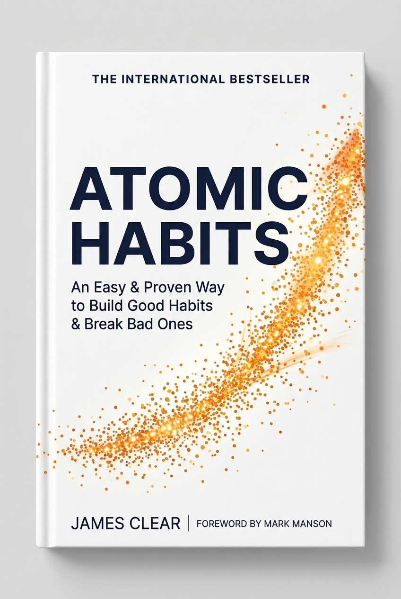
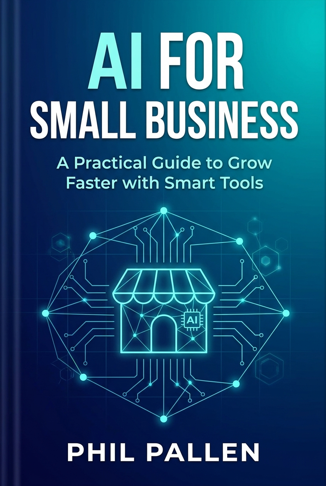
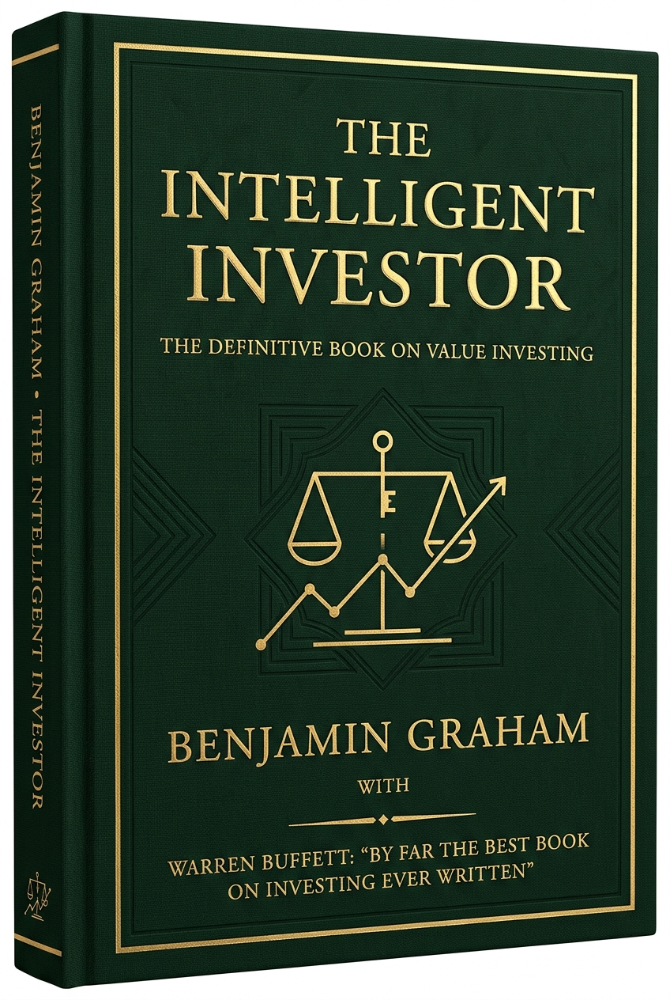
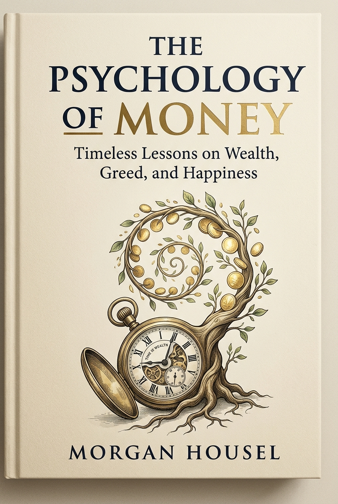

# 📚 Digital Book Hub & Knowledge Base

> Katalog terpusat koleksi buku pilihan, dilengkapi ringkasan eksekutif (*playbook*) dan bedah mendalam per bagian (*narrative teardown*) dengan studi kasus nyata.

---

## 🧭 Navigasi Cepat Kategori

- [🧠 Pengembangan Diri](#-pengembangan-diri)
- [💼 Bisnis & Teknologi](#-bisnis--teknologi)
- [📈 Finansial & Investasi](#-finansial--investasi)

---

## 🧠 Pengembangan Diri

<table width="100%">
<tr>
  <td width="160" align="center" valign="top">
    
     
    ⭐⭐⭐⭐⭐ <b>5.0 / 5.0</b>
  </td>
  <td valign="top">
    <h3><a href="books/atomic-habits/index.md">Atomic Habits: Perubahan Kecil yang Menghasilkan Lompatan Raksasa</a></h3>
    

      <b>Penulis:</b> James Clear &nbsp;|&nbsp; 
      <b>Tahun:</b> 2018 &nbsp;|&nbsp; 
      <b>Penerbit:</b> Avery (Penguin) &nbsp;|&nbsp; 
      <b>Estimasi Baca:</b> ~45–60 Menit (6 Modul)
    

    

      <code>🎯 Psikologi Perilaku</code> 
      <code>⚡ Produktivitas</code> 
      <code>🔄 Sistem & Habit</code> 
      <code>🧬 Transformasi Identitas</code>
    

    

      <b>💡 The Big Idea:</b> 
      <i>"Kualitas hidup Anda saat ini bukan ditentukan oleh target besar yang Anda impikan, melainkan sistem kecil tanpa nama yang Anda ulangi setiap hari. Menjadi 1% lebih baik setiap hari akan melipatgandakan kapasitas Anda hingga 37 kali lipat dalam satu tahun."</i>
    

    

      <b>🔑 Kerangka Berpikir Utama:</b> 
      <i>The 4 Laws of Behavior Change</i> (Jelas, Menarik, Mudah, Memuaskan), <i>Plateau of Latent Potential</i>, <i>Identity-Based Habits</i>, <i>Habit Stacking</i>, dan <i>The 2-Minute Rule</i>.
  </td>
</tr>
</table>

---

## 💼 Bisnis & Teknologi

<table width="100%">
<tr>
  <td width="160" align="center" valign="top">
    
     
    ⭐⭐⭐⭐⭐ <b>4.8 / 5.0</b>
  </td>
  <td valign="top">
    <h3><a href="books/ai-for-small-business/index.md">AI for Small Business: Panduan Praktis Transformasi Usaha</a></h3>
    

      <b>Penulis:</b> Phil Pallen &nbsp;|&nbsp; 
      <b>Tahun:</b> 2024 &nbsp;|&nbsp; 
      <b>Penerbit:</b> Entrepreneur Press &nbsp;|&nbsp; 
      <b>Estimasi Baca:</b> ~40–50 Menit (4 Modul)
    

    

      <code>🤖 Artificial Intelligence</code> 
      <code>💼 Strategi UMKM</code> 
      <code>⚙️ Otomasi Operasional</code> 
      <code>🚀 Skalabilitas Bisnis</code>
    

    

      <b>💡 The Big Idea:</b> 
      <i>"Kecerdasan Buatan adalah penyetara peluang (the great equalizer) paling radikal dalam sejarah dunia usaha. AI bukan pengganti manusia, melainkan 'pengganda kekuatan' yang memungkinkan tim kecil berisi 3 orang memiliki kapasitas kerja setara divisi korporasi 30 orang tanpa anggaran IT mahal."</i>
    

    

      <b>🔑 Kerangka Berpikir Utama:</b> 
      <i>Virtual Intern Framework</i>, <i>Automation Matrix</i>, <i>High-Converting Copywriting Prompts</i>, <i>24/7 Smart Customer Service</i>, dan <i>Data Privacy for SMBs</i>.
  </td>
</tr>
</table>

---

## 📈 Finansial & Investasi

<table width="100%">
<tr>
  <td width="160" align="center" valign="top">
    
     
    ⭐⭐⭐⭐⭐ <b>5.0 / 5.0</b>
  </td>
  <td valign="top">
    <h3><a href="books/the-intelligent-investor/index.md">The Intelligent Investor: Kitab Suci Value Investing</a></h3>
    

      <b>Penulis:</b> Benjamin Graham (Komentar: Jason Zweig) &nbsp;|&nbsp; 
      <b>Tahun:</b> 1949 &nbsp;|&nbsp; 
      <b>Penerbit:</b> Harper Business &nbsp;|&nbsp; 
      <b>Estimasi Baca:</b> ~45–60 Menit (4 Modul)
    

    

      <code>📈 Value Investing</code> 
      <code>💰 Psikologi Keuangan</code> 
      <code>🛡️ Margin of Safety</code> 
      <code>🏛️ Pasar Modal</code>
    

    

      <b>💡 The Big Idea:</b> 
      <i>"Keberhasilan berinvestasi seumur hidup bukan ditentukan oleh tebakan grafik atau IQ jenius, melainkan kerangka intelektual untuk memperlakukan saham sebagai kepemilikan bisnis riil dan disiplin emosional untuk membeli dengan 'Margin of Safety' (batas pengaman) dari histeria Mr. Market."</i>
    

    

      <b>🔑 Kerangka Berpikir Utama:</b> 
      <i>Investasi vs Spekulasi</i>, <i>Perumpamaan Mr. Market (Bab 8)</i>, <i>Investor Defensif vs Investor Enterprising</i>, dan <i>Doktrin Margin of Safety (Bab 20)</i>.
</tr>
</table>

 

<table width="100%">
<tr>
  <td width="160" align="center" valign="top">
    
     
    ⭐⭐⭐⭐⭐ <b>5.0 / 5.0</b>
  </td>
  <td valign="top">
    <h3><a href="books/the-psychology-of-money/index.md">The Psychology of Money: Pelajaran Abadi Mengenai Kekayaan, Ketamakan, dan Kebahagiaan</a></h3>
    

      <b>Penulis:</b> Morgan Housel &nbsp;|&nbsp; 
      <b>Tahun:</b> 2020 &nbsp;|&nbsp; 
      <b>Penerbit:</b> Harriman House &nbsp;|&nbsp; 
      <b>Estimasi Baca:</b> ~45–60 Menit (4 Modul)
    

    

      <code>💰 Psikologi Finansial</code> 
      <code>🧠 Perilaku & Emosi</code> 
      <code>⏳ Bunga Majemuk</code> 
      <code>🕊️ Kemerdekaan Waktu</code>
    

    

      <b>💡 The Big Idea:</b> 
      <i>"Keberhasilan finansial bukanlah ilmu eksak seperti fisika, melainkan keterampilan lunak (soft skill) di mana cara Anda berperilaku jauh lebih menentukan daripada seberapa banyak rumus yang Anda tahu. Kekayaan sejati adalah kebebasan mengendalikan waktu Anda sendiri, bukan memamerkan barang mewah yang mengikis saldo masa depan Anda."</i>
    

    

      <b>🔑 Kerangka Berpikir Utama:</b> 
      <i>Tak Seorang Pun Gila (No One's Crazy)</i>, <i>Misteri Waktu Warren Buffett</i>, <i>The Man in the Car Paradox</i>, <i>Menjadi Kaya vs Bertahan Kaya</i>, dan <i>Kekayaan Tak Kasatmata</i>.
    

  </td>
</tr>
</table>

---

## 📌 Catatan Operasional Agent
Setiap kali menambahkan buku baru ke repositori:
1. Simpan gambar cover di `books/<slug-judul>/cover.jpg` (atau `.png`).
2. Buat folder `books/<slug-judul>/` berisi `index.md` dan berkas bedah bab (`01-...md`).
3. Tambahkan kartu visual di kategori yang relevan di file ini serta perbarui badge statistik di bagian atas.
4. **Wajib Relative Path**: Selalu gunakan path relatif (contoh: `books/<slug-judul>/cover.jpg`), dilarang keras menuliskan path sistem lokal absolut.
