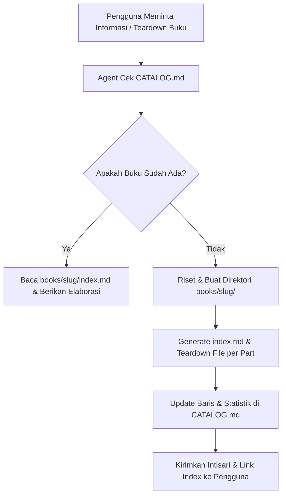

# 📚 Book & Article Knowledge Base + AI Agent

> Repositori sistem manajemen pengetahuan (*Knowledge Base*) untuk buku-buku bacaan terbaik dan artikel singkat lepas, dilengkapi **AI Assistant / Agent** yang bertugas meriset, menyusun intisari eksekutif, membedah buku per bab, serta menulis esai/artikel singkat beserta ilustrasinya.

👉 **[📖 Buka Katalog Visual Koleksi Buku (CATALOG.md)](CATALOG.md)** — *Lihat seluruh daftar buku lengkap dengan cover, rating, tesis utama, dan modul baca.*  
👉 **[📰 Buka Katalog Artikel Singkat Lepas (ARTICLES.md)](ARTICLES.md)** — *Lihat daftar artikel lepas, bedah fenomena, dan mental model.*

---

## 🗂️ Struktur Direktori

```text
book-hubs/
├── .agents/
│   └── skills/
│       ├── book-assistant/
│       │   └── SKILL.md                 # Definisi alur kerja AI Agent untuk Buku
│       └── article-writer/
│           └── SKILL.md                 # Definisi alur kerja AI Agent untuk Artikel Lepas
├── articles/                            # Direktori koleksi Artikel Singkat Lepas (per slug)
│   └── <slug-artikel>/
│       ├── cover.jpg                    # Ilustrasi utama / cover artikel
│       ├── illustrations/               # (Opsional) Ilustrasi pendukung di dalam artikel
│       └── index.md                     # Naskah utuh artikel singkat lepas
├── books/                               # Direktori koleksi buku (Model Modular Hub)
│   ├── atomic-habits/
│   │   ├── cover.jpg                    # Cover visual buku
│   │   ├── index.md                     # Roadmap eksekutif & playbook buku
│   │   ├── 01-the-fundamentals.md       # Part 1: Dasar-dasar (1% rule, British cycling, dll)
│   │   ├── ...                          # Modul teardown lainnya
│   │   └── 06-advanced-tactics.md       # Part 6: Taktik lanjutan (Goldilocks rule, review)
│   └── ...                              # Koleksi buku lainnya (11 buku)
├── templates/
│   ├── article_template.md              # Template standar artikel singkat lepas
│   ├── book_index_template.md           # Template master index hub per buku
│   └── part_teardown_template.md        # Template teardown mendalam per bagian/bab
├── AGENTS.md                            # Aturan otomatis untuk AI Agent dalam workspace
├── ARTICLES.md                          # Showcase visual & katalog seluruh Artikel Singkat Lepas
├── CATALOG.md                           # Showcase visual & katalog seluruh Buku (Murni Buku)
└── README.md                            # Panduan penggunaan proyek
```

---

## 🤖 Cara Kerja AI Agent

Agent ini diatur oleh dua komponen:
1. **[AGENTS.md](AGENTS.md)**: Aturan workspace yang memastikan agen selalu mengecek katalog, mematuhi standar kedalaman teardown, dan memperbarui daftar koleksi menggunakan relative path.
2. **[.agents/skills/book-assistant/SKILL.md](.agents/skills/book-assistant/SKILL.md)**: Prosedur bertahap (*step-by-step*) untuk meriset buku, membuat folder di `books/<slug>/`, dan menyinkronkan data ke `CATALOG.md`.

### Alur Kerja Otomatis:


---

## 📑 Format Teardown Naratif per Bagian

Alih-alih ringkasan kering berbentuk bullet point yang menghilangkan esensi membaca, setiap bagian buku dibedah dengan mempertahankan:
1. **Narasi & Konteks Pembuka**: Kisah nyata, biografi, atau eksperimen laboratorium yang digunakan penulis untuk membuka bab.
2. **Teardown Konsep Ilmiah**: Mengapa gagasan tersebut berlawanan dengan intuisi umum (*counter-intuitive*) dan studi riset yang mendasarinya.
3. **Analogi Kunci Penulis**: Perumpamaan kuat yang membuat konsep mudah dipahami dan diingat.
4. **Studi Kasus Dunia Nyata**: Bagaimana konsep bekerja dalam skenario pekerjaan, bisnis, dan relasi pribadi.
5. **Panduan Tindakan Nyata (Action Checklist)**: Langkah konkret yang bisa langsung diuji coba.
6. **Kutipan Pilihan & Pertanyaan Reflektif**: Kalimat berbobot dan pertanyaan introspektif untuk pembaca.

---

## 🚀 Contoh Perintah yang Dapat Anda Berikan ke Agent

Anda cukup meminta agen di chat, misalnya:
- *"Berikan detail dan bedah buku 'The Psychology of Money' karya Morgan Housel."*
- *"Tolong cek apakah buku 'Deep Work' sudah ada di list kita, jika belum tolong buatkan folder teardown per bab dan masukkan ke katalog."*
- *"Bagaimana penjelasan James Clear tentang Aturan Dua Menit di buku Atomic Habits?"*
