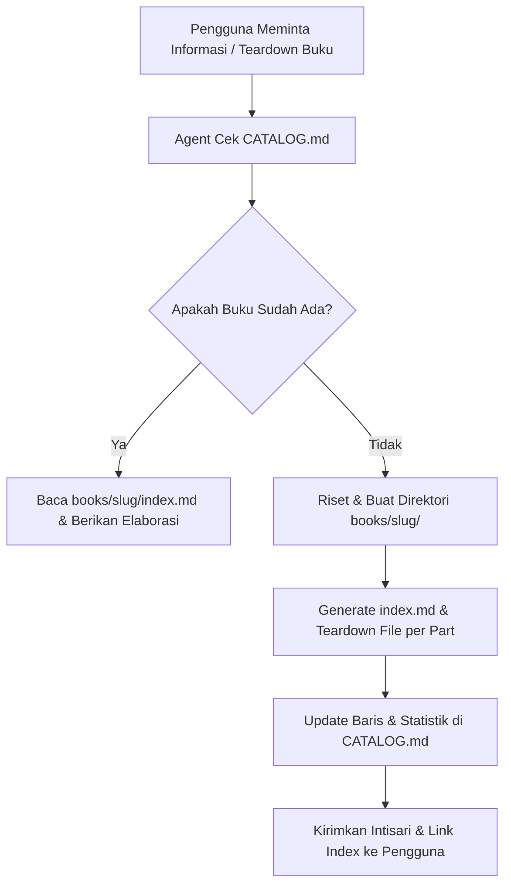

# 📚 Book Knowledge Base & AI Agent

Repositori ini adalah sistem manajemen pengetahuan (*Knowledge Base*) untuk buku-buku bacaan, dilengkapi dengan **AI Assistant / Agent** yang bertugas untuk meriset, meringkas, mendetailkan wawasan buku, serta mengelola katalog secara otomatis.

Struktur repositori menggunakan **Model Folder Modular per Buku (*Modular Book Hub*)**, di mana setiap buku memiliki direktori mandiri berisi *Roadmap Eksekutif* dan berkas *Teardown Mendalam per Bagian (Part)* agar tetap mempertahankan kenyamanan narasi layaknya membaca buku aslinya tanpa bertele-tele.

---

## 🗂️ Struktur Direktori

```text
books/
├── .agents/
│   └── skills/
│       └── book-assistant/
│           └── SKILL.md                 # Definisi alur kerja AI Agent (Skill)
├── books/                               # Direktori koleksi buku (Model Modular Hub)
│   └── atomic-habits/
│       ├── index.md                     # Roadmap eksekutif & playbook buku
│       ├── 01-the-fundamentals.md       # Part 1: Dasar-dasar (1% rule, British cycling, dll)
│       ├── 02-the-1st-law-make-it-obvious.md # Part 2: Hukum ke-1 (Habit scorecard, habit stacking)
│       ├── 03-the-2nd-law-make-it-attractive.md # Part 3: Hukum ke-2 (Dopamin, Polgar sisters)
│       ├── 04-the-3rd-law-make-it-easy.md    # Part 4: Hukum ke-3 (Motion vs Action, 2-minute rule)
│       ├── 05-the-4th-law-make-it-satisfying.md # Part 5: Hukum ke-4 (Never miss twice, tracker)
│       └── 06-advanced-tactics.md       # Part 6: Taktik lanjutan (Goldilocks rule, review tahunan)
├── templates/
│   ├── book_index_template.md           # Template master index hub per buku
│   └── part_teardown_template.md        # Template teardown mendalam per bagian/bab
├── AGENTS.md                            # Aturan otomatis untuk AI Agent dalam workspace
├── CATALOG.md                           # Berkas tunggal daftar seluruh buku & statusnya
└── README.md                            # Panduan penggunaan proyek
```

---

## 🤖 Cara Kerja AI Agent

Agent ini diatur oleh dua komponen:
1. **[AGENTS.md](AGENTS.md)**: Aturan workspace yang memastikan agen selalu mengecek katalog, mematuhi standar kedalaman teardown, dan memperbarui daftar koleksi menggunakan relative path.
2. **[.agents/skills/book-assistant/SKILL.md](.agents/skills/book-assistant/SKILL.md)**: Prosedur bertahap (*step-by-step*) untuk meriset buku, membuat folder di `books/<slug>/`, dan menyinkronkan data ke `CATALOG.md`.

### Alur Kerja Otomatis:


---

## 📑 Format Teardown Naratif per Bagian

Alih-alih ringkasan kering berbentuk bullet point yang menghilangkan esensi membaca, setiap bagian buku dibedah dengan mempertahankan:
1. **Narasi & Konteks Pembuka**: Kisah nyata, biografi, atau eksperimen laboratorium yang digunakan penulis untuk membuka bab.
2. **Teardown Konsep Ilmiah**: Mengapa gagasan tersebut berlawanan dengan intuisi umum (*counter-intuitive*) dan studi riset yang mendasarinya.
3. **Analogi Kunci Penulis**: Perumpamaan kuat yang membuat konsep mudah dipahami dan diingat.
4. **Studi Kasus Dunia Nyata**: Bagaimana konsep bekerja dalam skenario pekerjaan, bisnis, dan relasi pribadi.
5. **Panduan Tindakan Nyata (Action Checklist)**: Langkah konkret yang bisa langsung diuji coba.
6. **Kutipan Pilihan & Pertanyaan Reflektif**: Kalimat berbobot dan pertanyaan introspektif untuk pembaca.

---

## 🚀 Contoh Perintah yang Dapat Anda Berikan ke Agent

Anda cukup meminta agen di chat, misalnya:
- *"Berikan detail dan bedah buku 'The Psychology of Money' karya Morgan Housel."*
- *"Tolong cek apakah buku 'Deep Work' sudah ada di list kita, jika belum tolong buatkan folder teardown per bab dan masukkan ke katalog."*
- *"Bagaimana penjelasan James Clear tentang Aturan Dua Menit di buku Atomic Habits?"*
