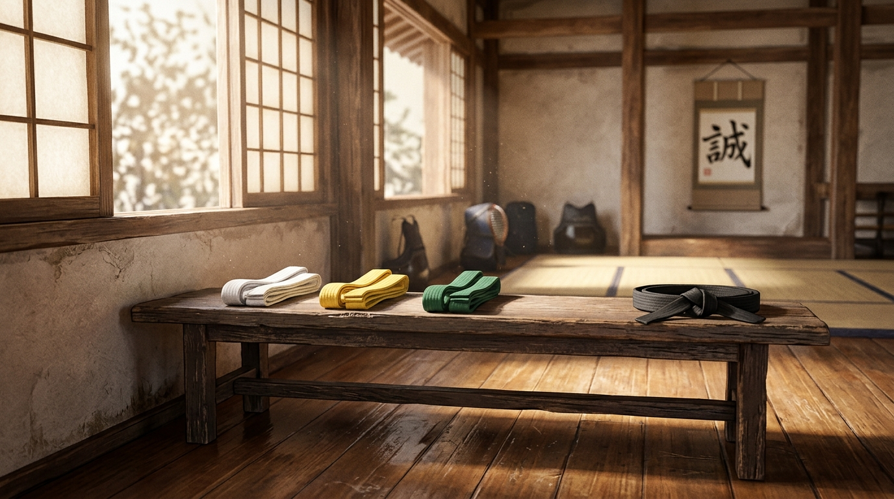
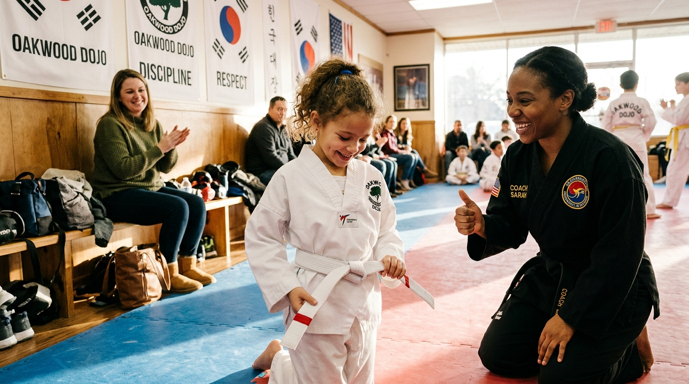

# ✍️ The Green Belt Mystery: Mengapa 50% Murid Berbakat Tiba-tiba Hilang Sebelum Sabuk Hitam?

> 📰 **[Kembali ke Katalog Artikel (ARTICLES.md)](../../ARTICLES.md)**  
> **Penulis / Kurator**: Days Editorial Team  
> **Tanggal Terbit**: 2026-10-23 | **Kategori**: Pengembangan Diri & Mental Model  
> **Estimasi Waktu Baca**: ~7–9 Menit  
> `🏷️ Psikologi Anak & Remaja` `🏷️ Retensi Murid` `🏷️ Seni Bela Diri` `🏷️ Bedah Buku DAYS`

<div align="center">
  
</div>

---

## 💡 Intisari 30 Detik (The Core Hook)
> *"Penyebab separuh murid dojang berhenti latihan sebelum meraih sabuk hitam hampir tidak pernah karena fisik anak yang kurang tahan banting. Mereka berhenti karena terperangkap di 'The Green Belt Plateau'—jurang psikologis di mana euforia pemula telah memudar, sementara orang tua mereka dibiarkan buta arah tanpa kejelasan progres di balik matras."*

---

## 📖 Latar Belakang & Fenomena (The Narrative Hook)

Setiap pelatih bela diri—baik Taekwondo, Karate, Silat, maupun Judo—pasti pernah menyaksikan grafik piramida yang memilukan di dojangnya.

Di awal tahun ajaran baru, matras selalu dipadati oleh gelombang puluhan anak berseragam putih bersih (*dobok* atau *gi*). Mereka datang dengan mata berbinar-binar, didorong oleh antusiasme orang tua yang ingin putra-putrinya sehat, disiplin, dan mampu membela diri. Dalam tiga hingga enam bulan pertama, atmosfer dojang dipenuhi sorak kegembiraan. Mereka dengan cepat melewati ujian sabuk kuning, memasang foto sertifikat di media sosial, dan bangga mengenakan seragamnya ke sekolah.

Namun, perhatikan apa yang terjadi saat mereka mengikat **sabuk hijau (*Green Belt*)** atau sabuk biru:

```text
┌────────────────────────────────────────────────────────────────────────┐
│                   PIRAMIDA PENYUSUTAN POPULASI DOJANG                  │
├────────────────────────────────────────────────────────────────────────┤
│                                                                        │
│  [Sabuk Putih & Kuning]  ████████████████████████████ (100% Murid Baru) │
│  ──> Euforia tinggi, gerakan baru, pujian melimpah                      │
│                                                                        │
│  [Sabuk Hijau & Biru]    ████████████ (Tiba-tiba Anjlok sisa 45-50%!)   │
│  ──> 'THE GREEN BELT PLATEAU': Jurang jenuh, jurus rumit, sunyi apresiasi│
│                                                                        │
│  [Sabuk Merah & Hitam]   ████ (Hanya 10-15% Bertahan Menjadi Atlet)     │
│  ──> Elit pembinaan prestasi                                            │
│                                                                        │
└────────────────────────────────────────────────────────────────────────┘
```

Satu per satu murid yang awalnya sangat berbakat mulai jarang datang. Awalnya izin les bimbingan belajar, lalu izin ulangan sekolah, hingga akhirnya menghilang sama sekali tanpa kabar. 

Ketika fenomena ini ditanyakan kepada para instruktur senior, jawaban yang paling lazim terdengar adalah keluhan bernada pasrah:  
*"Anak-anak zaman sekarang gampang jenuh."*  
*"Godaan gawai dan game online terlalu kuat."*  
*"Orang tua sekarang terlalu memanjakan anak, sedikit lelah langsung disuruh berhenti."*

Namun, benarkah demikian? Apakah benar generasi muda kita sedemikian rapuhnya, atau ada **kebocoran psikologis dan struktural tak kasat mata** yang selama ini gagal diidentifikasi oleh manajemen dojang konvensional?

---

## 🔬 Bedah Gagasan Utama (Core Insights)

Dalam buku [**DAYS: Dojang & Athlete Yield System**](../../books/days-dojang-athlete-yield-system/index.md), khususnya pada [Part 5: Psikologi Retensi & Mengelola Orang Tua Helikopter](../../books/days-dojang-athlete-yield-system/05-psikologi-retensi-dan-wali-murid.md), fenomena ini dibongkar menggunakan kacamata psikologi perkembangan anak dan teori motivasi modern. 

Ternyata, ada tiga alasan krusial mengapa jurang *Green Belt Plateau* ini terjadi:

### 1. Ilusi Kebosanan: Menipisnya Dopamin Pemula (*The Plateau Effect*)
Di sabuk putih dan kuning, kurva belajar murid sangat curam (*high reward*). Setiap minggu anak mempelajari tendangan baru yang spektakuler. Mereka merasakan lonjakan dopamin karena perbaikan kemampuan terlihat sangat nyata.

Namun, begitu tiba di sabuk hijau:
* Kurikulum beralih ke penyempurnaan detail teknis: kestabilan kuda-kuda, presisi sudut engsel lutut, dan rangkaian jurus (*poomsae / kata*) yang panjang dan repetitif.
* Tantangan fisik meningkat drastis dengan pengenalan kontak fisik (*sparring* terarah), yang menimbulkan rasa cemas dan takut tersakiti.
* Jarak waktu menuju ujian kenaikan tingkat berikutnya membentang jauh (bisa mencapai 4 hingga 6 bulan latihan tanpa jeda).

Tanpa sistem pencapaian mikro, anak merasa dirinya "berjalan di tempat". Di mata anak usia 8–12 tahun, enam bulan latihan tanpa pengakuan konkret terasa seperti keabadian. Rasa jenuh pun menyelinap masuk bukan karena mereka malas, melainkan karena **otak mereka kehilangan umpan balik positif (*feedback loop*) harian**.

---

<div align="center">
  
  <p><em>Gamifikasi tonggak mikro: Memberikan strip pencapaian fisik dan visibilitas progres berkala menyalakan kembali api motivasi anak sebelum terjebak jenuh di sabuk hijau.</em></p>
</div>

---

### 2. Mitos "Orang Tua Helikopter" vs Realitas "Orang Tua Buta Arah"
Banyak pelatih merasa terganggu oleh orang tua murid modern—yang kerap dicap sinis sebagai *"Orang Tua Helikopter"* karena terlalu banyak bertanya, menunggu di pinggir matras dengan tatapan cemas, atau mengintervensi porsi latihan fisik.

Namun, buku DAYS membedah akar psikologis dari kecemasan para orang tua: **mereka bukan ingin merepotkan pelatih, mereka hanya cemas karena berada dalam kegelapan informasi (*information blackout*)**.
* Orang tua mengantar anak dua kali seminggu dan membayar SPP tepat waktu, tetapi mereka tidak pernah tahu: *Apakah hari ini anak saya hadir tepat waktu? Apakah anak saya mengalami peningkatan konsentrasi? Mengapa anak saya pulang dengan mata sembab setelah sesi latihan?*
* Ketika pelatih tidak memiliki kanal komunikasi terstruktur, ruang kosong informasi itu otomatis diisi oleh rasa curiga dan asumsi negatif.
* Begitu anak mengeluh sekali saja di rumah (*"Ibu, aku capek, latihannya ngebosenin"*), orang tua yang buta arah akan langsung menyimpulkan: *"Ya sudah, berhenti saja les beladirinya, daripada buang uang dan bikin stres."*

### 3. Solusi Gamifikasi: Jembatan Tonggak Mikro (*Micro-Milestones*)
Mengapa anak-anak betah berjam-jam bermain video game tanpa rasa lelah? Karena game modern memahami prinsip **Gamifikasi**: setiap misi kecil memberikan poin pengalaman (*XP*), lencana (*badge*), dan indikator kenaikan level yang terlihat jelas di layar setiap menitnya.

Buku DAYS memperkenalkan rekayasa kurikulum berbasis pencapaian mikro:
1. **Sistem Strip Keterampilan (*Skill Stripes*)**: Jangan biarkan sabuk hijau polos selama 6 bulan. Berikan strip warna di ujung sabuk setiap kali anak menuntaskan 8 sesi presensi disiplin atau menguasai satu rangkaian jurus tertentu.
2. **Keterlibatan Emosional Orang Tua**: Setiap kali strip disematkan di matras, kirimkan kartu progres digital singkat ke ponsel orang tua: *"Selamat! Hari ini Ananda Farhan berhasil menguasai tendangan Ap Chagi dengan postur tegak sempurna."*
3. **Validasi Karakter di Rumah**: Minta orang tua mencatat apakah nilai disiplin di dojang (merapikan kasur, menghormati orang tua) diterapkan di rumah sebagai salah satu syarat poin kelayakan ujian sabuk.

---

## 🛡️ Seni Bela Diri Sebagai Penangkal Perundungan (*Anti-Bullying*)

Kunci retensi terbesar bagi orang tua murid kelas menengah modern bukanlah mencetak atlet medali emas olimpiade, melainkan **perlindungan karakter anak dari ancaman perundungan (*bullying*) di lingkungan sekolah**.

Buku DAYS merumuskan kurikulum pertahanan diri tiga lapis yang membuat orang tua sadar bahwa dojang bukan sekadar tempat menguras keringat anak:

| Lapisan Pertahanan | Bentuk Latihan di Matras | Manfaat Nyata di Dunia Sekolah |
| :--- | :--- | :--- |
| **Lapis 1: Postur Tubuh & Kontak Mata** | Sikap *Charyeot*, tatapan mata lurus, intonasi suara lantang saat kiai. | Memutus tanda-tanda anak sasaran empuk (*easy target*) bagi para perundung. |
| **Lapis 2: Ketegasan Verbal (*De-escalation*)** | Simulasi peran menetapkan batasan: melangkah mundur seraya berkata *"Hentikan!"*. | Menghentikan intimidasi verbal sebelum berujung pada kontak fisik di koridor sekolah. |
| **Lapis 3: Kontrol Fisik & Pertahanan Diri** | Tangkisan, pelepasan cengkeraman kerah baju, dan penguncian tanpa melukai. | Memberikan rasa percaya diri mutlak bahwa tubuhnya mampu membela diri jika terpaksa. |

Ketika orang tua melihat perubahan nyata—anak yang tadinya menunduk pemalu kini berani menatap mata lawan bicaranya dengan santun namun percaya diri—mereka tidak akan pernah mempertimbangkan untuk mencabut anak mereka dari dojang, berapa pun nominal iurannya.

---

## ⚡ 3 Langkah Taktis Pelatih: Menghentikan Kebocoran Murid Minggu Ini

Jika dojang Anda saat ini sedang mengalami penyusutan populasi di tingkat sabuk intermediate:

1. [ ] **Petakan Tanggal Ujian & Target Terbuka**:  
   Jangan merahasiakan jadwal ujian kenaikan tingkat. Tempelkan kalender tahunan di dinding dojang dan bagikan ke grup wali murid agar ada garis akhir yang pasti dalam pandangan anak.

2. [ ] **Terapkan Syarat Kehadiran Transparan (Misal: 24 Sesi)**:  
   Ubah syarat ujian dari sekadar penilaian subjektif pelatih menjadi akumulasi presensi disiplin. Ketika anak tahu ia butuh 5 kali hadir lagi untuk berhak ikut ujian, motivasi intrinsik mereka akan menyala secara mandiri.

3. [ ] **Sapa Wali Murid dengan Data Positif**:  
   Luangkan waktu 2 menit di akhir sesi latihan untuk menyapa orang tua di tribun bukan untuk menagih iuran, melainkan membagikan observasi karakter: *"Ibu, hari ini fokus tendangan Kevin luar biasa tenang, jauh lebih matang dibanding minggu lalu."*

---

## 💬 Penutup: Menjaga Benih Ksatria Tetap Bertumbuh

Setiap anak yang melangkah masuk ke dalam dojang membawa secercah harapan orang tua dan potensi ksatria di dalam dadanya. Adalah tanggung jawab kita sebagai pengelola dojang untuk memastikan api harapan tersebut tidak padam di tengah jalan hanya karena ketiadaan sistem pembinaan yang empatik dan transparan.

> *"Sabuk hitam bukanlah tentang seberapa keras Anda mampu memukul samsak. Sabuk hitam hanyalah lambang bagi sabuk putih yang tidak pernah berhenti belajar, yang berhasil melewati masa-masa sunyi di sabuk hijau berkat bimbingan guru yang tulus dan ekosistem yang menjaganya."*

### ❓ Pertanyaan untuk Direnungkan:
> *Berapa banyak calon atlet luar biasa yang telah hilang dari dojang Anda selama tiga tahun terakhir, hanya karena tidak ada jembatan komunikasi yang meyakinkan orang tua mereka bahwa perjuangan anak mereka sedang bergerak maju?*

---

## 🧭 Ingin Mendalami Arsitektur Dojang Modern?

Artikel ini diangkat dari pembahasan komprehensif di dalam buku master literatur manajemen olahraga bela diri:

👉 **[Baca Selengkapnya: DAYS (Dojang & Athlete Yield System)](../../books/days-dojang-athlete-yield-system/index.md)**  

Pelajari modul-modul strategis lainnya:
* 📘 **[Part 5: Psikologi Retensi & Mengelola Orang Tua Helikopter](../../books/days-dojang-athlete-yield-system/05-psikologi-retensi-dan-wali-murid.md)**  
  *Bedah lengkap penanganan drop-out murid, gamifikasi, dan kurikulum anti-perundungan.*
* 📘 **[Part 1: Tragedi di Balik Tatami — Jebakan Utang Administratif](../../books/days-dojang-athlete-yield-system/01-tragedi-di-balik-tatami.md)**  
  *Bebaskan pelatih dari jeratan buku kas manual dan pesan WhatsApp canggung.*
* 📘 **[Part 2: Arsitektur Ekosistem Dojang — Rekayasa Tiga Titik Sinergi](../../books/days-dojang-athlete-yield-system/02-arsitektur-ekosistem-dojang.md)**  
  *Keseimbangan peran antara Owner, Pelatih/Sabam, dan Siswa/Wali Murid.*
* 📘 **[Part 7: Seni Ekspansi: Membuka Cabang Sekolah & Waralaba Dojang](../../books/days-dojang-athlete-yield-system/07-seni-ekspansi-dan-waralaba-dojang.md)**  
  *Cetak biru membuka puluhan cabang tanpa mengorbankan mutu pembinaan karakter.*

---

## 🧭 Navigasi
⬅️ **[Kembali ke Katalog Artikel (ARTICLES.md)](../../ARTICLES.md)** &nbsp;&nbsp;|&nbsp;&nbsp; 📚 **[Lihat Katalog Buku (CATALOG.md)](../../CATALOG.md)**
