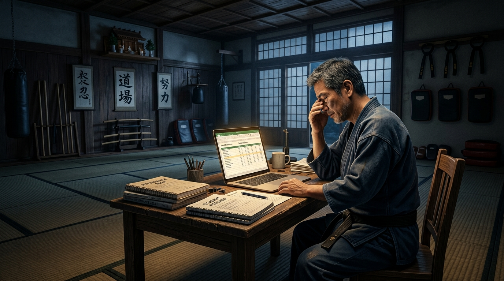

# ✍️ Mengapa Pelatih Bela Diri Terbaik Sering Kehabisan Nafas Bukan di Matras, tapi di Meja Kasir?

> 📰 **[Kembali ke Katalog Artikel (ARTICLES.md)](../../ARTICLES.md)**  
> **Penulis / Kurator**: Days Editorial Team  
> **Tanggal Terbit**: 2026-10-23 | **Kategori**: Bisnis, Karir & Teknologi  
> **Estimasi Waktu Baca**: ~5–6 Menit  
> `🏷️ Manajemen Olahraga` `🏷️ Leadership Seni Bela Diri` `🏷️ Dojang Modern` `🏷️ Bedah Buku DAYS`

<div align="center">
  
</div>

---

## 💡 Intisari 30 Detik (The Core Hook)
> *"Tragedi terbesar di dunia bela diri bukanlah ketika seorang atlet tersungkur kalah di matras kejuaraan, melainkan ketika seorang pelatih berkaliber juara kehilangan kobaran jiwanya karena energinya habis diperas oleh buku absen basah, ratusan tangkapan layar transfer WhatsApp, dan rasa canggung menagih iuran di pinggir tatami."*

---

## 📖 Latar Belakang & Fenomena (The Narrative Hook)

Jam dinding sudah menunjukkan pukul 22.30 malam. Lampu dojang utama sudah padam, menyisakan deretan sansak gantung dan aroma keringat di atas tatami yang perlahan mendingin. Di sudut ruangan, sebuah meja kayu kecil masih menyala remang. 

Di hadapan meja itu duduk seorang *Sabeumnim*—seorang penyandang sabuk hitam tingkat tinggi, mantan atlet kebanggaan daerah yang telah mengabdikan lebih dari dua dekade hidupnya untuk menyempurnakan tendangan putar dan menempa mental anak-anak pemalu menjadi ksatria tangguh. Namun malam ini, matanya tidak sedang membedah rekaman video taktik tanding atau merancang silabus pembinaan fisik. Matanya perih menatap layar ponsel, mencocokkan mutasi rekening bank dengan tumpukan kuitansi kertas yang tercecer.

Di layar aplikasi pesannya, ada puluhan pesan WhatsApp yang belum terbaca: wali murid yang bertanya rincian biaya seragam, orang tua yang lupa apakah anaknya hadir minggu lalu, dan draf pesan penagihan iuran bulanan yang sudah diketik tiga kali namun selalu dihapus kembali karena rasa canggung yang teramat sangat.

Pelatih terbaik kita sedang kehabisan nafas. Bukan karena sepuluh ronde *sparring*, melainkan karena tercekik oleh apa yang disebut dalam literatur manajemen modern sebagai **Utang Administratif (*Administrative Debt*)**.

---

## 🔬 Bedah Gagasan Utama (Core Insights)

Dalam karya literatur manajemen olahraga terbaru, [**DAYS: Dojang & Athlete Yield System**](../../books/days-dojang-athlete-yield-system/index.md), fenomena ini dibedah bukan sebagai "masalah teknis biasa", melainkan krisis peradaban tata kelola olahraga bela diri. Ada tiga kebocoran struktural tak kasat mata yang merongrong dojang-dojang tradisional:

```text
┌────────────────────────────────────────────────────────────────────────┐
│                   ANATOMI KEBOCORAN ENERGI PELATIH                     │
├────────────────────────────────────────────────────────────────────────┤
│                                                                        │
│  [TITIK RETAK 1: FRIKSI EMOSIONAL PENAGIHAN]                           │
│  Pelatih menagih tunai di pinggir matras ──> Wibawa sakral luntur      │
│                                                                        │
│  [TITIK RETAK 2: KEBUTAAN DATA ORANG TUA]                              │
│  Absen kertas tidak transparan ──> Orang tua merasa 'tidak ada progres' │
│                                                                        │
│  [TITIK RETAK 3: KETERGANTUNGAN FIGUR TUNGGAL]                         │
│  Pelatih merangkap Kasir, Kurir, & Admin ──> Burnout & Gagal Ekspansi  │
│                                                                        │
└────────────────────────────────────────────────────────────────────────┘
```

### 1. Erosi Wibawa di Pinggir Matras (*The Awkward Cashier Paradox*)
Hubungan antara guru bela diri dan murid dibangun di atas pilar penghormatan (*Ye Ui*) dan disiplin. Namun, ketika pelatih yang sama harus berdiri di pintu keluar seraya memegang amplop iuran atau mengingatkan orang tua yang menunggak di depan murid-murid lainnya, ada batas psikologis sakral yang runtuh.

Pelatih merasa rendah diri karena terlihat seperti penagih utang, sementara orang tua merasa dihakimi. Buku **DAYS** menegaskan: *urusan kas dan transaksi keuangan harus diserahkan sepenuhnya pada sistem otomatis pihak ketiga (digital ledger), sehingga setiap kali pelatih menginjak matras, posisinya murni 100% sebagai pendidik karakter dan pengawal teknik.*

### 2. "The Green Belt Plateau" Bukan Salah Mental Murid
Ketika murid sabuk hijau atau biru tiba-tiba memutuskan berhenti latihan, pelatih sering menghibur diri dengan asumsi: *"Anak zaman sekarang mentalnya lembek, tidak tahan lelah."*

Tetapi data membuktikan sebaliknya. Separuh dari murid yang drop-out berhenti karena **ketiadaan transparansi progres**. Orang tua membayar iuran setiap bulan tanpa pernah tahu kurikulum apa yang sedang dipelajari anaknya, berapa kali anaknya hadir dalam sebulan, dan kapan target ujian kenaikan tingkat berikutnya. Ketika iuran menunggak dua atau tiga bulan akibat kelalaian pencatatan, nominal yang membengkak menjadi beban mental bagi orang tua, yang akhirnya memilih jalan pintas: menarik anak keluar dari dojang.

### 3. Mengapa Dipakai Konsep "Athlete Yield System"?
Buku DAYS memperkenalkan analogi agrikultur yang menyegarkan:
* Seorang murid adalah sebutir **benih unggul**.
* Matras latihan adalah **tanah garapan**.
* Sang pelatih adalah **petani penggarap**.

Jika seorang petani menghabiskan 80% waktunya menambal ember bocor, mencatat bon pupuk di warung, dan bertengkar soal batas tanah, ia tidak akan memiliki sisa waktu dan energi untuk menyiram benih serta menyiangi hama. Hasil panen (*yield*) pun gagal total. Sistem tata kelola dojang modern adalah **sistem irigasi otomatis**—infrastruktur tanpa suara yang memastikan seluruh ekosistem bertumbuh subur tanpa menyedot habis tenaga sang pelatih.

---

## 🌍 Dari Dojang Rapuh Menuju Dojang Antirapuh (*Antifragile*)

Buku DAYS memetakan perbedaan mencolok antara dojang konvensional dan dojang yang telah mengadopsi ekosistem modern:

| Parameter | Dojang Tradisional (Fragile) | Dojang Berbasis Sistem DAYS (Antifragile) |
| :--- | :--- | :--- |
| **Presensi Siswa** | Buku kertas basah, rawan hilang & robek | Presensi QR/Satu-Klik di ponsel dalam 30 detik |
| **Keterlibatan Wali Murid** | Menunggu pasif di tribun tanpa kabar | Notifikasi kedatangan & laporan materi latihan otomatis |
| **Penagihan Iuran** | Pesan WhatsApp manual & setoran tunai | Tagihan digital terjadwal via payment gateway resmi |
| **Ujian Kenaikan Tingkat** | Penilaian subjektif di atas lembaran kertas | Verifikasi kelayakan otomatis berbasis histori kehadiran |
| **Pengelolaan Cabang** | Bergantung mutlak pada kehadiran fisik Master | Desentralisasi terstandar dengan sistem bagi hasil transparan |

---

## ⚡ Langkah Taktis: Bebaskan Meja Kerja Anda Hari Ini

Bagi Anda para pelatih, pemilik dojang, atau pengurus klub bela diri yang ingin mengembalikan kedaulatan waktu melatih:

1. [ ] **Hentikan Transaksi Tunai di Pinggir Matras**: Buat satu kanal rekening bank resmi dojang atau integrasikan sistem pembayaran digital. Pisahkan uang operasional dari dompet pribadi.
2. [ ] **Digitalisasi Presensi dalam 30 Detik**: Jangan biarkan sesi latihan terpotong 15 menit hanya untuk memanggil nama satu per satu di kertas absensi.
3. [ ] **Bangun Rasa Memiliki Wali Murid**: Jadikan orang tua murid sebagai mitra ko-pilot pembinaan karakter dengan memberi mereka visibilitas penuh atas rekam jejak latihan putra-putrinya.

---

## 💬 Penutup: Mengembalikan Jiwa Ksatria ke Tempat Semestinya

Bela diri bukan sekadar industri les olahraga komersial. Ia adalah wahana pembentukan martabat, ketahanan mental, dan kepemimpinan generasi penerus bangsa. Namun, nilai-nilai luhur tersebut tidak akan pernah bertahan lama jika fondasi operasionalnya keropos dan pengelolanya kelelahan secara kronis.

> *"Otomatisasi bukan hadir untuk menggantikan sentuhan manusiawi seorang pelatih, melainkan untuk membebaskannya dari belenggu klerikal—agar sang guru dapat kembali mencurahkan seluruh jiwanya kepada sang juara."*

### ❓ Pertanyaan untuk Direnungkan:
> *Jika seluruh urusan administrasi, penagihan iuran, dan pembukuan dojang Anda lenyap dari pundak Anda besok pagi, program latihan luar biasa apa yang akhirnya bisa Anda wujudkan untuk murid-murid Anda?*

---

## 🧭 Ingin Membedah Solusi Lengkapnya?

Artikel ini hanyalah secuil refleksi dari peta transformasi menyeluruh yang dirumuskan dalam buku utama:

👉 **[Baca Bedah Lengkap Buku: DAYS (Dojang & Athlete Yield System)](../../books/days-dojang-athlete-yield-system/index.md)**  
Jelajahi ke-7 modul mendalamnya:
* 📘 *[Part 1: Tragedi di Balik Tatami](../../books/days-dojang-athlete-yield-system/01-tragedi-di-balik-tatami.md)*  
* 📘 *[Part 2: Arsitektur Ekosistem Dojang](../../books/days-dojang-athlete-yield-system/02-arsitektur-ekosistem-dojang.md)*  
* 📘 *[Part 3: Jalur Prestasi Terintegrasi](../../books/days-dojang-athlete-yield-system/03-jalur-prestasi-terintegrasi.md)*  
* 📘 *[Part 4: Kemandirian Finansial & Masa Depan Dojang](../../books/days-dojang-athlete-yield-system/04-kemandirian-finansial-dan-masa-depan.md)*  
* 📘 *[Part 5: Psikologi Retensi & Mengelola Orang Tua Helikopter](../../books/days-dojang-athlete-yield-system/05-psikologi-retensi-dan-wali-murid.md)*  
* 📘 *[Part 6: Sports Science Sederhana & Pencegahan Cedera](../../books/days-dojang-athlete-yield-system/06-sports-science-dan-pencegahan-cedera.md)*  
* 📘 *[Part 7: Seni Ekspansi & Waralaba Dojang Modern](../../books/days-dojang-athlete-yield-system/07-seni-ekspansi-dan-waralaba-dojang.md)*

---

## 🧭 Navigasi
⬅️ **[Kembali ke Katalog Artikel (ARTICLES.md)](../../ARTICLES.md)** &nbsp;&nbsp;|&nbsp;&nbsp; 📚 **[Lihat Katalog Buku (CATALOG.md)](../../CATALOG.md)**
