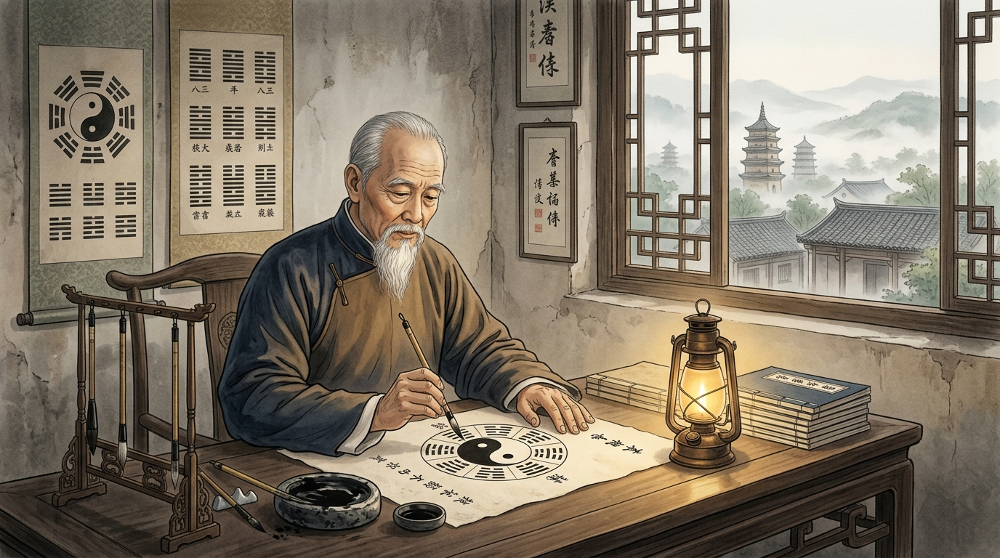

# Bab 1: Risalah 12 Tahun di Chenjiagou — Konteks Historis, Kosmologi I-Ching & Lahirnya Kanon Tushuo

> 📖 **Hub Buku**: **[The Illustrated Canon of Chen Family Taijiquan (Chenshi Taijiquan Tushuo)](index.md)**  
> 📑 **Cakupan Bab Asli**: *Juan Yi (卷一: Bagian Pengantar, Sejarah Transmisi, Diagram Wuji, Diagram Taiji & Matematika Bagua)*

---

## 📖 Narasi Pembuka & Latar Belakang (The Narrative Context)

Pada suatu malam musim dingin yang menusuk tulang di Desa Chenjiagou, Provinsi Henan, sekitar tahun 1910, sebuah lentera minyak tanah bergoyang pelan tertiup angin yang menyelinap melalui celah jendela kisi kayu tua[^1]. Di bawah temaram cahaya kuning tersebut, seorang pria lanjut usia bertubuh kurus dengan pakaian jubah katun lusuh khas Dinasti Qing duduk membungkuk di atas meja kayu berkaki pendek. Jari-jarinya yang kapalan memegang kuas bulu kelinci dengan ketenangan yang luar biasa. Pria tua itu adalah Chen Xin (陈鑫, 1849–1929), yang juga dikenal dengan nama kehormatan Chen Pinsan, generasi ke-16 dari klan pencipta Taijiquan[^1].

Kondisi kehidupan Chen Xin pada masa itu sesungguhnya sangat memprihatinkan. Dinasti Qing yang telah berkuasa selama ratusan tahun sedang berada di ambang keruntuhan total; perang saudara berkecamuk, kelaparan melanda pedesaan, dan gelombang modernisasi senjata api barat mulai memandang seni bela diri tradisional sebagai peninggalan usang yang tak berguna. Sebagai putra kedua dari master bela diri Chen Zhongshen, Chen Xin muda sesungguhnya diarahkan oleh ayahnya untuk menempuh jalur birokrasi sipil kekaisaran melalui ujian literatur (*Keju*)[^1]. Namun, setelah berkali-kali gagal meraih gelar pejabat tinggi dan menyaksikan bagaimana tradisi lisan (*oral tradition*) Taijiquan di desanya mulai mengalami kepunahan dan distorsi sepihak, Chen Xin mengambil sebuah sumpah hidup yang mengguncang sanubarinya[^1]:
> *"Seni bela diri leluhurku yang agung ini telah diwariskan dari darah dan air mata selama delapan generasi. Jika generasi kami tidak membukukannya secara tertulis dengan ketelitian ilmiah, ilmu ini akan lenyap ditelan zaman atau jatuh menjadi tarian dangkal yang memalukan nenek moyang."*[^1]

Sejak tahun 1908 hingga 1919—selama 12 tahun penuh tanpa henti dalam kemiskinan dan isolasi—Chen Xin mengurung diri di studionya. Ia menggabungkan keahlian sastra klasiknya dengan penguasaan bela diri tingkat tinggi, melukis lebih dari 400 diagram anatomi dan menulis ribuan halaman catatan kuas. Dedikasi sunyi inilah yang melahirkan mahakarya terbesar dalam sejarah seni bela diri dunia: **Chenshi Taijiquan Tushuo (陈氏太极拳图说 / *The Illustrated Canon of Chen Family Taijiquan*)**[^1], [^2].

---

<div align="center">
  
  <p><sub><em>Ilustrasi Bab 1: Grandmaster Chen Xin (Chen Pinsan) di bawah temaram lentera minyak studionya di Desa Chenjiagou (1910), melukiskan diagram kosmologi I-Ching dan mengkodifikasikan prinsip-prinsip fraktal Taijiquan ke atas kertas beras tradisional.</em></sub></p>
</div>

---

## 🔬 Teardown Konsep & Wawasan Utama (Deep-Dive Insights)

```text
┌────────────────────────────────────────────────────────────────────────┐
│           KOSMOLOGI GENERATIF CHEN XIN: DARI WUJI MENJADI JURUS        │
└────────────────────────────────────────────────────────────────────────┘
                    WUJI (无极 / Kekosongan Mutlak)
                    • Pikiran hening, postur berdiri netral
                    • Tidak ada polaritas, potensi tanpa batas
                                   │
                                   ▼
                    TAIJI (太极 / Titik Muasal Diferensiasi)
                    • Munculnya niat gerak pertama (Yi / 意)
                    • Pembagian menjadi Yin (tumpuan) & Yang (ekspansi)
                                   │
                   ┌───────────────┴───────────────┐
                   ▼                               ▼
       LIANG YI (两仪: Dua Kutub)        SI XIANG (四象: Empat Fenomena)
       • Buka vs Tutup (Kai-He)          • Maju, Mundur, Kiri, Kanan
       • Kosong vs Isi (Xu-Shi)          • Fase transisi beban gravitasi
                   │                               │
                   └───────────────┬───────────────┘
                                   ▼
                    BAGUA (八卦 / Delapan Trigram Arah)
                    • 8 Pintu Tenaga: Peng, Lu, Ji, An, Cai, Lie, Zhou, Kao
                    • Berpadu dengan Pola Sembilan Istana (Jiu Gong Tu)
```

### 1. Dari Wuji Menuju Taiji: Metafisika Gerak Tubuh
Chen Xin membuka Jilid Pertama (*Juan Yi*) bukan dengan instruksi kepalan tangan, melainkan dengan **Diagram Lingkaran Kosong Wuji (无极图)**[^1]:
- **Wuji (Ketiadaan Kutub)**: Merepresentasikan kondisi praktisi sebelum jurus dimulai. Tubuh berdiri tegak, pikiran hening bebas dari agresi, berat badan terbagi seimbang sempurna, dan tidak ada ketegangan pada satu otot pun. Wuji adalah "rahim" dari mana seluruh tenaga bela diri dilahirkan[^1].
- **Kelahiran Taiji**: Begitu sebuah niat gerak (*Yi*) muncul di dalam pikiran—misalnya niat untuk mengangkat tangan—kondisi Wuji seketika terpecah menjadi **Taiji (Kesatuan Dua Kutub)**. Tubuh langsung mendiferensiasikan dirinya: satu kaki menjadi tumpuan penahan bobot (*Yin*), sementara kaki lainnya bebas melangkah (*Yang*); satu tangan membuka (*Kai*), sementara tangan lainnya melindungi dada (*He*). Chen Xin menegaskan bahwa jika praktisi bergerak tanpa melalui fase hening Wuji, gerakannya hanyalah kepalsuan mekanis yang mudah ditebak lawan[^1].

### 2. I-Ching sebagai Peta Geometri Fraktal Bela Diri
Salah satu kejeniusan terbesar Chen Xin adalah keberhasilannya membuktikan bahwa **Kitab Perubahan (I-Ching)** bukanlah sekadar buku ramalan, melainkan buku teks geometri fraktal tubuh manusia[^1]:
- **Delapan Trigram (Bagua) sebagai Vektor Tenaga**:
  Chen Xin memetakan delapan trigram klasik langsung ke dalam delapan metode transmisi tenaga (*Jin*) dalam Taiji:
  1. *Qian (Langit / ☰)*: Karakter energi yang bulat, kokoh, dan melingkupi segala arah (*Peng Jin*).
  2. *Kun (Bumi / ☷)*: Karakter energi penyerapan yang lapang dan menelan beban lawan ke lantai (*Lu Jin*).
  3. *Kan (Air / ☵)*: Aliran kontinu yang menembus celah sempit pertahanan (*Ji Jin*).
  4. *Li (Api / ☲)*: Kejutan dorongan dua tangan yang membakar lurus (*An Jin*).
  5. *Sun, Zhen, Dui, Gen*: Empat sudut diagonal yang menaungi tenaga memetik (*Cai*), membelah (*Lie*), menyikut (*Zhou*), dan menabrak dengan bahu/punggung (*Kao*)[^1].
- **Pola Sembilan Istana (Jiu Gong Tu / 九宫图)**:
  Chen Xin menggambar diagram jejak kaki di lantai berdasarkan matematika kisi 3x3 kuno (*Luoshu*). Praktisi tidak pernah melangkah dalam garis lurus kaku; setiap langkah kaki melengkung mengikuti angka-angka Sembilan Istana, memastikan bahwa pusat gravitasi tubuh selalu berada di atas sudut 45 derajat yang stabil[^1], [^3].

### 3. Pengorbanan Tragis & Penyelamatan Manuskrip 1933
Sejarah di balik terbitnya buku ini dipenuhi pengorbanan yang mengharukan:
- Chen Xin hidup membujang dan tidak memiliki keturunan langsung. Setelah menyelesaikan penulisan pada tahun 1919 di usia 70 tahun, beliau jatuh sakit parah dan hidup dalam kemiskinan ekstrem, bahkan tidak memiliki biaya untuk mencetak naskahnya sendiri[^1].
- Sebelum wafat pada tahun 1929, Chen Xin memanggil keponakannya, Chen Chunyuan, dan menyerahkan berkas manuskrip berharga tersebut sambil berpesan: *"Juallah tanah warisan keluarga jika perlu, tetapi pastikan buku ini dicetak agar dunia tahu kebenaran seni keluarga Chen"*[^1].
- Murid-murid dan kerabat Chen Xin mengumpulkan dana selama empat tahun. Akhirnya, pada tahun 1933, penerbit bergengsi **Kaiming Book Bureau (开明书局)** di Shanghai mencetak edisi perdana *Chenshi Taijiquan Tushuo* dalam format empat jilid berjahit benang tradisional. Buku tersebut seketika mengguncang komunitas bela diri Tiongkok dan menjadi standar rujukan akademis tertinggi hingga hari ini[^1], [^2].

---

## 🧠 Eksperimen Pikiran & Contoh Kasus di Dunia Nyata

### Kasus Historis: Mengapa Garis Lurus Selalu Kalah oleh Busur Melengkung?
Dalam naskah Jilid 1, Chen Xin menceritakan sebuah analogi klasik tentang gerobak kayu beroda bundar versus balok kayu persegi panjang[^1]. Ketika sebuah batu besar menggelinding menabrak balok persegi panjang, seluruh gaya benturan diserap secara frontal dan mematahkan balok tersebut. Namun, ketika batu yang sama menabrak roda bundar yang sedang berputar pada porosnya, benturan tersebut tergelincir miring di sepanjang permukaan busur lingkaran dan justru membuat roda berputar semakin cepat.

Chen Xin menulis: *"Lawan menyerang saya dengan garis lurus yang kaku; saya menyambutnya dengan busur lingkaran Taiji yang melengkung. Garis lurus memiliki ujung yang terbatas, tetapi lingkaran tidak memiliki awal dan akhir. Siapa pun yang mencoba menusuk lingkaran yang berputar hanya akan mendapati senjatanya terlempar ke udara"*[^1], [^3]. Ini adalah fondasi hukum fisika tangensial yang kemudian dikodifikasikan oleh Hong Junsheng dalam *Practical Method*.

---

## ⚡ Panduan Aksi Nyata dari Bagian Ini (Action Checklist)

1. [ ] **Ritual Keheningan Pra-Latihan (Wuji Stance)**: Sebelum Anda mulai berlatih jurus apa pun, berdirilah tegak diam selama minimal 3 menit dalam postur Wuji. Jangan biarkan pikiran Anda memikirkan teknik pukulan; biarkan seluruh sistem saraf Anda mengendap hingga tubuh terasa netral dan lapang[^1].
2. [ ] **Audit Kelengkungan Busur Tangan**: Amati postur tangan Anda saat berada di depan dada. Jika sudut siku Anda membentuk sudut lancip kaku 90 derajat atau garis lurus patah, segera lengkungkan menjadi busur setengah lingkaran yang elastis seperti busur panah yang siap meluncurkan anak panah[^1].
3. [ ] **Pahami Prinsip Liang Yi dalam Kehidupan**: Ketika menghadapi situasi krisis atau perdebatan sengit hari ini, ingatlah prinsip Yin-Yang: jangan melawan kekerasan dengan kekerasan frontal. Jadilah kutub penampung yang tenang (Yin) hingga lawan kehabisan momentum agresinya, lalu selesaikan masalah dengan ketegasan yang tepat (Yang)[^1].

---

## 💬 Kutipan Pilihan & Catatan Reflektif

> *"Taiji bermula dari yang tiada (Wuji) dan melahirkan yang ada. Ia tidak berwujud nyata namun mencakup seluruh hukum alam semesta. Jika Anda berlatih hanya untuk memamerkan kegagahan otot Anda, Anda sedang membuang permata demi mengejar sebutir kerikil yang tak berharga."*  
> — **Grandmaster Chen Xin (陈鑫 / Chen Pinsan)** *(Kanon Tushuo: Juan Yi)*[^1]

**Pertanyaan Refleksi Diri**:
- *Apakah selama ini latihan bela diri atau olahraga Anda didorong oleh keinginan ego untuk membuktikan diri kepada orang lain, ataukah ia merupakan sarana hening untuk menyelaraskan kembali tubuh dan jiwa Anda dengan tatanan alam semesta?*

---

## 📚 Referensi, Studi Ilmiah & Catatan Kaki Bab Ini

Bagian ini merangkum naskah primer kanon, kajian sinologi sejarah, dan literatur pendukung Bab 1:

[^1]: **Chen Xin (陈鑫).** *Chenshi Taijiquan Tushuo* (陈氏太极拳图说 / *Illustrated Explanations of Chen Family Taijiquan*). Shanghai: Kaiming Book Bureau (开明书局); 1933.  
Rujukan otentik Juan Yi (Jilid 1), memuat kata pengantar asli penulis, silsilah keluarga Chenjiagou, teks kanonis diagram Wuji, diferensiasi Taiji, matematika 8 Trigram (Bagua), serta pola langkah sembilan istana (Jiu Gong Tu).

[^2]: **Chen Xin (Translated by Alex Golstein).** *The Illustrated Canon of Chen Family Taijiquan*. Melbourne: INBI Matrix Pty Ltd; 2007. ISBN: 978-5-98687-008-3.  
Edisi terjemahan komparatif bahasa Inggris lengkap setebal 750 halaman mengenai biografi Chen Pinsan dan analisis terminologi teknis.

[^3]: **Hong Junsheng (洪均生).** *Chen Shi Taijiquan Shiyong Quanfa* (陈式太极拳实用拳法). Jinan: Shandong Science and Technology Publishing House; 1989. ISBN: 978-7-5331-0640-9.  
Kajian analitis modern yang mengonfirmasi validitas kosmologi fraktal Chen Xin dalam penerapan fisika bela diri praktis.

---

## 🧭 Navigasi Bab Selanjutnya

📖 **[Kembali ke Hub Buku (Index)](index.md)** &nbsp;&nbsp;|&nbsp;&nbsp; ➡️ **[Lanjut ke Bab 2: Teori Lilitan Sutra (Chan Si Jin) — Geometri Spiral & Polaritas Shun-Ni](02-teori-lilitan-sutra-chansijin.md)**

