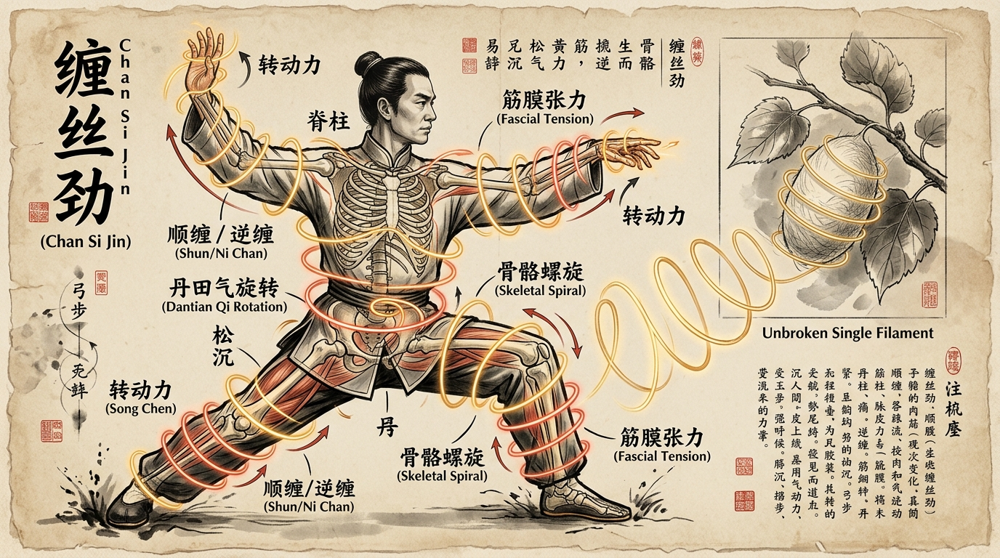

# Bab 2: Teori Lilitan Sutra (Chan Si Jin) — Geometri Spiral, Polaritas Shun-Ni & Mekanika Elastis

> 📖 **Hub Buku**: **[The Illustrated Canon of Chen Family Taijiquan (Chenshi Taijiquan Tushuo)](index.md)**  
> 📑 **Cakupan Bab Asli**: *Juan Yi (Chan Si Fa / 缠丝法, Diagram Spiral Tubuh, Kidung Lilitan Sutra & Aturan Kurvatura Sendi)*

---

## 📖 Narasi Pembuka & Latar Belakang (The Narrative Context)

Jika Anda bertanya kepada seorang sejarawan seni bela diri dunia tentang apa kontribusi paling orisinal, paling revolusioner, dan paling mendalam yang pernah disumbangkan oleh Grandmaster Chen Xin bagi peradaban bela diri manusia, jawabannya hanya satu: **Teori Chan Si Jin (缠丝劲 / Tenaga Lilitan Sutra)**[^1].

Sebelum buku *Chenshi Taijiquan Tushuo* diterbitkan pada tahun 1933, istilah "tenaga internal" dalam dunia persilatan Tiongkok selalu diselimuti oleh bahasa mistis yang sangat kabur. Banyak guru berbicara tentang "aliran angin Qi" atau "kekuatan batin tak kasatmata" tanpa mampu menjelaskan bagaimana gaya fisik tersebut bekerja pada persendian tulang. Chen Xin menghancurkan kabut mistisisme tersebut melalui pengamatan brilian terhadap proses pemintalan sutra tradisional di pedesaan Henan[^1].

Chen Xin mengamati bagaimana seorang gadis pemintal sutra menarik sehelai filamen sutra halus dari dalam kepompong ulat sutra yang mengambang di mangkuk air panas. Jika gadis itu menarik benang tersebut dengan sentakan garis lurus yang terburu-buru, benang sutra halus itu akan seketika putus. Namun, jika ia memutar kepompong secara perlahan dan menggulung benang tersebut dalam gerakan spiral yang kontinu, seutas serat sutra sepanjang ratusan meter dapat ditarik keluar tanpa pernah putus sedikit pun, bahkan memiliki kekuatan tarik yang mampu menahan beban luar biasa[^1]. Dari analogi pemintalan ulat sutra inilah, Chen Xin merumuskan hukum besi Taijiquan: **Di dalam tubuh manusia, tidak boleh ada gerakan garis lurus murni; seluruh pergerakan harus berupa lilitan spiral tiga dimensi**[^1], [^2].

---

<div align="center">
  
  <p><sub><em>Ilustrasi Bab 2: Rekonstruksi kanon diagram Chan Si Jin (缠丝劲) Chen Xin — menampilkan praktisi dalam kuda-kuda kokoh dengan lintasan spiral ganda bercahaya emas (Shun Chan / lilitan masuk) dan merah cinnabar (Ni Chan / lilitan keluar) yang melingkari seluruh rantai fasia dari telapak kaki ke jemari, berpadu dengan metafora kepompong sutra klasik.</em></sub></p>
</div>

---

## 🔬 Teardown Konsep & Wawasan Utama (Deep-Dive Insights)

```text
┌────────────────────────────────────────────────────────────────────────┐
│            KLASIFIKASI POLARITAS SPIRAL CHAN SI JIN (CHEN XIN)         │
└────────────────────────────────────────────────────────────────────────┘
                   TITIK MUASAL SPIRAL: DANTIAN BAWAH & KUA
                                      │
        ┌─────────────────────────────┴─────────────────────────────┐
        ▼                                                           ▼
[SHUN CHAN / 顺缠 (SPIRAL MASUK)]            [NI CHAN / 逆缠 (SPIRAL KELUAR)]
• Arah: Jempol memimpin ke dalam             • Arah: Kelingking memimpin ke luar
• Lengan bawah: Supinasi bertahap            • Lengan bawah: Pronasi bertahap
• Fungsi: Menyerap, Menetralisir,            • Fungsi: Mengekspansi, Mengunci,
  Menelan gaya lawan ke bumi (Yin)             Melepaskan tenaga Fa Jin (Yang)
• Lintasan: Menuju sumbu tubuh               • Lintasan: Menjauhi sumbu tubuh
        │                                                           │
        └─────────────────────────────┬─────────────────────────────┘
                                      ▼
                 [KESATUAN HELIKS GANDA PADA SETIAP SENDI]
                 Tidak pernah ada lilitan tunggal yang terisolasi;
                 Jika lengan Shun, panggul membuka Ni (Dui La Spiral)
```

### 1. Dua Polaritas Utama: Shun Chan vs Ni Chan
Dalam teks Jilid 1, Chen Xin membagi seluruh dinamika spiral ke dalam dua polaritas gerak komplementer yang bekerja serentak pada lengan dan tungkai kaki[^1]:
- **Shun Chan (顺缠 — Lilitan Searah / Spiral Masuk)**:
  - *Pada Lengan*: Ibu jari memimpin putaran memutar ke arah dalam menuju dada, telapak tangan bertransisi dari telungkup (*pronasi*) menjadi terbuka menengadah (*supinasi*), siku tenggelam melindungi rusuk.
  - *Sifat Fungsional*: Bersifat *Yin* (penyerapan). Digunakan untuk "menempel dan mengikuti" (*Zhan Nian Lian Sui*) pukulan lawan, mengalirkan momentum lawan menyusuri busur lengan hingga jatuh ke tanah tanpa benturan otot[^1].
- **Ni Chan (逆缠 — Lilitan Berlawanan / Spiral Keluar)**:
  - *Pada Lengan*: Jari kelingking memimpin putaran memutar ke arah luar menjauhi sumbu tubuh, telapak tangan bertransisi dari menengadah (*supinasi*) menjadi menelungkup (*pronasi*), pergelangan tangan mengunci titik tumpu.
  - *Sifat Fungsional*: Bersifat *Yang* (pelepasan/ekspansi). Digunakan untuk membongkar cengkeraman kuncian lawan (*Qin Na*), membelah keseimbangan lawan, dan menembakkan tenaga ledak (*Fa Jin*) seperti bor spiral yang menembus baja[^1].

### 2. Lima Pasang Jalur Spiral Tubuh Manusia
Chen Xin melukiskan diagram-diagram rumit yang memperlihatkan bagaimana lilitan spiral tidak hanya terjadi di pergelangan tangan, melainkan di lima zona struktural tubuh[^1]:
1. **Lilitan Tangan Luar & Dalam (*Li-Wai Chan*)**: Spiral yang melilit dari ujung jari tangan, melewati pergelangan dan siku, menuju sendi bahu.
2. **Lilitan Kaki Atas & Bawah (*Shang-Xia Chan*)**: Spiral yang berputar dari titik *Yongquan* di telapak kaki, melilit pergelangan kaki dan tulang tibia, menembus tempurung lutut, dan berlabuh di sendi panggul (*Kua*)[^1].
3. **Lilitan Pinggang & Torso (*Yao-Fu Chan*)**: Spiral horizontal dan diagonal yang melingkari rongga perut, mengintegrasikan otot oblikus dan fasia torakolumbal di sekeliling gerbang *Mingmen*.
4. **Lilitan Dada & Punggung (*Xiong-Bei Chan*)**: Spiral yang membuka dan menutup rongga tulang rusuk (*scapular wrapping*), melindungi jantung dan paru-paru dari benturan keras.
5. **Lilitan Tulang Belakang (*Ji-Zhu Chan*)**: Gelombang mikro kompresi dan dekompresi vertikal yang merambat di sepanjang 24 ruas tulang belakang dari sakrum hingga atlas leher[^1], [^4].

### 3. Validasi Sains Modern: Teori Spiral Line Thomas Myers (2014)
Salah satu bukti paling menakjubkan dari ketelitian pengamatan Chen Xin pada tahun 1919 adalah kesesuaiannya dengan sains anatomi fasia mutakhir abad ke-21[^4], [^5]:
- Dalam buku medis standar internasional *Anatomy Trains* oleh Thomas W. Myers (2014), dipetakan sebuah jalur jaringan ikat yang dinamakan **The Spiral Line (SPL)**[^5].
- Jalur *Spiral Line* membungkus tubuh manusia dalam pola heliks ganda: dimulai dari tengkorak kepala, menyilang melintasi punggung atas ke belikat lawan arah, melingkari tulang rusuk ke perut depan, menyilang melalui panggul ke paha luar (*IT band*), menyusuri tulang kering ke telapak kaki, lalu berbalik naik melalui betis belakang dan paha belakang (*hamstrings*) menuju sakrum[^5].
- **Kesesuaian Sempurna**: Diagram *Chan Si Jin* yang dilukis oleh Chen Xin menggunakan kuas tinta di atas kertas beras Dinasti Qing memiliki trajektori yang **100% identik dengan jalur anatomis Spiral Line Thomas Myers**. Apa yang dipahami Chen Xin melalui meditasi dan bela diri empiris terbukti sebagai pemetaan ilmiah jalur transmisi ketegangan elastis fasia manusia[^4], [^5].

---

## 🧠 Eksperimen Pikiran & Contoh Kasus di Dunia Nyata

### Kasus Tempur: Mengapa Mengunci Praktisi Chen Taiji Seperti Mencengkeram Belut Licin?
Dalam seni bela diri gulat atau kuncian (*grappling/Jiu-jitsu*), seorang petarung yang tertangkap pergelangan tangannya biasanya akan mencoba menarik tangannya secara lurus ke belakang. Ini adalah kesalahan fatal karena mempermudah lawan mengunci sendi siku dan bahunya.

Chen Xin menguraikan teknik pembebasan via *Chan Si Jin*[^1]: ketika lawan mencengkeram pergelangan tangan Anda dengan tenaga penuh, jangan melawan cengkeraman tersebut ke belakang. Cukup lakukan **Ni Chan Mikro (rotasi pergelangan tangan keluar)** sambil melipat sendi panggul (*Song Kua*). Karena pergelangan tangan berputar secara spiral tiga dimensi, titik cengkeraman jari-jari lawan akan tergelincir kehilangan gesekan (*rotational torque*). Pada saat yang sama, spiral tersebut menyalurkan gaya reaksi tanah langsung ke tulang jempol lawan, membongkar cengkeramannya seketika tanpa perlu adu kekuatan otot lengan[^1], [^3]. Praktisi terasa licin dan mustahil dicengkeram, persis seperti memegang belut basah yang terus berputar.

---

## ⚡ Panduan Aksi Nyata dari Bagian Ini (Action Checklist)

1. [ ] **Hilangkan Titik Sudut Patah (No Broken Angles)**: Saat berlatih jurus, perhatikan transisi antar-gerakan. Jangan pernah berhenti mendadak lalu memulai gerakan baru dengan patahan tajam. Setiap akhir dari sebuah gerakan harus menjadi awal lingkaran spiral gerakan berikutnya secara bersambung[^1].
2. [ ] **Latih Lilitan Sutra Tunggal di Depan Cermin**: Berdirilah dalam kuda-kuda netral. Julurkan tangan kanan ke depan. Latihlah memutar lengan ke dalam (*Shun Chan*) saat menarik tangan ke dekat dada, dan memutar lengan ke luar (*Ni Chan*) saat mendorong tangan ke depan. Pastikan ujung jari memimpin putaran secara elastis[^1].
3. [ ] **Audit Sendi Lutut Bebas Torsi**: Saat melakukan gerakan spiral pada kaki, pastikan sendi lutut tidak terpelintir (*twisting*). Torsi spiral harus diserap murni oleh pergelangan kaki dan sendi panggul (*Kua*), sementara lutut hanya berfungsi sebagai engsel fleksi-ekstensi yang stabil sejajar jari kaki[^1], [^4].

---

## 💬 Kutipan Pilihan & Catatan Reflektif

> *"Lilitan sutra (Chan Si) adalah jiwa dari Taijiquan. Dari ujung kepala hingga telapak kaki, dari organ dalam hingga kulit terluar, tidak ada satu inci pun bagian tubuh yang tidak dililit oleh benang sutra ini. Jika Anda kehilangan lilitan sutra walau hanya sekejap, tubuh Anda akan terputus menjadi tumpukan tulang kering yang rapuh."*  
> — **Grandmaster Chen Xin (陈鑫 / Chen Pinsan)** *(Kanon Tushuo: Juan Yi)*[^1]

**Pertanyaan Refleksi Diri**:
- *Apakah saat Anda bergerak dan beraktivitas sehari-hari, Anda merasakan tubuh Anda bergerak secara kaku dalam garis lurus yang terpotong-potong, ataukah Anda mulai mampu merasakan alunan spiral elastis yang menghubungkan telapak kaki hingga ujung jemari Anda?*

---

## 📚 Referensi, Studi Ilmiah & Catatan Kaki Bab Ini

Bagian ini merangkum literatur primer kanon Chan Si Jin, anatomi fasia spiral, dan studi biomekanika Bab 2:

[^1]: **Chen Xin (陈鑫).** *Chenshi Taijiquan Tushuo* (陈氏太极拳图说 / *Illustrated Explanations of Chen Family Taijiquan*). Shanghai: Kaiming Book Bureau; 1933.  
Rujukan primer Juan Yi (Jilid 1), bagian *Chan Si Fa (Metode Lilitan Sutra)*, kidung lilitan sutra tangan dan kaki, serta diagram ilustrasi kayu asli mengenai sirkulasi spiral Shun-Ni.

[^2]: **Chen Xin (Translated by Alex Golstein).** *The Illustrated Canon of Chen Family Taijiquan*. Melbourne: INBI Matrix Pty Ltd; 2007. ISBN: 978-5-98687-008-3.  
Terjemahan komprehensif bab teori lilitan sutra, analisis filamen kepompong ulat sutra, dan penjabaran geometris busur kurvatura sendi.

[^3]: **Hong Junsheng (洪均生).** *Chen Style Taijiquan Practical Method: Volume One — Theory* (Terjemahan Inggris oleh Chen Zhonghua). Edmonton, AB: Hunyuantaiji Press; 2006. ISBN: 978-0-9730045-5-7.  
Kajian analitis mengenai penerapan praktis lilitan sutra Chen Xin dalam kurikulum Lingkaran Positif dan Lingkaran Negatif Jibengong.

[^4]: **Schleip R, Findley TW, Chaitow L, Huijing PA.** *Fascia: The Tensional Network of the Human Body*. Edinburgh: Churchill Livingstone / Elsevier; 2012.  
Kajian medis mengenai sifat anisotropic dan elastisitas heliks jaringan kolagen tubuh manusia yang memvalidasi efisiensi mekanika spiral terhadap pencegahan aus sendi.

[^5]: **Myers TW.** *Anatomy Trains: Myofascial Meridians for Manual and Movement Therapists*. 3rd ed. Edinburgh: Churchill Livingstone / Elsevier; 2014. ISBN: 978-0-7020-4654-4.  
Buku teks anatomi internasional yang mendokumentasikan *The Spiral Line (SPL)*—rantai myofascial spiral ganda yang identik dengan pemetaan diagram Chan Si Jin Chen Xin.

---

## 🧭 Navigasi Bab Selanjutnya

⬅️ **[Bab 1: Konteks Historis & Kosmologi I-Ching](01-konteks-historis-dan-kosmologi-iching.md)** &nbsp;&nbsp;|&nbsp;&nbsp; 📖 **[Hub Buku (Index)](index.md)** &nbsp;&nbsp;|&nbsp;&nbsp; ➡️ **[Lanjut ke Bab 3: Integrasi Medis TCM — Organ Dalam Zang-Fu & 12 Meridian](03-integrasi-medis-zangfu-dan-meridian.md)**

