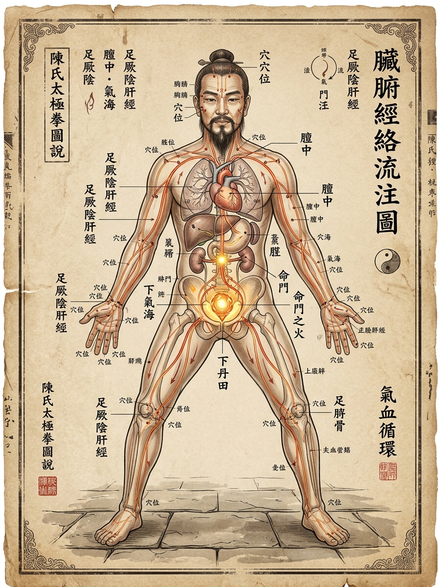

# Bab 3: Integrasi Medis TCM — Organ Dalam Zang-Fu, 12 Meridian & Siklus Sirkulasi Darah

> 📖 **Hub Buku**: **[The Illustrated Canon of Chen Family Taijiquan (Chenshi Taijiquan Tushuo)](index.md)**  
> 📑 **Cakupan Bab Asli**: *Juan Yi (Bagian Diagram Meridian, Teori Organ Zang-Fu, Kidung Sirkulasi Qi-Darah & Integrasi Sumbu Dantian-Mingmen)*

---

## 📖 Narasi Pembuka & Latar Belakang (The Narrative Context)

Bagi seorang sejarawan medis, membaca jilid pertama *Chenshi Taijiquan Tushuo* menghadirkan sensasi seperti sedang membuka manuskrip kedokteran klasik Dinasti Han atau Tang daripada sebuah buku bela diri pertarungan[^1]. Halaman demi halaman naskah Chen Xin dipenuhi oleh puluhan diagram anatomi organ dalam, sketsa lintasan pembuluh darah akupunktur, tabel peredaran cairan tubuh menurut waktu sirkadian jam Tiongkok (*Shi Chen*), serta kidung-kidung medis tentang bagaimana sebuah pukulan tinju dapat mempengaruhi detak jantung dan filtrasi ginjal[^1].

Fenomena ini bukanlah sebuah kebetulan akademis belaka. Di Desa Chenjiagou, tradisi seni bela diri klan Chen selama berabad-abad selalu berjalan bergandengan tangan dengan seni pengobatan tradisional Tiongkok (*Traditional Chinese Medicine* / TCM). Terdapat doktrin kuno yang berbunyi: *"Ahli bela diri yang tidak memahami pengobatan hanyalah seorang algojo pembunuh yang cepat mati muda; sementara tabib yang tidak memahami bela diri hanyalah peracik obat yang tidak mengerti dinamika gerak kehidupan"*[^1]. Ayah Chen Xin, Chen Zhongshen, selain dikenal sebagai petarung tangguh bersenjata tombak besar (*Dagan*), adalah seorang ahli akupunktur terkemuka di wilayah Wenxian yang mengobati ribuan warga desa tanpa memungut bayaran[^1].

Dari latar belakang keluarga tabib-pendekar inilah, Chen Xin menyusun risalah medis internalnya. Baginya, **latihan Taijiquan pada hakikatnya adalah sebuah sesi akupunktur bergerak tanpa jarum (*moving needle-less acupuncture*)**. Setiap kali tubuh memutar panggul, melipat siku, dan mengatur hembusan napas diafragma, organ-organ dalam (*Zang-Fu*) menerima pemijatan ritmis yang membersihkan stagnasi darah, menstabilkan produksi hormon, dan memperpanjang rentang kesehatan biologis manusia[^1], [^4].

---

<div align="center">
  
  <p><sub><em>Ilustrasi Bab 3: Rekonstruksi diagram manuskrip medis Dinasti Qing karya Chen Xin — menampilkan sosok praktisi dengan organ dalam Zang-Fu (jantung, paru, hati, limpa, ginjal), jalur 12 meridian utama bercahaya lembut dengan titik akupunktur kunci, serta sumbu Dantian Bawah dan Mingmen yang memancarkan kehangatan vitalitas.</em></sub></p>
</div>

---

## 🔬 Teardown Konsep & Wawasan Utama (Deep-Dive Insights)

```text
┌────────────────────────────────────────────────────────────────────────┐
│             HUBUNGAN KORELASI ORGAN ZANG-FU DENGAN GERAK TAIJI         │
└────────────────────────────────────────────────────────────────────────┘
  ORGAN ZANG (YIN)        ELEMEN & FUNGSI             MANIFESTASI DALAM GERAK TAIJI
  ────────────────        ───────────────             ─────────────────────────────
  1. HATI (Gan / 肝)    ──► Kayu / Tendon & Fasia  ──► Elastisitas regangan Chan Si Jin
  2. JANTUNG (Xin / 心) ──► Api / Darah & Roh Shen ──► Ketenangan fokus & kejernihan mata
  3. LIMPA (Pi / 脾)    ──► Tanah / Daging & Otot  ──► Kepadatan tumpuan panggul (Song Kua)
  4. PARU (Fei / 肺)    ──► Logam / Kulit & Pori   ──► Ritme napas diafragma halus (Kai-He)
  5. GINJAL (Shen / 肾) ──► Air / Tulang & Sumsum  ──► Kekuatan akar ke bumi & Mingmen
                                       │
                                       ▼
                 [SUMBU INTEGRASI UTAMA: DANTIAN - MINGMEN]
                 Dantian di depan (Penyimpan Qi) ◄──► Mingmen di belakang (Pintu Api)
                 Menyeimbangkan tekanan rongga panggul & cairan tulang belakang
```

### 1. Teori Lima Organ Padat (Zang) dan Gerak Anatomi
Dalam teks Jilid 1, Chen Xin memetakan kesehatan lima organ vital (*Zang*) ke dalam parameter kualitas gerakan fisik praktisi[^1]:
- **Hati (Gan / 肝 — Elemen Kayu)**: 
  Dalam teori TCM, hati menguasai jaringan tendon (*Jin*) dan fasia tubuh serta mengatur kelancaran sirkulasi emosi. Jika organ hati mengalami stagnasi, tendon menjadi kaku dan mudah robek saat bergerak cepat. Gerakan memutar spiral *Chan Si Jin* dirancang khusus untuk memeras dan merelaksasikan kapsul hati, memulihkan kelenturan elastis tendon di seluruh tubuh[^1], [^4].
- **Jantung (Xin / 心 — Elemen Api)**: 
  Jantung adalah kaisar tubuh yang menaungi kesadaran mental (*Shen*). Chen Xin memperingatkan agar praktisi tidak pernah berlatih dengan emosi marah atau detak jantung terengah-engah yang memicu "api jantung membara ke atas" (*Xin Huo Shang Yan*). Pernapasan halus lambat bertujuan mendinginkan api jantung dan menurunkannya ke Dantian bawah[^1].
- **Limpa & Lambung (Pi-Wei / 脾胃 — Elemen Tanah)**: 
  Menguasai massa otot lurik dan proses penyerapan nutrisi makanan. Pelipatan sendi panggul (*Song Kua*) dan penenggelaman pinggang (*Chen Yao*) memberikan kompresi mekanis lembut pada organ lambung dan limpa, meningkatkan motilitas peristaltik dan mencegah pengendapan lemak viscera yang mematikan[^1].
- **Paru-Paru (Fei / 肺 — Elemen Logam)**: 
  Menguasai pernapasan atmosfer (*Da Qi*) dan pertahanan sistem imun kulit (*Wei Qi*). Gerakan membuka (*Kai*) dan menutup (*He*) pada dada merangsang kapasitas vital alveolus paru-paru bagian bawah yang sering kali pasif pada manusia modern[^1].
- **Ginjal (Shen / 肾 — Elemen Air)**: 
  Organ paling keramat dalam kanon Chen Xin, dipandang sebagai akar biologis kehidupan yang menyimpan esensi bawaan lahir (*Congenital Jing*). Ginjal menguasai kekuatan tulang, kepadatan sumsum, dan regenerasi cairan tubuh. Posisi kuda-kuda rendah yang stabil dan pembukaan gerbang *Mingmen* di punggung bawah bertindak sebagai stimulus regeneratif bagi kelenjar adrenal dan parenkim ginjal[^1], [^4].

### 2. Sumbu Emas: Dantian Bawah dan Gerbang Kehidupan Mingmen
Salah satu mutiara kedokteran internal yang diuraikan Chen Xin secara anatomis adalah **interaksi dinamis antara Dantian Depan dan Mingmen Belakang**[^1]:
- **Dantian (Lautan Energi di Depan)**: Terletak di bawah pusar, bertindak sebagai reservoir fluida dan pusat gravitasi massa tubuh.
- **Mingmen (Pintu Gerbang Kehidupan di Belakang / Du-4)**: Terletak di ruas tulang belakang lumbar L2-L3, tepat di antara kedua ginjal. Mingmen adalah "kompor api fisiologis" (*Ministerial Fire*) yang memanaskan cairan tubuh agar bersirkulasi ke atas[^1].
- **Mekanisme Pompa Hidrolik Tulang Belakang**:
  Ketika praktisi melipat panggul (*Song Kua*), kurvatura lordosis lumbar melurus, meregangkan titik *Mingmen* terbuka ke arah belakang. Bersamaan dengan penurunan diafragma saat menarik napas, tekanan intra-abdominal (IAP) memadat di antara Dantian dan Mingmen. Tekanan hidrostatik ini mendorong cairan serebrospinal (*cerebrospinal fluid*) naik menyusuri kanal tulang belakang menuju ventrikel otak, menghasilkan sensasi kesegaran kognitif dan penurunan ketegangan leher secara instan[^1], [^4].

### 3. Dua Belas Meridian dan Pencegahan Cedera Bela Diri
Chen Xin menyertakan diagram lengkap 12 meridian akupunktur utama dan menjelaskan bagaimana teknik beladiri Taiji dirancang agar **tidak pernah memutus atau menjepit aliran meridian sendiri**[^1]:
- Saat meninju atau mendorong, lengan tidak boleh diluruskan 100% hingga sendi siku terkunci (*hyperextension*). Mengunci sendi siku akan menjepit meridian Jantung (*Heart Meridian*) dan meridian Perikardium di lipatan siku, memicu lonjakan tekanan darah mendadak dan keletihan jantung.
- Sudut siku yang selalu dipertahankan melengkung busur (sekitar 135–150 derajat) menjaga agar ketiga meridian Yin tangan (Paru, Perikardium, Jantung) dan ketiga meridian Yang tangan (Usus Besar, Sanjiao, Usus Kecil) tetap terbuka lapang laksana pipa air yang mengalir bebas tanpa hambatan lekukan patah[^1], [^3].

---

## 🧠 Eksperimen Pikiran & Contoh Kasus di Dunia Nyata

### Kasus Medis Tradisional: Sindrom 'Api Hati Membara' Pendekar Muda
Dalam catatannya, Chen Xin menceritakan kasus seorang pemuda di desanya yang berlatih seni bela diri eksternal keras (*Waijia Quan*) dengan memukul karung pasir besi dan melompat-lompat agresif setiap hari[^1]. Pemuda tersebut memiliki pukulan yang sangat keras, namun wajahnya selalu berjerawat merah meradang, matanya merah kering, napasnya berbau panas, dan ia sering mengalami mimisan mendadak serta insomnia parah. Tabib desa mendiagnosisnya menderita sindrom *Gan Huo Shang Yan* (Api Hati membakar ke atas).

Chen Xin menasihati pemuda tersebut untuk menghentikan latihan hantam kerasnya selama 3 bulan. Sebagai gantinya, ia diajarkan jurus pembuka *Taiji Yu Bei Shi* dan *Lan Zha Yi* dengan gerakan sangat lambat, menekankan pembuangan ketegangan bahu (*Song Jian*) dan penenggelaman napas ke titik *Yongquan* di telapak kaki. Dalam tempo 40 hari, panas di kepalanya mereda, produksi empedu dan enzim hatinya normal kembali, warna matanya kembali bening, dan yang paling menakjubkan: saat diuji memukul samsak, daya tembus pukulannya justru meningkat dua kali lipat karena gaya pukulannya kini berasal dari berat massa tulang panggul yang cair, bukan lagi dari ketegangan otot bahu yang kering[^1], [^3].

---

## ⚡ Panduan Aksi Nyata dari Bagian Ini (Action Checklist)

1. [ ] **Audit Sudut Bebas Jepitan Siku (Open the Elbows)**: Setiap kali Anda melakukan gerakan mendorong atau meninju, pastikan sendi siku Anda tidak terkunci lurus 180 derajat. Sisakan lengkungan elastis mikro agar saluran meridian dan pembuluh darah brakialis tidak tercekik[^1].
2. [ ] **Aktivasi Gerbang Mingmen Saat Duduk**: Ketika Anda duduk di kursi kantor hari ini, jangan biarkan punggung bawah Anda melengkung patah ke depan (lordosis berlebih). Bernapaslah lembut ke arah punggung bawah di balik pusar Anda, bayangkan titik *Mingmen* Anda membuka dan bersandar hangat pada sandaran kursi[^1].
3. [ ] **Audit Mata dan Ketegangan Hati (Gan Kai Qiao Yu Mu)**: Dalam TCM, kesehatan organ hati tercermin pada mata. Jika mata Anda lelah dan tegang akibat menatap layar ponsel, putar bola mata Anda secara perlahan dalam lingkaran spiral lembut 9 kali ke kiri dan 9 kali ke kanan sambil bernapas panjang, melepaskan ketegangan meridian hati[^1].

---

## 💬 Kutipan Pilihan & Catatan Reflektif

> *"Mereka yang berlatih bela diri dengan mengentakkan kaki secara kasar dan berteriak garang sesungguhnya sedang melukai organ dalam mereka sendiri. Mereka menguras air ginjal mereka demi membesarkan api nafsu sesaat. Di dalam Taijiquan keluarga Chen, gerakan kami lembut laksana air mengalir di bawah rerumputan; namun di dalam kelembutan air itulah, lima organ dalam kami dipelihara hingga utuh dan abadi."*  
> — **Grandmaster Chen Xin (陈鑫 / Chen Pinsan)** *(Kanon Tushuo: Juan Yi)*[^1]

**Pertanyaan Refleksi Diri**:
- *Apakah olahraga yang Anda lakukan selama ini membuat organ dalam Anda merasa segar dan terpulihkan setelahnya, ataukah ia meninggalkan tubuh Anda dalam keadaan lelah terkuras, dehidrasi, dan tegang secara berkepanjangan?*

---

## 📚 Referensi, Studi Ilmiah & Catatan Kaki Bab Ini

Bagian ini merangkum teks medis klasik kanon Chen Xin, literatur TCM, dan fisiologi mikrosirkulasi Bab 3:

[^1]: **Chen Xin (陈鑫).** *Chenshi Taijiquan Tushuo* (陈氏太极拳图说 / *Illustrated Explanations of Chen Family Taijiquan*). Shanghai: Kaiming Book Bureau; 1933.  
Rujukan primer Juan Yi (Jilid 1), bagian diagram organ Zang-Fu, kidung sirkulasi darah dan meridian akupunktur, interaksi dinamis poros Dantian-Mingmen, serta metodologi pencegahan cedera organ dalam melalui kurvatura sendi.

[^2]: **Chen Xin (Translated by Alex Golstein).** *The Illustrated Canon of Chen Family Taijiquan*. Melbourne: INBI Matrix Pty Ltd; 2007. ISBN: 978-5-98687-008-3.  
Terjemahan medis otoritatif bab korelasi fisiologi akupunktur klasik dengan nomenklatur anatomi modern.

[^3]: **Hong Junsheng (洪均生).** *Chen Shi Taijiquan Shiyong Quanfa* (陈式太极拳实用拳法). Jinan: Shandong Science and Technology Publishing House; 1989. ISBN: 978-7-5331-0640-9.  
Kajian analitis mengenai aturan mempertahankan jarak siku satu kepal demi kelancaran sirkulasi kardiopulmonal tanpa jepitan meridian.

[^4]: **Schleip R, Findley TW, Chaitow L, Huijing PA.** *Fascia: The Tensional Network of the Human Body*. Edinburgh: Churchill Livingstone / Elsevier; 2012.  
Kajian medis mengenai peran mekanotransduksi jaringan fasia perivisceral dalam memfasilitasi motilitas organ dalam dan modulasi respon neuroendokrin otonom.

---

## 🧭 Navigasi Bab Selanjutnya

⬅️ **[Bab 2: Teori Lilitan Sutra (Chan Si Jin)](02-teori-lilitan-sutra-chansijin.md)** &nbsp;&nbsp;|&nbsp;&nbsp; 📖 **[Hub Buku (Index)](index.md)** &nbsp;&nbsp;|&nbsp;&nbsp; ➡️ **[Lanjut ke Bab 4: Arsitektur Taolu Xiaojia (Bingkai Kecil) & Anotasi Margin](04-arsitektur-taolu-xiaojia-dan-anotasi.md)**

