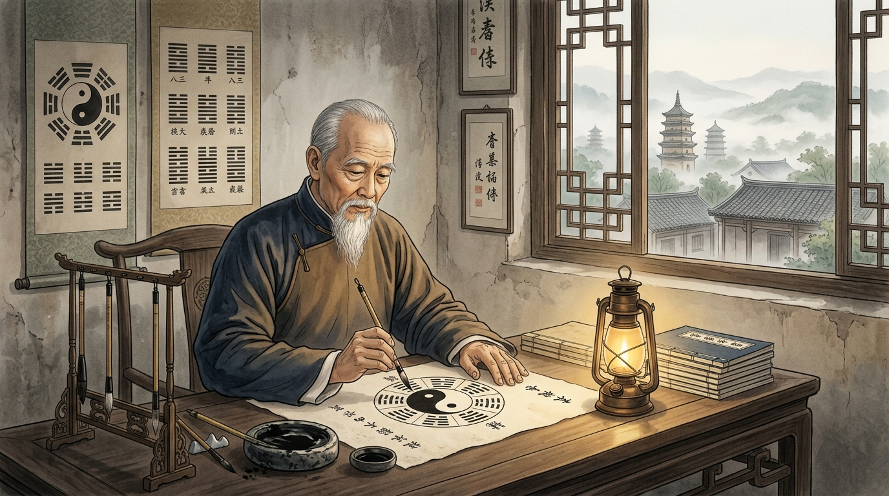

# Bab 4: Arsitektur Taolu Xiaojia (Bingkai Kecil) — Bedah Postur, Diagram Jejak Kaki & Anotasi Margin

> 📖 **Hub Buku**: **[The Illustrated Canon of Chen Family Taijiquan (Chenshi Taijiquan Tushuo)](index.md)**  
> 📑 **Cakupan Bab Asli**: *Juan Er, San, Si (卷二、三、四: 64 Postur Rangkaian Xiaojia, Diagram Langkah Kaki Luoshu & Anotasi Margin Tishi)*

---

## 📖 Narasi Pembuka & Latar Belakang (The Narrative Context)

Ketika pembaca modern membuka Jilid Kedua, Ketiga, dan Keempat dari *Chenshi Taijiquan Tushuo*, mereka akan langsung disambut oleh pemandangan visual yang tiada duanya dalam sejarah penerbitan buku bela diri dunia[^1]. Di setiap halaman naskah aslinya, Chen Xin menyajikan sebuah pelat ukiran kayu (*woodblock print*) yang menggambarkan figur seorang praktisi sedang memperagakan sebuah postur jurus. Namun, daya tarik sejati dari buku ini bukanlah gambarnya semata, melainkan **anotasi tulisan tangan kuas yang memadati setiap inci tepi margin halaman (*Tishi / 提示*)**[^1].

Chen Xin tidak membiarkan satu ruang kosong pun terbuang sia-sia. Di sekeliling figur gambar, ia menuliskan catatan-catatan kritis: berapa derajat sudut kemiringan telapak kaki kiri, ke mana arah pandangan mata harus tertuju, bagian tulang mana yang bertindak sebagai poros mati (*fulcrum*), di mana letak titik konsentrasi niat mental (*Yi*), hingga berapa persen distribusi berat badan yang harus tertanam pada masing-masing tumit[^1].

Koreografi yang didokumentasikan oleh Chen Xin dalam kanon ini adalah tradisi **Xiaojia (小架 — Bingkai Kecil)**, yaitu kurikulum kuno keluarga Chen yang menekankan lingkaran-lingkaran gerak yang sangat rapat, ketat, tersembunyi, dan efisien secara mekanis[^1], [^2]. Berbeda dari aliran pertunjukan modern yang memperbesar ayunan lengan demi keindahan estetika panggung, Xiaojia Chen Xin dirancang untuk pertarungan hidup-mati di ruang sempit: di mana setiap milimeter pergerakan tangan harus dilindungi oleh struktur panggul (*Kua*) yang solid dan tidak memberi celah sedikit pun bagi serangan musuh[^1].

---

<div align="center">
  
  <p><sub><em>Ilustrasi Bab 4: Rekonstruksi pelat cetak kayu klasik kanon 1933 Chen Xin — menampilkan postur fondasi Dan Bian (Cambuk Tunggal) dengan tangan kait Diao Shou, lintasan busur tangan kiri, diagram jejak telapak kaki 8 penjuru mata angin di lantai (pola Luoshu), serta catatan kaligrafi kuas instruksi margin (Tishi).</em></sub></p>
</div>

---

## 🔬 Teardown Konsep & Wawasan Utama (Deep-Dive Insights)

```text
┌────────────────────────────────────────────────────────────────────────┐
│             ANATOMI STRUKTUR POSTUR KUNCI: DAN BIAN (CAMBUK TUNGGAL)   │
└────────────────────────────────────────────────────────────────────────┘
     [TANGAN KAIT KANAN (DIAO SHOU)]               [PUNCAK KEPALA]
     • 5 jari menguncup ke bawah                   • Xu Ling Ding Jin
     • Pergelangan fleksi, siku tenggelam          • Menjaga sumbu vertikal
     • Titik tumpu penahan belakang (Yin)                        │
                    │                                            │
                    └─────────────────────┬──────────────────────┘
                                          ▼
                             [DADA & TULANG BELAKANG]
                             • Han Xiong Ba Bei (Dada rileks, punggung bulat)
                             • Regangan dua arah (Dui La horizontal)
                                          │
                    ┌─────────────────────┴──────────────────────┐
                    ▼                                            ▼
      [TANGAN PALM KIRI (ZHOU LI ZHANG)]           [PANGGUL & KUDA-KUDA]
      • Menghadap miring 45°, siku busur           • Song Kua, bokong tenggelam
      • Menyalurkan gaya ekspansi (Yang)           • Distribusi berat 70:30
      • Jari kelingking sedikit membuka            • Jejak kaki pola Luoshu 8 Arah
```

### 1. Dekonstruksi Postur Mahkota: Dan Bian (单鞭 — Cambuk Tunggal)
Dalam analisis Jilid 2, Chen Xin mendedikasikan beberapa halaman catatan khusus untuk membedah postur paling terkenal dalam Taijiquan: *Dan Bian*[^1]:
- **Morfologi Tangan Kait Kanan (Diao Shou / 刁手)**:
  Banyak praktisi modern membuat tangan kait dengan mencubit kelima ujung jari secara kaku seperti paruh burung bangau. Chen Xin membongkar kesalahan ini: kelima ujung jari menguncup lembut mengarah ke bawah, namun pergelangan tangan tetap fleksibel dan tidak tegang. Tangan kait kanan bukanlah alat penusuk, melainkan **jangkar penyeimbang gravitasi (*gravitational counterweight*)** yang mengunci titik tumpu belakang saat tangan kiri membuka ke depan[^1], [^3].
- **Morfologi Tangan Telapak Kiri (Li Zhang)**:
  Tangan kiri membuka dalam lintasan busur spiral *Ni Chan*, dengan telapak tangan menghadap ke depan miring 45 derajat. Ujung siku kiri tergantung berat tepat di atas lutut kiri, membentuk segitiga penahan beban yang mustahil diruntuhkan dari samping.
- **Dinamika Regangan Dua Arah (*Dui La*)**:
  Chen Xin menulis anotasi margin tebal: *"Tangan kanan menarik ke kanan belakang, tangan kiri memanjang ke kiri depan; dada ditarik ke dalam, punggung membulat ke luar. Kedua lengan bekerja seperti tali busur panah yang direntangkan maksimal. Tenaga tidak tinggal di tangan, melainkan tersimpan pada ketegangan elastis tulang belikat punggung"*[^1], [^4].

### 2. Postur Lan Zha Yi (揽扎衣 — Merapikan Jubah Perang)
Postur pembuka yang menjadi "ibu dari seluruh jurus Taiji gaya Chen"[^1]:
- Nama aslinya berasal dari tradisi militer Dinasti Ming: seorang prajurit yang hendak maju ke medan laga menyibakkan ujung jubah perangnya ke samping agar langkah kakinya tidak terbelit saat mencabut pedang.
- **Geometri Kuda-Kuda**: Kaki kanan melangkah ke samping kanan membentuk kuda-kuda busur condong (*Gong Bu*), namun berat badan 70% tetap tertahan pada kaki kiri belakang. Lutut kanan tidak boleh meluncur melewati ujung jempol kaki.
- **Tishi Margin Chen Xin**: *"Tangan kanan memutar busur Shun Chan dari bawah panggul naik ke ulu hati, lalu mendorong keluar dengan Ni Chan setinggi dada. Pandangan mata mengikuti ujung jari manis kanan, sementara telinga kiri mendengarkan angin di belakang tubuh"*[^1].

### 3. Diagram Jejak Langkah Sembilan Istana (Jiu Gong Bu / 九宫步)
Di bagian bawah gambar jurus, Chen Xin menggambar sketsa telapak kaki dengan garis-garis panah putus-putus yang rumit[^1]:
- **Pola Matematika Luoshu**: Arah melangkah kaki tidak pernah berupa garis tegak lurus 90 derajat atau maju mundur 180 derajat. Setiap langkah kaki mengikuti angka-angka kisi ajaib 3x3 (*Luoshu Magic Square*): melangkah dari posisi 1 (Utara) ke posisi 6 (Barat Laut), berputar ke posisi 8 (Timur Laut), dan kembali ke posisi 5 (Pusat)[^1].
- **Mekanika Transmisi Tumit ke Jari**:
  Chen Xin menegaskan aturan emas melangkah: *"Maju melangkah laksana kucing mengendap di atas genting; mundur melangkah laksana daun kering jatuh di atas air"*. Tumit selalu mendarat terlebih dahulu tanpa suara benturan, disusul oleh tepi luar telapak kaki, dan diakhiri oleh cengkeraman lembut kelima jari kaki. Ini memastikan bahwa praktisi tidak pernah mentransfer berat badannya sebelum fondasi tumpuannya terverifikasi kokoh[^1], [^3].

---

## 🧠 Eksperimen Pikiran & Contoh Kasus di Dunia Nyata

### Kasus Analisis Gerak: Jebakan 'Tangan Melayang Tanpa Akar'
Seorang instruktur bela diri modern di Shanghai memperagakan jurus *Dan Bian* dengan rentangan tangan yang sangat lebar dan dada membusung tegak lurus laksana penari balet. Secara visual fotografi, penampilannya terlihat sangat megah dan gagah.

Namun, ketika dianalisis menggunakan catatan margin (*Tishi*) Chen Xin, postur tersebut terbukti mengalami tiga cacat struktural fatal[^1]:
1. Dada yang membusung memutuskan koneksi fasia punggung (*Ba Bei*), membuat paru-paru tertekan dan napas tercekik di dada atas.
2. Rentangan tangan yang terlalu lebar membuat sendi bahu terlepas dari soketnya (*shoulder impingement*), sehingga dorongan ringan 5 kg dari samping langsung mematahkan struktur lengannya.
3. Berat badan terbagi rata 50:50 di tengah (*Shuang Zhong / Bobot Ganda*), membuat kakinya terpaku di lantai dan tidak mampu melangkah menghindar secara cepat jika diserang mendadak[^1], [^3].

Setelah memperbaiki posturnya mengikuti instruksi ukiran kayu Chen Xin—menenggelamkan dada sedikit ke dalam, menurunkan siku satu kepal dari rusuk, dan membebankan 70% bobot ke tumit belakang—struktur tubuhnya seketika menjadi solid laksana batu karang, membuktikan keunggulan rekayasa biomekanika tradisi Xiaojia.

---

## ⚡ Panduan Aksi Nyata dari Bagian Ini (Action Checklist)

1. [ ] **Audit Sudut Kaki 45 Derajat pada Dan Bian**: Saat berdiri dalam postur akhir *Dan Bian*, periksa telapak kaki kanan Anda. Apakah telapak kaki kanan Anda mengarah miring 45 derajat ke luar, sementara kaki kiri melangkah lurus ke depan? Sudut 45 derajat ini adalah kunci kestabilan panggul penahan gaya reaksi tanah[^1].
2. [ ] **Latih Langkah Kaki Tanpa Suara (Cat-Stepping Protocol)**: Berjalanlah melintasi ruangan rumah Anda di malam hari. Latihlah mendaratkan tumit secara perlahan tanpa menghasilkan bunyi decit atau dentuman lantai sedikit pun. Jika lantai Anda berbunyi keras, itu adalah tanda bahwa gravitasi tubuh Anda jatuh bebas tanpa kontrol otot panggul (*Kua*)[^1].
3. [ ] **Terapkan Prinsip Tangan Kait Pelindung**: Saat Anda membentuk tangan kait (*Diao Shou*), jangan mengencangkan otot lengan bawah Anda. Rasakan bagaimana pergelangan tangan tetap lemas lentur, membiarkan tendon jari yang mempertahankan bentuk kaitan secara pasif[^1].

---

## 💬 Kutipan Pilihan & Catatan Reflektif

> *"Setiap postur di dalam jurus memiliki seribu alasan matematis di baliknya. Jika Anda mengubah satu inci sudut tangan demi terlihat indah di mata orang awam, Anda telah meruntuhkan seribu benteng pertahanan yang dibangun oleh para leluhur dengan tetesan darah mereka."*  
> — **Grandmaster Chen Xin (陈鑫 / Chen Pinsan)** *(Kanon Tushuo: Juan Er)*[^1]

**Pertanyaan Refleksi Diri**:
- *Apakah saat Anda mempelajari sebuah keahlian atau gerakan, Anda cenderung terburu-buru menghafal seluruh urutan luarnya saja, ataukah Anda memiliki kesabaran untuk membedah ketelitian setiap detail mikronya hingga tuntas?*

---

## 📚 Referensi, Studi Ilmiah & Catatan Kaki Bab Ini

Bagian ini merangkum naskah pelat cetak kayu kanon Chen Xin, kajian koreografi Xiaojia, dan studi biomekanika Bab 4:

[^1]: **Chen Xin (陈鑫).** *Chenshi Taijiquan Tushuo* (陈氏太极拳图说 / *Illustrated Explanations of Chen Family Taijiquan*). Shanghai: Kaiming Book Bureau; 1933.  
Rujukan primer Juan Er, San, dan Si (Jilid 2, 3, dan 4), memuat dokumentasi 64 postur jurus Xiaojia, diagram jejak kaki Sembilan Istana (*Jiu Gong Bu / Luoshu*), serta teks anotasi margin tulisan tangan asli (*Tishi*) mengenai sudut sendi dan arah atensi niat (*Yi*).

[^2]: **Chen Xin (Translated by Alex Golstein).** *The Illustrated Canon of Chen Family Taijiquan*. Melbourne: INBI Matrix Pty Ltd; 2007. ISBN: 978-5-98687-008-3.  
Terjemahan komprehensif bab dekonstruksi jurus Xiaojia, analisis istilah kosa kata teknis, dan reproduksi faksimili pelat kayu Dinasti Qing.

[^3]: **Hong Junsheng (洪均生).** *Chen Shi Taijiquan Shiyong Quanfa* (陈式太极拳实用拳法). Jinan: Shandong Science and Technology Publishing House; 1989. ISBN: 978-7-5331-0640-9.  
Analisis komparatif Hong Junsheng mengenai koreksi posisi tangan kait (*Diao Shou*) dan sudut siku pada jurus *Dan Bian* dan *Lan Zha Yi* warisan Chen Fake di Beijing.

[^4]: **Schleip R, Findley TW, Chaitow L, Huijing PA.** *Fascia: The Tensional Network of the Human Body*. Edinburgh: Churchill Livingstone / Elsevier; 2012.  
Kajian medis mengenai sifat transmisi beban tegangan berpasangan (*Dui La*) pada rantai fasia posterior (*Back Functional Line*) yang memvalidasi efisiensi mekanika postur Dan Bian.

---

## 🧭 Navigasi Bab Selanjutnya

⬅️ **[Bab 3: Integrasi Medis Zang-Fu & 12 Meridian](03-integrasi-medis-zangfu-dan-meridian.md)** &nbsp;&nbsp;|&nbsp;&nbsp; 📖 **[Hub Buku (Index)](index.md)** &nbsp;&nbsp;|&nbsp;&nbsp; ➡️ **[Lanjut ke Bab 5: Laboratorium Tempur & Warisan Abadi — Aplikasi Qin Na](05-laboratorium-tempur-dan-warisan-abadi.md)**

