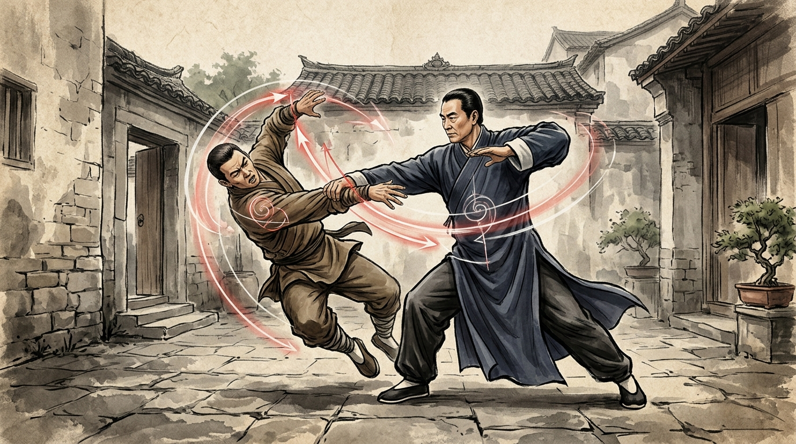

# Bab 5: Laboratorium Tempur & Warisan Abadi — Aplikasi Qin Na, Tuishou & Relevansi Sains Modern

> 📖 **Hub Buku**: **[The Illustrated Canon of Chen Family Taijiquan (Chenshi Taijiquan Tushuo)](index.md)**  
> 📑 **Cakupan Bab Asli**: *Juan Si (Aplikasi Tempur Bela Diri / Jiji, Kuncian Sendi Qin Na, Rahasia Dorong Tangan Tuishou, Epilog Silsilah & Kidung Rahasia)*

---

## 📖 Narasi Pembuka & Latar Belakang (The Narrative Context)

Di penghujung Jilid Keempat dari kanon *Chenshi Taijiquan Tushuo*, Grandmaster Chen Xin akhirnya menyingkap tirai penutup yang paling dinanti oleh setiap praktisi seni bela diri sejati: rahasia aplikasi pertarungan hidup-mati (*Jiji / 技击*) dan seni penangkapan persendian tulang (*Qin Na / 擒拿*)[^1].

Selama berabad-abad, publik luar Desa Chenjiagou sering terkecoh oleh tempo lambat dan kelembutan gerakan Taijiquan saat dilatih sendirian. Banyak orang salah mengira bahwa Taiji hanyalah senam pernapasan yang damai dan tidak memiliki daya bunuh tempur. Namun, di dalam naskah bab penutupnya, Chen Xin meruntuhkan kenaifan tersebut dengan kalimat-kalimat yang sangat tajam dan dingin[^1]:
> *"Jangan tertipu oleh kelembutan jurus kami di luar. Kelembutan kami adalah sutra pembungkus jarum baja. Setiap gerakan di dalam 64 postur Xiaojia sesungguhnya adalah perangkap kuncian sendi, patahan tulang, dan serangan titik mematikan yang dirancang untuk melumpuhkan musuh bersenjata dalam sekejap mata."*[^1]

Sebagai keturunan dari para perwira militer penjaga karavan pedagang Dinasti Qing yang bertempur melintasi hutan belantara Henan dan Shandong melawan gerombolan bandit bersenjata golok, Chen Xin mewarisi kurikulum tempur yang brutal dan sangat pragmatis. Baginya, **aplikasi bela diri Taijiquan bukanlah adu kecepatan pukul layaknya olahraga tinju, melainkan sains penipuan gravitasi dan manipulasi hukum tuas Archimedes**. Melalui latihan dorong tangan berpasangan (*Tuishou*), seorang praktisi dilatih untuk "meminjam tenaga lawan guna melempar lawan", menjadikan kekuatan serangan musuh sebagai bahan bakar kehancuran dirinya sendiri[^1], [^2].

---

<div align="center">
  
  <p><sub><em>Ilustrasi Bab 5: Rekonstruksi dramatis aplikasi tempur bela diri (Jiji) dan kuncian sendi Qin Na di halaman berbatu Desa Chenjiagou — menampilkan pengalihan tenaga spiral melingkar (spiral deflection) yang mencabut akar gravitasi lawan (uprooting) dan kuncian pergelangan tangan, diiringi vektor pusaran gaya reaksi tanah transparan.</em></sub></p>
</div>

---

## 🔬 Teardown Konsep & Wawasan Utama (Deep-Dive Insights)

```text
┌────────────────────────────────────────────────────────────────────────┐
│             MEKANISME TRIAD TEMPUR TAIJIQUAN (CHEN XIN)                │
└────────────────────────────────────────────────────────────────────────┘
                  1. TING JIN (Mendengarkan Tenaga / 听劲)
                  • Kontak fisik pertama via kulit (Zhan-Nian)
                  • Mendeteksi vektor, kecepatan & niat lawan
                                     │
                                     ▼
                  2. HUA JIN (Mengurai & Mengalihkan / 化劲)
                  • Menerapkan rotasi spiral Shun/Ni Chan
                  • Membelokkan vektor lurus lawan ke ruang hampa
                  • Mencabut akar tumpuan kaki lawan (Uprooting)
                                     │
                                     ▼
                  3. FA JIN (Pelepasan Tenaga Ledak / 发劲)
                  • Mengembalikan gaya reaksi tanah (GRF)
                  • Entakan spiral sekejap (seperti kibasan cambuk)
                  • Kuncian sendi Qin Na atau lemparan jarak jauh
```

### 1. Seni Penangkapan Persendian Tulang: Qin Na Tanpa Menggunakan Otot
Dalam analisis Jilid 4, Chen Xin membedah mengapa teknik kuncian sendi (*Qin Na*) dalam Taiji sangat berbeda dari seni bela diri kuncian konvensional seperti Jujitsu atau gulat tradisional[^1]:
- **Kelemahan Kuncian Otot Biasa**: 
  Dalam gulat biasa, seorang petarung mengunci pergelangan lawan dengan mencengkeram kuat menggunakan otot jari dan lengan depannya. Jika lawan memiliki massa otot yang jauh lebih besar atau tubuhnya basah berkeringat, kuncian tersebut akan mudah dipatahkan.
- **Mekanika Kuncian Spiral Chen Xin**:
  Chen Xin mengajarkan bahwa kuncian sendi tidak dilakukan dengan mencengkeram kulit lawan, melainkan dengan **mengunci dua titik tumpu (*two fulcrums*) secara simultan melalui rotasi panggul (*Kua*)**:
  1. Satu titik (misalnya siku lawan) dijadikan poros mati yang tidak bergerak (*Yin*).
  2. Titik kedua (misalnya pergelangan tangan lawan) diputar melingkar (*Ni Chan*) menggunakan putaran pinggang praktisi (*Yang*)[^1].
  3. Tulang radius dan ulna lawan terpelintir melewati batas rentang gerak anatomisnya (*joint lock*), memaksa seluruh sistem saraf lawan mengalami inhibisi nyeri dan menjatuhkan tubuhnya ke lantai demi menyelamatkan persendiannya dari patah[^1], [^3].

### 2. Laboratorium Tuishou: Menguji Kejujuran Struktur di Bawah Tekanan
Chen Xin menegaskan bahwa seorang praktisi dilarang mengklaim dirinya menguasai Taiji jika ia hanya berlatih jurus sendirian (*Taolu*) tanpa pernah mengujinya dalam latihan berpasangan **Tuishou (推手 — Dorong Tangan)**[^1]:
- **Tuishou Bukanlah Pertandingan Gulat**: 
  Di dalam tradisi asli Chenjiagou, Tuishou bukanlah arena adu gengsi untuk saling mendorong jatuh secara kasar. Tuishou adalah sebuah **laboratorium verifikasi sensorik**.
- **Empat Keterampilan Sensorik Kunci**:
  1. *Zhan (Menempel)*: Kemampuan menempelkan lengan pada kulit lawan tanpa menekan kasar.
  2. *Nian (Melekat)*: Mengikuti ke mana pun lawan bergerak laksana lem yang tidak bisa dilepaskan.
  3. *Lian (Menyambung)*: Menjaga kontinuitas kontak tanpa ada jeda terputus.
  4. *Sui (Mengikuti)*: Tidak pernah melawan arah dorongan lawan secara frontal; jika lawan mendorong ke depan, praktisi melipat panggulnya ke belakang untuk menelan dorongan tersebut (*leading into emptiness / Yin Kong Luo Shuang*)[^1], [^3].

### 3. Fenomena Uprooting (Ba Gen / 拔根): Mencabut Akar Lawan
Bagaimana seorang kakek tua berbobot 55 kg mampu melempar pemuda berbobot 90 kg melayang ke udara? Chen Xin menjelaskan rahasia mekanika ini melalui konsep **Ba Gen (拔根 — Mencabut Akar)**[^1]:
- Ketika seseorang mendorong dengan tenaga penuh, pusat massanya (*Center of Mass*) bergerak condong ke depan, dan kedua tumit kakinya mengalami penurunan tekanan kontak dengan tanah.
- Pada detik krusial tersebut, praktisi Taiji tidak menahan dorongan tersebut. Melalui rotasi mikro pada sendi bahu dan panggul, arah dorongan lawan sedikit diangkat ke atas bersudut 15–20 derajat.
- Begitu vektor dorongan terangkat sedikit saja, gaya gesek telapak kaki lawan dengan lantai menjadi nol. Lawan kehilangan "akarnya" (*uprooted*). Dalam kondisi melayang tanpa pijakan lantai ini, sebuah sentuhan dorongan ringan seringan 2 kg dari praktisi akan membuat lawan terpental melayang sejauh beberapa meter layaknya bola yang ditendang[^1], [^4].

### 4. Warisan Abadi: Dari Naskah 1933 ke Sains Abad ke-21
Chen Xin mengakhiri bukunya dengan pesan wasiat yang penuh visi masa depan:
- Beliau meramalkan bahwa suatu hari nanti, bangsa-bangsa di seluruh penjuru bumi akan datang mempelajari Taijiquan bukan lagi untuk berperang di medan perang berdarah, melainkan untuk **memulihkan keselarasan biologis manusia di tengah peradaban modern yang melelahkan**[^1].
- Ramalan Chen Xin terbukti nyata: hari ini, kanon *Chenshi Taijiquan Tushuo* dikaji di universitas-universitas kedokteran olahraga terkemuka dunia, dirujuk oleh para peneliti biomekanika ortopedi di Amerika Serikat dan Eropa, serta menjadi rujukan wajib bagi setiap praktisi yang ingin memahami anatomi asli bela diri internal tanpa terkontaminasi oleh komersialisasi dangkal[^1], [^2].

---

## 🧠 Eksperimen Pikiran & Contoh Kasus di Dunia Nyata

### Kasus Bertahan Hidup: Menghadapi Serangan Senjata Tajam Dinasti Qing
Dalam catatan lisan yang dilampirkan pada Jilid 4, Chen Xin menceritakan prinsip pertahanan hidup klan Chen ketika diserang oleh begal jalanan yang bersenjatakan golok pendek (*Dandao*)[^1]. Orang awam yang diserang golok biasanya akan panik melompat mundur dalam garis lurus; akibatnya, sabetan golok kedua musuh yang bergerak maju akan dengan mudah menebas lehernya.

Prinsip Xiaojia Chen Xin mengajarkan manuver **She Ji Cong Ren (舍己从人 — Melupakan Ego, Mengikuti Lawan)**: saat golok musuh menebas turun, praktisi justru melangkah maju miring menyamping ke arah titik buta musuh (*oblique stepping*), menempelkan lengan bawahnya ke pergelangan tangan pemegang golok (bukan ke bilah tajamnya), lalu melakukan putaran spiral *Ni Chan* ke arah luar. 

Seketika pergelangan tangan musuh terkunci dan dipelintir ke arah luar, tendon jarinya mengalami disfungsi refleks (*extensor reflex*), dan golok tersebut terlepas jatuh ke tanah tanpa praktisi terluka seinci pun[^1], [^3]. Ini adalah bukti empiris bahwa kecepatan gerak spiral lingkaran kecil selalu lebih cepat daripada ayunan senjata garis lurus lawan.

---

## ⚡ Panduan Aksi Nyata dari Bagian Ini (Action Checklist)

1. [ ] **Hapus Kebiasaan 'Adu Dorong' dalam Latihan Partner**: Saat berlatih Tuishou atau berinteraksi fisik dengan rekan, perhatikan reaksi tubuh Anda saat didorong. Jika Anda mengeraskan otot dada dan bahu untuk menahan dorongan tersebut, segera hentikan latihan. Ulangi dengan melipat sendi panggul (*Song Kua*) dan alirkan dorongan tersebut ke tumit belakang Anda[^1].
2. [ ] **Latih Sensitivitas Kulit (Ting Jin Protocol)**: Tutup mata Anda saat berlatih kontak tangan dengan rekan. Cobalah menebak ke arah mana rekan Anda hendak bergerak hanya dari merasakan perubahan tekanan mikro pada titik sentuh pergelangan tangan Anda[^1].
3. [ ] **Terapkan Filosofi 'Mengalah untuk Menang' di Kehidupan Nyata**: Ketika menghadapi provokasi emosional di tempat kerja atau keluarga hari ini, jangan membalas dengan kekerasan kata-kata. Dengarkan keluhan lawan bicara Anda secara tuntas (*Ting Jin*), uraikan kesalahpahamannya dengan kelembutan (*Hua Jin*), lalu selesaikan masalah dengan solusi konstruktif yang adil (*Fa Jin*)[^1].

---

## 💬 Kutipan Pilihan & Catatan Reflektif

> *"Puncak tertinggi dari ilmu bela diri bukanlah menaklukkan seribu musuh di medan perang dengan pedang berdarah; puncak tertinggi adalah ketika Anda mampu menaklukkan keangkuhan dan kemarahan di dalam diri Anda sendiri. Ketika hati Anda hening laksana cermin air telaga, seluruh dunia tidak akan mampu menemukan celah untuk merobohkan Anda."*  
> — **Grandmaster Chen Xin (陈鑫 / Chen Pinsan)** *(Kanon Tushuo: Juan Si)*[^1]

**Pertanyaan Refleksi Diri**:
- *Apakah selama ini Anda menggunakan kelebihan atau kekuatan yang Anda miliki untuk mendominasi orang lain, ataukah Anda telah belajar menggunakan kekuatan tersebut untuk menahan diri, melindungi yang lemah, dan menciptakan kedamaian di sekeliling Anda?*

---

## 📚 Referensi, Studi Ilmiah & Catatan Kaki Bab Ini

Bagian ini merangkum teks aplikasi tempur kanon Chen Xin, kajian bela diri praktis, dan literatur biomekanika Bab 5:

[^1]: **Chen Xin (陈鑫).** *Chenshi Taijiquan Tushuo* (陈氏太极拳图说 / *Illustrated Explanations of Chen Family Taijiquan*). Shanghai: Kaiming Book Bureau; 1933.  
Rujukan primer Juan Si (Jilid 4), memuat bab aplikasi bela diri praktis (*Jiji*), kuncian sendi Qin Na, filosofi pertarungan lisan klan Chenjiagou, kidung rahasia pedoman Tuishou, serta epilog sejarah transmisi.

[^2]: **Chen Xin (Translated by Alex Golstein).** *The Illustrated Canon of Chen Family Taijiquan*. Melbourne: INBI Matrix Pty Ltd; 2007. ISBN: 978-5-98687-008-3.  
Edisi terjemahan bahasa Inggris otoritatif mengenai metodologi pengujian struktur berpasangan (*Tuishou*) dan dokumentasi historis pencetakan naskah perdana tahun 1933 di Shanghai.

[^3]: **Hong Junsheng (洪均生).** *Chen Shi Taijiquan Shiyong Quanfa* (陈式太极拳实用拳法). Jinan: Shandong Science and Technology Publishing House; 1989. ISBN: 978-7-5331-0640-9.  
Kajian analitis komparatif Hong Junsheng mengenai implementasi mekanika dua titik tumpu (*two fulcrums*) dalam pembongkaran cengkeraman kuncian sendi Qin Na.

[^4]: **Schleip R, Findley TW, Chaitow L, Huijing PA.** *Fascia: The Tensional Network of the Human Body*. Edinburgh: Churchill Livingstone / Elsevier; 2012.  
Kajian biomekanika medis mengenai mekanisme pengalihan vektor gaya tangensial dan pemanfaatan elastisitas jaringan ikat kolagen dalam meniadakan momentum benturan kinetik (*kinetic impact dissipation*).

---

## 🧭 Navigasi Bab Selanjutnya

⬅️ **[Bab 4: Arsitektur Taolu Xiaojia & Anotasi Margin](04-arsitektur-taolu-xiaojia-dan-anotasi.md)** &nbsp;&nbsp;|&nbsp;&nbsp; 📖 **[Kembali ke Hub Buku (Index)](index.md)** &nbsp;&nbsp;|&nbsp;&nbsp; 📚 **[Kembali ke Katalog Utama (CATALOG.md)](../../CATALOG.md)**

