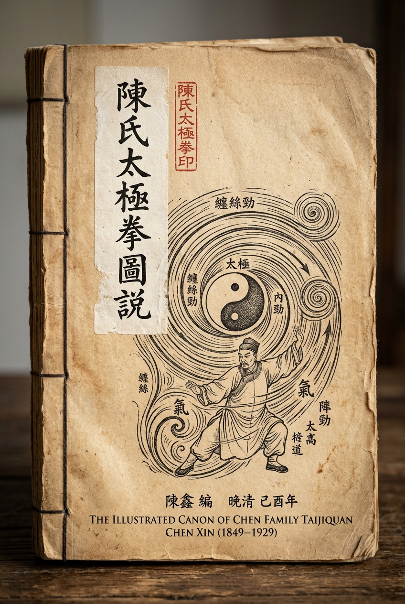
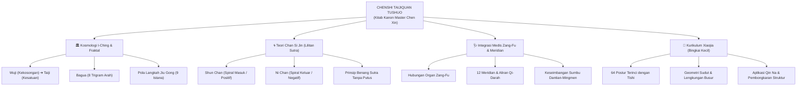

# 📖 The Illustrated Canon of Chen Family Taijiquan (Chenshi Taijiquan Tushuo / 陳氏太極拳圖說)

<div align="center">
  
</div>

> 📚 **[Kembali ke Katalog Utama (CATALOG.md)](../../CATALOG.md)**  
> **Penulis**: Grandmaster Chen Xin (陈鑫 / Chen Pinsan, 1849–1929; Generasi ke-16 Keluarga Chen)  
> **Tahun Penulisan**: 1908–1919 (12 Tahun Dedikasi) | **Tahun Publikasi Perdana**: 1933 (Kaiming Book Bureau, Shanghai)  
> **Edisi Rujukan Terjemahan Inggris**: Alex Golstein / INBI Matrix (750 Halaman Kompendium Lengkap)  
> **Genre**: Kanon Klasik Wushu, Biomekanika Spiral Dinasti Qing, Filosofi I-Ching, Pengobatan Tradisional Tiongkok (TCM)  
> **Estimasi Waktu Baca Keseluruhan**: ~90–120 Menit (5 Bab Komprehensif Lengkap + Anotasi Ilmiah)  
> **Rating Rekomendasi**: ⭐⭐⭐⭐⭐ (5.0/5.0 — *Karya Kanonis Terbesar Sepanjang Masa*)  

---

## 🧭 Peta Eksplorasi Buku (Reading Roadmap)

Kanon ensiklopedis ini merupakan "kitab suci induk" bagi seluruh aliran Taijiquan modern di dunia. Dibedah secara mendalam ke dalam 5 modul tematik naratif:

- [x] 📘 **[Bab 1: Risalah 12 Tahun di Chenjiagou — Konteks Historis, Kosmologi I-Ching & Lahirnya Kanon Tushuo](01-konteks-historis-dan-kosmologi-iching.md)**  
  *Cakupan Asli: Juan Yi (卷一: Bagian Pengantar & Kosmologi). Riwayat hidup Chen Xin yang mengorbankan karier birokrasi Dinasti Qing demi membukukan seni leluhur selama 12 tahun, penyatuan heksagram I-Ching dengan pergerakan tubuh, serta peralihan dari Wuji ke Taiji.*

- [x] 📘 **[Bab 2: Teori Lilitan Sutra (Chan Si Jin) — Geometri Spiral, Polaritas Shun-Ni & Mekanika Elastis](02-teori-lilitan-sutra-chansijin.md)**  
  *Cakupan Asli: Juan Yi (Chan Si Fa / 缠丝法 & Diagram Spiral). Mengapa gerak Taiji wajib melingkar spiral 3 dimensi (tidak ada garis lurus murni): pemisahan Shun Chan vs Ni Chan, analogi ulat sutra, dan proteksi persendian tubuh.*

- [x] 📘 **[Bab 3: Integrasi Medis TCM — Organ Dalam Zang-Fu, 12 Meridian & Siklus Sirkulasi Darah](03-integrasi-medis-zangfu-dan-meridian.md)**  
  *Cakupan Asli: Juan Yi (Bagian Diagram Meridian & Kidung Organ Tubuh). Pemetaan akupunktur internal Chen Xin: keterhubungan organ Zang-Fu dengan lintasan pukulan, sumbu Dantian-Mingmen, dan pencegahan cedera organ dalam saat bertarung.*

- [x] 📘 **[Bab 4: Arsitektur Taolu Xiaojia (Bingkai Kecil) — Bedah Postur, Diagram Jejak Kaki & Anotasi Margin](04-arsitektur-taolu-xiaojia-dan-anotasi.md)**  
  *Cakupan Asli: Juan Er, San, Si (卷二、三、四: 64 Postur Xiaojia & Tishi). Dekonstruksi jurus-jurus kunci seperti Lan Zha Yi, Dan Bian, dan Jin Gang Dao Dui; diagram pola langkah Luoshu, serta catatan margin (Tishi) tulisan tangan Chen Xin.*

- [x] 📘 **[Bab 5: Laboratorium Tempur & Warisan Abadi — Aplikasi Qin Na, Tuishou & Relevansi Sains Modern](05-laboratorium-tempur-dan-warisan-abadi.md)**  
  *Cakupan Asli: Juan Si (Aplikasi Tempur, Kuncian Qin Na & Catatan Penutup). Mekanika kuncian sendi tanpa otot, netralisasi serangan senjata tajam, serta bagaimana kanon Chen Xin divalidasi oleh sains biotensegrity fasia modern.*

---

## 📜 Struktur Asli Kanon (Traditional Four-Volume / Juan Mapping)

Naskah asli *Chenshi Taijiquan Tushuo* yang diselesaikan oleh Chen Xin pada tahun 1919 dan dicetak pada tahun 1933 terdiri dari 4 jilid tebal (*Juan*) dengan lebih dari 400 diagram ilustrasi kuas tinta:

```text
┌────────────────────────────────────────────────────────────────────────────────────────┐
│             STRUKTUR KANON ASLI DINASTI QING: CHENSHI TAIJIQUAN TUSHUO (陳氏太極拳圖說)│
└────────────────────────────────────────────────────────────────────────────────────────┘
1. JUANG YI (卷一: TEORI DASAR, KOSMOLOGI & MEDIS)
   ├── Kata Pengantar Penulis (Chen Xin / Chen Pinsan) & Silsilah Keluarga Chen
   ├── Diagram Wuji, Diagram Taiji, 8 Trigram (Bagua), & Matematika I-Ching
   ├── Teori Lilitan Sutra (Chan Si Jin Tu / 缠丝劲图) & Aturan Lengkungan Tubuh
   └── Pemetaan 12 Meridian Akupunktur, Teori Zang-Fu, dan Kidung Sirkulasi Darah

2. JUAN ER (卷二: JURUS BINGKAI KECIL / XIAOJIA — BAGIAN PERTAMA)
   ├── Postur Pembuka (Yu Bei Shi) hingga Jin Gang Dao Dui
   ├── Lan Zha Yi (Mengikat Jubah) & Dan Bian (Cambuk Tunggal)
   └── Anotasi Margin Lengkap (Tishi) mengenai Distribusi Berat Kaki & Arah Pandangan

3. JUAN SAN (卷三: JURUS BINGKAI KECIL / XIAOJIA — BAGIAN KEDUA)
   ├── Gerakan Menengah: Bai He Liang Chi, Lou Se Ao Bu, Shou Fei Pi Pa
   ├── Analisis Transmisi Tenaga Spiral pada Kaki dan Lengan
   └── Diagram Langkah Kaki Berdasarkan Pola Sembilan Istana (Jiu Gong Tu)

4. JUAN SI (卷四: JURUS BINGKAI KECIL / XIAOJIA — BAGIAN AKHIR & APLIKASI)
   ├── Jurus Penutup, Tendangan Lompat, dan Pukulan Paochui
   ├── Aplikasi Tempur Bela Diri Praktis (Jiji) & Penangkapan Sendi (Qin Na)
   └── Kidung Rahasia Taiji Keluarga Chen & Epilog Sejarah Transmisi
```

---

## 🎯 1. Inti Filosofis & Tesis Utama

> **"Taijiquan adalah perwujudan fisik dari Kitab Perubahan (I-Ching). Setiap lekukan tubuh manusia adalah busur lingkaran; setiap gerakan melangkah adalah pergeseran heksagram; dan setiap helaan napas adalah perputaran lilitan sutra (Chan Si). Jika sebuah gerakan kehilangan sifat spiralnya, ia bukan lagi Taijiquan melainkan sekadar kepalan tangan yang kaku."**

Sebelum Chen Xin menulis *Chenshi Taijiquan Tushuo*, seni bela diri Taijiquan di Desa Chenjiagou diwariskan secara rahasia dari mulut ke mulut (*oral transmission*) di halaman tertutup. Akibatnya, banyak teori mendalam terancam punah atau terdistorsi oleh interpretasi sepihak. Menyadari bahwa Dinasti Qing sedang runtuh dan modernisasi barat mulai melindas tradisi kuno, Chen Xin—seorang sarjana klasik yang gagal dalam ujian birokrasi kekaisaran namun mahir dalam bela diri—mengambil keputusan berani: mengurung diri di studionya selama 12 tahun (1908–1919) demi mendokumentasikan setiap sudut, derajat, dan prinsip ilmiah dari seni leluhurnya[^1], [^2].

Tesis utama buku ini menegaskan bahwa **Taijiquan bukanlah kumpulan teknik pukulan terpisah, melainkan sebuah sistem geometri fraktal spiral tertutup**. Seluruh gerakan di dalam tubuh diatur oleh hukum *Chan Si Jin* (tenaga lilitan sutra). Seperti benang sutra yang ditarik keluar dari kepompong ulat sutra yang berputar, tenaga bela diri tidak boleh ditarik secara menyentak garis lurus (karena akan putus), melainkan harus digulung melingkar secara kontinu melalui koordinasi sendi panggul (*Kua*), pinggang (*Yao*), dan tulang belakang[^1], [^3].

---

## 💡 2. Peta Konsep & Kerangka Berpikir Utama (Core Frameworks)



- **Pilar 1: Kosmologi Matematika I-Ching dalam Tubuh**: Mengaitkan 8 penjuru mata angin dan dinamika Yin-Yang dengan perpindahan berat badan dan arah vektor gaya dorong lawan[^1], [^2].
- **Pilar 2: Dinamika Spiral Chan Si Jin Tanpa Garis Lurus**: Seluruh segmen tulang dan sendi bergerak dalam kurvatura heliks ganda (*double helix*), memastikan tidak ada titik henti (*dead spot*) yang dapat dimanfaatkan lawan untuk mengunci tubuh[^1], [^3].
- **Pilar 3: Kesatuan Bela Diri (*Wushu*) dan Pengobatan (*Yidao*)**: Menyelaraskan teknik bertarung dengan pelestarian kesehatan organ dalam (*Zang-Fu*) sehingga praktisi bertambah sehat seiring bertambahnya usia[^1], [^4].

---

## ⚡ 3. Playbook Praktis: Rencana Implementasi Ajaran Chen Xin

Gunakan kurikulum klasik ini untuk mengkalibrasi latihan Taiji Anda agar selaras dengan kanon asli:

### Fase 1: Hari Ini (Mengoreksi Gerak Garis Lurus)
- [ ] **Audit Sudut Busur (*Arch Alignment*)**: Periksa gerakan tangan Anda dalam postur apa pun. Apakah ada gerakan yang mendorong lurus secara linier seperti tinju barat? Lengkungkan lintasan tersebut menjadi busur spiral (*spiral arc*), dengan pergelangan tangan berotasi saat lengan memanjang[^1].
- [ ] **Terapkan Aturan Busur Lima Busur (*Five Bows*)**: Pastikan kelima busur tubuh Anda siap pegas: dua busur lengan, dua busur kaki, dan satu busur utama pada tulang belakang[^1].

### Fase 2: 30 Hari Pertama (Menguasai Lilitan Shun dan Ni)
- [ ] **Latihan Isolasi Lilitan Sutra Tangan**: Latih 100 putaran *Shun Chan* (ibu jari memimpin rotasi ke dalam) dan 100 putaran *Ni Chan* (kelingking memimpin rotasi ke luar) setiap hari, memastikan rotasi berakar dari sendi panggul (*Kua*)[^1], [^3].
- [ ] **Sinkronisasi Jejak Kaki Sembilan Istana (*Jiu Gong Stepping*)**: Saat melangkah, pastikan tumit mendarat lembut terlebih dahulu, lalu berat badan bergeser secara spiral menuju jempol kaki tanpa menghentak lantai secara serampangan[^1].

### Fase 3: Jangka Panjang (Penyatuan Struktur & Karakter)
- [ ] **Penyelarasan Dantian dan Mingmen**: Dalam setiap transisi jurus, rasakan bagaimana Dantian bawah di depan dan gerbang *Mingmen* di punggung belakang bekerja sebagai dua kutub magnet yang saling menyeimbangkan pusat massa tubuh[^1], [^4].

---

## 📚 4. Daftar Literatur & Referensi Primer Terpenting

1. **Chen Xin (陈鑫 / Chen Pinsan) (1933)** — *Chenshi Taijiquan Tushuo* (陈氏太极拳图说 / *Illustrated Explanations of Chen Family Taijiquan*). Shanghai: Kaiming Book Bureau (开明书局).  
*Kanon asli Dinasti Qing terlengkap yang menjadi fondasi teori seluruh aliran Taiji.*
2. **Chen Xin (Translated by Alex Golstein) (2007)** — *The Illustrated Canon of Chen Family Taijiquan*. Melbourne: INBI Matrix Pty Ltd. ISBN: 978-5-98687-008-3.  
*Terjemahan bahasa Inggris otoritatif setebal 750 halaman lengkap dengan seluruh 400+ diagram ilustrasi asli.*
3. **Hong Junsheng (洪均生) (1989)** — *Chen Shi Taijiquan Shiyong Quanfa* (陈式太极拳实用拳法). Jinan: Shandong Science and Technology Publishing House.  
*Kajian modern yang menyederhanakan kanon rumit Chen Xin menjadi instruksi mekanika roda gigi terapan.*
4. **Schleip R, Findley TW, Chaitow L, Huijing PA (2012)** — *Fascia: The Tensional Network of the Human Body*. Edinburgh: Churchill Livingstone / Elsevier.  
*Literatur medis standar mengenai sistem transmisi spiral jaringan ikat fasia (*Spiral Line of Fascia*) yang memvalidasi teori Chan Si Jin.*
5. **Myers TW (2014)** — *Anatomy Trains: Myofascial Meridians for Manual and Movement Therapists*. 3rd ed. Edinburgh: Churchill Livingstone / Elsevier.  
*Pembuktian anatomis jalur spiral myofascial yang mengitari tubuh persis seperti diagram Chan Si Jin Chen Xin.*

---

## ⚖️ 5. Evaluasi Kritis & Tinjauan Metodologi Ilmiah

- **Kekuatan Terbesar**: Buku ini adalah ensiklopedia paling komprehensif, paling berbobot, dan paling autentik yang pernah ditulis oleh keturunan langsung keluarga Chen. Tanpa buku ini, sebagian besar teori internal Taiji di Desa Chenjiagou telah lenyap ditelan perang dan revolusi.
- **Audit Metodologi & Validitas Ilmiah**:
  - Konsep *Chan Si Jin* yang diilustrasikan Chen Xin pada tahun 1919 terbukti identik secara presisi dengan **Spiral Line (SPL)** dalam pemetaan *Anatomy Trains* modern oleh Thomas Myers (2014)[^5].
  - Namun, bahasa metafisik I-Ching yang sangat sarat numerologi kuno membutuhkan penerjemahan kritis ke dalam sains gerak modern agar tidak menjebak praktisi dalam kebingungan filsafat abstrak.
- **Kritik & Titik Buta (Blind Spots)**: Gaya bahasa sastra klasik Tiongkok (*Wenyanwen*) yang digunakan Chen Xin sangat padat dan puitis, sehingga rentan disalahartikan oleh pembaca yang tidak memiliki dasar bahasa Mandarin klasik atau bimbingan praktisi ahli.
- **Profil Pembaca Ideal**: Instruktur dan praktisi senior Taijiquan, peneliti sejarah bela diri Asia, akademisi biomekanika terapan, serta pengkaji filsafat I-Ching komparatif.
