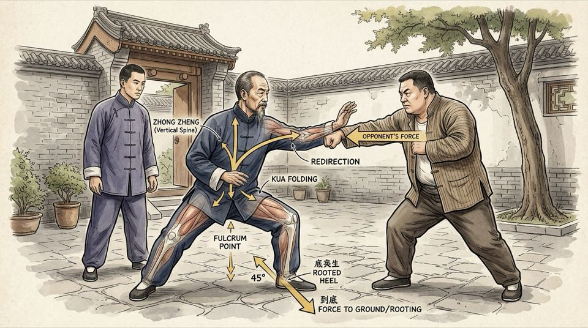

# Bab 1: Dari Desa Chenjiagou ke Jinan — Sejarah & Silsilah Transmisi Practical Method

> 📖 Hub Buku: **[Chen Style Taijiquan Practical Method: Sejarah, Filosofi Mekanika & Panduan Latihan Shiyong Quanfa](index.md)**

---

## 📖 Narasi Pembuka & Latar Belakang (The Narrative Context)

Pada suatu sore yang dingin di Beijing tahun 1930, seorang pemuda berusia 23 tahun berperawakan kurus dan berwajah pucat melangkah ragu memasuki sebuah halaman tradisional di kawasan barat kota. Pemuda itu bernama Hong Junsheng (洪均生). Di usianya yang masih sangat muda, tubuhnya telah digerogoti penyakit tuberkulosis paru-paru kronis, radang selaput dada, dan kelemahan saraf menahun yang membuatnya nyaris tak sanggup menaiki tangga tanpa tersengal-sengal [[1]](#ref-1), [[2]](#ref-2). Dokter-dokter medis barat maupun sinshe tradisional di Beijing telah angkat tangan; mereka memperkirakan sisa umurnya tidak akan bertahan lama jika daya tahan tubuhnya tidak segera diperbaiki.

Di halaman itu, ia diperkenalkan kepada seorang pria paruh baya bertubuh gempal, tenang, dan berpakaian jubah katun sederhana khas pedesaan Provinsi Henan: Grandmaster Chen Fake (陈发科, 1887–1957), keturunan generasi ke-17 dari keluarga pencipta Taijiquan. Dua tahun sebelumnya, pada tahun 1928, Chen Fake tiba di Beijing atas undangan para pejabat dan praktisi seni bela diri terkemuka di ibu kota setelah keponakannya, Chen Zhaopei (陈照丕), harus bertolak ke Nanjing. Saat pertama kali Chen Fake tiba, publik ibu kota memandang sebelah mata: bagaimana mungkin aliran pedesaan dari Desa Chenjiagou (陈家沟), Wenxian, dapat menandingi kemasyhuran aliran Yang dan petarung Baguazhang serta Xingyiquan yang telah merajai panggung bela diri Beijing selama beberapa dekade? [[4]](#ref-4), [[5]](#ref-5).

Jawaban Chen Fake tidak disampaikan melalui sesumbar kata, melainkan melalui serangkaian pertarungan terbuka tanpa aturan (*lei tai*) di kediamannya. Para penantang terbaik ibu kota—mulai dari ahli gulat Mongol, petinju muslim Chaquan, hingga master tenaga dalam—datang menguji kekuatannya. Dalam setiap tantangan, Chen Fake tidak pernah sekalipun memukul secara brutal atau mencederai lawannya. Dengan senyum tipis dan gerakan tubuh yang nyaris tak kasatmata, setiap serangan lawan yang menyentuh tubuhnya justru terpental melayang ke dinding seolah terlempar oleh pusaran air bah atau pegas raksasa yang mendadak terlepas [[2]](#ref-2), [[5]](#ref-5). Reputasinya menyebar bak api di padang ilalang: *"Chen Fake tidak terkalahkan di Beijing, namun tidak pernah melukai martabat lawannya."*

Hong Junsheng menyaksikan keajaiban mekanika tersebut bukan sebagai tontonan mistis, melainkan sebagai harapan hidup. Ia berlutut menjadi murid resmi (*tudi*) Chen Fake dan berikrar mendedikasikan hidupnya untuk meneliti rahasia di balik gerakan tuannya. Selama 15 tahun tanpa putus (1930–1944), Hong mendampingi Chen Fake setiap hari di Beijing. Hubungan mereka bukan sekadar hubungan guru dan murid biasa, melainkan laboratorium berjalan: Hong mencatat setiap instruksi lisan, menanyakan alasan di balik setiap sudut lengan, dan merasakan langsung bagaimana gaya dorong diuraikan pada tubuh Chen Fake [[1]](#ref-1), [[2]](#ref-2).

Ketika perang dan gelombang perubahan politik memaksa Hong Junsheng pindah ke Kota Jinan, Provinsi Shandong pada tahun 1944, transmisi itu tidak terputus. Hong terus berlatih dan mengajar dalam keheningan selama 12 tahun. Pada tahun 1956, menyadari usianya yang menua dan rindu akan bimbingan sang guru, Hong Junsheng mengumpulkan tabungan yang pas-pasan untuk kembali ke Beijing selama beberapa bulan guna menjalani verifikasi terakhir (*testing and refining*) langsung di hadapan Chen Fake yang sudah sepuh [[1]](#ref-1). 

Di hadapan sang master, Hong memperagakan seluruh jurus (*Yilu* dan *Erlu*) serta teknik *Tuishou* (dorong tangan) yang telah ia formulasikan secara rasional. Chen Fake mengamati dengan mata tajam, tersenyum bangga, dan menegaskan pengesahannya: 
> *"Junsheng, kamu tidak menyia-nyiakan 15 tahun bersamaku. Pemahamanmu tentang detail mekanika bahkan melampaui apa yang mampu kuartikulasikan dengan kata-kata. Inilah bentuk latihan yang sesungguhnya."* [[1]](#ref-1), [[2]](#ref-2).

Pengesahan historis tahun 1956 inilah yang melahirkan entitas yang kelak dikenal dunia sebagai **Chen Style Taijiquan Practical Method (*Shiyong Quanfa* / 陈式太极拳实用拳法)**.

---

<div align="center">
  
  <p><sub><em>Ilustrasi Bab 1: Grandmaster Chen Fake mendemonstrasikan struktur kuda-kuda rendah, tulang belakang vertikal (Zhong Zheng), pelipatan Kua, dan pengalihan vektor dorong lawan 45° menuju tumit belakang di hadapan Hong Junsheng (Beijing, 1930-an).</em></sub></p>
</div>

---

## 🔬 Teardown Konsep & Wawasan Utama (Deep-Dive Insights)

```text
┌────────────────────────────────────────────────────────────────────────┐
│             GARIS TRANSMISI RESMI SHIYONG QUANFA (PRACTICAL METHOD)    │
└────────────────────────────────────────────────────────────────────────┘
                       CHEN WANGTING (Abad ke-17)
              Panglima Militer Dinasti Ming / Awal Qing
              Pencipta 7 Taolu Awal Taiji di Desa Chenjiagou
                                    │
                                    ▼
                     CHEN CHANGXING (1771–1853)
              Generasi ke-14; Menggabungkan Taolu menjadi 
              Dua Bingkai Utama: Yilu (Frame 1) & Erlu (Frame 2)
              (Guru dari Yang Luchan, pendiri Yang Style)
                                    │
                                    ▼
                      CHEN YANXI (Generasi ke-16)
              Ayahanda Chen Fake; Master Ternama Senjata Tombak & Pedang
                                    │
                                    ▼
                      CHEN FAKE (1887–1957)
              Generasi ke-17; Membawa Seni Chen ke Beijing (1928)
              Mengembangkan Teknik Micro-Spiral & Combat Applications
                                    │
                                    ▼
                     HONG JUNSHENG (1907–1996)
              Murid Terlama Chen Fake (15 Tahun di Beijing + Uji 1956)
              Mengodifikasikan "Practical Method" & Menulis Shiyong Quanfa
                                    │
                                    ▼
                     CHEN ZHONGHUA (Lahir 1961)
              Pewaris Internasional Garis Transmisi Hong Junsheng
              Mendirikan Daqingshan & Menerjemahkan Risalah ke Dunia Modern
```

---

### 1. Rekonstruksi Historis: Chen Wangting vs Mitos Taois Zhang Sanfeng

Selama lebih dari dua abad, sejarah asal-usul Taijiquan diselimuti mitos populer tentang seorang petapa Taois semi-legendaris bernama Zhang Sanfeng di Gunung Wudang yang konon terinspirasi menciptakan jurus setelah menyaksikan pertarungan antara burung bangau dan ular [[4]](#ref-4), [[6]](#ref-6). Mitos ini sengaja dipelihara oleh sebagian praktisi abad ke-19 dan awal abad ke-20 untuk memberi aura kesucian spiritual dan menarik minat kaum bangsawan Dinasti Qing.

Namun, penelitian historiografi modern yang dipelopori oleh sejarawan wushu terkemuka **Tang Hao (唐豪)** dan **Gu Liuxin (顾留馨)** pada dekade 1930 hingga 1960-an membongkar tuntas mitos tersebut melalui penyelidikan dokumen silsilah keluarga Chen di Wenxian (*Chenshi Jiapu* / 陈氏家谱) [[4]](#ref-4). Pencipta sejati Taijiquan adalah **Jenderal Chen Wangting (陈王廷, ±1600–1680)**, seorang perwira militer garnisun pada akhir Dinasti Ming.

Setelah runtuhnya Dinasti Ming dan berdirinya Dinasti Qing, Chen Wangting pensiun dari kehidupan militer dan menetap di Desa Chenjiagou. Dengan memadukan:
1. **Taktik tempur 32 postur dari risalah militer Jenderal Qi Jiguang** (*Ji Xiao Xin Shu* / 纪效新书) [[4]](#ref-4),
2. **Teori sirkulasi energi dan jalur meridian Pengobatan Tradisional Tiongkok (TCM)** seperti risalah *Huangdi Neijing* [[3]](#ref-3), dan
3. **Filsafat gerak dialektika Yin-Yang dari Kitab Perubahan (*I Ching*)**,

Chen Wangting menciptakan serangkaian sistem latihan bela diri terpadu yang terdiri dari 7 rangkaian jurus (*Taolu*), teknik dorong tangan berpasangan (*Tuishou*), serta latihan senjata tombak perekat (*Zhanqiang*) [[3]](#ref-3), [[4]](#ref-4).

---

### 2. Dari Chenjiagou ke Beijing: Mengapa Chen Fake Mengubah Paradigma?

Pada masa generasi ke-14 melalui **Chen Changxing (陈长兴, 1771–1853)**, kurikulum Chen disederhanakan dari tujuh rangkaian menjadi dua rangkaian utama: **Yilu (Jurus Pertama / Bingkai Utama)** dan **Erlu Paochui (Jurus Kedua / Tinju Meriam)** [[4]](#ref-4), [[5]](#ref-5). Di era inilah Yang Luchan mempelajari seni keluarga Chen sebelum kembali ke Beijing dan mendirikan aliran Yang yang gerakannya diperlebar dan diperlembut untuk konsumsi keluarga istana.

Ketika Chen Fake tiba di Beijing pada tahun 1928, ia menemukan jurus-jurus Taiji yang beredar di masyarakat luas telah kehilangan taring bela dirinya (*martial integrity*). Banyak gerakan telah diubah menjadi sekadar tarian lambat yang membuang unsur kuncian sendi (*Qin Na*), sapuan kaki (*Shuai*), dan ledakan tenaga (*Fa Jin*) [[1]](#ref-1), [[2]](#ref-2).

Chen Fake tidak berniat mendirikan aliran baru. Namun, dalam menghadapi para penantang tangguh di ibu kota metropolitan, ia melakukan evolusi metodologis yang krusial:
- **Pengecilan Diameter Lingkaran (*Compact Frames*)**: Chen Fake menyadari bahwa lingkaran besar (*Da Jia*) yang terbuka sangat rentan disusupi oleh petarung cepat. Ia memperkecil lingkaran gerakan hingga setaraf kepalan tangan dan siku (*Zhong Jia* / *Xiao Jia*) tanpa mengurangi rentang tenaga [[1]](#ref-1), [[2]](#ref-2).
- **Penambahan Spiral Ganda (*Micro-Chansijin*)**: Di setiap postur tunggal, Chen Fake menambahkan putaran mikro pergelangan tangan, lipatan *Kua*, dan rotasi tumit yang sebelumnya tidak terlihat jelas dalam demonstrasi lambat di desa [[1]](#ref-1).

---

### 3. Mengapa Disebut "Practical Method" (*Shiyong Quanfa*)?

Nama **Chen Style Taijiquan Practical Method** bukanlah trik pemasaran modern. Istilah ini dicetuskan langsung oleh Hong Junsheng untuk merangkum esensi dari apa yang diajarkan Chen Fake pada masa senjanya (*wannian chuanshou* / 晚年传授) [[2]](#ref-2).

Dalam buku monumentalnya terbitan 1989 di Jinan, Hong menegaskan dua kriteria utama mengapa sistem ini dinamai *Shiyong Quanfa*:
1. **Setiap Titik Memiliki Fungsi Nyata (*Shiyong*)**: Di dalam *Taolu* Practical Method, tidak ada satupun gerakan yang berfungsi sebagai dekorasi, tarian estetika panggung, atau pengisi waktu transisi. Setiap kali jemari berputar 15 derajat, itu adalah gerakan mengurai kuncian pergelangan tangan lawan. Setiap kali pinggul bergeser ke bawah, itu adalah aksi meruntuhkan pusat gravitasi lawan [[1]](#ref-1), [[2]](#ref-2).
2. **Metode yang Konsisten dan Bebas Kontradiksi (*Fa*)**: Gerakan saat melatih jurus sendirian (*solo form*) persis identik dengan gerakan saat berhadapan dengan lawan (*combat application*). Di banyak perguruan lain, seseorang melatih jurus dengan cara A (lembut dan lebar), namun ketika bertarung beralih ke cara B (tinju acak dan gulat kasar). Practical Method menuntut ketepatan geometris: *"Bagaimana Anda berlatih Yilu, persis seperti itulah Anda mengunci dan melempar lawan di arena"* [[1]](#ref-1).

---

### 4. Transmisi ke Abad ke-21: Peran Chen Zhonghua & Daqingshan

Setelah wafatnya Chen Fake pada tahun 1957 dan badai Revolusi Kebudayaan di Tiongkok, Hong Junsheng terus menjaga api kemurnian transmisi ini di Jinan. Salah satu murid terdekat yang mewarisi seluruh kedalaman sistem ini adalah **Chen Zhonghua (陈中华)**, yang mulai belajar intensif di bawah bimbingan Hong Junsheng sejak tahun 1979 hingga wafatnya Hong pada tahun 1996 [[1]](#ref-1).

Chen Zhonghua, yang berlatar belakang pendidikan linguistik dan akademis, menyadari bahwa ajaran lisan Hong Junsheng yang luar biasa kaya terancam hilang jika tidak diterjemahkan ke dalam bahasa mekanika modern yang dapat diakses oleh dunia internasional. Bersama Hong, Chen Zhonghua menerjemahkan dan menyusun karya agung berbahasa Inggris *Chen Style Taijiquan Practical Method: Volume One — Theory* (2006) [[1]](#ref-1).

Chen Zhonghua kemudian mendirikan pusat pelatihan internasional di Gunung Daqingshan (大青山), Provinsi Shandong, di mana praktisi dari seluruh penjuru dunia datang untuk menguji keabsahan mekanika tubuh ini melalui latihan fisik intensif ribuan repetisi harian [[1]](#ref-1).

---

## 🧠 Eksperimen Pikiran & Contoh Kasus di Dunia Nyata

### Kasus Historis 1: Chen Fake dan Ahli Gulat di Teater Xidan (Beijing, 1932)
Suatu sore di Teater Xidan, seorang juara gulat tradisional Tiongkok (*Shuai Jiao*) bertubuh kekar menantang Chen Fake. Pegulat tersebut maju dengan cepat, mencengkeram pergelangan tangan kanan Chen Fake dengan kedua tangannya yang berkekuatan luar biasa, lalu bersiap memutar pinggulnya untuk membanting Chen Fake ke lantai.

Alih-alih menarik tangannya ke belakang (respons panik alami manusia yang melawan tenaga dengan tenaga), Chen Fake justru **mengunci sikunya sebagai titik tumpu (*fulcrum*)** dan memutar lengan bawahnya ke dalam (*positive circle* mikro) sambil melipat lipatan paha kirinya (*Kua*). Pegulat tersebut seketika kehilangan tumpuan kakinya (*uprooted*), terangkat melayang beberapa jengkal dari tanah, dan terhempas telentang di atas karpet tanpa Chen Fake melangkah mundur seinci pun [[2]](#ref-2). Ketika ditanya oleh Hong Junsheng bagaimana itu terjadi, Chen Fake menjawab: *"Lawan memberi saya poros; saya hanya meminjam porosnya untuk memutar roda tubuh saya."*

### Kasus Modern: Ujian Struktur Hong Junsheng di Taman Mawar Jinan (1982)
Pada dekade 1980-an, banyak praktisi bela diri muda dari Jepang dan Eropa yang mengunjungi Jinan meragukan apakah kakek berusia 75 tahun bertubuh pendek dan mengenakan kacamata tebal seperti Hong Junsheng benar-benar bisa bertarung. Hong sering meminta para tamu muda yang berbobot lebih dari 90 kg untuk meletakkan kedua telapak tangan mereka di dadanya dan mendorong sekuat tenaga dengan aba-aba hitungan tiga [[1]](#ref-1).

Ketika dorongan bertenaga penuh dilepaskan, Hong tidak tegang menahan dorongan tersebut. Melalui rotasi mikro pada tulang belakang dan penguncian sudut 45 derajat ke tumit belakang, gaya dorong 90 kg tersebut dialirkan langsung menembus lantai beton. Detik berikutnya, saat lawan kehabisan dorongan dan tertahan oleh lantainya sendiri, Hong memutar sedikit *Kua*-nya. Tanpa ayunan tangan, dorong lawan terpental ke belakang sejauh dua meter. Ini adalah bukti empiris bahwa hukum aksi-reaksi Newton bekerja mutlak di dalam Practical Method [[1]](#ref-1), [[8]](#ref-8).

---

## ⚡ Panduan Aksi Nyata dari Bagian Ini (Action Checklist)

1. [ ] **Hormati Silsilah Melalui Kejujuran Gerak**: Pahami bahwa Anda mewarisi seni bela diri militer yang diuji dengan darah dan reputasi nyata, bukan tarian fantasi mistis. Bersikaplah jujur terhadap struktur tubuh Anda saat berlatih.
2. [ ] **Hindari Sinkretisme yang Mengaburkan**: Jangan mencampuradukkan instruksi Practical Method dengan instruksi aliran Taiji lain yang bertolak belakang (misalnya: jangan melonggarkan siku jika Practical Method mewajibkan siku terkunci pada jarak tertentu; jangan mengayun bahu jika Practical Method melarang bahu bergerak independen) [[1]](#ref-1).
3. [ ] **Baca Kanon Asli**: Luangkan waktu mempelajari teks klasik Chen Xin (*Chenshi Taijiquan Tushuo*) dan buku teks Hong Junsheng (*Shiyong Quanfa*) untuk memahami istilah bahasa Mandarin aslinya secara akurat [[2]](#ref-2), [[3]](#ref-3).

---

## 💬 Kutipan Pilihan & Catatan Reflektif

> *"Saya menghabiskan 15 tahun belajar dari guru saya, Chen Fake. Saya tidak pernah melihat beliau memamerkan tenaga mistis atau berbicara tentang hal-hal gaib. Beliau selalu berbicara tentang sudut, jarak, berat badan, dan titik tumpu. Jika Anda tidak bisa menjelaskan bela diri Anda dengan hukum alam dan mekanika fisik, Anda sesungguhnya belum memahaminya."*  
> — **Grandmaster Hong Junsheng (洪均生)** [[1]](#ref-1), [[2]](#ref-2)

**Pertanyaan Refleksi Diri**:
- *Apakah selama ini Anda berlatih Taiji dengan harapan mendapatkan "tenaga ajaib instan", ataukah Anda siap membongkar kebiasaan buruk tubuh Anda melalui ketelitian mekanika tulang yang melelahkan?*

---

## 📚 Daftar Pustaka Bab 1

- <a id="ref-1"></a>**[1]** **Hong Junsheng (洪均生).** *Chen Style Taijiquan Practical Method: Volume One — Theory* (Terjemahan Inggris oleh Chen Zhonghua). Edmonton, AB: Hunyuantaiji Press; 2006. ISBN: 978-0-9730045-5-7.
- <a id="ref-2"></a>**[2]** **Hong Junsheng (洪均生).** *Chen Shi Taijiquan Shiyong Quanfa: Shiqidai Zongshi Chen Fake Wannian Chuanshou Jiji Jingcui* (陈式太极拳实用拳法). Jinan: Shandong Science and Technology Publishing House; 1989. ISBN: 978-7-5331-0640-9.
- <a id="ref-3"></a>**[3]** **Chen Xin (陈鑫).** *The Illustrated Canon of Chen Family Taijiquan* (陈式太极拳图说 / *Chenshi Taijiquan Tushuo*). Melbourne: INBI Matrix Pty Ltd; 2007. ISBN: 978-5-98687-008-3.
- <a id="ref-4"></a>**[4]** **Tang Hao (唐豪), Gu Liuxin (顾留馨).** *Taijiquan Yanjiu* (太极拳研究). Beijing: People's Sports Publishing House; 1964.
- <a id="ref-5"></a>**[5]** **Sim DSV, Gaffney D.** *Chen Style Taijiquan: The Source of Taiji Boxing*. Berkeley, CA: North Atlantic Books; 2002. ISBN: 978-1-55643-377-1.
- <a id="ref-6"></a>**[6]** **Wile D.** *Lost T'ai-chi Classics from the Late Ch'ing Dynasty*. Albany, NY: State University of New York Press; 1996. ISBN: 978-0-7914-2654-8.
- <a id="ref-8"></a>**[8]** **Hua H, Zhu D, Wang Y.** Comparative Study on the Joint Biomechanics of Different Skill Level Practitioners in Chen-Style Tai Chi Punching. *Int J Environ Res Public Health*. 2022;19(10):5915. doi:[10.3390/ijerph19105915](https://doi.org/10.3390/ijerph19105915).

---

## 🧭 Navigasi Bab Selanjutnya

📖 **[Kembali ke Hub Buku (Index)](index.md)** &nbsp;&nbsp;|&nbsp;&nbsp; ➡️ **[Lanjut ke Bab 2: Mendemistifikasi Taiji — Filosofi Mekanika, Roda Gigi & Pemisahan Yin-Yang](02-filosofi-mekanika-dan-roda-gigi.md)**
