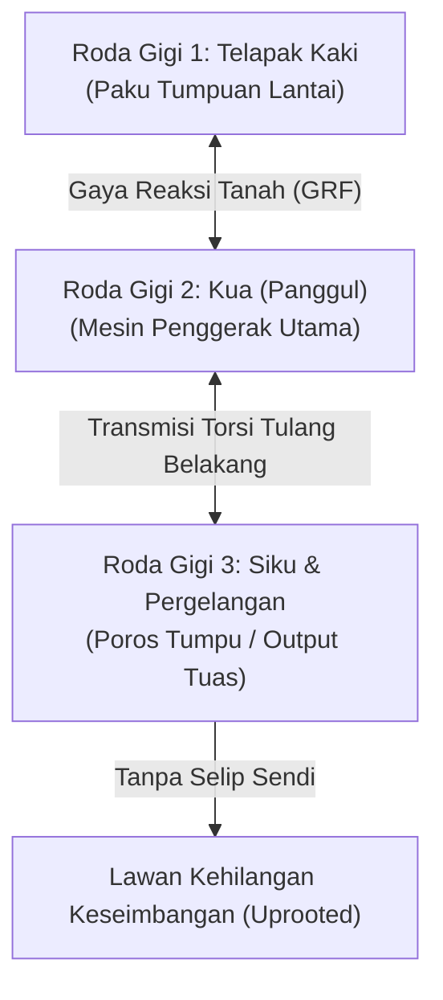

# Bab 2: Mendemistifikasi Taiji — Filosofi Mekanika, Roda Gigi & Pemisahan Yin-Yang

> 📖 Hub Buku: **[Chen Style Taijiquan Practical Method: Sejarah, Filosofi Mekanika & Panduan Latihan Shiyong Quanfa](index.md)**

---

## 📖 Narasi Pembuka & Latar Belakang (The Narrative Context)

Bayangkan Anda sedang berdiri di hadapan sebuah pintu kayu jati kuno yang sangat berat. Pintu itu terkunci engselnya di sisi kiri. Ketika seseorang mendorong bagian tengah daun pintu dengan sekuat tenaga, apa yang terjadi? Jika engsel pintu kokoh tertanam di kusen dinding, seluruh dorongan orang tersebut tidak akan mampu merobohkan pintu; sebaliknya, dorongan itu justru akan memutar daun pintu mengelilingi engselnya, dan ujung kanan pintu yang bebas akan berayun ke depan dengan momentum berlipat ganda, menghantam apapun yang berada di jalurnya.

Sekarang, bayangkan skenario kedua: seseorang mendorong pintu tersebut, namun baut engselnya longgar dan goyang. Ketika didorong, engselnya bergeser mundur, kusennya melengkung, dan seluruh daun pintu ambruk menimpa lantai.

Analogi pintu dan engsel inilah yang selalu digunakan oleh Grandmaster Chen Zhonghua saat mengajar di seminar internasional untuk menjelaskan paradoks terbesar dalam **Chen Style Taijiquan Practical Method** [[1]](#ref-1). Di dunia bela diri tradisional, banyak praktisi diajarkan bahwa Taiji adalah seni "melembut seperti kapas", "mengikuti kemauan lawan tanpa perlawanan", dan "mengalirkan energi kosmik *Qi* melalui visualisasi pikiran" [[6]](#ref-6). Akibatnya, ketika menerima dorongan keras dari petarung tinju atau gulat modern, praktisi Taiji yang salah kaprah ini melonggarkan seluruh tubuhnya—mereka menjadi seperti pintu dengan engsel yang copot. Begitu tersentuh, tubuh mereka langsung terlipat, kehilangan keseimbangan, dan terhempas ke lantai.

Practical Method menolak mistisisme verbal yang menyesatkan tersebut. Bagi Hong Junsheng dan Chen Zhonghua, Taijiquan bukanlah sihir okultisme, melainkan **ilmu fisika terapan dan rekayasa mekanika tuas (*applied physics and lever mechanics*)** [[1]](#ref-1), [[2]](#ref-2). Di dalam buku ini, konsep abstrak *Yin* dan *Yang* yang selama ribuan tahun diselimuti kabut filsafat diurai menjadi definisi teknik yang presisi: *Yin* adalah titik tumpu (*fulcrum*) yang diam absolut, sedangkan *Yang* adalah lengan tuas (*lever arm*) yang berputar melakukan kerja. Jika Anda tidak bisa memisahkan mana bagian tubuh yang menjadi engsel dan mana bagian yang menjadi daun pintu, bela diri Anda hanyalah ilusi angan-angan [[1]](#ref-1).

---

## 🔬 Teardown Konsep & Wawasan Utama (Deep-Dive Insights)

```text
┌────────────────────────────────────────────────────────────────────────┐
│             ARSITEKTUR FISIKA TUAS DALAM PRACTICAL METHOD              │
└────────────────────────────────────────────────────────────────────────┘
              [GAYA DORONG LAWAN] (F_in)
                       │
                       ▼
             ┌───────────────────┐  <--- Titik Kontak (Lengan Bawah)
             │   TITIK TUMPU     │       DIKUNCI MENJADI TITIK DIAM (YIN)
             │  (FULCRUM / AXIS) │       Aturan Besi: "BU DONG" (DON'T MOVE)
             └─────────┬─────────┘
                       │
         ┌─────────────┴─────────────┐
         ▼                           ▼
 ┌───────────────┐           ┌───────────────┐
 │  LENGAN TUAS  │           │ TRANSMISI RODA│
 │   INTERNAL    │           │  GIGI (KUA)   │
 │   (Kaki &     │           │ Rotasi Panggul│
 │  Sudut 45°)   │           │   & Pinggang  │
 └───────┬───────┘           └───────┬───────┘
         │                           │
         └─────────────┬─────────────┘
                       │
                       ▼
           [GAYA REAKSI BALIK] (F_out)
        Lawan Terangkat & Terpental (Uprooted)
        Tanpa Sedikitpun Menghantam Otot
```

---

### 1. Demistifikasi Konsep Qi: Dari Mistisisme ke Rantai Fasial & Sudut Tulang

Dalam literatur bela diri Tiongkok populer, kata *Qi* (气) sering diterjemahkan secara keliru sebagai "energi gaib" yang dapat ditembakkan seperti proyektil tak terlihat [[6]](#ref-6). Di dalam *Practical Method*, Hong Junsheng menolak keras takhayul ini. Berdasarkan bimbingan Chen Fake selama 15 tahun, Hong menegaskan bahwa *Qi* dalam konteks bela diri praktis mengacu pada dua hal konkret [[1]](#ref-1), [[2]](#ref-2):
1. **Regulasi Respirasi Diafragma & Tekanan Intra-Abdominal (*Intra-Abdominal Pressure* / IAP)**: Pernapasan perut bagian bawah yang dalam dan tenang, menstabilkan rongga panggul dan tulang belakang lumbar (*Yao*) sehingga tubuh bagian atas tetap rileks tanpa membebani bahu [[10]](#ref-10).
2. **Keterhubungan Jalur Fasia Tubuh (*Myofascial Meridians*)**: Jaringan ikat fasia yang menyelimuti seluruh otot dan rangka tubuh manusia bekerja sebagai satu kesatuan jaring elastis yang terintegrasi (sesuai model anatomi fasia modern) [[10]](#ref-10). Ketika satu titik di tangan ditarik, ketegangan terdistribusi merata hingga ke telapak kaki tanpa terputus di persendian.

Apa yang dirasakan lawan sebagai "tenaga dalam yang dahsyat" sejatinya adalah **gaya reaksi tanah (*Ground Reaction Force* / GRF)** yang diteruskan secara sempurna melalui struktur sudut tulang yang rigid namun lentur (*tensegrity*), tanpa ada tenaga yang bocor (*dissipated*) akibat tekukan sendi yang salah [[8]](#ref-8).

---

### 2. Tiga Aturan Besi Practical Method (The Three Iron Rules)

Practical Method berdiri di atas tiga hukum gerak tanpa kompromi. Pelanggaran terhadap salah satu dari ketiga aturan ini akan seketika meruntuhkan struktur seorang praktisi [[1]](#ref-1):

#### Aturan I: "Jangan Bergerak" (*Bu Dong* / 不动)
Ketika lawan menyentuh atau mendorong lengan Anda, reaksi insting primitif manusia adalah menarik lengan itu menjauh (lari) atau mendorong balik lengan itu ke depan (adu otot). Practical Method melarang kedua reaksi tersebut. Titik yang disentuh lawan harus **dikunci menjadi titik poros mati (*fixed point / fulcrum*)** [[1]](#ref-1). 
- Jika titik kontak bergerak maju, Anda melakukan agresi buta yang mudah ditarik lawan.
- Jika titik kontak bergerak mundur, struktur Anda runtuh dan lawan akan merangsek masuk.
- Solusinya: **Titik kontak tidak bergerak seinci pun**, sementara bagian tubuh Anda yang lain (pinggul/*Kua*, tulang belakang, kaki) berputar mengelilingi titik kontak tersebut seperti roda berputar pada porosnya [[1]](#ref-1).

#### Aturan II: "Jangan Melawan Tenaga dengan Tenaga" (*Bu Kang* / 不抗)
Menolak adu ketegangan isometrik antar-otot. Jika lawan mendorong dengan bobot 80 kg, mengeraskan otot lengan hanya akan menciptakan benturan massa vs massa, di mana yang berotot lebih besarlah yang menang. Practical Method menggunakan prinsip **Divergensi Sudut (Angle Redirection)**: dengan mempertahankan sudut 45 derajat pada siku dan lutut, vektor gaya lawan yang lurus dibelokkan menjadi gerak tangensial melingkar tanpa pernah menyentuh otot praktisi [[1]](#ref-1), [[8]](#ref-8).

#### Aturan III: Regangan Dua Arah yang Berlawanan (*Dui La* / 对拉)
Setiap kali ada satu bagian tubuh yang bergerak ke arah tertentu, harus ada bagian tubuh pasangan yang bergerak ke arah yang persis berlawanan secara serentak [[1]](#ref-1), [[3]](#ref-3):
- Jika tangan kanan bergerak maju ke depan, pinggul kanan (*Kua*) atau tumit belakang harus tenggelam menarik ke belakang.
- Jika kepala terangkat ke atas (*Xu Ling Ding Jin*), tulang ekor (*Wei Lu*) harus jatuh ke bawah menunjuk bumi.
- Jika siku kanan bergerak ke kanan, dada atau rusuk kiri harus meregang ke kiri.

Prinsip *Dui La* memastikan bahwa pusat massa tubuh (*Center of Mass* / COM) tidak pernah bergeser keluar dari bidang tumpuan kaki, mencegah tubuh praktisi terjungkal saat menyalurkan tenaga ledak (*Fa Jin*) [[1]](#ref-1), [[7]](#ref-7).

---

### 3. Model Roda Gigi (The Interlocking Gears Theory)

Salah satu kontribusi analitis terbesar Chen Zhonghua dalam menjelaskan ajaran Hong Junsheng adalah **Teori Roda Gigi Jam Mekanis (*Clockwork Gear Transmission*)** [[1]](#ref-1).

Tubuh manusia dalam Practical Method dipandang sebagai susunan roda-roda gigi yang saling bertaut:
- Telapak kaki = Roda gigi 1
- Pergelangan kaki & Lutut = Roda gigi 2
- Sendi Panggul (*Kua*) = Roda gigi penggerak utama (*Main Drive Gear*)
- Tulang Belakang (*Yao*) = Poros transmisi
- Belikat & Bahu = Roda gigi sekunder
- Siku & Pergelangan tangan = Roda gigi output



**Hukum Roda Gigi Tanpa Selip (*No-Slippage Law*)**:
Dalam sebuah jam mekanis, jika dua roda gigi bertaut, Anda tidak bisa memutar salah satu roda tanpa membuat roda lainnya ikut berputar ke arah yang berlawanan. Jika Anda memaksakan satu roda berputar sementara roda pasangannya diam, gerigi jam tersebut akan patah atau selip (*slipping*).

Di dalam latihan Practical Method:
- Ketika tangan Anda berputar ke dalam (*Inward Silk-Reeling* / *Positive Circle*), panggul (*Kua*) Anda secara serentak **harus berputar membuka ke arah luar** [[1]](#ref-1).
- Jika tangan Anda bergerak tetapi pinggul Anda diam, atau pinggul Anda bergerak tetapi kaki Anda tidak memutar tanah, telah terjadi **kebocoran transmisi (*structural slippage*)** [[1]](#ref-1).

---

### 4. Pemisahan Yin dan Yang Secara Absolut: Menghindari Dosa "Shuang Zhong" (Beban Ganda)

Teks klasik Taiji abad ke-18 yang dinisbatkan kepada Wang Zongyue memperingatkan bahaya paling fatal dalam Taijiquan: **Shuang Zhong (双重 / Double Heavy)** [[6]](#ref-6). Di banyak perguruan, *Shuang Zhong* hanya dipahami secara dangkal sebagai "membagi berat badan 50:50 pada kedua kaki".

Hong Junsheng membongkar bahwa *Shuang Zhong* jauh lebih mendalam dari sekadar persentase berat kaki. *Shuang Zhong* adalah **kebingungan fungsional antara Yin dan Yang pada satu segmen sendi yang sama** [[1]](#ref-1), [[2]](#ref-2):
- Jika Anda mencoba menahan dorongan lawan (fungsi pasif/poros) sekaligus memukul lawan dengan lengan yang sama pada saat bersamaan (fungsi aktif), lengan Anda menjadi kaku karena otot agonis dan antagonis berkontraksi serentak. Ini adalah *Shuang Zhong* sejati [[8]](#ref-8).
- **Aturan Pemisahan Mutlak**: Satu titik hanya boleh melakukan SATU fungsi pada satu satuan waktu. Titik kontak tangan bertindak murni sebagai **poros mati (*Yin*)**, sementara dorongan dihasilkan sepenuhnya oleh **rotasi panggul dan dorongan kaki (*Yang*)** [[1]](#ref-1).

---

## 🧠 Eksperimen Pikiran & Contoh Kasus di Dunia Nyata

### Eksperimen Tuas Archimedes: Mengapa Mengangkat Mobil dengan Dongkrak Terasa Ringan?
Archimedes pernah berkata: *"Beri aku titik tumpu yang kokoh dan tuas yang cukup panjang, maka aku akan menggerakkan bumi."* Dongkrak hidrolik mobil memungkinkan seorang anak kecil mengangkat kendaraan seberat 1,5 ton. Mengapa? Karena anak kecil tersebut tidak mengangkat mobil secara langsung; ia hanya memompa tuas di atas titik tumpu hidrolik yang terkunci mati pada tanah.

Di dalam Practical Method, lawan Anda yang berotot besar adalah mobil 1,5 ton tersebut. Jika Anda mencoba mendorongnya dengan otot dada Anda, Anda akan kalah. Namun, jika pergelangan tangan Anda menjadi engsel dongkrak, panggul Anda menjadi pompa tuas, dan lantai beton menjadi fondasi penahan beban, dorongan seberat apapun dari lawan akan berbalik mengangkat kedua telapak kakinya sendiri keluar dari tanah (*uprooting*) [[1]](#ref-1).

### Studi Kasus Biomekanika: Analisis Kinematika Pukulan Chen Style (Hua dkk., 2022)
Sebuah penelitian terindeks PubMed oleh Hua, Zhu, dan Wang (2022) menggunakan sistem penangkap gerak 3D (*3D Vicon Motion Capture*) dan pelat penekan gaya (*Kistler Force Plates*) untuk membandingkan praktisi elit Chen Style Taiji dengan praktisi pemula saat melakukan hentakan tenaga [[8]](#ref-8).

Temuan penelitian menunjukkan:
- Praktisi pemula menghasilkan gaya dorong dominan dari kontraksi otot deltoid (bahu) dan trisep lengan atas (pola eksternal), dengan koordinasi intermuskular yang buruk dan lonjakan gaya tumpuan kaki yang tidak stabil.
- Sebaliknya, praktisi tingkat lanjut menunjukkan aktivitas otot bahu yang sangat minim (relaksasi efektif), namun mencatatkan **kecepatan sudut sendi panggul (*hip angular velocity*)** dan **penyaluran gaya reaksi tanah (GRF) vertikal-ke-anterior** yang secara signifikan lebih tinggi (*p* < 0,01) [[8]](#ref-8).
- Data ini secara empiris mengonfirmasi dalil Hong Junsheng: *"Kekuatan Taiji tidak tinggal di lengan; lengan hanyalah pipa besi penghantar yang menghubungkan panggul ke sasaran"* [[1]](#ref-1), [[2]](#ref-2).

---

## ⚡ Panduan Aksi Nyata dari Bagian Ini (Action Checklist)

1. [ ] **Hilangkan Reaksi Menarik Tangan**: Saat seseorang memegang kerah baju atau pergelangan tangan Anda, tahan keinginan bawah sadar untuk menyentak tangan ke belakang. Terapkan aturan *Bu Dong*: jadikan pergelangan tangan Anda paku yang diam di udara, lalu putar tubuh Anda mengitarinya [[1]](#ref-1).
2. [ ] **Audit Yin-Yang Harian**: Tanyakan pada diri Anda setiap kali melakukan jurus *Taolu*: *"Di mana titik tumpu (Yin) saya saat ini? Dan segmen mana yang sedang bertindak sebagai penggerak (Yang)?"* Jika jawabannya tidak jelas, ulangi gerakan tersebut secara perlahan [[1]](#ref-1).
3. [ ] **Latih Regangan Dui La**: Dalam postur akhir *Dan Bian* (Single Whip), periksa apakah saat tangan kiri membuka ke depan, panggul kanan dan tumit kanan Anda benar-benar menarik ke arah berlawanan untuk menciptakan ketegangan elastis fasia diagonal [[1]](#ref-1), [[10]](#ref-10).

---

## 💬 Kutipan Pilihan & Catatan Reflektif

> *"Pemisahan Yin dan Yang harus dilakukan hingga ke tingkat molekuler gerak. Jika ada sedikit saja kebingungan antara mana yang menopang dan mana yang bergerak, Anda telah memberikan tuas kontrol ke tangan lawan Anda."*  
> — **Grandmaster Chen Zhonghua (陈中华)** [[1]](#ref-1)

**Pertanyaan Refleksi Diri**:
- *Ketika menghadapi tekanan atau konflik dalam hidup dan pekerjaan, apakah Anda cenderung panik bereaksi (bergerak serampangan), ataukah Anda mampu mempertahankan titik tumpu ketenangan internal Anda sementara dunia berputar di sekeliling Anda?*

---

## 📚 Daftar Pustaka Bab 2

- <a id="ref-1"></a>**[1]** **Hong Junsheng (洪均生).** *Chen Style Taijiquan Practical Method: Volume One — Theory* (Terjemahan Inggris oleh Chen Zhonghua). Edmonton, AB: Hunyuantaiji Press; 2006. ISBN: 978-0-9730045-5-7.
- <a id="ref-2"></a>**[2]** **Hong Junsheng (洪均生).** *Chen Shi Taijiquan Shiyong Quanfa: Shiqidai Zongshi Chen Fake Wannian Chuanshou Jiji Jingcui* (陈式太极拳实用拳法). Jinan: Shandong Science and Technology Publishing House; 1989. ISBN: 978-7-5331-0640-9.
- <a id="ref-3"></a>**[3]** **Chen Xin (陈鑫).** *The Illustrated Canon of Chen Family Taijiquan* (陈式太极拳图说 / *Chenshi Taijiquan Tushuo*). Melbourne: INBI Matrix Pty Ltd; 2007. ISBN: 978-5-98687-008-3.
- <a id="ref-6"></a>**[6]** **Wile D.** *Lost T'ai-chi Classics from the Late Ch'ing Dynasty*. Albany, NY: State University of New York Press; 1996. ISBN: 978-0-7914-2654-8.
- <a id="ref-7"></a>**[7]** **Liu H, Gong H, Chen P, Zhang L, Cen H, Fan Y.** Biomechanical effects of typical lower limb movements of Chen-style Tai Chi on knee joint. *Med Biol Eng Comput*. 2023;61(11):3087–3101. doi:[10.1007/s11517-023-02906-y](https://doi.org/10.1007/s11517-023-02906-y).
- <a id="ref-8"></a>**[8]** **Hua H, Zhu D, Wang Y.** Comparative Study on the Joint Biomechanics of Different Skill Level Practitioners in Chen-Style Tai Chi Punching. *Int J Environ Res Public Health*. 2022;19(10):5915. doi:[10.3390/ijerph19105915](https://doi.org/10.3390/ijerph19105915).
- <a id="ref-10"></a>**[10]** **Wayne PM, Fuerst ML.** *The Harvard Medical School Guide to Tai Chi*. Boston, MA: Harvard Health Publications / Shambhala; 2013. ISBN: 978-1-59030-942-1.

---

## 🧭 Navigasi Bab Selanjutnya

⬅️ **[Bab 1: Dari Desa Chenjiagou ke Jinan — Sejarah & Silsilah Transmisi Practical Method](01-sejarah-dan-silsilah-transmisi.md)** &nbsp;&nbsp;|&nbsp;&nbsp; 📖 **[Hub Buku (Index)](index.md)** &nbsp;&nbsp;|&nbsp;&nbsp; ➡️ **[Lanjut ke Bab 3: Anatomi Struktur & Kosa Kata Teknis — Yao, Kua, Siku, dan Sudut 45 Derajat](03-anatomi-struktur-dan-kosakata-teknis.md)**
