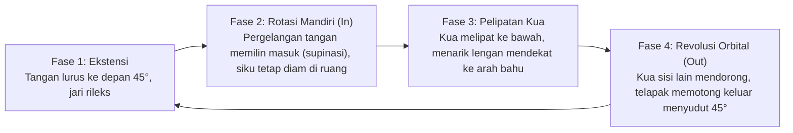

# Bab 4: Fondasi Latihan (Jibengong) — Positive/Negative Circles & Mekanika Chan Si Jin

> 📖 Hub Buku: **[Chen Style Taijiquan Practical Method: Sejarah, Filosofi Mekanika & Panduan Latihan Shiyong Quanfa](index.md)**

---

## 📖 Narasi Pembuka & Latar Belakang (The Narrative Context)

Setiap pagi di puncak bukit Gunung Daqingshan, Provinsi Shandong, sebelum kabut fajar sempat tersapu matahari terbit, puluhan murid dari berbagai belahan dunia sudah berdiri tegak di atas pelataran batu [[1]](#ref-1). Mereka tidak sedang memperagakan jurus-jurus rumit yang memukau mata penonton; mereka bahkan tidak melangkah seinci pun. Selama dua hingga tiga jam berturut-turut, yang terdengar hanyalah gesekan kain katun dan deru napas teratur saat mereka mengulangi dua gerakan tangan yang tampak sangat sederhana: **Lingkaran Positif (*Positive Circle*)** dan **Lingkaran Negatif (*Negative Circle*)** [[1]](#ref-1).

Bagi pengamat luar yang tidak paham, pemandangan ini tampak seperti latihan yang membosankan dan monoton. Mengapa seorang praktisi bela diri yang ingin bisa bertarung rela berdiri berjam-jam hanya untuk memutar tangannya dalam lingkaran kecil berdiameter 30 sentimeter?

Grandmaster Chen Fake pernah memberikan jawaban tajam saat murid-murid mudanya di Beijing memohon untuk segera diajarkan jurus kedua yang eksplosif (*Erlu Paochui*):
> *"Kalian ingin belajar melompat dan memukul cepat seperti harimau, padahal kalian belum mampu menggambar satu lingkaran yang bulat sempurna. Jurus tanpa lingkaran dasar yang presisi hanyalah tumpukan jerami kering; begitu ditiup angin kencang, ia akan tercerai-berai tak bersisa. Lingkaran adalah cetakan logamnya; jika cetakannya bengkok, semua peluru yang kalian cetak akan meleset dari sasaran."* [[1]](#ref-1), [[2]](#ref-2).

Di dalam **Chen Style Taijiquan Practical Method**, *Jibengong* (基本功 — Latihan Fondasi Dasar) bukanlah sekadar pemanasan sebelum masuk ke "menu utama". *Jibengong* adalah menu utama itu sendiri. Dalam sistem transmisi Hong Junsheng, seluruh 81 jurus *Yilu* sesungguhnya hanyalah variasi permutasi geometris dari interaksi antara Lingkaran Positif dan Lingkaran Negatif [[1]](#ref-1). Jika Anda menguasai kedua lingkaran ini hingga ke tingkat neuromuskular terdalam, jurus akan mengalir dengan sendirinya; namun jika kedua lingkaran ini cacat, ribuan repetisi jurus Anda tidak akan memiliki tenaga bela diri sedikit pun [[1]](#ref-1), [[3]](#ref-3).

---

## 🔬 Teardown Konsep & Wawasan Utama (Deep-Dive Insights)

```text
┌────────────────────────────────────────────────────────────────────────┐
│           ANATOMI DUA FASE LINGKARAN PRACTICAL METHOD                  │
└────────────────────────────────────────────────────────────────────────┘
                       [TITIK PUNCAK ATAS]
                                ▲
                                │  Fase 1: ROTASI POROS MANDIRI (Self-Rotation)
                                │  • Pronasi / Supinasi Radius-Ulna
                                │  • Siku terkunci diam (Fulcrum)
                                │
       [SISI DALAM / DADA] ◄────┼────► [SISI LUAR / 45° DIAGONAL]
                                │
                                │  Fase 2: REVOLUSI ORBITAL (Revolution)
                                │  • Didorong oleh pelipatan Kua
                                │  • Tangan menumpang pada perputaran torso
                                ▼
                      [TITIK PUNCAK BAWAH]
```

---

### 1. Pembedahan Mekanika Dua Gerak: Rotasi Mandiri vs Revolusi Orbital

Banyak praktisi bela diri menggambar lingkaran dengan mengayunkan seluruh lengannya secara utuh dari sendi bahu. Ini menghasilkan apa yang disebut Hong Junsheng sebagai "lingkaran sapuan mati" (*flat sweeping circle*) yang sangat mudah dipatahkan lawan [[1]](#ref-1).

Practical Method membedah setiap lingkaran menjadi dua komponen gerak fisika yang bekerja bergantian namun berkesinambungan [[1]](#ref-1):
1. **Rotasi Poros Mandiri (*Self-Rotation* / 自转)**:
   - Gerakan rotasi lengan bawah di sekitar sumbu panjang tulangnya sendiri (tulang radius berputar menyilang di atas tulang ulna).
   - Gerakan ini melibatkan supinasi (telapak membuka ke atas) dan pronasi (telapak memutar ke bawah).
   - Selama fase rotasi mandiri, **siku dan bahu tidak berpindah tempat**; keduanya bertindak sebagai jangkar stasioner di ruang angkasa [[1]](#ref-1).
2. **Revolusi Orbital (*Revolution* / 公转)**:
   - Pergerakan seluruh unit lengan mengelilingi pusat massa tubuh (poros vertikal *Dantian* dan tulang belakang).
   - Gerakan ini **bukan digerakkan oleh otot lengan**, melainkan digerakkan oleh dorongan kaki dan pelipatan sendi panggul (*Kua*). Lengan hanya bertindak sebagai jeruji roda yang menumpang pada putaran poros utama [[1]](#ref-1), [[8]](#ref-8).

> **Hukum Geometri Practical Method**:  
> *"Jika Anda melakukan rotasi mandiri, jangan lakukan revolusi orbital. Jika Anda sedang melakukan revolusi orbital, jangan ubah sudut rotasi mandiri. Mencampuradukkan keduanya secara serentak akan merusak kelengkungan lingkaran menjadi elips gepeng yang kehilangan daya tolak tuasnya."* [[1]](#ref-1).

---

### 2. Panduan Teknis Melatih Lingkaran Positif (*Positive Circle / Zheng Quan*)

Lingkaran Positif (*Shun Chan / Zheng Quan*) adalah gerakan dasar pertama yang wajib dikuasai praktisi [[1]](#ref-1):



- **Fase 1 (Awal)**: Berdiri dalam kuda-kuda kokoh. Tangan kanan berada di depan dada setinggi ulu hati, jemari mengarah ke depan.
- **Fase 2 (Rotasi Masuk)**: Jari kelingking memimpin putaran ke dalam menuju tubuh (*inward spiraling*). Pergelangan tangan berputar hingga telapak menghadap ke atas/dada. **Kritis**: Siku tidak boleh tertarik mundur ke belakang pinggang; siku tetap terkunci di tempatnya sebagai titik tumpu (*fulcrum*) [[1]](#ref-1).
- **Fase 3 (Tenggelam)**: Lipat *Kua* kanan. Berat badan tenggelam ke tumit kaki kanan. Tangan terbawa sedikit mendekati bahu karena pelipatan panggul, bukan karena ditarik oleh otot bisep [[1]](#ref-1).
- **Fase 4 (Potongan Keluar)**: *Kua* kiri membuka dan mendorong. Lengan kanan berputar memotong diagonal ke luar pada sudut 45 derajat hingga kembali ke posisi awal Fase 1 [[1]](#ref-1), [[2]](#ref-2).

---

### 3. Panduan Teknis Melatih Lingkaran Negatif (*Negative Circle / Fan Quan*)

Lingkaran Negatif (*Ni Chan / Fan Quan*) adalah cermin mekanis dari Lingkaran Positif dan merupakan kunci dari teknik-teknik penguraian kuncian lawan (*Qin Na escape*) serta pukulan memutar (*deflective striking*) [[1]](#ref-1):

- **Fase 1**: Tangan kanan berada di depan, telapak menghadap ke bawah atau serong ke dalam.
- **Fase 2 (Rotasi Keluar)**: Ibu jari memimpin putaran memilin ke luar (*outward pronation*). Tepi telapak tangan sisi kelingking memotong ke arah luar-bawah diagonal 45 derajat [[1]](#ref-1).
- **Fase 3 (Penyerapan Melalui Kua)**: Saat lengan bergerak ke bawah, *Kua* kiri melipat menyerap momentum. Lengan bawah membentuk busur pelindung di depan selangkangan (*Dang*) [[1]](#ref-1), [[3]](#ref-3).
- **Fase 4 (Penyaluran Balik)**: Kaki belakang mendorong lantai; torsi disalurkan melalui tulang belakang untuk mengangkat lengan kembali ke posisi awal di depan dada dengan lintasan spiral melingkar [[1]](#ref-1).

---

### 4. Mekanika Chan Si Jin (Tenaga Lilitan Sutra) & Perlindungan Fasia

Buku klasik Chen Xin, *The Illustrated Canon of Chen Family Taijiquan* (1919), mendedikasikan lusinan ilustrasi geometris untuk menjelaskan konsep **Chan Si Jin (缠丝劲 — Silk Reeling Energy)** [[3]](#ref-3). Chen Xin menganalogikan tenaga ini seperti proses menarik seutas serat sutra halus dari dalam kepompong ulat sutra yang sedang direbus: jika Anda menariknya terlalu keras atau lurus menyentak, seratnya akan putus; jika Anda menariknya terlalu lambat atau kendor, seratnya akan menggumpal dan kusut. Satu-satunya cara adalah memilinnya secara spiral dengan tegangan yang konstan [[3]](#ref-3).

#### Tinjauan Biomekanika & Fisiologi Jaringan Ikat (Fasia)
Dalam tinjauan sains modern oleh Dr. Peter M. Wayne dari Harvard Medical School (2013), gerakan spiral tiga dimensi seperti *Chan Si Jin* terbukti secara klinis memiliki keunggulan biomekanika yang jauh melampaui gerakan linier dua dimensi (seperti *bench press* atau *bicep curls*) [[10]](#ref-10):
1. **Distribusi Tekanan Hidrostatis Sendi**: Gerakan spiral mendistribusikan beban geser (*shear stress*) secara merata ke seluruh permukaan rawan sendi (*articular cartilage*), merangsang produksi cairan sinovial dan mencegah pengikisan fokal pada satu titik bantalan sendi [[7]](#ref-7), [[10]](#ref-10).
2. **Pengisian Pegas Fasia (*Tensegrity Loading*)**: Fasia tubuh manusia tersusun dalam orientasi serat diagonal dan heliks (spiral). Gerakan *Chan Si Jin* Practical Method memilin jaring fasia ini hingga mencapai kapasitas elastis maksimalnya (*elastic strain energy*). Ketika dilepaskan, ia menghasilkan daya lontar kinetik tanpa memerlukan usaha kontraksi otot yang melelahkan [[8]](#ref-8), [[10]](#ref-10).

---

## 🧠 Eksperimen Pikiran & Contoh Kasus di Dunia Nyata

### Eksperimen Obeng dan Baut: Mengapa Memutar Lebih Kuat Daripada Mendorong?
Bayangkan Anda ingin memasukkan sebuah sekrup ulir baja ke dalam balok kayu jati yang keras. Jika Anda mengambil palu dan menghantam ujung sekrup itu lurus ke depan, Anda akan merusak kayu atau membengkokkan sekrup tersebut. Namun, jika Anda menggunakan obeng dan memutar sekrup tersebut mengikuti alur ulirnya, sekrup tersebut akan meluncur menembus kayu tebal dengan tenaga tangan yang sangat kecil.

Lingkaran *Chan Si Jin* dalam Practical Method adalah ulir pada sekrup tersebut. Ketika lawan mencengkeram lengan Anda, jangan mendorong balik (meniru palu); putar lengan Anda mengikuti ulir *Positive Circle* atau *Negative Circle* (meniru obeng). Cengkeraman tangan lawan akan terurai dengan sendirinya karena jari-jarinya tidak memiliki sudut mekanis untuk mengunci permukaan silinder yang sedang berputar pada porosnya [[1]](#ref-1), [[2]](#ref-2).

### Kasus Pelatihan Daqingshan: Mengoreksi Bentuk Telur Gepeng
Seorang mahasiswa bela diri dari Jerman berlatih *Positive Circle* selama dua tahun namun selalu gagal saat rekannya melakukan uji dorong (*feed*). Chen Zhonghua menempelkan penggaris kayu di antara ujung siku dan dadanya. Setiap kali mahasiswa tersebut memutar tangan, ujung penggaris terlepas dan jatuh ke lantai. Ini membuktikan bahwa alih-alih melakukan *Self-Rotation* murni pada pergelangan tangan, mahasiswa tersebut tanpa sadar mengayunkan sikunya ke belakang dada—mengubah lingkaran sempurna menjadi bentuk "telur gepeng".

Setelah Chen Zhonghua menahan sikunya secara fisik dengan satu jari dan memaksanya hanya memutar pergelangan tangan serta melipat *Kua*, mahasiswa tersebut mampu menahan dorongan partner seberat 85 kg tanpa bergeser sedikit pun. *"Lingkaran sejati tidak memiliki sudut yang bocor,"* tegas Chen Zhonghua [[1]](#ref-1).

---

## ⚡ Panduan Aksi Nyata dari Bagian Ini (Action Checklist)

1. [ ] **Protokol 100 Lingkaran Harian**: Sisihkan waktu 15 menit setiap pagi. Lakukan 50 repetisi *Positive Circle* tangan kanan dan 50 repetisi tangan kiri secara perlahan (setiap lingkaran berdurasi 6–8 detik). Fokuskan perhatian pada imobilitas siku di udara [[1]](#ref-1).
2. [ ] **Eksperimen Dua Titik (*The Two-Point Audit*)**: Letakkan telunjuk tangan kiri di ujung siku kanan Anda. Lakukan *Positive Circle* dengan tangan kanan. Jika siku kanan Anda mendorong telunjuk kiri Anda atau menjauh darinya, segera koreksi; siku Anda telah melanggar prinsip *Bu Dong* [[1]](#ref-1).
3. [ ] **Integrasi Kua-Tangan**: Pastikan bahwa pergerakan tangan keluar pada kuadran terakhir lingkaran terjadi tepat bersamaan dengan saat Anda merasakan beban tumit kaki penopang menekan lantai secara mantap [[1]](#ref-1), [[8]](#ref-8).

---

## 💬 Kutipan Pilihan & Catatan Reflektif

> *"Jangan bangga jika Anda telah menghafal seluruh urutan jurus Yilu dari awal hingga akhir tetapi lingkaran tangan Anda masih bergoyang dan longgar. Taolu Anda hanyalah cangkang kosong. Kuasai dua lingkaran ini, dan Anda telah mengantongi kunci pembuka seluruh pintu bela diri Chen Fake."*  
> — **Grandmaster Chen Zhonghua (陈中华)** [[1]](#ref-1)

**Pertanyaan Refleksi Diri**:
- *Apakah Anda memiliki kesabaran untuk melatih gerakan mikro yang repetitif dan tidak glamor setiap hari demi membangun keunggulan biomekanika yang sejati?*

---

## 📚 Daftar Pustaka Bab 4

- <a id="ref-1"></a>**[1]** **Hong Junsheng (洪均生).** *Chen Style Taijiquan Practical Method: Volume One — Theory* (Terjemahan Inggris oleh Chen Zhonghua). Edmonton, AB: Hunyuantaiji Press; 2006. ISBN: 978-0-9730045-5-7.
- <a id="ref-2"></a>**[2]** **Hong Junsheng (洪均生).** *Chen Shi Taijiquan Shiyong Quanfa: Shiqidai Zongshi Chen Fake Wannian Chuanshou Jiji Jingcui* (陈式太极拳实用拳法). Jinan: Shandong Science and Technology Publishing House; 1989. ISBN: 978-7-5331-0640-9.
- <a id="ref-3"></a>**[3]** **Chen Xin (陈鑫).** *The Illustrated Canon of Chen Family Taijiquan* (陈式太极拳图说 / *Chenshi Taijiquan Tushuo*). Melbourne: INBI Matrix Pty Ltd; 2007. ISBN: 978-5-98687-008-3.
- <a id="ref-7"></a>**[7]** **Liu H, Gong H, Chen P, Zhang L, Cen H, Fan Y.** Biomechanical effects of typical lower limb movements of Chen-style Tai Chi on knee joint. *Med Biol Eng Comput*. 2023;61(11):3087–3101. doi:[10.1007/s11517-023-02906-y](https://doi.org/10.1007/s11517-023-02906-y).
- <a id="ref-8"></a>**[8]** **Hua H, Zhu D, Wang Y.** Comparative Study on the Joint Biomechanics of Different Skill Level Practitioners in Chen-Style Tai Chi Punching. *Int J Environ Res Public Health*. 2022;19(10):5915. doi:[10.3390/ijerph19105915](https://doi.org/10.3390/ijerph19105915).
- <a id="ref-10"></a>**[10]** **Wayne PM, Fuerst ML.** *The Harvard Medical School Guide to Tai Chi*. Boston, MA: Harvard Health Publications / Shambhala; 2013. ISBN: 978-1-59030-942-1.

---

## 🧭 Navigasi Bab Selanjutnya

⬅️ **[Bab 3: Anatomi Struktur & Kosa Kata Teknis — Yao, Kua, Siku, dan Sudut 45 Derajat](03-anatomi-struktur-dan-kosakata-teknis.md)** &nbsp;&nbsp;|&nbsp;&nbsp; 📖 **[Hub Buku (Index)](index.md)** &nbsp;&nbsp;|&nbsp;&nbsp; ➡️ **[Lanjut ke Bab 5: Kurikulum Taolu — Bedah Struktur Yilu (81 Jurus) & Erlu Paochui (64 Jurus)](05-kurikulum-taolu-yilu-dan-erlu.md)**
