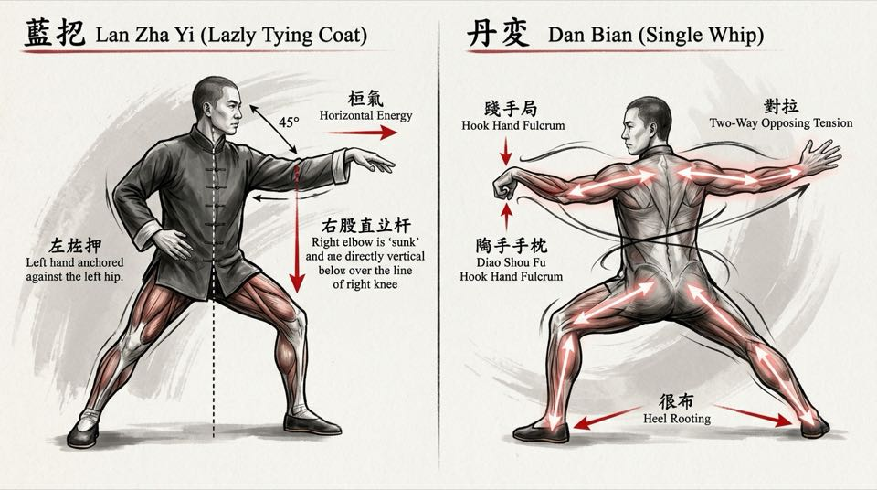

# Bab 5: Kurikulum Taolu — Bedah Struktur Yilu (81 Jurus) & Erlu Paochui (64 Jurus)

> 📖 Hub Buku: **[Chen Style Taijiquan Practical Method: Sejarah, Filosofi Mekanika & Panduan Latihan Shiyong Quanfa](index.md)**

---

## 📖 Narasi Pembuka & Latar Belakang (The Narrative Context)

Pada awal dekade 1980-an di Kota Jinan, seorang pemuda atlet wushu modern dari perguruan tinggi olahraga provinsi datang menemui Grandmaster Hong Junsheng [[1]](#ref-1), [[2]](#ref-2). Pemuda tersebut ingin memamerkan kebolehannya memperagakan jurus kedua Taiji Gaya Chen, yaitu **Erlu Paochui (Tinju Meriam)**. Di hadapan Hong yang duduk tenang di kursi kayu, pemuda itu melompat tinggi ke udara, menendang dengan bunyi kibasan celana yang menggelegar, dan melepaskan pukulan-pukulan cepat dengan entakan kaki yang menggetarkan lantai ubin. Setiap gerakannya memancarkan kecepatan akrobatik dan kegarangan layaknya seorang atlet Olimpiade.

Setelah pemuda itu selesai dan membungkuk dengan napas tersengal-sengal menanti pujian, Hong Junsheng tersenyum lembut dan bertanya:
> *"Gerakanmu sangat indah untuk ditonton di atas panggung pertunjukan. Tetapi izinkan kakek tua ini bertanya: saat kamu memukulkan tinjumu dengan begitu keras tadi, ke mana perginya reaksi tenagamu saat tinjumu menabrak target yang tidak bisa mundur? Apakah tubuhmu mampu menahan getaran benturan tersebut tanpa patah di persendian bahumu?"* [[1]](#ref-1), [[2]](#ref-2).

Hong kemudian bangkit dari kursinya, meminta pemuda itu berdiri dalam postur kuda-kuda kokoh dengan kedua telapak tangan menempel di dada Hong, lalu menyuruhnya bersiap. Tanpa ancang-ancang melompat, tanpa mengayunkan bahunya ke belakang, dan tanpa mengeraskan otot wajahnya, Hong hanya menurunkan panggulnya (*Kua*) sepersekian milimeter dan memutar pergelangan tangannya. Suara benturan tumpul terdengar—seperti dentuman palu godam menghantam kayu balok. Pemuda atlet tersebut terlempar ke belakang sejauh tiga meter dan jatuh terduduk di atas karpet dengan mata terbelalak kebingungan [[1]](#ref-1).

*"Itulah perbedaan antara tinju yang meniru bunyi guntur dengan tinju yang memiliki laras meriam,"* bisik Hong. *"Kalian terlalu terburu-buru ingin menembakkan peluru meriam (Erlu), padahal kalian belum membangun fondasi baja dari laras meriam itu sendiri melalui jurus pertama (Yilu). Jika laras meriammu terbuat dari kayu rapuh, ledakan mesiu di dalamnya justru akan meledakkan meriammu sendiri sebelum peluru menyentuh musuh."* [[1]](#ref-1), [[2]](#ref-2).

Kisah ini menggarisbawahi arsitektur kurikulum yang sangat ketat di dalam **Chen Style Taijiquan Practical Method**. Sistem ini tidak memandang *Taolu* (rangkaian jurus) sebagai koreografi panggung, melainkan sebagai sebuah cetak biru rekayasa struktural yang memiliki urutan hierarkis tak terpisahkan: **Yilu (81 Jurus)** bertugas membangun rangka baja dan kemampuan menyerap gaya, sedangkan **Erlu Paochui (64 Jurus)** bertugas menembakkan gaya tersebut ke sasaran tempur [[1]](#ref-1), [[5]](#ref-5).

---

<div align="center">
  
  <p><sub><em>Ilustrasi Bab 5: Koreksi presisi Hong Junsheng atas dua postur fondasi Yilu — Lan Zha Yi (kiri) dengan siku jatuh tepat segaris vertikal di atas lutut kanan, dan Dan Bian (kanan) dengan tangan kait (Diao Shou) sebagai poros tumpu serta regangan dua arah (Dui La) melintasi punggung ke tumit.</em></sub></p>
</div>

---

## 🔬 Teardown Konsep & Wawasan Utama (Deep-Dive Insights)

```text
┌────────────────────────────────────────────────────────────────────────┐
│             ARSITEKTUR KURIKULUM TAOLU PRACTICAL METHOD                │
└────────────────────────────────────────────────────────────────────────┘
                      YILU (JURUS PERTAMA - 81 POSTUR)
                                  [TI / 体]
                   Substansi • Struktur • Rangka Tulang
      • Kecepatan: Konstan, lambat hingga sedang (slow & steady)
      • Fokus: Presisi sudut 45°, penguncian siku, pelipatan Kua
      • Fungsi Bela Diri: Menetralisir (Yielding), Mengurai, Kuncian (Qin Na)
      • Prinsip Utama: "Mencari kebenaran mekanika dalam ketenangan"
                                     │
                                     ▼
                    ERLU PAOCHUI (TINJU MERIAM - 64 POSTUR)
                                  [YONG / 用]
                    Fungsi • Ledakan • Aplikasi Tempur
      • Kecepatan: Fluktuatif (ritme lambat mendadak meledak / Fa Jin)
      • Fokus: Perubahan arah tajam, sapuan kaki, bantingan jarak dekat
      • Fungsi Bela Diri: Proyeksi gaya destruktif, terobosan garis pertahanan
      • Prinsip Utama: "Melepaskan peluru dari laras yang tak tergoyahkan"
```

---

### 1. Yilu (一路): Konstruksi Bingkai Baja dan Penyerapan Gaya

Dalam tradisi Hong Junsheng, **Yilu** dikodifikasikan ke dalam **81 jurus** (beberapa cabang desa Chenjiagou menghitung 74 atau 83 postur) [[1]](#ref-1), [[2]](#ref-2). Yilu adalah laboratorium penempaan postur. 

Tiga karakteristik mekanis mutlak saat melatih Yilu dalam Practical Method:
1. **Kecepatan Konstan Tanpa Hentakan Sembarangan**: Pemula dilarang keras melepaskan ledakan tenaga (*Fa Jin*) saat melatih Yilu. Tujuannya adalah mengeliminasi momentum inersia palsu. Jika Anda bergerak lambat dengan kecepatan seragam, Anda tidak bisa menyembunyikan kesalahan keseimbangan atau kekakuan sendi [[1]](#ref-1).
2. **Ketinggian Kuda-Kuda yang Terkunci (*Constant Level*)**: Kepala tidak boleh naik-turun seperti perahu terombang-ambing ombak. Begitu Anda menetapkan ketinggian panggul di awal jurus, seluruh transisi 81 jurus harus diselesaikan pada ketinggian horisontal yang sama persis, memaksa otot paha dan gluteus bekerja secara isometrik-dinamis yang stabil [[1]](#ref-1), [[7]](#ref-7).
3. **Penyelarasan Jalur Spiral 3D**: Setiap pergantian postur wajib mematuhi aturan *Chan Si Jin*—tidak ada anggota tubuh yang bergerak dalam garis lurus telanjang; semua bergerak dalam heliks spiral yang memotong sudut 45 derajat [[1]](#ref-1), [[3]](#ref-3).

---

### 2. Erlu Paochui (二路 炮捶): Pelepasan Gaya Ledak (Fa Jin) dan Pertarungan Jarak Dekat

Berasal dari tradisi seni perang kuno Dinasti Ming, **Erlu Paochui (Tinju Meriam)** terdiri dari **64 jurus** yang dipenuhi oleh entakan eksplosif, lompatan (*jumping kicks*), dan perubahan arah yang tak terduga [[1]](#ref-1), [[5]](#ref-5).

Di dalam Practical Method, Erlu bukanlah antitesis dari Yilu, melainkan **percepatan dari geometri Yilu**.
- Jika dalam Yilu sebuah putaran *Positive Circle* dilakukan dalam tempo 5 detik, dalam Erlu putaran yang sama diselesaikan dalam tempo 0,2 detik [[1]](#ref-1).
- **Mekanisme Fa Jin (发劲 — Tenaga Ledak)**: Studi Hua dkk. (2022) mengonfirmasi bahwa pelepasan tenaga ledak dalam Chen-style Taiji bukanlah hasil dari ayunan otot bisep atau dada, melainkan hasil dari **deselerasi mendadak pada pangkal panggul (*sudden hip deceleration*)** yang mentransfer momentum kinetik sepanjang rantai tulang belakang menuju pergelangan tangan, serupa dengan mekanisme lecutan ujung cambuk (*kinetic chain whiplash effect*) [[8]](#ref-8).

---

### 3. Bedah Presisi Jurus-Jurus Ikonik & Koreksi Hong Junsheng

Grandmaster Hong Junsheng terkenal sangat teliti dalam mengoreksi distorsi jurus yang kerap dilakukan praktisi umum. Berikut adalah tiga jurus kunci dan koreksi presisi Practical Method [[1]](#ref-1), [[2]](#ref-2):

#### A. Lan Zha Yi (懒扎衣 — Mengikat Jubah Secara Malas)
- **Salah Kaprah Umum**: Praktisi mengayunkan tangan kanannya melebar jauh ke samping kanan seperti membuka gorden jendela lebar-lebar, membiarkan ketiak terbuka dan rusuk kanan terekspos tanpa perlindungan.
- **Koreksi Practical Method**: Lengan kanan tidak pernah berayun ke samping. Lengan kanan melakukan *Positive Circle* di depan dada. Ketika tangan kanan bergerak ke kanan-depan pada sudut 45 derajat, siku kanan tetap berat menunjuk bumi, dan telapak tangan tidak boleh melampaui garis vertikal lutut kanan [[1]](#ref-1). Tangan kiri berada di pinggul kiri untuk menjaga regangan diagonal *Dui La* [[1]](#ref-1), [[2]](#ref-2).

#### B. Dan Bian (单鞭 — Cambuk Tunggal)
- **Salah Kaprah Umum**: Tangan kanan membentuk paruh burung (*Gou Shou*) yang ditarik jauh ke belakang bahu, sementara tangan kiri mendorong lurus ke depan dengan pinggang yang terpelintir miring.
- **Koreksi Practical Method**: Tangan kanan membentuk kait (*Diao Shou*) tepat pada sudut 45 derajat di depan garis bahu kanan, bertindak sebagai jangkar tumpuan (*fulcrum*). Tangan kiri membuka ke arah 45 derajat kiri dengan rotasi supinasi-ke-pronasi mikro. Dada tidak boleh membusung; tulang selangka rileks dan punggung belakang membulat (*Han Xiong Ba Bei*), menciptakan tegangan busur panah fasia melintang dari ujung jari kanan ke ujung jari kiri [[1]](#ref-1), [[3]](#ref-3), [[10]](#ref-10).

#### C. Jin Gang Dao Dui (金刚捣碓 — Vajra Menumbuk Lesung)
- **Salah Kaprah Umum**: Praktisi mengangkat kaki kanan tinggi-tinggi lalu membanting telapak kaki ke lantai dengan suara keras untuk pamer kekuatan di depan penonton.
- **Koreksi Practical Method**: Entakan kaki (*stamping foot*) dilarang keras dibanting dengan tumit mendarat terlebih dahulu (yang dapat memicu cedera kompresi meniskus dan gegar mikro pada tulang belakang) [[7]](#ref-7). Kaki kanan dijatuhkan dengan telapak kaki rata (*flat foot landing*) melalui relaksasi gravitasi murni (*free fall*), di mana Kua kiri tenggelam secara simultan untuk menyerap gaya tumbukan tanah dan membalikkannya menjadi tinju vertikal tangan kanan ke telapak tangan kiri [[1]](#ref-1), [[2]](#ref-2).

---

## 🧠 Eksperimen Pikiran & Contoh Kasus di Dunia Nyata

### Kasus Chen Fake Mengoreksi Hong Junsheng: Mengapa Mengayun Tangan adalah Dosa Bela Diri?
Pada tahun ke-5 Hong Junsheng berguru di Beijing, ia merasa gerakannya sudah sangat bertenaga. Suatu hari, saat memperagakan jurus *Dan Bian*, Hong mengayunkan tangan kirinya dengan cepat untuk memukul Chen Fake. Chen Fake tidak menepis tangan Hong; beliau hanya meletakkan jari telunjuknya di ketiak kiri Hong yang terbuka akibat ayunan tersebut.

Dalam sekejap, Hong kehilangan napas dan terdorong mundur. Chen Fake berkata dengan lembut:
*"Junsheng, saat kamu mengayunkan tanganmu ke luar garis tubuhmu, kamu mengira kamu sedang menyerangku. Padahal sesungguhnya kamu sedang membukakan pintu rumahmu dan mengundangku masuk untuk merampokmu. Di dalam jurus kita, tangan tidak pernah mengayun ke luar perbatasan tubuh. Tanganmu tetap berada di garis tengah; jika kamu ingin menyerang ke samping, putar panggulmu dan langkahkan kakimu!"* [[1]](#ref-1), [[2]](#ref-2).

Pelajaran berharga ini menjadi hukum besi yang selalu diingat Hong: **tangan mempertahankan garis tengah; tubuh yang memposisikan tangan ke sasaran.**

---

## ⚡ Panduan Aksi Nyata dari Bagian Ini (Action Checklist)

1. [ ] **Audit Ketinggian Horisontal**: Letakkan pita perekat di cermin setinggi mata Anda saat berada dalam posisi kuda-kuda *Lan Zha Yi*. Lakukan transisi ke jurus *Liu Si Bi He* (Enam Penjuru Menutup); pastikan pandangan mata Anda tidak naik atau turun melampaui garis pita perekat tersebut [[1]](#ref-1).
2. [ ] **Verifikasi Titik Siku Lan Zha Yi**: Berhenti pada postur akhir *Lan Zha Yi*. Periksa apakah siku kanan Anda berada tepat di atas lutut kanan (dalam proyeksi vertikal) dan berjarak satu kepalan tangan dari rusuk. Jika siku Anda berada di belakang rusuk, perbaiki segera [[1]](#ref-1).
3. [ ] **Disiplin Yilu Sebelum Erlu**: Jangan mencoba melatih kecepatan tinggi atau entakan *Erlu* sebelum Anda mampu menyelesaikan satu putaran *Yilu* penuh (15–20 menit) tanpa ada satu kali pun sendi Anda terasa kaku atau napas Anda tersengal-sengal [[1]](#ref-1), [[5]](#ref-5).

---

## 💬 Kutipan Pilihan & Catatan Reflektif

> *"Yilu adalah ibumu; ia merawat, membangun tulang, dan memberimu kehidupan struktur. Erlu adalah senjatamu; ia hanya berguna di medan perang jika tubuhmu sudah dewasa dan sehat. Jangan tinggalkan ibumu demi mengejar kilauan senjata."*  
> — **Grandmaster Hong Junsheng (洪均生)** [[1]](#ref-1), [[2]](#ref-2)

**Pertanyaan Refleksi Diri**:
- *Apakah Anda sering merasa tergoda untuk melatih gerakan yang terlihat spektakuler dan cepat, daripada setia melatih postur lambat yang menuntut kesabaran dan ketelitian geometris?*

---

## 📚 Daftar Pustaka Bab 5

- <a id="ref-1"></a>**[1]** **Hong Junsheng (洪均生).** *Chen Style Taijiquan Practical Method: Volume One — Theory* (Terjemahan Inggris oleh Chen Zhonghua). Edmonton, AB: Hunyuantaiji Press; 2006. ISBN: 978-0-9730045-5-7.
- <a id="ref-2"></a>**[2]** **Hong Junsheng (洪均生).** *Chen Shi Taijiquan Shiyong Quanfa: Shiqidai Zongshi Chen Fake Wannian Chuanshou Jiji Jingcui* (陈式太极拳实用拳法). Jinan: Shandong Science and Technology Publishing House; 1989. ISBN: 978-7-5331-0640-9.
- <a id="ref-3"></a>**[3]** **Chen Xin (陈鑫).** *The Illustrated Canon of Chen Family Taijiquan* (陈式太极拳图说 / *Chenshi Taijiquan Tushuo*). Melbourne: INBI Matrix Pty Ltd; 2007. ISBN: 978-5-98687-008-3.
- <a id="ref-5"></a>**[5]** **Sim DSV, Gaffney D.** *Chen Style Taijiquan: The Source of Taiji Boxing*. Berkeley, CA: North Atlantic Books; 2002. ISBN: 978-1-55643-377-1.
- <a id="ref-7"></a>**[7]** **Liu H, Gong H, Chen P, Zhang L, Cen H, Fan Y.** Biomechanical effects of typical lower limb movements of Chen-style Tai Chi on knee joint. *Med Biol Eng Comput*. 2023;61(11):3087–3101. doi:[10.1007/s11517-023-02906-y](https://doi.org/10.1007/s11517-023-02906-y).
- <a id="ref-8"></a>**[8]** **Hua H, Zhu D, Wang Y.** Comparative Study on the Joint Biomechanics of Different Skill Level Practitioners in Chen-Style Tai Chi Punching. *Int J Environ Res Public Health*. 2022;19(10):5915. doi:[10.3390/ijerph19105915](https://doi.org/10.3390/ijerph19105915).
- <a id="ref-10"></a>**[10]** **Wayne PM, Fuerst ML.** *The Harvard Medical School Guide to Tai Chi*. Boston, MA: Harvard Health Publications / Shambhala; 2013. ISBN: 978-1-59030-942-1.

---

## 🧭 Navigasi Bab Selanjutnya

⬅️ **[Bab 4: Fondasi Latihan (Jibengong) — Positive/Negative Circles & Mekanika Chan Si Jin](04-jibengong-lingkaran-dan-chansijin.md)** &nbsp;&nbsp;|&nbsp;&nbsp; 📖 **[Hub Buku (Index)](index.md)** &nbsp;&nbsp;|&nbsp;&nbsp; ➡️ **[Lanjut ke Bab 6: Laboratorium Tuishou (Push Hands), Aplikasi Bela Diri & Kurikulum Latihan Mandiri](06-laboratorium-tuishou-dan-aplikasi.md)**
