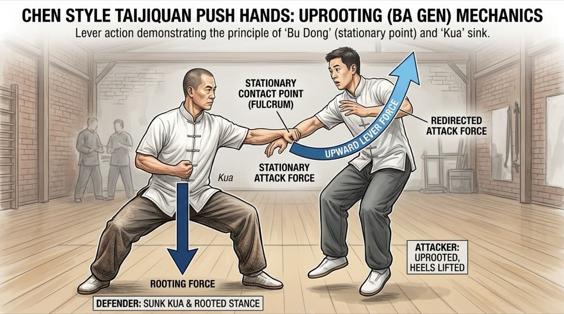
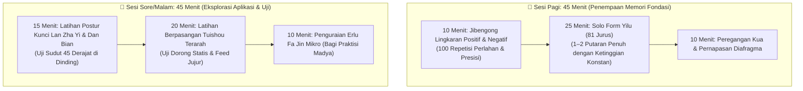

# Bab 6: Laboratorium Tuishou (Push Hands), Aplikasi Bela Diri & Kurikulum Latihan Mandiri

> 📖 Hub Buku: **[Chen Style Taijiquan Practical Method: Sejarah, Filosofi Mekanika & Panduan Latihan Shiyong Quanfa](index.md)**

---

## 📖 Narasi Pembuka & Latar Belakang (The Narrative Context)

Di banyak ruang latihan bela diri modern, sesi latihan berpasangan sering kali berubah menjadi ajang pembuktian ego yang gaduh. Dua orang saling mencengkeram leher, mendorong sekuat tenaga dengan urat leher menegang, mendengus kelelahan, dan berusaha saling menjatuhkan dengan mengandalkan bobot badan mentah. Pemandangan semacam ini, yang sering disalahartikan sebagai latihan *Push Hands* (*Tuishou* / 推手), oleh Grandmaster Hong Junsheng disebut sebagai "adu banteng buta di lumpur" [[1]](#ref-1), [[2]](#ref-2).

Bagi Hong Junsheng dan Chen Zhonghua, **Tuishou bukanlah ajang adu gulat bebas untuk mencari siapa yang menang dan siapa yang kalah**. Tuishou adalah **laboratorium ilmiah (*scientific laboratory*)** [[1]](#ref-1). 

Di dalam laboratorium, seorang ilmuwan tidak berkelahi dengan mikroskopnya; ia menggunakan instrumen tersebut untuk mengamati fenomena dengan penuh kejujuran. Demikian pula di atas matras Practical Method: rekan latihan Anda bukanlah musuh yang harus dihancurkan, melainkan sebuah instrumen pengukur presisi yang bertugas "menyuapkan tenaga dorong" (*feeding force*) ke tubuh Anda [[1]](#ref-1). Tugas Anda sebagai praktisi adalah mengamati: *Ketika dorongan seberat 50 kg menyentuh lengan bawah saya, apakah siku saya bergeser? Apakah Kua saya melipat dengan benar? Ataukah lutut saya bergoyang ke dalam?*

Jika struktur Anda runtuh di bawah dorongan rekan latihan, Anda tidak boleh marah atau mencari dalih. Rekan Anda baru saja memberi tahu Anda sebuah fakta ilmiah objektif: sudut geometri Anda masih salah. Anda harus berterima kasih kepadanya, mengatur ulang posisi tumit dan panggul Anda, lalu menguji kembali hipotesis mekanika Anda. Inilah kejujuran absolut yang menjadikan Chen Style Taijiquan Practical Method salah satu seni bela diri paling murni dan paling disegani di dunia [[1]](#ref-1), [[6]](#ref-6).

---

<div align="center">
  
  <p><sub><em>Ilustrasi Bab 6: Laboratorium Tuishou (Push Hands) dan mekanika Uprooting (Ba Gen) — praktisi mempertahankan titik kontak lengan bawah sebagai poros mati (Bu Dong) sambil menenggelamkan Kua, mengubah vektor dorong lawan menjadi gaya angkat yang mencabut kedua tumit lawan dari lantai.</em></sub></p>
</div>

---

## 🔬 Teardown Konsep & Wawasan Utama (Deep-Dive Insights)

```text
┌────────────────────────────────────────────────────────────────────────┐
│            SIKLUS EMPAT TAHAP KINETIK DALAM TUISHOU                    │
└────────────────────────────────────────────────────────────────────────┘
          1. ZHAN NIAN (MENEMPEL & MEREKATKAN TITIK KONTAK)
             Sentuhan tanpa mencengkeram otot; membentuk engsel bersama
                                    │
                                    ▼
          2. TING JIN (MENDENGAR VEKTOR GAYA LAWAN)
             Proprioception fasia membaca arah, kecepatan & intensitas dorong
                                    │
                                    ▼
          3. HUA JIN (MENGURAI & MEMBELOKKAN GAYA)
             Aturan Bu Dong: titik kontak diam, Kua melipat memutar vektor
                                    │
                                    ▼
          4. FA JIN & UPROOTING (MENCABUT AKAR & MEMENTALKAN)
             Gaya reaksi tanah (GRF) ditembakkan melalui titik kontak stasioner
             Lawan kehilangan tumpuan kaki dan terlempar melayang
```

---

### 1. Dekonstruksi Ting Jin (Daya Mendengar) & Fisiologi Propriosepsi

Di dalam teks klasik Taiji, praktisi dituntut menguasai *Ting Jin* (听劲 — Mendengar Tenaga) [[6]](#ref-6). Tentu saja, kata "mendengar" di sini tidak merujuk pada indra pendengaran telinga, melainkan pada **sensitivitas proprioseptif neuromuskular (*neuromuscular proprioceptive acuity*)** [[10]](#ref-10).

Ketika kulit lengan Anda bersentuhan dengan lengan lawan:
- Jika otot Anda tegang dan kaku, reseptor mekanik di kulit (*mechanoreceptors*) seperti korpuskel Meissner dan Pacinian akan tertekan oleh kontraksi otot Anda sendiri, membuat Anda "tuli" terhadap arah gaya lawan [[10]](#ref-10). Anda baru menyadari ke mana lawan bergerak setelah tubuh Anda terdorong mundur.
- Sebaliknya, jika otot lengan Anda rileks namun struktur tulang Anda terisi (*Peng Jin*), reseptor di fasia dan gelendong otot (*muscle spindles*) mampu mendeteksi perubahan vektor gaya lawan sebesar sepersekian milimeter dalam waktu kurang dari 50 milidetik [[8]](#ref-8), [[10]](#ref-10). Praktisi tingkat lanjut sudah mengetahui ke mana lawan akan kehilangan keseimbangan bahkan sebelum lawan menyelesaikan dorongannya.

---

### 2. Mekanika Uprooting (Mencabut Akar Gravitasi Lawan)

Bagaimana seorang kakek tua bertubuh mungil dapat menerbangkan seorang pria muda berbobot 90 kg melayang ke udara tanpa ayunan pukulan besar? Kuncinya terletak pada fenomena biomekanika yang disebut **Uprooting (拔根 — Ba Gen / Mencabut Akar)** [[1]](#ref-1), [[2]](#ref-2).

Manusia mempertahankan keseimbangan berdirinya melalui pusat massa (*Center of Mass* / COM) yang diproyeksikan vertikal ke dalam poligon bidang tumpuan kaki (*Base of Support* / BOS). 
1. Saat lawan mendorong Anda, ia memfokuskan seluruh berat badannya ke arah depan. Pada momen ini, kedua tumitnya menancap ke tanah untuk menghasilkan dorongan.
2. Praktisi Practical Method tidak mendorong balik. Ia mengunci titik kontak di lengan lawan menjadi titik tumpu mati (*fulcrum*), lalu **menurunkan panggulnya sendiri (*sinking the Kua*)** sambil memutar tubuh sedikit diagonal 45 derajat [[1]](#ref-1).
3. Akibatnya, lengan tuas bekerja: gaya dorong maju lawan dialihkan menjadi **gaya angkat vertikal ke atas (*upward vertical force component*)** pada ketiak atau bahu lawan [[1]](#ref-1), [[8]](#ref-8).
4. Titik tumpuan tumit lawan terangkat beberapa milimeter dari lantai (*uprooted*). Begitu kedua tumit lawan tidak lagi menekan tanah, gaya gesek lantainya menjadi nol. Pada kondisi tanpa gesekan ini, dorongan sekecil hembusan napas sekalipun akan membuat lawan meluncur terpental tak berdaya [[1]](#ref-1), [[2]](#ref-2).

---

### 3. Empat Penyakit Fatal Pemula dalam Tuishou (The Four Fatal Flaws)

Hong Junsheng merumuskan empat kesalahan utama yang wajib dihindari oleh setiap praktisi saat melakukan latihan dorong tangan [[1]](#ref-1), [[2]](#ref-2):

| Penyakit Teknis | Karakteristik Mekanis | Konsekuensi Fatal di Arena |
|---|---|---|
| **1. Ding (顶 — Menabrak/Melawan)** | Menegang dan mendorong balik gaya lawan secara frontal (adu otot). | Yang berbadan lebih besar menang; struktur praktisi hancur terbentur. |
| **2. Diu (丢 — Melepas/Kabur)** | Menarik lengan menjauh atau memutuskan kontak fisik karena takut didorong. | Memberikan inisiatif penuh kepada lawan untuk mengejar dan memukul telak. |
| **3. Bian (瘪 — Runtuh/Kempis)** | Terlalu lemas (*over-yielding*); membiarkan siku menempel ke dada sendiri. | Lengan praktisi menekan rusuknya sendiri; tercekik oleh struktur sendiri. |
| **4. Kuang (抗/浮 — Mengambang)** | Pusat gravitasi naik ke dada; bahu terangkat dan tumit kehilangan gigitan ke tanah. | Praktisi sangat mudah dicabut akarnya dan dibanting lawan dengan satu sentakan. |

Prinsip sejati yang dipertahankan adalah **Zhan Nian Lian Sui (粘黏连随 — Menempel, Melekat, Menyambung, Mengikuti)** tanpa pernah *Ding* dan tanpa pernah *Diu* [[1]](#ref-1), [[6]](#ref-6).

---

### 4. Kurikulum Latihan Mandiri: Cetak Biru Disiplin Harian

Untuk menguasai sistem ini tanpa kehadiran guru setiap hari, praktisi dapat mengikuti jadwal latihan mandiri terstruktur berikut [[1]](#ref-1):



---

## 🧠 Eksperimen Pikiran & Contoh Kasus di Dunia Nyata

### Kasus Chen Zhonghua di Seminar Warsawa (Polandia): Menguji Kejujuran Dorongan
Dalam sebuah rekaman lokakarya yang terkenal di Warsawa, seorang petarung seni bela diri campuran (MMA) bertubuh besar dengan berat lebih dari 100 kg menantang keabsahan teknik *Tuishou* Chen Zhonghua. Petarung tersebut menaruh kedua tangannya di dada Chen Zhonghua dan mendorong dengan segenap tenaga otot tubuhnya.

Chen Zhonghua tidak melangkah mundur. Ia meminta penonton mengamati kakinya: kakinya tidak bergeser satu milimeter pun. Apa yang dilakukannya? Chen Zhonghua mengunci dadanya (tidak menarik dada ke belakang / tidak *Diu*), melipat *Kua* kirinya, dan menyalurkan dorongan 100 kg tersebut menembus tumit kanannya ke lantai beton. Setelah dorongan petarung MMA tersebut mencapai batas maksimal dan tertahan oleh kekakuannya sendiri, Chen Zhonghua hanya memutar pergelangan tangannya sebesar 15 derajat. Seketika itu juga, petarung MMA seberat 100 kg tersebut terpental melayang ke belakang dan menabrak matras pelindung dinding [[1]](#ref-1). Petarung tersebut bangkit sambil tersenyum takjub dan berkata: *"Rasanya seperti mendorong dinding beton yang mendadak menembakkan pegas raksasa ke tubuh saya."*

---

## ⚡ Panduan Aksi Nyata dari Bagian Ini (Action Checklist)

1. [ ] **Protokol Uji Statis Rekan (*Static Partner Feed*)**: Mintalah rekan latihan menaruh satu tangan di pergelangan tangan Anda dan memberikan dorongan konstan sebesar 20–30 kg. Jangan bergerak mundur. Gunakan pelipatan *Kua* untuk merasakan apakah dorongan tersebut mengalir ke tumit belakang Anda tanpa membuat bahu Anda tegang [[1]](#ref-1).
2. [ ] **Eliminasi Keinginan Menang (*Drop the Ego*)**: Saat berlatih *Tuishou*, jika Anda merasa harus mengeraskan lengan untuk menjatuhkan rekan latihan, segera hentikan gerakan dan akui bahwa Anda telah kalah secara teknis. Mulailah kembali dari posisi netral [[1]](#ref-1).
3. [ ] **Disiplin Jurnal Latihan**: Catat di bagian jurus mana Anda masih merasa kehilangan tumpuan atau kehilangan kontak dengan tanah, lalu bedah kembali anatomi sudut 45 derajat pada jurus tersebut di depan cermin [[1]](#ref-1).

---

## 💬 Kutipan Pilihan & Catatan Reflektif

> *"Tuishou adalah cermin yang tidak pernah berbohong. Anda bisa membohongi murid-murid Anda dengan kata-kata manis tentang Qi dan filsafat kosmik saat memperagakan jurus sendirian di atas panggung; tetapi di hadapan dorongan jujur seorang lawan di arena Tuishou, seluruh kebohongan Anda akan ditelanjangi dalam waktu kurang dari satu detik."*  
> — **Grandmaster Hong Junsheng (洪均生)** [[1]](#ref-1), [[2]](#ref-2)

**Pertanyaan Refleksi Diri**:
- *Apakah Anda memiliki kerendahan hati untuk menerima ketika struktur Anda terbukti runtuh dalam latihan, dan menjadikannya bahan bakar untuk menyempurnakan ketelitian mekanika Anda?*

---

## 📚 Daftar Pustaka Bab 6

- <a id="ref-1"></a>**[1]** **Hong Junsheng (洪均生).** *Chen Style Taijiquan Practical Method: Volume One — Theory* (Terjemahan Inggris oleh Chen Zhonghua). Edmonton, AB: Hunyuantaiji Press; 2006. ISBN: 978-0-9730045-5-7.
- <a id="ref-2"></a>**[2]** **Hong Junsheng (洪均生).** *Chen Shi Taijiquan Shiyong Quanfa: Shiqidai Zongshi Chen Fake Wannian Chuanshou Jiji Jingcui* (陈式太极拳实用拳法). Jinan: Shandong Science and Technology Publishing House; 1989. ISBN: 978-7-5331-0640-9.
- <a id="ref-6"></a>**[6]** **Wile D.** *Lost T'ai-chi Classics from the Late Ch'ing Dynasty*. Albany, NY: State University of New York Press; 1996. ISBN: 978-0-7914-2654-8.
- <a id="ref-8"></a>**[8]** **Hua H, Zhu D, Wang Y.** Comparative Study on the Joint Biomechanics of Different Skill Level Practitioners in Chen-Style Tai Chi Punching. *Int J Environ Res Public Health*. 2022;19(10):5915. doi:[10.3390/ijerph19105915](https://doi.org/10.3390/ijerph19105915).
- <a id="ref-10"></a>**[10]** **Wayne PM, Fuerst ML.** *The Harvard Medical School Guide to Tai Chi*. Boston, MA: Harvard Health Publications / Shambhala; 2013. ISBN: 978-1-59030-942-1.

---

## 🧭 Navigasi Bab Selanjutnya

⬅️ **[Bab 5: Kurikulum Taolu — Bedah Struktur Yilu (81 Jurus) & Erlu Paochui (64 Jurus)](05-kurikulum-taolu-yilu-dan-erlu.md)** &nbsp;&nbsp;|&nbsp;&nbsp; 📖 **[Kembali ke Hub Buku (Index)](index.md)** &nbsp;&nbsp;|&nbsp;&nbsp; 📚 **[Kembali ke Katalog Utama (CATALOG.md)](../../CATALOG.md)**
