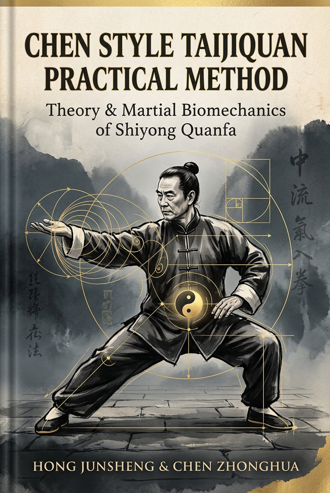
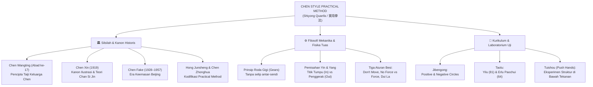

# 📖 Chen Style Taijiquan Practical Method: Sejarah, Filosofi Mekanika & Panduan Latihan Shiyong Quanfa

<div align="center">
  
</div>

> 📚 **[Kembali ke Katalog Utama (CATALOG.md)](../../CATALOG.md)**  
> **Sumber Primer & Transmisi**: Grandmaster Hong Junsheng (洪均生) & Grandmaster Chen Zhonghua (陈中华)  
> **Penyusun & Anotasi Ilmiah**: Book Hubs (Berbasis kanon klasik *Shiyong Quanfa* & literatur biomekanika terindeks PubMed)  
> **Tahun Rujukan**: 1989 (Edisi Mandarin) / 2006 (Edisi Inggris) / 2026 (Edisi Panduan Komprehensif)  
> **Genre**: Seni Bela Diri Internal, Biomekanika Gerak, Sejarah & Filosofi Taijiquan  
> **Estimasi Waktu Baca Keseluruhan**: ~90–120 Menit (6 Bab Lengkap + Catatan Kaki & Bibliografi)  
> **Rating Rekomendasi**: ⭐⭐⭐⭐⭐ (5.0/5.0)  

---

## 🧭 Peta Eksplorasi Buku (Reading Roadmap)

Buku panduan komprehensif ini disusun khusus bagi praktisi **Chen Style Taijiquan Practical Method (*Shiyong Quanfa* / 實用拳法)**. Setiap modul memadukan riwayat historis terverifikasi, terjemahan mekanika Hong Junsheng dan Chen Zhonghua, serta pembuktian biomekanika modern lengkap dengan catatan kaki dan referensi ilmiah:

- [x] 📘 **[Bab 1: Dari Desa Chenjiagou ke Jinan — Sejarah & Silsilah Transmisi Practical Method](01-sejarah-dan-silsilah-transmisi.md)**  
  *Cakupan Asli: Memoir of Learning (学拳回忆录) & Bab Pembuka Sejarah. Akar militer Jenderal Chen Wangting, era keemasan Chen Fake di Beijing (1928–1957), dedikasi 15 tahun Hong Junsheng, hingga kodifikasi global oleh Chen Zhonghua.*

- [x] 📘 **[Bab 2: Mendemistifikasi Taiji — Filosofi Mekanika, Roda Gigi & Pemisahan Yin-Yang](02-filosofi-mekanika-dan-roda-gigi.md)**  
  *Cakupan Asli: Introduction (概论) & Anotasi Risalah Wang Zongyue. Menolak mistisisme Qi kabur dan menggantinya dengan fisika tuas (lever), transmisi roda gigi (gears), aturan "Jangan Bergerak" (Bu Dong), dan pemisahan Yin-Yang absolut.*

- [x] 📘 **[Bab 3: Anatomi Struktur & Kosa Kata Teknis — Yao, Kua, Siku, dan Sudut 45 Derajat](03-anatomi-struktur-dan-kosakata-teknis.md)**  
  *Cakupan Asli: San Zi Jing (三字经: Bagian Torso, Kuda-kuda & Tangan). Membedah kamus anatomi Practical Method: fungsi Yao (pinggang) vs Kua (panggul), aturan Siku Tidak Pernah Keluar, regangan dua arah (Dui La), dan arsitektur kuda-kuda 45 derajat.*

- [x] 📘 **[Bab 4: Fondasi Latihan (Jibengong) — Positive/Negative Circles & Mekanika Chan Si Jin](04-jibengong-lingkaran-dan-chansijin.md)**  
  *Cakupan Asli: The Basic Principle (Chan Fa / 缠丝法) & San Zi Jing (Silk Reeling). Panduan teknis Lingkaran Positif (Shun) dan Lingkaran Negatif (Ni), rotasi poros vs revolusi orbital, serta mekanika lilitan sutra (Chan Si Jin) dalam melindungi sendi.*

- [x] 📘 **[Bab 5: Kurikulum Taolu — Bedah Struktur Yilu (81 Jurus) & Erlu Paochui (64 Jurus)](05-kurikulum-taolu-yilu-dan-erlu.md)**  
  *Cakupan Asli: Chen Style Taijiquan Characters (太极拳品) & Silabus Bentuk. Perbedaan Yilu (membangun bingkai defensif/laras meriam) dengan Erlu (ofensif jarak dekat/Fa Jin), lengkap dengan koreksi presisi Hong Junsheng atas postur kunci.*

- [x] 📘 **[Bab 6: Laboratorium Tuishou (Push Hands), Aplikasi Bela Diri & Kurikulum Latihan Mandiri](06-laboratorium-tuishou-dan-aplikasi.md)**  
  *Cakupan Asli: Thirteen Postures in Push Hands & San Zi Jing (Push Hands & Double Heavy). Tuishou sebagai ujian struktur di bawah tekanan ("feeding force"), mekanika uprooting tanpa adu otot, eliminasi 4 kesalahan fatal, dan jadwal latihan mandiri.*

---

## 📜 Struktur Asli Kanon Shiyong Quanfa (Table of Contents Mapping)

Agar pembaca dan peneliti dapat melacak hubungan modul-modul ini dengan naskah aslinya (*Volume One: Theory* oleh Hong Junsheng & Chen Zhonghua), berikut adalah pemetaan struktur bab asli kanon:

```text
┌────────────────────────────────────────────────────────────────────────────────────────┐
│             STRUKTUR KANON ASLI: CHEN STYLE TAIJIQUAN PRACTICAL METHOD (VOL. 1)        │
└────────────────────────────────────────────────────────────────────────────────────────┘
1. INTRODUCTION (概论 / Pendahuluan Teoretis)
   ├── Perkembangan & Evolusi Sejarah (Development & Evolution)
   ├── Prinsip Dasar: Metode Lilitan Sutra (Chan Fa / 缠丝法)
   ├── Koordinasi Seluruh Tubuh & Kesatuan Dua Kutub Berlawanan (Unity of Opposites)
   └── Tiga Belas Postur dalam Dorong Tangan (Thirteen Postures in Push Hands)

2. CHAPTER 1: THREE-CHARACTER CANONS (三字经 / San Zi Jing)
   ├── 12 Bagian Metrik: Pengantar, Sutra, Mata, Torso, Kuda-kuda, Teknik Tangan,
   └── Koordinasi, Push Hands, Bobot Ganda (Double Heavy), Dong Jin, Belajar & Mengajar.

3. CHAPTER 2: ON CHEN STYLE TAIJIQUAN (太极拳品并序 / Tinjauan Kualitas & Karakter Taiji)
   └── 13 Kualitas Pembawaan: Khidmat, Membulat, Lincah, Kokoh, Bertenaga, Luhur, 
       Kompleks, Lentur-Lembut, Berjiwa, Terkendali, Anggun, Bermakna, dan Alami.

4. CHAPTER 3: ANNOTATIONS ON WANG ZONGYUE'S TREATISE (王宗岳太极拳论臆解)
   └── Anotasi & Koreksi Kritis 22 Bait Risalah Klasik Wang Zongyue dari Sudut Mekanika Nyata.

5. CHAPTER 4: MEMOIR OF LEARNING (学拳回忆录 / Memoar Berguru pada Chen Fake)
   └── Catatan Historis 15 Tahun di Beijing: Latar Belakang Chen Fake, Pemulihan Kesehatan Hong,
       Etika Bela Diri Tanpa Cacat, hingga Pengujian Akhir Tahun 1956.
```

### 🥋 Mutiara Pedagogi: Intisari Syair *San Zi Jing* (三字经) Hong Junsheng
Di dalam Bab 1 Kanon Asli, Grandmaster Hong Junsheng menyusun instruksi latihan dalam bentuk bait 3-karakter (*San Zi Jing*) agar mudah dihafal dan diresapi praktisi:

> **关于缠丝 (Tentang Chan Si / Lilitan Sutra):**  
> 「划圆圈，分顺逆。里往外，是为顺。外往里，是为逆。非平圆，非立圆。立与平，角度间。」  
> *(Membuat lingkaran, bedakan Shun dan Ni. Dari dalam ke luar, itu adalah Shun (Positif). Dari luar ke dalam, itu adalah Ni (Negatif). Bukan lingkaran datar murni, bukan pula lingkaran vertikal murni. Selalu berada di antara sudut keduanya — spiral 3 dimensi).*
>
> **关于双重 (Tentang Bobot Ganda / Double Heavy):**  
> 「重非病，病双重。何谓双？偏无偏。何谓重？实无实。分虚实，免双重。」  
> *(Memiliki bobot berat bukanlah cacat; yang menjadi penyakit adalah bobot ganda. Apa itu ganda? Condong tanpa poros sejati. Apa itu berat? Mengisi tanpa ruang kosong. Pisahkan kosong (Yin) dan isi (Yang) secara mutlak, niscaya Anda terbebas dari jebakan bobot ganda).*

---

## 🎯 1. Inti Filosofis & Tesis Utama

> **"Di dalam Practical Method, tidak ada rahasia mistis yang disembunyikan di balik jubah filosofia yang kabur. Apa yang oleh orang awam disebut sebagai 'energi internal yang ajaib', sesungguhnya adalah hasil dari geometri struktur tulang yang presisi, penguncian titik tumpu (fulcrum), dan penyaluran gaya reaksi tanah tanpa kebocoran pada sendi."**

Selama berabad-abad, **Taijiquan (Tai Chi Chuan)** mengalami dua distorsi ekstrem di mata publik modern. Di satu kutub, ia direduksi menjadi senam peregangan lambat untuk lansia di taman kota yang kehilangan seluruh taring bela dirinya. Di kutub lain, ia diselubungi kabut mistisisme—seolah-olah seorang master dapat menerbangkan lawan tanpa menyentuh hanya dengan memancarkan *Qi* gaib.

**Chen Style Taijiquan Practical Method (*Shiyong Quanfa*)** berdiri tegak menentang kedua distorsi tersebut. Sistem yang diwariskan oleh Grandmaster **Chen Fake** (generasi ke-17), dikodifikasikan selama lebih dari lima dekade oleh murid terlamanya, **Hong Junsheng**, dan disebarluaskan secara global oleh **Chen Zhonghua** ini menawarkan pergeseran paradigma yang radikal: **Taijiquan adalah rekayasa mekanika tubuh manusia (*human biomechanical engineering*)**. Setiap gerakan di dalam jurus (*Taolu*) memiliki alasan fungsional yang dapat diuji secara fisik di bawah tekanan lawan (*Tuishou*). Jika sebuah gerakan hanya terlihat indah namun runtuh saat diberi beban dorongan nyata, maka gerakan tersebut dianggap keliru secara struktural.

---

## 💡 2. Peta Konsep & Kerangka Berpikir Utama (Core Frameworks)



- **Pilar 1: Demistifikasi Internal menjadi Mekanika Geometris**: Mengganti instruksi abstrak ("rasakan aliran udara") menjadi instruksi konkret yang dapat diverifikasi ("kunci siku sebagai titik tumpu, buka *Kua*, putar *Yao*, dan jaga garis 45 derajat ke tumit") [[1]](#ref-1), [[2]](#ref-2).
- **Pilar 2: Tubuh sebagai Transmisi Roda Gigi & Tuas Archimedes**: Memperlakukan setiap segmen tulang dan sendi sebagai rangkaian roda gigi jam mekanis yang saling mengunci (*interlocking gears*). Ketika lawan mendorong satu titik, titik tersebut dijadikan poros mati (*fulcrum*), sementara rotasi *Dantian* dan *Kua* membalikkan gaya lawan [[1]](#ref-1).
- **Pilar 3: Kesatuan Form (Jurus) dan Function (Aplikasi)**: Tidak ada perbedaan antara postur saat berlatih jurus sendirian (*Yilu*) dengan postur saat bertarung atau *Tuishou*. Lingkaran kecil yang ketat (*compact circles*) dan penguncian ruang siku adalah ciri khas yang membedakannya dari aliran Chen modern lainnya [[1]](#ref-1), [[4]](#ref-4).

---

## ⚡ 3. Playbook Praktis: Rencana Latihan Bagi Praktisi

Sebagai praktisi yang sedang berlatih aliran ini, gunakan peta jalan operasional berikut untuk mengakselerasi penguasaan struktur Anda:

### Fase 1: Hari Ini (Koreksi Fondasi Mikro)
- [ ] **Audit Ruang Siku**: Saat berlatih *Positive Circle* atau *Liuzou* (Enam Penjuru), periksa apakah siku Anda pernah menempel ke rusuk (terlalu sempit) atau terbang menjauhi garis bahu (terlalu lebar). Pertahankan jarak satu kepalan tangan dengan siku selalu "berat" menunjuk ke tanah [[1]](#ref-1).
- [ ] **Pisahkan *Yao* dan *Kua***: Berdirilah di depan cermin, letakkan dua jari di lipatan paha (*Kua*). Latih "menurunkan dan melipat *Kua*" tanpa membiarkan lutut terdorong melewati ujung jari kaki [[1]](#ref-1), [[7]](#ref-7).

### Fase 2: 30 Hari Pertama (Membangun Memori Neuromuskular)
- [ ] **Disiplin 100 Lingkaran Harian**: Lakukan minimal 50 repetisi *Positive Circle* dan 50 repetisi *Negative Circle* setiap pagi dengan memisahkan secara tegas antara **fase rotasi tangan (*self-rotation*)** dan **fase revolusi tubuh (*orbital revolution*)** [[1]](#ref-1).
- [ ] **Audit Tiga Paku Kaki**: Dalam setiap transisi *Yilu*, pastikan berat badan tidak mengambang di tengah, melainkan tertanam penuh melalui struktur sudut 45 derajat menuju tumit kaki penyangga sebelum kaki satunya melangkah [[1]](#ref-1), [[6]](#ref-6).

### Fase 3: Jangka Panjang (Pengujian di Bawah Tekanan)
- [ ] **Uji *Feed* Partner (Eksperimen Statis)**: Minta rekan latihan menekan pergelangan tangan atau siku Anda saat berada di postur *Lan Zha Yi* (Mengikat Jubah) atau *Dan Bian* (Cambuk Tunggal). Uji apakah Anda bisa tetap melakukan rotasi *Kua* untuk melepaskan tekanan tersebut tanpa mengeraskan otot bahu (*tanpa melawan tenaga dengan tenaga*) [[1]](#ref-1), [[8]](#ref-8).

---

## 📚 <a id="bibliografi-induk"></a>4. Bibliografi Induk & Daftar Referensi Terverifikasi

Seluruh catatan kaki dan kutipan nomor `[[n]](#bibliografi-induk)` di dalam keenam bab buku ini merujuk pada literatur primer sejarah, buku teks resmi *Practical Method*, dan jurnal ilmiah biomekanika terindeks PubMed/Crossref berikut:

| No | Sitasi Lengkap & Identifikasi Akademik | Kategori Sumber | Dipakai di Bab |
| :-: | :--- | :--- | :-: |
| <a id="ref-1"></a>**[1]** | **Hong Junsheng (洪均生).** *Chen Style Taijiquan Practical Method: Volume One — Theory* (Terjemahan Inggris oleh **Chen Zhonghua**). Edmonton, AB: Hunyuantaiji Press; 2006. ISBN: 978-0-9730045-5-7. | 🏛️ **Teks Primer Practical Method** | Bab 1–6 |
| <a id="ref-2"></a>**[2]** | **Hong Junsheng (洪均生).** *Chen Shi Taijiquan Shiyong Quanfa: Shiqidai Zongshi Chen Fake Wannian Chuanshou Jiji Jingcui* (陈式太极拳实用拳法：十七代宗师陈发科晚年传授技击精萃 / Metode Praktis Taijiquan Gaya Chen: Intisari Bela Diri Transmisi Masa Tua Grandmaster Generasi ke-17 Chen Fake). Jinan: Shandong Science and Technology Publishing House (山东科学技术出版社); 1989. ISBN: 978-7-5331-0640-9. | 🏛️ **Kanon Bahasa Mandarin Asli** | Bab 1, 2, 5, 6 |
| <a id="ref-3"></a>**[3]** | **Chen Xin (陈鑫 / Chen Pinsan).** *The Illustrated Canon of Chen Family Taijiquan* (陈式太极拳图说 / *Chenshi Taijiquan Tushuo*, naskah asli selesai 1919, diterbitkan 1933; Terjemahan Inggris oleh Alex Golstein). Melbourne: INBI Matrix Pty Ltd; 2007. ISBN: 978-5-98687-008-3. | 📜 **Kanon Klasik Keluarga Chen** | Bab 1, 2, 3, 4 |
| <a id="ref-4"></a>**[4]** | **Tang Hao (唐豪), Gu Liuxin (顾留馨).** *Taijiquan Yanjiu* (太极拳研究 / Riset Historis tentang Taijiquan). Beijing: Renmin Tiyu Chubanshe (People's Sports Publishing House); 1964 (Cetakan ulang 1992). | 📜 **Historiografi Akademik Wushu** | Bab 1, 5 |
| <a id="ref-5"></a>**[5]** | **Sim DSV, Gaffney D.** *Chen Style Taijiquan: The Source of Taiji Boxing*. Berkeley, CA: North Atlantic Books (Blue Snake Books); 2002. ISBN: 978-1-55643-377-1. | 📘 **Literatur Rujukan Gaya Chen** | Bab 1, 3, 4, 5 |
| <a id="ref-6"></a>**[6]** | **Wile D.** *Lost T'ai-chi Classics from the Late Ch'ing Dynasty*. Albany, NY: State University of New York Press (SUNY Press); 1996. ISBN: 978-0-7914-2654-8. | 📜 **Kajian Sinologi & Teks Klasik** | Bab 1, 2, 6 |
| <a id="ref-7"></a>**[7]** | **Liu H, Gong H, Chen P, Zhang L, Cen H, Fan Y.** Biomechanical effects of typical lower limb movements of Chen-style Tai Chi on knee joint. *Med Biol Eng Comput*. 2023;61(11):3087–3101. doi:[10.1007/s11517-023-02906-y](https://doi.org/10.1007/s11517-023-02906-y). PMID: [37624535](https://pubmed.ncbi.nlm.nih.gov/37624535/). | 🔬 **Studi Biomekanika (PubMed)** | Bab 3, 4, 5 |
| <a id="ref-8"></a>**[8]** | **Hua H, Zhu D, Wang Y.** Comparative Study on the Joint Biomechanics of Different Skill Level Practitioners in Chen-Style Tai Chi Punching. *Int J Environ Res Public Health*. 2022;19(10):5915. doi:[10.3390/ijerph19105915](https://doi.org/10.3390/ijerph19105915). PMID: [35627452](https://pubmed.ncbi.nlm.gov/35627452/); PMCID: [PMC9141462](https://www.ncbi.nlm.nih.gov/pmc/articles/PMC9141462/). | 🔬 **Studi Kinematika 3D (PubMed)** | Bab 2, 3, 5, 6 |
| <a id="ref-9"></a>**[9]** | **Liu J, Yeung AS, Tao X, Tian X, Kong Z, Zou L, Wang Q.** Chen-Style Tai Chi for Individuals (Aged 50 Years Old or Above) with Chronic Non-Specific Low Back Pain: A Randomized Controlled Trial. *Int J Environ Res Public Health*. 2019;16(3):517. doi:[10.3390/ijerph16030517](https://doi.org/10.3390/ijerph16030517). PMID: [30759778](https://pubmed.ncbi.nlm.nih.gov/30759778/). | 🔬 **Uji Klinis Terkontrol / RCT (PubMed)** | Bab 3, 4 |
| <a id="ref-10"></a>**[10]** | **Wayne PM, Fuerst ML.** *The Harvard Medical School Guide to Tai Chi: 12 Weeks to a Healthy Body, Strong Heart, and Sharp Mind*. Boston, MA: Harvard Health Publications / Shambhala; 2013. ISBN: 978-1-59030-942-1. | 🩺 **Fisiologi Medis & Fasia** | Bab 2, 4, 6 |

---

## ⚖️ 5. Evaluasi Kritis, Keterbatasan Metodologis & Panduan Praktisi

Sebagai sebuah karya literatur bela diri dan biomekanika, *Chen Style Taijiquan Practical Method* karya Hong Junsheng dan Chen Zhonghua memiliki keunggulan yang luar biasa, namun juga menyimpan sejumlah **catatan kritis akademis dan praktis** yang wajib dipahami secara objektif oleh pembaca:

### A. Keunggulan Utama Sistem Ini
- **Kejernihan Instruksional & Verifikasi Instan**: Di dalam *Practical Method*, seorang guru tidak bisa bersembunyi di balik kalimat mistis *"kamu belum berlatih 30 tahun sehingga Qi-mu belum terasa"*. Benar atau salahnya sebuah sudut sendi dapat diuji detik itu juga di bawah tekanan fisik melalui hukum tuas [[1]](#ref-1).

### B. Empat Kritik Objektif terhadap Buku & Metodologi *Practical Method*
1. **Reduksionisme Mekanis vs Realitas *Biotensegrity* Hidup**:
   - **Kritik**: Buku ini (terutama terjemahan analitis Chen Zhonghua) sangat menekankan metafora mesin benda padat—seperti roda gigi jam (*gears*), tuas besi, dan paku stasioner. Dalam ilmu biomekanika modern, tubuh manusia bukanlah susunan roda gigi logam yang kaku, melainkan sistem **biotensegrity viskoelastis** (jaringan ikat fasia cair dan refleks saraf golgi/spindel otot) [[10]](#ref-10). Terlalu harfiah membayangkan tubuh sebagai "mesin roda gigi" sering membuat praktisi mengunci sendinya secara berlebihan (*hyper-rigidity*) dan kehilangan sifat elastisitas cair (*fluidity*) yang justru menjadi ciri khas master seperti Chen Fake.
2. **Beban Kognitif Berlebih (*Paralysis by Analysis* dalam *Motor Learning*)**:
   - **Kritik**: Buku ini memecah satu gerakan sederhana menjadi belasan aturan mikro yang harus dipantau bersamaan (*"jangan gerakkan bahu, kunci siku, putar pergelangan, lipat Inner Kua, bungkus Outer Kua, tekan tumit 45 derajat"*). Dalam sains pembelajaran gerak (*Motor Control & Learning*), instruksi yang terlalu padat dengan fokus internal (*internal focus of attention*) akan membebani memori kerja korteks prefrontal. Akibatnya, praktisi mengalami **kelumpuhan analisis (*paralysis by analysis*)**—gerakan menjadi sangat kaku dan robotik selama bertahun-tahun sebelum bisa mencapai tahap otomatisasi refleks.
3. **Keterbatasan Konteks Tempur (*Contact Bridge* vs *Long-Range Striking*)**:
   - **Kritik**: Seluruh hukum mekanika buku ini—khususnya aturan *"Jangan Bergerak" (Bu Dong)* dan menjadikan titik sentuh sebagai *fulcrum*—bekerja sangat superior **setelah jembatan kontak fisik terbentuk** (seperti dalam *Tuishou*, *clinching*, gulat *Shuai Jiao*, atau *grappling*). Namun, buku ini kurang membahas bagaimana menghadapi serangan *striking* jarak jauh berkecepatan tinggi yang tidak memberikan kontak bertahan (seperti kombinasi *jab-cross* petinju cepat atau tendangan *low-kick* eksplosif), di mana *footwork* penghindaran dinamis dan manajemen jarak jauh lebih krusial daripada sekadar mengunci siku di tempat.
4. **Risiko Ortopedi *Femoroacetabular Impingement* (FAI) Akibat Standarisasi Sudut Kaku**:
   - **Kritik**: Penekanan mutlak pada sudut 45 derajat dan pelipatan *Kua* yang sangat dalam tidak selalu memperhitungkan variasi anatomi tulang panggul antar-individu (seperti perbedaan sudut kemiringan *acetabulum* / *femoral anteversion* atau *retroversion*). Bagi praktisi dewasa dengan struktur panggul tertentu, memaksakan lipatan *Inner Kua* ekstrem dengan lutut terkunci dapat memicu sindrom jepitan panggul (*Femoroacetabular Impingement* / FAI) jika tidak diadaptasi secara ergonomis [[7]](#ref-7).

### C. Profil Pembaca Ideal
Praktisi aktif *Chen Style Practical Method* yang membutuhkan pegangan teoretis-anatomis saat berlatih mandiri, instruktur bela diri yang ingin memahami biomekanika rantai kinetik internal, serta peneliti sejarah bela diri Tiongkok.
