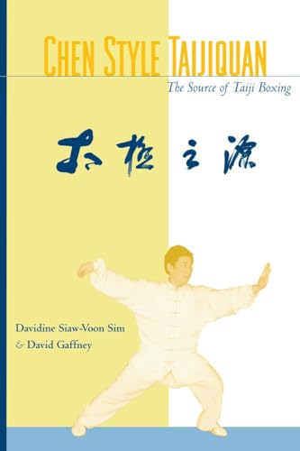

# 📖 Chen Style Taijiquan: The Source of Taiji Boxing

> 📚 **[Kembali ke Katalog Utama (CATALOG.md)](../../CATALOG.md)**  
> **Penulis**: Davidine Siaw-Voon Sim & David Gaffney  
> **Tahun Terbit**: 2002 | **Penerbit**: Blue Snake Books / North Atlantic Books (Berkeley, CA)  
> **ISBN**: 978-1556433771 | **Jumlah Halaman**: ~240 Halaman  
> **Genre**: Sains Olahraga, Biomekanika Tradisional & Sejarah Seni Bela Diri  
> **Estimasi Waktu Baca Keseluruhan**: ~75–90 Menit (5 Bab Lengkap)  
> **Rating Rekomendasi**: ⭐⭐⭐⭐⭐ (5.0 / 5.0)  

---

  
   
  <em>Cover resmi edisi Blue Snake Books / North Atlantic Books. Kaligrafi cover ditulis langsung oleh Grandmaster Chen Xiaowang.</em>

---

## 🧭 Peta Eksplorasi Buku (Reading Roadmap)

Buku ini dibedah secara mendalam per bab tematik untuk menguraikan sejarah otentik, teori fisika-filosofis, dan metodologi latihan praktis tanpa kehilangan nuansa tradisi aslinya:

- [x] 📘 **[Part 1: Akar Sejarah & Historiografi Chenjiagou](01-akar-sejarah-dan-historiografi.md)** — *Asal-usul di Desa Chenjiagou, peran jenderal Chen Wangting, sintesis militer Jenderal Qi Jiguang, transmisi Chen Changxing (Laojia) dan Chen Youben (Xiaojia), hingga dekonstruksi mitos Zhang Sanfeng.*
- [x] 📘 **[Part 2: Fondasi Filosofis, Yin-Yang & Dinamika Chan Si Jin](02-fondasi-filosofis-dan-chansijin.md)** — *Dialektika Yin-Yang dari I-Ching, dekonstruksi Qi dan meridian TCM, hukum bio-helical spiral Silk-Reeling (Chan Si Jin), serta integrasi biotensegrity fasia tubuh.*
- [x] 📘 **[Part 3: Penyelarasan Anatomi & Lima Tingkat Kemahiran Chen Xiaowang](03-penyelarasan-anatomi-dan-lima-tingkat-kemahiran.md)** — *Standar mekanika tubuh (Song, Kua, Fang Song, Xu Ling Ding Jin), eliminasi kebocoran biomekanika sendi, dan peta evolusi 5 tingkatan keahlian (Five Levels of Skill).*
- [x] 📘 **[Part 4: Kurikulum Latihan Inti — Zhan Zhuang, Silk-Reeling & Dua Tiang Taolu](04-kurikulum-latihan-dan-taolu.md)** — *Metodologi berdiri tiang (Wuji Zhuang), latihan spiral Chan Ssu Gong mandiri, meditasi dinamis Laojia Yilu (74 postur), dan daya ledak kanon Laojia Paocui.*
- [x] 📘 **[Part 5: Laboratorium Tempur — Tuishou, Kuncian Qinna & Senjata Tradisional](05-laboratorium-tempur-dan-senjata-tradisional.md)** — *8 gerak kinetik Tuishou (Peng, Lu, Ji, An, Cai, Lie, Zhou, Kao), 5 langkah kaki, manipulasi anatomi sendi Qinna, serta kurikulum senjata pedang, golok, dan tombak 13 bunga.*

---

## 🎯 1. Inti Filosofis & Tesis Utama

> *"Taijiquan bukanlah senam lambat pasif untuk relaksasi lansia, melainkan sistem beladiri canggih berbasis fisika terapan, dialektika perubahan, dan penyelarasan anatomi tubuh manusia secara total yang lahir dari darah dan pertarungan nyata di Desa Chenjiagou."*  
> — **Davidine Siaw-Voon Sim & David Gaffney**

*Chen Style Taijiquan: The Source of Taiji Boxing* karya Davidine Siaw-Voon Sim dan David Gaffney diakui secara global sebagai salah satu buku berbahasa Inggris paling otoritatif yang pernah ditulis mengenai gaya Chen asli. Di tengah membanjirnya literatur barat yang mereduksi Taiji menjadi sekadar "meditasi gerak" tanpa taring, Sim dan Gaffney—yang merupakan murid senior dan pewaris silsilah yang berlatih bertahun-tahun langsung di Desa Chenjiagou di bawah bimbingan "Empat Berlian Emas" (Grandmaster Chen Xiaowang, Chen Zhenglei, Zhu Tiancai, dan Wang Xian)—mengembalikan seni ini ke fitrah aslinya: **sebuah seni beladiri utuh (*martial art*), sains biomekanika (*internal mechanics*), dan metode preservasi kesehatan (*vitality cultivation*) yang tidak terpisahkan**.

Tesis utama buku ini menegaskan bahwa seluruh cabang gaya Taiji populer saat ini (Yang, Wu, Sun, Wu/Hao) berakar langsung dari Desa Chenjiagou (*The Source*). Namun yang membedakan gaya Chen adalah pemeliharaan karakteristik aslinya yang lengkap: kontras harmonis antara gerakan sangat lambat dan ledakan kecepatan tinggi (*slow/fast*), kelembutan lentur dan ketajaman benturan (*soft/hard*), serta teknik pelepasan tenaga kinetik spiral (*Fajin*) yang eksplosif.

Buku ini menyingkirkan mistifikasi dan takhayul gaib dengan menyajikan penjelasan yang dapat diuji secara fisik: bagaimana gravitasi bumi diserap melalui relaksasi panggul (*Kua*), disalurkan melalui elastisitas jaringan ikat fasia (*Biotensegrity*), dan diarahkan keluar melalui koordinasi spiral tiga dimensi (*Chan Si Jin*).

---

## 💡 2. Gagasan Besar (The Big Ideas)

1. **Chenjiagou sebagai Titik Nol (The Source)**: Membuktikan secara historis dan tekstual bahwa Taijiquan diciptakan oleh Komandan Chen Wangting pada masa transisi Dinasti Ming ke Qing (abad ke-17), menggabungkan teori militer klasik Jenderal Qi Jiguang (*Ji Xiao Xin Shu*), teori pengobatan meridian TCM, dan filsafat perubahan *I-Ching*.
2. **Hukum Besi Lilitan Sutra (Chan Si Jin)**: Gerakan lurus murni adalah kelemahan fatal dalam fisika tempur. Setiap pergerakan dalam Taijiquan harus berupa spiral ganda komplementer (*Shun Chan* dan *Ni Chan*), yang meminjam gaya inersia rotasional laksana peluru yang berputar di dalam laras senapan.
3. **Konsep Song vs Lemas Pasif**: Menegaskan perbedaan radikal antara *Song* (relaksasi struktural aktif yang elastis) dengan *Ta* (lemas lunglai tak berdaya). *Song* berarti membebaskan otot lurik dari cengkeraman berlebih sehingga beban ditopang oleh kerangka tulang dan elastisitas tendon.
4. **Peta Jalan 5 Tingkat Keahlian Chen Xiaowang**: Membedah transisi keahlian praktisi mulai dari Level 1 (kaku dan patah-patah), Level 2-3 (mulai memahami kelenturan dan koordinasi dalam-luar), hingga Level 4-5 (peleburan total antara niat mental *Yi* dan pelepasan gaya tak kasat mata).
5. **Dualitas Taolu: Yilu dan Paocui**: Memahami arsitektur *Laojia Yilu* (Bingkai Tua Rutinitas Pertama) untuk membangun kelembutan dan kelenturan dasar, serta *Laojia Paocui* (Tinju Meriam) untuk melatih daya ledak tempur, lompatan dinamis, dan kecepatan kilat.

---

## 👥 3. Relevansi Praktis & Target Pembaca

Buku ini dirancang untuk:
- **Praktisi Bela Diri & Seniman Bela Diri**: Memahami prinsip tuas, penyerapan momentum (*neutralizing force*), mencabut akar lawan (*uprooting*), dan teknik kuncian sendi (*Qinna*) tanpa menggunakan otot brute-force.
- **Atlet Olahraga & Fisioterapis**: Mempelajari bagaimana rantai kinetik heliks fasia bekerja, pencegahan cedera lutut dan pinggang melalui pengaturan *Kua*, serta manipulasi gravitasi untuk stabilitas postural.
- **Peminat Filsafat Terapan & Sejarah Asia Timur**: Mempelajari dialektika Yin-Yang bukan sekadar sebagai simbol mistik, melainkan formula matematis dan mekanis yang diterapkan langsung di atas lantai latihan.

---

## 📑 4. Informasi Bibliografis Lengkap

- **Judul Asli**: *Chen Style Taijiquan: The Source of Taiji Boxing*
- **Penulis**: Davidine Siaw-Voon Sim & David Gaffney
- **Kata Pengantar (*Foreword*)**: Grandmaster Chen Xiaowang, Grandmaster Chen Zhenglei, Grandmaster Zhu Tiancai
- **Penerbit**: Blue Snake Books (Imprint of North Atlantic Books), Berkeley, California
- **Tahun Rilis**: 2002
- **ISBN-10**: 1556433778 | **ISBN-13**: 978-1556433771
- **Klasifikasi Bahasa Asli**: Bahasa Inggris (dengan istilah kanonis aksara Mandarin & Pinyin)

