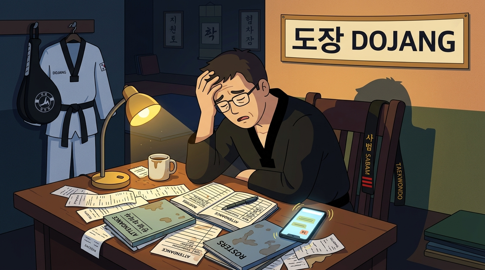

# Part 1: Tragedi di Balik Tatami — Jebakan Utang Administratif

> 📖 Hub Buku: **[DAYS: Dojang & Athlete Yield System](index.md)**

---

<div align="center">
  
  <p><sub><em>Ilustrasi 1: Ketika keahlian teknik di matras tertimbun oleh ratusan bukti transfer, buku presensi basah, dan tumpukan administrasi di larut malam.</em></sub></p>
</div>

---

## 📖 Narasi Pembuka: Sore yang Melelahkan di Ujung Matras

Pukul 16.30, matahari sore menyusup miring melalui kisi-kisi jendela kaca sebuah aula olahraga serbaguna di pinggiran kota. Di atas susunan matras puzzle berwarna merah dan biru yang mulai hangat oleh hawa tubuh, terdengar dentuman berirama: *dug... dug... bakk!* 

Dua puluh pasang kaki berseragam putih (*dobok*) bergerak lincah mengikuti aba-aba. Setiap kali ujung kaki menghantam bantalan target (*kicking target*), pekikan semangat (*kihap*) yang menggelegar memantul di dinding ruangan. Di tengah matras, berdiri Sabam Rahmat. 

Sabam Rahmat adalah sosok pelatih yang disegani. Ia menghabiskan masa mudanya di pelatnas, menyumbangkan medali emas di berbagai kejuaraan nasional, dan memiliki mata elang yang mampu mendeteksi kesalahan terkecil dalam gerak tubuh seseorang. Dari jarak lima belas meter, ia bisa melihat bahwa pinggul seorang murid sabuk kuning terlambat berputar tiga derajat saat mengeksekusi tendangan *dollyo chagi*, atau kuda-kuda seorang atlet kadet terlalu sempit sehingga rentan dijatuhkan lawan. Di atas matras ini, Sabam Rahmat adalah seorang maestro. Kata-katanya didengar dengan takzim, gerakannya ditiru dengan kagum, dan kehadirannya memancarkan wibawa ksatria sejati.

Namun, tepat pukul 18.00, ketika peluit panjang dibunyikan dan para murid berbaris rapi untuk membungkuk memberi hormat (*charyeot, gyeong-nye*), pesona kepemimpinan itu seketika koyak oleh kenyataan duniawi yang dingin.

Begitu anak-anak melangkah keluar dari matras sambil menenteng botol minum mereka, Sabam Rahmat tidak memiliki kemewahan untuk duduk santai bersama para asistennya guna mengevaluasi efektivitas latihan fisik hari itu. Sebaliknya, ia harus buru-buru menyambar tas ranselnya yang diletakkan di bangku sudut. Dari dalam tas yang berbau minyak gosok dan keringat itu, ia mengeluarkan sebuah binder map plastik lusuh. Di dalamnya terselip belasan lembar kertas fotokopi presensi yang tepi-tepinya sudah melengkung, lusuh, dan sebagian bernoda basah akibat cipratan air minum anak-anak.

Di luar pintu dojang, antrean orang tua murid sudah menunggu. Sebagian dari mereka memegang ponsel dengan layar menyala:

*"Sabam, maaf mengganggu sebentar. Anak saya, Fajar, bulan ini sudah lunas iuran belum ya? Soalnya suami saya kemarin katanya sudah transfer, tapi dia lupa simpan bukti resinya."*

Sabam Rahmat tertegun sejenak. Ia mencoba mengingat-ingat mutasi rekeningnya, lalu membolak-balik lembaran binder kertas yang kusut: *"Ehm... sebentar ya Bu. Nanti malam saya cek mutasi di internet banking ya, Bu. Soalnya nama rekening pengirim kadang beda sama nama Fajar."*

Belum sempat ia menutup binder, seorang wali murid lain menghampiri: *"Sabam, jadwal Ujian Kenaikan Tingkat bulan depan hari Minggu tanggal berapa ya? Soalnya keluarga kami mau pesan tiket liburan keluar kota. Takutnya bentrok."*

Di saku celana training-nya, ponsel pintar Sabam bergetar tiada henti. Di layar terkunci, notifikasi grup WhatsApp dojang yang beranggotakan 180 orang tua murid mengalir deras layaknya air bah: ada yang izin tidak masuk karena ada tugas kelompok sekolah, ada yang komplain seragam dobok anaknya kekecilan, dan ada tujuh gambar tangkapan layar m-banking yang dikirim tanpa keterangan nama siswa sama sekali.

Pukul 22.00 malam, setelah menembus kemacetan jalanan dan membersihkan diri, Sabam Rahmat duduk di meja makannya di bawah temaram lampu belajar. Di samping cangkir kopi yang sudah dingin, laptop tuanya menyala menampilkan lembar Excel manual yang kolom-kolomnya berantakan. Matanya yang merah menatap angka demi angka: ia harus mencocokkan mutasi bank senilai ratusan ribu rupiah dengan nama-nama panggilan di obrolan WhatsApp yang kerap kali berbeda: akun bernama *"Bunda Cantik 88"* ternyata adalah ibu dari seorang murid bernama Kevin. 

Tepat pukul 00.15 dini hari, Sabam Rahmat menutup laptopnya dengan helaan napas panjang. Punggungnya pegal, kepalanya berdenyut, dan hatinya terasa hampa. Waktu istirahat yang semestinya ia gunakan untuk mempelajari rekaman video taktik pertandingan lawan dari kejuaraan dunia terbaru, atau merancang periodisasi beban otot bagi atlet binaannya yang akan bertanding dua bulan lagi, habis tak berbekas hanya untuk urusan administrasi kas dan presensi yang remeh-temeh.

Keesokan paginya, ketika ia melangkah kembali ke atas matras, api di matanya meredup. Ia mengajar dengan sisa energi fisik, suaranya parau, dan kesabarannya menipis. Sabam Rahmat bukan lagi pelatih berwawasan tajam yang membimbing atletnya menuju puncak prestasi; ia telah berubah menjadi seorang juru tata usaha yang kelelahan dan kebetulan mengenakan sabuk hitam.

---

## 🔬 Teardown Konsep & Wawasan Utama

### 1. Paradoks Dojang Tradisional: Utang Administratif (*Administrative Debt*)

Di dunia teknologi perangkat lunak, para insinyur sangat mengenal konsep *Technical Debt* (Utang Teknis)—kondisi di mana tim memilih jalan pintas yang cepat dan berantakan demi mengejar peluncuran produk, yang pada akhirnya menumpuk menjadi beban bunga struktural yang melumpuhkan stabilitas sistem di masa depan. 

Dalam dunia olahraga bela diri, Days Prestasi menemukan fenomena yang persis sama, yang kami namakan **Utang Administratif (*Administrative Debt*)**.

Kebanyakan dojang didirikan atas dasar cinta murni (*pure passion*) terhadap seni bela diri. Seorang atlet senior memutuskan membuka kelas latihan. Pada awalnya, muridnya hanya delapan hingga sepuluh orang—anak tetangga, keponakan, dan teman dekat. Dalam skala mikro ini, pencatatan di atas buku saku atau sekadar mengandalkan ingatan kepala masih bekerja dengan baik. Hubungan personal sangat intim; jika ada yang belum membayar iuran, pelatih cukup menyapa di pertemuan berikutnya.

Namun bahaya utang administratif baru menampakkan wujud aslinya ketika dojang mulai tumbuh:

```text
  [ SKALA MIKRO: 10 SISWA ] ──> Cukup Ingatan Kepala & Buku Catatan Tulis
              │
              ▼ (Dojang Berkembang)
  [ SKALA MENENGAH: 50-100 SISWA ] ──> Excel Mulai Berantakan, WhatsApp Riuh
              │
              ▼ (Buka Cabang Baru)
  [ SKALA MAKRO: >150 SISWA ] ──> KEBOCORAN SISTEMIK!
                                  - 20% Iuran Menguap
                                  - Absensi Menjadi Asumsi
                                  - Pelatih Mengalami Burnout Kronis
```

Ketika jumlah siswa melompat melewati angka 50, dan kemudian membuka cabang di tempat latihan kedua, **sistem ingatan manusia ambruk**. Grup WhatsApp menjadi bising tanpa struktur. Lembaran spreadsheet ditinggalkan karena tidak mampu mengimbangi kecepatan interaksi di pinggir matras. 

Tragedi dari utang administratif adalah ia tidak membunuh dojang secara mendadak; ia membunuhnya secara perlahan lewat **pengeroposan energi mental (*mental bandwidth exhaustion*)**. Setiap kali seorang pelatih dipaksa mengingat siapa yang belum membayar uang ujian atau memeriksa kuitansi sewa gedung yang hilang, kapasitas otaknya untuk memikirkan taktik pertandingan dan pembinaan mental atlet terpotong secara dramatis.

---

### 2. Tiga Kebocoran Fatal yang Melumpuhkan Dojang

Days Prestasi memetakan tiga titik kebocoran utama yang dialami oleh lebih dari 85% dojang bela diri tradisional di Indonesia:

#### A. Kebocoran Presensi & Patahnya Kurikulum Longitudinal
Ketika presensi hanya dicatat di atas lembaran kertas atau bahkan tidak dicatat sama sekali, dojang kehilangan aset paling berharga dalam ilmu keolahragaan modern: **data konsistensi kehadiran**. 

Seorang anak bernama Dimas absen selama tiga minggu berturut-turut karena sakit demam berdarah. Ketika Dimas kembali ke matras, pelatih yang mengajar hari itu adalah asisten pelatih pengganti yang tidak mengetahui riwayat sakitnya. Sang asisten langsung menyuruh Dimas melakukan latihan fisik intensif (lari keliling gedung dan *sprint kick*). Akibatnya, Dimas pingsan di lapangan karena daya tahan kardiovaskularnya belum pulih, memicu kepanikan dan kemarahan orang tuanya.

Sebaliknya, ada murid yang hadir hanya seminggu sekali, namun ketika pendaftaran Ujian Kenaikan Tingkat (UKT) dibuka, orang tuanya ngotot mendaftarkan anaknya karena merasa *"sudah ikut latihan selama empat bulan"*. Ketiadaan data presensi objektif memaksa pelatih berada dalam posisi serba salah: menolak akan memicu konflik dengan orang tua, sementara meloloskan akan merusak standar mutu sabuk dan membahayakan keselamatan sang murid di tingkatan berikutnya.

#### B. Kebocoran Finansial yang Senyap (*The Phantom Churn*)
Secara statistik empiris, dojang yang mengandalkan penagihan manual kehilangan antara **15% hingga 25% potensi pendapatannya setiap bulan**. Menariknya, kebocoran ini jarang disebabkan oleh niat jahat orang tua untuk mengemplang iuran. Di era modern yang serba sibuk, orang tua murid sering kali benar-benar lupa apakah mereka sudah mentransfer iuran untuk bulan berjalan atau belum.

Karena tidak ada sistem penagihan otomatis yang mengirimkan notifikasi santun dan faktur digital, tugas penagihan jatuh ke pundak pelatih. Namun, pelatih bukanlah penagih utang profesional. Di hadapan orang tua murid yang lebih tua atau berstatus sosial tinggi, pelatih muda kerap merasa sungkan (*ewuh pakewuh*). Akibatnya, piutang dibiarkan menggantung berbulan-bulan. 

Ketika tunggakan menumpuk hingga tiga atau empat bulan, jumlah tagihan menjadi terlalu besar. Pada titik inilah terjadi fenomena **Phantom Churn**: alih-alih melunasi tunggakan, orang tua murid memilih secara diam-diam memberhentikan anaknya dari dojang dengan alasan *"anak sedang fokus ujian sekolah"*. Padahal, alasan sebenarnya adalah rasa malu atau ketidakmampuan melunasi akumulasi tagihan yang membengkak akibat kelalaian sistem penagihan dojang itu sendiri.

#### C. Keruntuhan Wibawa Guru Bela Diri
Ada paradoks psikologis yang sangat merusak marwah hubungan antara guru dan murid dalam seni bela diri. Seni bela diri mengajarkan *Ye-Ui* (Kesopanan), *Yom-Chi* (Integritas), dan *Baekjulboolgool* (Semangat Pantang Menyerah). Di mata anak-anak dan masyarakat, sabam adalah simbol kebijaksanaan dan keteguhan karakter.

Namun, bayangkan apa yang terjadi ketika figur berwibawa ini harus berdiri di pintu keluar dojang, memegang tas pinggang, dan bertanya dengan nada canggung kepada para orang tua: *"Ibu Rini, maaf... iuran bulan ini sudah sempat ditransfer belum ya?"*

Dalam sekejap, aura penghormatan (*respect*) terkikis. Relasi sakral antara pembimbing jiwa dan murid terdegradasi menjadi transaksi komersial jalanan. Rasa canggung ini menguras energi emosional pelatih, membuat mereka merasa rendah diri, dan pada akhirnya menciptakan kebencian bawah sadar (*subconscious resentment*) terhadap profesi melatih itu sendiri.

---

### 3. Mengapa Excel dan WhatsApp Tidak Pernah Cukup?

Banyak pengelola dojang yang berargumen: *"Kami sudah modern, kami mencatat semuanya di Google Sheets dan berkomunikasi lewat grup WhatsApp!"* 

Namun, mari kita bedah mengapa kombinasi ini terbukti gagal menjadi solusi jangka panjang:

1. **WhatsApp adalah Saluran Aliran (*Stream*), Bukan Basis Data (*Database*)**:
   WhatsApp dirancang untuk obrolan dinamis, bukan untuk pengarsipan sistematis. Ketika seorang ibu mengirimkan bukti transfer jam 14.00, lalu pada jam 14.15 ada 30 pesan lain masuk menanyakan *"Apakah latihan hari ini hujan?"* atau *"Kaos kaki anak saya ketinggalan di dojang"*, pesan bukti transfer tersebut seketika tenggelam puluhan layar ke atas. Pelatih harus meluangkan waktu berjam-jam melakukan *scrolling* mundur hanya untuk mencari satu gambar bukti bayar.
2. **Kesenjangan Waktu Nyata (*Real-Time Gap*) pada Spreadsheet**:
   Sebuah lembar kerja Excel tidak bisa berinteraksi langsung dengan kenyataan di matras. Pelatih di matras memegang peluit dan bantalan tendang; mereka tidak bisa mengetik di ponsel sambil mengawasi 40 anak yang sedang berlatih. Akibatnya, pencatatan di Excel selalu ditunda—menjadi pekerjaan rumah yang dikerjakan di akhir pekan. Ketika data tertunda 5 hingga 7 hari, data tersebut sudah basi (*stale data*) dan tidak lagi akurat untuk pengambilan keputusan.
3. **Ketidakmampuan Mengirim Umpan Balik Tertutup (*Closed-Loop Feedback*)**:
   Ketika Anda mengubah status *"Sudah Bayar"* pada kolom Excel di laptop pribadi Anda, orang tua murid tidak mengetahuinya. Mereka tidak menerima tanda terima otomatis, tidak mendapatkan laporan kehadiran bulanan anak mereka, dan tidak merasakan kepuasan transparansi. Spreadsheet adalah kotak hitam (*black box*) yang hanya bisa dilihat oleh si pembuatnya sendiri.

---

## 🧠 Eksperimen Pikiran: Dojang Sinar Harapan vs Dojang Cakra Buana

Untuk memahami dampak jangka panjang dari perbedaan cara pandang ini, bayangkan dua dojang bela diri yang didirikan pada tahun yang sama di kota yang sama:

* **Dojang Sinar Harapan (Sistem Manual Tradisional)**:
  Dipimpin oleh Sabam Danang, seorang juara yang sangat berdedikasi. Danang mencatat presensi di buku agenda dan mengelola keuangan melalui buku kas tulis tangan. Di tahun pertama dengan 30 siswa, dojang berjalan hangat. 
  
  Namun pada tahun ketiga dengan 120 siswa di dua tempat latihan berbeda, Danang mulai tampak kelelahan. Setiap akhir bulan ia mengeluhkan stres pencocokan kas. Asisten pelatihnya sering mengeluh honor mereka telat dibayarkan karena kas dojang sering kosong akibat penagihan yang bocor. Di tahun kelima, Danang menderita sakit asam lambung kronis akibat stres administratif. Dua atlet terbaiknya dibajak klub lain karena program pelatda dojangnya macet. Dojang Sinar Harapan terjebak dalam siklus pergantian murid yang tinggi (*high turnover*) dan prestasinya jalan di tempat.

* **Dojang Cakra Buana (Mengadopsi Paradigma DAYS)**:
  Dipimpin oleh Sabam Fajar. Sejak memiliki 30 murid pertama, Fajar menolak mencatat presensi di kertas. Ia menerapkan sistem DAYS. Setiap sesi latihan dibuka dengan memindai kehadiran via ponsel pintar selama 30 detik. Sistem secara otomatis menyapa orang tua melalui WhatsApp: *"Ananda Bintang telah hadir di matras latihan hari ini pukul 16.02 WIB."* Tagihan iuran mengalir otomatis tanggal 25 setiap bulannya dengan QRIS instan tanpa Fajar perlu membuka mulut satu patah kata pun untuk menagih.
  
  Hasilnya? Kas Dojang Cakra Buana selalu surplus 100%. Tidak ada kebocoran piutang. Fajar memiliki waktu luang setiap sore untuk mengamati grafik performa fisik muridnya, mendatangkan fisioterapis olahraga untuk mencegah cedera lutut atletnya, dan merancang strategi tanding video analysis. Dalam tiga tahun, dojang ini berkembang menjadi lima cabang dengan 450 murid aktif dan memborong gelar Juara Umum di Kejuaraan Provinsi.

Kunci keunggulan Dojang Cakra Buana bukan karena Sabam Fajar memiliki sabuk yang lebih tinggi dari Sabam Danang, melainkan karena **Sabam Fajar membangun infrastruktur yang menjaga energi mentalnya tetap utuh untuk hal yang paling penting: prestasi dan pembinaan manusia**.

---

## ⚡ Panduan Aksi Nyata dari Part 1

Bagi para pelatih dan pemilik perguruan bela diri yang ingin memutus rantai utang administratif hari ini:

1. [ ] **Audit Kebocoran Waktu Harian**: Mulai hari ini, pasang stopwatch di ponsel Anda. Catat persis berapa menit yang Anda habiskan setiap hari untuk: merekap absen, mencocokkan bukti transfer bank, membalas chat komplain jadwal, dan mencari barang inventaris yang hilang. Kalikan angka tersebut dengan 30 hari; Anda akan terkejut melihat berapa banyak waktu emas Anda yang tercuri.
2. [ ] **Hentikan Penerimaan Uang Tunai di Matras**: Buat pengumuman resmi bahwa terhitung mulai bulan depan, dojang tidak lagi melayani titipan uang tunai iuran di pinggir matras demi menjaga ketertiban pencatatan dan keamanan dana murid. Alihkan seluruh pembayaran ke satu pintu rekening virtual atau QRIS resmi dojang.
3. [ ] **Deklarasikan Batas Suci Matras Latihan**: Sepakati bersama tim pelatih bahwa saat kaki sudah menginjak matras, ponsel hanya digunakan untuk fungsi presensi instan kilat; tidak ada lagi pelatih yang duduk melamun membalas chat administrasi saat anak didik sedang memeras keringat di hadapannya.

---

## 💬 Kutipan Pilihan & Catatan Reflektif

> *"Seorang atlet berlatih menendang ribuan kali untuk mencapai ketepatan satu sentimeter di atas matras laga. Namun seluruh ketepatan itu menjadi sia-sia jika sistem yang menaunginya dikelola dengan perkiraan dan ingatan yang samar."*  
> — **Days Prestasi**, *DAYS Manifesto*

**Pertanyaan Refleksi Diri**:
- *Berapa banyak atlet bertalenta emas yang pernah lewat di dojang Anda, namun akhirnya menghilang tanpa jejak hanya karena ketiadaan sistem yang rapi untuk memantau kehadiran dan perkembangan mereka sejak sabuk putih?*

---

## 🧭 Navigasi Bab Selanjutnya

📖 **[Kembali ke Hub Buku](index.md)** &nbsp;&nbsp;•&nbsp;&nbsp; ➡️ **[Lanjut ke Part 2: Arsitektur Ekosistem Dojang — Rekayasa Tiga Titik Sinergi →](02-arsitektur-ekosistem-dojang.md)**
