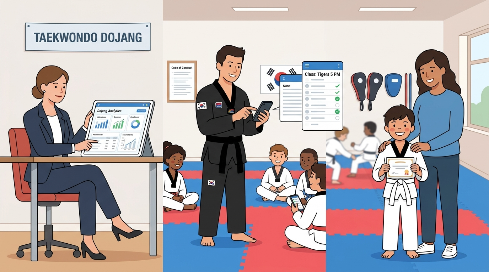

# Part 2: Arsitektur Ekosistem Dojang — Rekayasa Tiga Titik Sinergi

> 📖 Hub Buku: **[DAYS: Dojang & Athlete Yield System](index.md)**

---

<div align="center">
  
  <p><sub><em>Ilustrasi 2: Tiga pilar sinergi dalam Taekwondo Dojang modern—Owner dengan dasbor tata kelola, Sabam dengan presensi kilat di matras, serta Siswa dan Orang Tua dengan rasa percaya yang kokoh.</em></sub></p>
</div>

---

## 📖 Narasi Pembuka: Ketika Tiga Kepentingan Bertemu di Satu Pintu

Di setiap dojang taekwondo yang pintu utamanya dibuka setiap sore, sesungguhnya ada tiga dunia dengan realitas emosional yang sangat berbeda, yang saling bertatap muka namun kerap kali tidak saling memahami:

1. **Dunia Pemilik Dojang (The Dojang Owner)**:
   Ia duduk di meja kerjanya dengan kalkulator dan buku rekening. Di kepalanya berputar hitungan biaya operasional yang tak kenal kompromi: biaya sewa gelanggang latihan yang naik 15% tahun ini, pembelian matras baru berstandar WT (*World Taekwondo*) untuk menggantikan matras lama yang sudah licin, honor para sabam muda yang harus dibayar tepat tanggal satu, dan pertanyaan abadi: *"Dari 150 murid yang terdaftar, mengapa hanya 95 anak yang rutin hadir bulan ini? Cabang mana yang surplus dan cabang mana yang sebenarnya beroperasi dalam kerugian tersembunyi?"*

2. **Dunia Pelatih (The Coach / Sabam)**:
   Ia berdiri di atas matras dengan dobok hitam-putih dan sabuk hitam yang telah pudar warnanya karena keringat bertahun-tahun. Baginya, angka rupiah di atas kertas bukanlah prioritas saat peluit sudah berbunyi. Pikirannya tercurah pada anak-anak: *"Bagaimana membetulkan sudut tendangan melingkar (dollyo chagi) Rizky agar tidak mudah ditangkis lawan? Mengapa Sarah yang kemarin sangat bersemangat tiba-tiba mogok latihan dan menangis di pojok matras?"* Sabam ingin melatih dengan hati dan jiwa, namun ia muak saat harus merangkap menjadi kasir, penagih iuran, dan pembagi selebaran pengumuman.

3. **Dunia Siswa dan Orang Tua Murid (The Student & Parent)**:
   Bagi siswa cilik, dojang adalah petualangan. Ini tentang mengenakan dobok kebanggaan, meniru tendangan terbang para jagoan di televisi, dan mimpi suatu hari mengenakan sabuk hitam di pinggang. Namun bagi orang tua yang duduk menunggu di deretan bangku kayu di luar matras selama dua jam sambil mengorbankan waktu istirahat kerja mereka, pertanyaannya sangat pragmatis: *"Apakah investasi waktu dan biaya yang kami keluarkan setiap bulan benar-benar membentuk karakter dan kedisiplinan anak kami? Mengapa pengumuman jadwal sering mendadak? Apakah sabam benar-benar memperhatikan perkembangan anak saya, atau anak saya hanya menjadi pelengkap di barisan belakang?"*

Ketika ketiga entitas ini tidak dipersatukan oleh sebuah sistem komunikasi dan data yang transparan, lahirlah **jurang prasangka struktural**. 

Owner merasa pelatih bekerja seenaknya tanpa peduli manajemen kas. Pelatih merasa owner hanya memeras keringat mereka tanpa peduli betapa beratnya menangani puluhan anak kecil hiperaktif di lapangan. Sementara orang tua merasa dojang dikelola layaknya perkumpulan amatir karena kuitansi sering hilang dan jadwal tumpang tindih.

DAYS hadir untuk merajut kembali benang kusut ini. Melalui **Arsitektur Tiga Titik Sinergi (*The Dojang Synergy Triangle*)**, teknologi difungsikan bukan sebagai tirani mekanik yang dingin, melainkan sebagai jembatan yang membuat setiap pihak dapat menjalankan perannya secara mulia, saling menghargai, dan bekerja dengan rasa saling percaya yang mutlak.

---

## 🔬 Teardown Konsep & Wawasan Utama

```text
                                [ 🏛️ THE OWNER ]
                        Kedaulatan Visi, Kebijakan Kas,
                          & Manajemen Multi-Cabang
                                  ▲      ▲
                                 /        \
                   Transparansi Honor     \ Transparansi Nilai,
                   & Verifikasi Kinerja    \ Kepastian Jadwal,
                               /            \ & Keamanan Lingkungan
                              ▼              ▼
                 [ 🥋 SANG SABAM ] ◄────────► [ 🥋 SISWA & WALI ]
               Presensi Sekali Sentuh,        Jejak Rekam Sabuk Digital,
               Monitoring Teknik Siswa,       Kebanggaan Prestasi, &
               & Waktu Penuh di Matras        Rasa Memiliki Komunitas
```

---

### 1. Kedaulatan Sang Pemilik: Manajemen Dojang Terpusat (*Owner Command Center*)

Dalam hierarki seni bela diri tradisional, pemilik dojang sering kali adalah pendiri (*kwanjangnim*) atau praktisi senior yang bertransformasi menjadi pengusaha olahraga. Namun, banyak dari mereka terjebak dalam perangkap *Micromanagement Hell*—mereka harus berada secara fisik di setiap cabang hanya untuk memastikan pintu gelanggang dibuka tepat waktu dan uang pendaftaran tidak diselewengkan.

Modul Dojang Management dalam DAYS dirancang sebagai **pusat kendali kedaulatan institusional**:

* **Identitas Institusi yang Tak Tergoyahkan (Branding & Filosofi)**:
  Dojang adalah rumah pembentukan karakter (*way of life*). Nama, logo resmi, janji taekwondo, dan visi-misi perguruan harus tertanam secara konsisten di setiap cabang. Melalui DAYS, seluruh profil cabang—baik cabang pusat, cabang sekolah, maupun cabang studio kebugaran—bernaung di bawah payung standar mutu identik.
* **Manajemen Multi-Lokasi & Alokasi Pelatih**:
  Mengelola lima cabang latihan dengan jadwal berbeda (misalnya: Cabang GOR Koni hari Senin-Rabu, Cabang Al-Azhar hari Selasa-Kamis, dan Cabang Studio Prestasi hari Sabtu-Minggu) sering memicu kekacauan jadwal pelatih. DAYS memetakan ketersediaan tempat, pembagian kelas (kelas reguler, kadet, junior, hingga kelas khusus atlet tanding), serta menugaskan sabam utama dan asisten secara otomatis tanpa risiko tabrakan jadwal (*scheduling conflict*).
* **Otomasi Ledger Keuangan & Honorarium Berbasis Kinerja**:
  Menghapus perhitungan manual di akhir bulan. Setiap kali seorang pelatih menyelesaikan sesi kelas dan memverifikasi presensi murid di lapangan, sistem secara otomatis mencatat beban honor mengajar yang menjadi hak sang pelatih. Di sisi pemasukan, sistem menyajikan dasbor arus kas yang jernih: berapa uang iuran yang sudah masuk via saluran digital, berapa piutang yang masih tertunda, dan berapa alokasi dana operasional yang tersedia untuk pemeliharaan fasilitas.
* **Monitoring Pertumbuhan & Kesehatan Retensi Murid**:
  Pemilik tidak lagi membutuhkan laporan setebal puluhan halaman. Di layar dasbor, tersaji grafik retensi murid secara berkala: cabang mana yang angka pendaftarannya melesat, dan cabang mana yang angka keluarnya (*drop-out rate*) mengkhawatirkan. Pemilik dapat segera mengambil tindakan kuratif—misalnya mengevaluasi metode pengajaran di cabang tersebut—sebelum masalah membesar.

---

### 2. Modul Pelatih: Memangkas Rutinitas Demi Mengawal Mutu Teknik

Seorang sabam adalah jantung dari dojang. Karisma pribadinya, ketepatan contoh gerakannya, dan kehangatan dorongan moralnya adalah alasan utama mengapa seorang anak kecil rela bangun pagi di hari libur untuk berlatih menendang hingga bercucuran keringat. Membebani sabam dengan urusan tata usaha adalah pemborosan sumber daya kemanusiaan paling fatal dalam dunia olahraga.

Modul Pelatih dirancang dengan filosofi **Ultra-Lean & Ergonomis**:

* **Presensi Sekali Sentuh (*One-Tap Attendance*) Kurang dari 30 Detik**:
  Ketika 35 murid berbaris di awal kelas, sabam cukup membuka aplikasi di ponsel pintarnya. Daftar nama murid di kelas tersebut sudah tersaji rapi lengkap dengan foto wajah mereka. Cukup dengan sentuhan jari, status hadir, izin, sakit, atau alfa terdata seketika. Tidak ada lagi buku absen basah, tidak ada lagi pulpen macet di pinggir matras.
* **Catatan Perkembangan Siswa (*Digital Student Log*)**:
  Seorang sabam yang baik tidak hanya melihat kehadiran, tetapi mengamati detail perkembangan fisik dan mental anak didiknya. Di aplikasi, sabam dapat menyematkan catatan penting dalam hitungan detik melalui input suara atau ketukan singkat:
  - *"Aditya: fleksibilitas otot selangkangan meningkat pesat, siap diajarkan tendangan cangkul (naeryo chagi)."*
  - *"Bagas: hari ini tampak lesu dan kurang fokus, perlu diajak bicara santai pasca-latihan."*
  Catatan ini menjadi rekam jejak berharga yang tidak akan hilang ketika terjadi rotasi pelatih, memastikan kontinuitas pembinaan murid tetap terjaga secara konsisten.
* **Transparansi Jam Terbang & Penghargaan Profesi**:
  Pelatih dapat melihat langsung akumulasi jam mengajarnya sepanjang bulan berjalan. Kepastian bahwa setiap tetes keringat mereka tercatat dan akan dibayarkan secara adil tanpa ada yang terlewat menumbuhkan rasa aman (*psychological safety*) dan loyalitas tinggi terhadap dojang tempat mereka mengabdi.

---

### 3. Modul Siswa & Wali Murid: Membangun Kepercayaan dan Kebanggaan

Bagi orang tua murid, menyekolahkan anak ke dojang taekwondo adalah keputusan investasi karakter. Mereka ingin anak mereka belajar disiplin, memiliki tubuh yang bugar, dan mampu membela diri dari perundungan (*anti-bullying*). Namun, ketidakpastian administrasi sering kali mengikis niat baik tersebut.

Modul Siswa menghadirkan **Paspor Digital Bela Diri (*The Martial Arts Passport*)**:

* **Ketenangan Hati Secara Real-Time**:
  Begitu sabam menandai kehadiran anak di matras, ponsel orang tua yang sedang bekerja di kantor menerima notifikasi lembut: *"Ananda Rayhan telah hadir di matras latihan Taekwondo Dojang Prestasi (Sesi 16.00 WIB)."* Rasa cemas orang tua sirna; mereka tahu anak mereka telah sampai di tempat yang aman dan sedang dibina dengan baik.
* **Transparansi Silabus & Kelaikan Sabuk**:
  Orang tua tidak perlu lagi bertanya-tanya: *"Kapan anak saya bisa ikut ujian sabuk kuning?"* Di aplikasi mereka, terdapat indikator progres yang jelas: dari syarat 24 sesi latihan untuk kenaikan sabuk, anak mereka telah menyelesaikan 18 sesi dengan catatan teknik dasar yang sudah terverifikasi oleh sabam. Hal ini mengeliminasi kecurigaan bahwa dojang menunda-nunda kenaikan tingkat demi menarik uang iuran lebih lama.
* **Jadwal Dinamis & Kalender Terintegrasi**:
  Jika ada perubahan jadwal latihan mendadak karena gelanggang dipakai untuk acara dinas olahraga, pengumuman otomatis terdistribusi ke ponsel seluruh wali murid tanpa perlu sabam mengunggah pesan panjang yang rawan tenggelam di grup chat.

---

## 🧠 Eksperimen Pikiran: Studi Kasus Transformasi "Taekwondo Satria Perkasa"

Taekwondo Satria Perkasa adalah perguruan yang memiliki 3 cabang di Yogyakarta dengan 180 murid. Sebelum menerapkan DAYS, pemilik dojang (Sabam Senior Kusuma) sering bersitegang dengan para pelatih mudanya:

* **Insiden Honor yang Tertukar**: Sabam Yoga merasa telah mengajar 16 kali pertemuan di Cabang Selatan, namun bendahara dojang hanya menemukan 11 lembar paraf presensi di meja kantor. Sabam Yoga merasa tidak dihargai dan sempat mengancam akan keluar membawa separuh murid binaannya.
* **Siswa yang Terlupakan**: Seorang anak bernama Dania berhenti datang latihan selama sebulan penuh karena sakit. Tidak ada seorang pelatih pun yang menyadarinya karena tidak ada sistem rekapitulasi presensi otomatis. Ketika orang tua Dania akhirnya memutuskan keluar, mereka berkata: *"Ternyata ada atau tidak adanya anak saya di dojang ini sama sekali tidak ada yang peduli."*

**Dua Bulan Pasca-Implementasi DAYS**:
1. **Presensi Cloud Terpadu**: Sabam Yoga mencatat presensi langsung di matras via ponsel. Setiap akhir bulan, dasbor owner langsung menghitung total 16 sesi secara akurat. Honor ditransfer otomatis pada tanggal 1 dengan rincian slip digital yang transparan. Hubungan antara owner dan pelatih menjadi sangat harmonis.
2. **Sistem Peringatan Dini Kehadiran (*Early Dropout Warning*)**: Ketika ada siswa yang absen dua kali berturut-turut tanpa kabar, sistem DAYS secara otomatis memunculkan tanda waspada di dasbor sabam. Sabam dapat langsung mengirim pesan perhatian pribadi ke orang tua murid: *"Halo Ibu Dania, kami melihat Dania sudah dua sesi absen latihan, apakah Dania sedang kurang sehat? Kami semua di dojang merindukan senyum dan semangat Dania di matras."* 
   
Perhatian personal yang didukung oleh sistem data ini menyentuh hati orang tua murid. Angka retensi siswa di Taekwondo Satria Perkasa melonjak hingga 94%, dan dojang tersebut dinobatkan sebagai perguruan taekwondo paling profesional dan ramah anak di wilayahnya.

---

## ⚡ Panduan Aksi Nyata dari Part 2

Langkah nyata membangun ekosistem sinergi di dojang taekwondo Anda:

1. [ ] **Petakan Tiga Peran Kunci**: Duduklah bersama tim inti dojang. Tuliskan batas tanggung jawab yang tegas: Owner fokus pada pengembangan fasilitas dan visi makro; Pelatih fokus 100% pada teknik, kedisiplinan, dan keselamatan atlet di matras; Staf administrasi/sistem mengurus seluruh aliran data dan transaksi.
2. [ ] **Standardisasi Silabus Digital**: Rangkum kurikulum gerakan dasar (*kibon dongjak*), jurus (*taegeuk*), dan teknik tendangan untuk masing-masing tingkatan sabuk agar dapat diakses oleh seluruh pelatih di aplikasi mereka.
3. [ ] **Bangun Kebiasaan Transparansi**: Mulai bagikan laporan perkembangan dan apresiasi kehadiran siswa kepada para orang tua secara berkala, membuktikan bahwa dojang Anda mengelola amanah pendidikan karakter mereka dengan standar tertinggi.

---

## 💬 Kutipan Pilihan & Catatan Reflektif

> *"Kepercayaan orang tua murid tidak dibangun dari megahnya piala di lemari pajangan kantor dojang, melainkan dari keteraturan dan rasa hormat yang mereka rasakan dalam setiap detail interaksi sehari-hari."*  
> — **Days Prestasi**, *DAYS Manifesto*

**Pertanyaan Refleksi Diri**:
- *Apakah selama ini pelatih di dojang Anda merasa didukung penuh oleh sistem manajemen untuk menjadi pendidik terbaik, ataukah mereka merasa ditinggalkan sendirian mengurus segala kerepotan di pinggir matras?*

---

## 🧭 Navigasi Bab Selanjutnya

⬅️ **[Kembali ke Part 1: Tragedi di Balik Tatami](01-tragedi-di-balik-tatami.md)** &nbsp;&nbsp;•&nbsp;&nbsp; 📖 **[Hub Buku](index.md)** &nbsp;&nbsp;•&nbsp;&nbsp; ➡️ **[Lanjut ke Part 3: Jalur Prestasi Terintegrasi (UKT, Turnamen, Federasi) →](03-jalur-prestasi-terintegrasi.md)**
