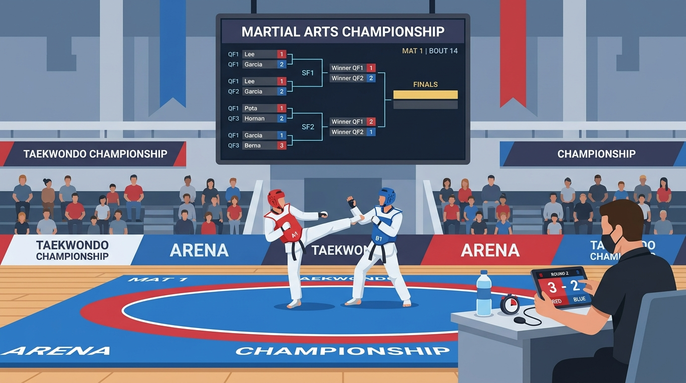

# Part 3: Jalur Prestasi Terintegrasi — Dari Matras Ujian Hingga Podium Juara

> 📖 Hub Buku: **[DAYS: Dojang & Athlete Yield System](index.md)**

---

<div align="center">
  
  <p><sub><em>Ilustrasi 3: Transformasi arena kejuaraan taekwondo dan ujian sabuk modern—bagan digital terintegrasi di layar arena, pertarungan jujur di matras, dan penilaian wasit real-time via tablet tanpa kekacauan meja panitia.</em></sub></p>
</div>

---

## 📖 Narasi Pembuka: Kepanikan di Balik Meja Panitia Kejuaraan

Bagi siapa pun yang pernah terlibat dalam penyelenggaraan kejuaraan taekwondo tingkat daerah, sirkuit pelajar, atau sekadar Ujian Kenaikan Tingkat (UKT) gabungan antar-dojang, pemandangan dramatis berikut tentu sudah terpahat erat dalam ingatan:

Hari Sabtu pagi pukul 07.30 di sebuah Gelanggang Olahraga (GOR) milik pemerintah daerah. Dari luar, suasana tampak gegap gempita: ratusan atlet anak-anak dan remaja berseragam dobok putih berjalan beriringan bersama orang tua mereka yang membawa tas perlengkapan besar berisi pelindung tubuh (*hogu*), helm pelindung kepala (*headguard*), serta bantalan tulang kering (*shin guard*). 

Namun, jika Anda melangkah mendekati meja panitia pelaksana di depan tribun VIP, suasananya lebih mirip ruang gawat darurat yang sedang dilanda bencana:
- Tumpukan map kertas formulir pendaftaran setinggi setengah meter berserakan di atas taplak meja yang basah tersenggol botol air mineral.
- Seorang pelatih kontingen dari luar kota sedang menggebrak meja dengan wajah merah padam. Atlet andalannya di kelas Kyorugi Cadet Putri Under 41 kg tidak tercantum di bagan pertandingan (*drawing bracket*), padahal sang pelatih telah mengirimkan bukti transfer pendaftaran via WhatsApp tiga minggu lalu ke nomor panitia yang ternyata nomor ponsel sukarelawan panitia yang sudah tidak aktif.
- Di sudut penimbangan berat badan (*weigh-in*), terjadi antrean mengular puluhan meter yang memicu pertengkaran antar-pelatih karena timbangan jarum manual panitia menunjukkan selisih 400 gram lebih berat dibanding timbangan digital yang digunakan atlet di penginapan mereka.
- Jadwal pertandingan (*match order*) yang ditempel di dinding kaca GOR dipenuhi coretan pulpen spidol tebal: ada nama yang dicoret karena salah memasukkan atlet sabuk hijau ke kelas sabuk hitam, ada nomor partai yang melompat, dan jadwal yang semestinya dimulai pukul 08.30 pagi baru bisa melangsungkan partai pertama pada pukul 12.15 siang setelah sholat dzuhur.

Akibat keterlambatan kronis ini, bencana berantai terjadi. Pertandingan babak penyisihan molor hingga larut malam. Menjelang pukul 23.00, atlet-atlet cilik berusia delapan tahun tertidur pulas kelelahan di bangku tribun dengan kepala berbantal tas ransel. Ketika nomor partainya akhirnya dipanggil oleh pengeras suara panitia, anak-anak tersebut dibangunkan dalam kondisi mengantuk, bingung, kedinginan, dan menangis. Di atas matras, mereka bertanding tanpa energi optimal, rentan mengalami cedera akibat pemanasan yang sudah dingin berjam-jam sebelumnya.

Kondisi serupa terjadi pada momentum **Ujian Kenaikan Tingkat (UKT)**. Master penguji yang didatangkan dari Pengurus Cabang membawa berkas kertas penilaian setebal novel. Menilai 300 peserta dalam waktu empat jam membuat penguji mengalami kelelahan visual (*visual fatigue*). Di akhir ujian, lembaran nilai kertas dikumpulkan ke dalam kardus, dibawa ke kantor sekretariat, dan berbulan-bulan kemudian sertifikat kelulusan belum juga selesai dicetak karena juru ketik sekretariat harus mengetik ulang nama murid satu per satu di blangko piagam, di mana 10% di antaranya mengalami kesalahan penulisan nama atau nomor registrasi sabuk.

Inilah potret nyata mengapa pembinaan olahraga bela diri kita kerap kali tersengal-sengal di kancah regional dan internasional. **Bakat atlet kita berlimpah bagaikan intan di dasar sungai, tekad para sabam kita membara tak pernah padam, namun infrastruktur pengujian dan perhelatan kita masih tertinggal puluhan tahun di era analog yang rapuh.**

DAYS hadir untuk merombak total seluruh jalur pipa prestasi ini: menghubungkan matras ujian sabuk di dojang, arena kejuaraan yang megah, hingga basis data talenta nasional di tingkat federasi tertinggi.

---

## 🔬 Teardown Konsep & Wawasan Utama

```text
┌────────────────────────────────────────────────────────────────────────┐
│            JALUR PIPA PRESTASI TERPADU (DAYS ATHLETE PIPELINE)         │
├────────────────────────────────────────────────────────────────────────┤
│                                                                        │
│   [ 1. MATRAS DOJANG ]   ──> Presensi Latihan Rutin & Mastery Silabus  │
│             │                                                          │
│             ▼                                                          │
│   [ 2. MODUL UKT ]       ──> Validasi Kelaikan Otomatis, Scoring       │
│                              Digital Tablet Penguji, E-Sertifikasi QR │
│             │                                                          │
│             ▼                                                          │
│   [ 3. MODUL TURNAMEN ]  ──> Pendaftaran Kontingen Online, Drawing     │
│                              Digital Otomatis, Live Bracket di Layar,  │
│                              Rekam Jam Terbang & Medali Atlet          │
│             │                                                          │
│             ▼                                                          │
│   [ 4. MODUL FEDERASI ]  ──> Scouting Bakat Berbasis Big Data Analitik,│
│                              Data Profil Atlet Nasional Longitudinal   │
│                                                                        │
└────────────────────────────────────────────────────────────────────────┘
```

---

### 1. Modul UKT: Mengembalikan Kesucian & Objektivitas Pengujian Sabuk

Dalam filosofi taekwondo, sabuk (*tti*) bukan sekadar kain berwarna pengikat pinggang; ia adalah lambang dari pendewasaan jiwa, peningkatan kematangan teknik, dan tanggung jawab moral. Sayangnya, akibat ketiadaan standardisasi, UKT sering kali disalahpahami oleh masyarakat awam sebagai sekadar "bisnis jual beli sabuk" di mana siapa pun yang membayar biaya ujian dijamin pasti lulus.

Modul UKT DAYS merehabilitasi marwah sakral ini melalui sistem verifikasi objektif:

* **Penyaringan Kelaikan Otomatis (*Automated Eligibility Gate*)**:
  Sebelum nama siswa dapat didaftarkan ke dalam daftar peserta UKT, sistem secara otomatis menguji pemenuhan syarat mutlak:
  1. *Kehadiran Minimal*: Siswa telah menghadiri jumlah sesi latihan yang ditentukan (misalnya minimal 24 sesi sejak ujian sabuk terakhir).
  2. *Verifikasi Silabus Pelatih*: Sabam utama telah memberikan centang hijau pada kompetensi teknik dasar (*kibon dongjak*), bentuk jurus (*poomsae*), dan teknik tendangan (*chagi*) di aplikasi.
  3. *Integritas Waktu*: Jeda waktu minimal antar-tingkatan sabuk (misal minimal 3–4 bulan untuk sabuk warna, dan 1 tahun untuk kenaikan tingkat Dan sabuk hitam) terkunci secara otomatis oleh sistem, mencegah praktik "sabuk karbitan".
* **Lembar Penilaian Digital Penguji (*Tablet Scoring Sheet*)**:
  Grandmaster atau master penguji dari Pengurus Cabang tidak lagi memegang kertas dan pena yang rawan tertiup angin di tengah lapangan. Di hadapan mereka terpasang tablet digital dengan antarmuka yang sangat intuitif:
  - Penguji cukup mengetuk nilai untuk aspek ketepatan gerakan, kekuatan tendangan (*power*), kelenturan, dan kedisiplinan sikap (*attitude*).
  - Nilai langsung terakumulasi secara matematis seketika sesi ujian kelompok selesai, menghapus potensi salah hitung nilai rata-rata oleh staf panitia.
* **Penerbitan E-Sertifikat Terverifikasi dengan QR Code**:
  Begitu dewan penguji menandatangani berita acara digital di sistem, data kelulusan murid langsung disahkan. Sistem secara otomatis menerbitkan sertifikat digital beresolusi tinggi lengkap dengan **Nomor Registrasi Unik** dan **QR-Code Verifikasi**. Ketika orang tua atau pihak sekolah memindai kode tersebut, layar ponsel akan menampilkan riwayat resmi: nama atlet, tanggal kelulusan, nama master penguji, serta legalitas dojang penerbit. Hal ini menutup rapat peredaran sertifikat sabuk bodong yang merugikan nama baik cabang olahraga.

---

### 2. Modul Turnamen: Menghapus Kekacauan Meja Panitia Menjadi Ajang Berkelas Dunia

Kejuaraan taekwondo adalah kawah candradimuka di mana seorang atlet menguji keberanian mentalnya, merasakan pahitnya kekalahan, dan menikmati manisnya kemenangan. Pengalaman ini harus dikawal dengan kepanitiaan yang presisi, adil, dan bermartabat.

Modul Turnamen DAYS mengubah pekerjaan berhari-hari menjadi hitungan menit:

* **Pendaftaran Kontingen Digital & Kunci Usia Mutlak**:
  Manajer kontingen mendaftarkan atlet mereka secara online dari kota asal mereka masing-masing. Sistem mengunci validasi tanggal lahir berdasarkan Nomor Induk Kependudukan (NIK) atau akta kelahiran yang diunggah, **melenyapkan praktik pencurian umur (*age fraud*)** yang selama ini menjadi momok kejuaraan kategori pra-usia dini dan kadet.
* **Bagan Pertandingan & Algoritma Drawing Cerdas (*Smart Bracket Generation*)**:
  Hari-hari pengundian bagan menggunakan sobekan kertas di dalam toples yang memicu kecurigaan kongkalikong telah berakhir. Sistem DAYS menghasilkan bagan pertandingan digital (*single elimination bracket*) menggunakan algoritma teruji:
  - *Seeding Logic*: Menempatkan atlet unggulan peraih medali di kejuaraan sebelumnya pada kutub bagan yang berlawanan agar tidak bertemu di babak awal.
  - *Do-Not-Meet Constraint*: Mencegah dua atlet yang berasal dari satu dojang yang sama untuk saling berhadapan di partai penyisihan pertama.
* **Sinkronisasi Timbang Badan (*Digital Weigh-in Integration*)**:
  Saat atlet melangkah ke atas timbangan badan resmi pada H-1 pertandingan, timbangan digital terhubung langsung dengan sistem. Jika berat badan atlet berada dalam rentang kelas yang didaftarkan (misal Kyorugi Junior Putra Under 55 kg: 51.01 kg – 55.00 kg), sistem langsung mencetak kartu atlet (*accreditation badge*) berstatus terverifikasi.
* **Dasbor Urutan Partai & Bagan Real-Time di Seluruh Gelanggang**:
  Di dalam arena, layar monitor besar di setiap lapangan menampilkan bagan yang bergerak secara langsung (*live bracket*). Ketika wasit di Lapangan 1 menyelesaikan partai ke-14, sistem secara otomatis memanggil atlet untuk partai ke-15 dan mengirimkan notifikasi pengingat ke ponsel sabam pendamping partai ke-16 untuk mulai mengenakan pelindung di ruang pemanasan. Tidak ada lagi partai yang terbengkalai, tidak ada lagi atlet yang didiskualifikasi karena terlambat masuk gelanggang (*walk-out* tanpa sengaja).

---

### 3. Modul Federasi: Jembatan Data Akar Rumput Menuju Panggung Dunia

Di banyak negara berkembang, federasi cabang olahraga sering kali beroperasi dalam kebutaan data. Pengurus daerah atau pengurus nasional hanya mengenal atlet-atlet yang beredar di klub-klub elite ibu kota, atau atlet yang kebetulan memiliki kedekatan personal dengan pengurus. Ratusan mutiara terpendam di dojang-dojang pelosok daerah tidak pernah terpantau karena hasil kejuaraan daerah mereka hanya tersimpan di tumpukan kertas buletin panitia yang berdebu di gudang.

Modul Federasi DAYS membangun jalan tol data nasional yang revolusioner:

* **Basis Data Atlet Tunggal Terpadu (*Single Athlete ID*)**:
  Setiap atlet taekwondo yang berlatih di dojang yang terafiliasi memiliki satu identitas unik (*Unique Athlete Passport*). Seluruh rekam jejak mereka—sejak pertama kali memakai sabuk putih di usia 6 tahun, rekam jejak berat badan dari tahun ke tahun, catatan medali di berbagai kejuaraan, hingga riwayat cedera ligamen—terekam secara kronologis dan tidak dapat dimanipulasi.
* **Pemanduan Bakat Berbasis Analisis Data (*Data-Driven Talent Scouting*)**:
  Ketika pelatih tim nasional junior membutuhkan seorang atlet kelas Kyorugi Flyweight putra dengan jangkauan kaki panjang dan memiliki rasio kemenangan tendangan kepala (*head kick ratio*) di atas 40%, federasi tidak perlu lagi menggelar seleksi terbuka yang memakan biaya miliaran rupiah. Pengurus federasi cukup memfilter data di dasbor DAYS: sistem akan menyajikan sepuluh kandidat atlet terbaik dari berbagai penjuru tanah air lengkap dengan video aksi dan data statistik pertandingan mereka. Pembinaan atlet menjadi transparan, objektif, dan berlandaskan prestasi murni (*meritocracy*).
* **Harmonisasi Regulasi Internasional**:
  Setiap kali federasi dunia (seperti World Taekwondo) memperbarui aturan perolehan poin atau sistem pelanggaran (*gam-jeom*), pengurus federasi dapat menyebarkan petunjuk teknis resmi dan video edukasi langsung ke dasbor seluruh pelatih dan wasit di jaringan DAYS secara serentak dalam satu detik.

---

## 🧠 Eksperimen Pikiran: Kisah Dua Kejuaraan di Kota Samudera

Untuk menguji kekuatan sistem ini, mari kita bandingkan dua ajang kejuaraan taekwondo antar-pelajar yang diselenggarakan di kota yang sama dengan jumlah peserta yang sama (600 peserta):

* **Kejuaraan Tradisional (Piala Walikota Tahun Lalu)**:
  Panitia mengandalkan formulir kertas dan lembar bagan manual yang ditempel di triplek. Terjadi insiden salah catat skor di partai semifinal: sudut biru yang menang tendangan emas (*golden point*) justru diumumkan kalah karena wasit meja keliru menorehkan angka di formulir berita acara. Suporter dari kedua dojang bersitegang hingga nyaris terjadi adu fisik di pinggir matras. Kejuaraan terhenti satu setengah jam untuk mediasi. Pertandingan partai final baru selesai pukul 01.30 dini hari. Para pemenang menerima piala di depan tribun yang sudah kosong melompong karena para penonton sudah pulang kelelahan. Biaya sewa GOR membengkak karena terkena denda lembur dari pengelola gedung.

* **Kejuaraan Modern Bersama DAYS (Piala Bergilir Musim Ini)**:
  Seluruh 600 peserta terdaftar online lengkap dengan bukti akta kelahiran terverifikasi. Bagan pertandingan tayang di web resmi kejuaraan sejak H-2, memungkinkan pelatih menyusun taktik jauh-jauh hari. Di hari H, tiga gelanggang beroperasi layaknya mesin arloji Swiss: tertib, presisi, dan hening dari kegaduhan meja panitia. Skor pertandingan dan bagan terproyeksi di layar videotron arena. 
  
  Tepat pukul 17.45 WIB, partai final kelas utama selesai. Lagu kebangsaan berkumandang khidmat saat penyerahan medali di hadapan tribun yang masih dipenuhi tepuk tangan bangga dari ratusan orang tua murid. Rekapitulasi perolehan medali dan gelar atlet terbaik (*Best Player*) langsung diumumkan detik itu juga tanpa jeda rapat panitia yang bertele-tele.

Perbedaan di antara kedua kejuaraan tersebut bukanlah pada anggaran dana atau kehebatan atletnya, melainkan pada **kejernihan arsitektur operasional yang menghormati martabat dan waktu manusia di dalamnya**.

---

## ⚡ Panduan Aksi Nyata dari Part 3

Langkah nyata membenahi jalur prestasi di lingkungan Anda:

1. [ ] **Tertibkan Data Riwayat UKT**: Hentikan pencatatan kenaikan sabuk di lembar buku tamu lepas; kumpulkan seluruh data murid yang lulus UKT ke dalam format basis data terstruktur lengkap dengan tanggal dan nama penguji resminya.
2. [ ] **Tinggalkan Pengundian Bagan Manual**: Jika dojang Anda menyelenggarakan kejuaraan internal (*try-in* atau *sparing partner*), gunakan sistem bagan digital yang memiliki logika pencegahan pertemuan atlet satu dojang di babak penyisihan awal.
3. [ ] **Dokumentasikan Statistik Tanding Atlet Binaan**: Biasakan para asisten pelatih mencatat bukan hanya menang atau kalah, melainkan teknik apa yang paling sering menghasilkan poin atau justru menjadi titik kelemahan atlet saat bertanding di kejuaraan resmi.

---

## 💬 Kutipan Pilihan & Catatan Reflektif

> *"Seorang atlet muda menyerahkan masa kecilnya, menahan perih memar di tulang keringnya, dan meneteskan air mata di ruang latihan demi satu menit kehormatan di atas matras laga. Menghargai perjuangan mereka berarti memastikan tidak ada satu detik pun dari keringat mereka yang dicurangi oleh kekacauan selembar kertas panitia."*  
> — **Days Prestasi**, *DAYS Manifesto*

**Pertanyaan Refleksi Diri**:
- *Apakah atlet-atlet di dojang Anda sudah memiliki rekam jejak prestasi yang terverifikasi dan siap dibawa ke jenjang beasiswa perguruan tinggi atau tim daerah, ataukah piagam kejuaraan mereka masih tercecer di laci lemari rumah tanpa legitimasi data yang sah?*

---

## 🧭 Navigasi Bab Selanjutnya

⬅️ **[Kembali ke Part 2: Arsitektur Ekosistem Dojang](02-arsitektur-ekosistem-dojang.md)** &nbsp;&nbsp;•&nbsp;&nbsp; 📖 **[Hub Buku Utama](index.md)** &nbsp;&nbsp;•&nbsp;&nbsp; ➡️ **[Lanjut ke Part 4: Kemandirian Finansial & Masa Depan Dojang Modern →](04-kemandirian-finansial-dan-masa-depan.md)**
