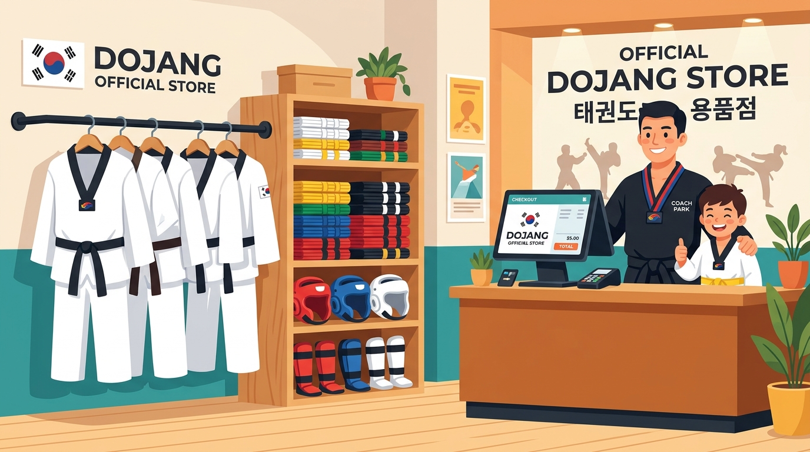

# Part 4: Kemandirian Finansial & Masa Depan Dojang Modern

> 📖 Hub Buku: **[DAYS: Dojang & Athlete Yield System](index.md)**

---

<div align="center">
  
  <p><sub><em>Ilustrasi 4: Sudut Official Dojang Store modern—pengadaan seragam dobok, sabuk, pelindung tubuh, dan merchandise resmi yang memperkokoh kemandirian ekonomi dojang serta membiayai beasiswa atlet binaan.</em></sub></p>
</div>

---

## 📖 Narasi Pembuka: Romantisme 'Pengabdian Buta' vs Realita Keberlanjutan

Ada sebuah doktrin usang yang telah mengendap puluhan tahun di sebagian kalangan praktisi bela diri tradisional: sebuah keyakinan bahwa membicarakan uang, profit, dan model bisnis di dalam dojang adalah tindakan tabu yang mencemari kemurnian spiritual seni bela diri. Sebagian kalangan berpandangan bahwa pelatih sejati harus hidup semata-mata dari 'pengabdian ikhlas', mengajar tanpa memikirkan kelayakan finansial, dan membiarkan dojang berjalan apa adanya di bawah atap yang bocor.

Namun mari kita pandang realita yang sesungguhnya di lapangan dengan kejujuran yang menoreh hati:
- Berapa banyak dojang legendaris yang telah melahirkan deretan atlet peraih medali PON dan SEA Games terpaksa membubarkan diri dan mengusir ratusan muridnya hanya karena pengelola tidak lagi sanggup melunasi kenaikan harga sewa gedung latihan?
- Berapa banyak mantan atlet nasional dan pelatih jenius yang terpaksa menggantungkan dobok kebanggaan mereka—beralih menjadi penagih utang keliling, pengemudi ojek online, atau buruh pabrik kasar—bukan karena cinta mereka pada taekwondo telah pudar, melainkan karena honor melatih mereka yang hanya Rp25.000 per sesi latihan tidak cukup untuk membelikan beras bagi keluarga dan membiayai anak mereka bersekolah?
- Berapa banyak anak-anak bertalenta emas dari keluarga pemulung atau buruh tani yang menangis tersedu-sedu di sudut matras karena terpaksa mengubur impiannya bertanding di Kejuaraan Nasional, hanya karena dojang tempat mereka bernaung tidak memiliki kas cadangan untuk membelikan tiket bus dan sepasang pelindung kaki (*shin guard*) yang layak?

Days Prestasi merobohkan kepalsuan romantisme tersebut dengan satu penegasan nurani yang mendasar:

> **"Kemandirian finansial bukanlah racun bagi seni bela diri, melainkan benteng pelindung terkuatnya. Sebuah dojang yang rapuh secara finansial adalah dojang yang selalu hidup dalam ketakutan: rentan digusur, rentan ditinggalkan pelatih terbaiknya, dan tak berdaya saat atlet binaannya membutuhkan bantuan. Sebaliknya, dojang yang mandiri, sehat, dan makmur secara ekonomi memiliki kedaulatan mutlak untuk menggaji pelatihnya secara terhormat, menyediakan fasilitas matras yang aman dari risiko cedera fatal, dan mendanai atlet-atlet terbaiknya terbang menaklukkan panggung dunia."**

Kemandirian finansial ini tidak boleh dicapai dengan cara memeras para murid, menaikkan iuran bulanan secara serampangan, atau mengubah dojang menjadi mesin komersial yang rakus. Kemandirian sejati dibangun di atas **rekayasa ekosistem bernilai tambah (*value-added ecosystem*)**, di mana instrumen utamanya adalah **Modul Official Dojang Store**.

---

## 🔬 Teardown Konsep & Wawasan Utama

```text
┌────────────────────────────────────────────────────────────────────────┐
│            DARI KERENTANAN MONOLITIK MENUJU KEMANDIRIAN LENGKAP        │
├────────────────────────────────────────────────────────────────────────┤
│                                                                        │
│  [ MODEL LAMA: SANGAT RENTAN & FRAGIL ]                                │
│  Sumber Kas : 100% Mengandalkan Iuran Bulanan Siswa                    │
│  Risiko     : Musim liburan sekolah / Ramadhan ──> Kas Anjlok 60%      │
│  Dampak     : Honor sabam telat, uang sewa tertunggak, fasilitas rusak │
│                                                                        │
│  [ MODEL MODERN DAYS: RESILIEN & BERKELANJUTAN ]                       │
│  1. Iuran Anggota Reguler & Kelas Prestasi Terkelola Otomatis          │
│  2. Official Dojang Store: Dobok, Sabuk, Pelindung, Merchandise Resmi  │
│  3. Penyelenggaraan Event Mandiri: Biaya UKT & Turnamen Terpadu        │
│  4. Dana Abadi Atlet (Athlete Yield Fund): Beasiswa Siswa Duafa        │
│                                                                        │
└────────────────────────────────────────────────────────────────────────┘
```

---

### 1. Modul Official Dojang Store: Dari Makelar Sporadis Menjadi Bisnis Resmi yang Elegan

Dalam pola manajemen lama, proses pengadaan perlengkapan latihan di sebuah dojang taekwondo hampir selalu menyerupai komedi kekacauan:

Ketika seorang anak baru mendaftar, orang tuanya bertanya: *"Sabam, beli seragam dobok dan sabuk putihnya di mana ya?"*

Sang sabam menjawab sambil mengusap keringat di dahinya: *"Oh, titip uangnya ke saya saja ya Bu, Rp250.000. Nanti kalau saya sempat ke toko grosir perlengkapan di pusat kota minggu depan, saya belikan sekalian."*

Uang titipan itu pun masuk ke dompet pribadi sang pelatih, bercampur baur dengan uang bensin motor dan uang makan hariannya. Seminggu kemudian, sabam lupa mampir ke toko karena kelelahan melatih. Dua minggu kemudian, ukuran dobok yang dibeli ternyata terlalu besar untuk sang anak. Ketika orang tua murid menanyakan kuitansi atau menuntut retur, suasana menjadi sangat canggung. Keuntungan marjinal yang didapat sabam tidak sebanding dengan hancurnya citra profesionalisme dojang di mata orang tua murid.

Modul **Official Dojang Store** di DAYS mengubah proses amatir ini menjadi sebuah pengalaman e-commerce modern yang membanggakan:

* **Katalog Digital Terintegrasi di Aplikasi**:
  Orang tua dan murid dapat membuka etalase resmi dojang langsung dari ponsel mereka. Katalog menampilkan:
  - *Seragam Resmi (Dobok)*: Dilengkapi panduan ukuran tinggi badan (*size chart*) yang presisi dan bordiran logo resmi dojang di dada kiri.
  - *Sabuk Tingkatan Resmi*: Memastikan sabuk kuning, hijau, biru, hingga merah yang dipakai siswa memiliki ketebalan dan warna standar yang seragam.
  - *Perlengkapan Pelindung Standar WT*: Pelindung dada (*hogu* merah/biru reversibel), pelindung kepala (*headguard*), pelindung tulang kering (*shin guard*), serta pelindung tangan (*forearm guard*).
  - *Merchandise Komunitas*: Jaket hoodie dojang, kaos suporter untuk orang tua murid yang menonton turnamen, tas ransel perlengkapan, hingga botol minum berlogo dojang.
* **Manajemen Inventaris & Transparansi Margin Usaha**:
  Pemilik dojang (*owner*) memiliki dasbor stok barang (*inventory control*). Pemilik dapat memesan grosir langsung dari produsen atau distributor resmi taekwondo dengan harga pabrik, menetapkan harga jual eceran yang wajar dan terjangkau, serta mengunci margin keuntungan secara transparan di dalam laporan kas dojang.
* **Pemesanan dan Pembayaran Mandiri**:
  Orang tua murid memilih produk, memasukkan ke keranjang belanja, dan membayar secara instan melalui transfer virtual account atau QRIS. Barang disiapkan oleh petugas inventaris dojang dan diserahkan kepada murid di sesi latihan berikutnya dengan bukti tanda terima digital yang rapi.
* **Kemandirian Pendapatan Dojang**:
  Laba dari pembelian seragam dan perlengkapan tidak lagi bocor ke pedagang perantara yang tidak berkontribusi apa pun bagi kemajuan matras. Seluruh perputaran uang tetap berada di dalam ekosistem dojang, memperkuat pundi-pundi kas mandiri.

---

### 2. Lingkaran Kebajikan Finansial (*The Virtuous Financial Cycle*)

Days Prestasi menekankan bahwa keuntungan finansial dari Official Dojang Store dan efisiensi manajemen event bukanlah tujuan akhir (*end goal*), melainkan bahan bakar (*fuel*) untuk menggerakkan mesin kebajikan sosial dan pembinaan olahraga.

Keuntungan yang diperoleh dialirkan ke dalam **Tiga Pilar Investasi Peradaban Dojang**:

```text
           ┌────────────────────────────────────────────────────────┐
           │         SURPLUS DANA OFFICIAL STORE & SISTEM DAYS      │
           └───────────────────────────┬────────────────────────────┘
                                       │
        ┌──────────────────────────────┼──────────────────────────────┐
        ▼                              ▼                              ▼
  [ KESEJAHTERAAN SABAM ]     [ FASILITAS KELAS DUNIA ]      [ THE ATHLETE YIELD FUND ]
  Honor Layak, Tunjangan       Matras WT Eva tebal,          Beasiswa SPP Gratis &
  Kesehatan, & Kehormatan      Target Tendang Baru,          Subsidi Perlengkapan bagi
  Profesi Melatih Sepenuh Hati & Kotak P3K Medis Lengkap     Bibit Atlet Prasejahtera
```

1. **Memuliakan Profesi Sang Sabam**:
   Ketika kas dojang sehat, pemilik dojang mampu memberikan honor yang kompetitif, bonus kejuaraan, bahkan asuransi perlindungan cedera bagi para pelatihnya. Pelatih tidak perlu lagi memecah konsentrasi mencari pekerjaan sampingan di luar dunia bela diri. Mereka dapat mendedikasikan 100% hidup mereka untuk mempelajari tren ilmu kepelatihan modern (*sports science*), nutrisi atlet, dan periodisasi fisik terkini.
2. **Kualitas dan Keselamatan Fasilitas Latihan**:
   Banyak cedera patah tulang selangka atau robek ligamen lutut (*ACL tear*) pada anak-anak bela diri terjadi bukan karena benturan dengan lawan, melainkan karena matras latihan yang sudah tipis, licin, atau puzzle yang renggang dan tidak segera diganti karena kas dojang kosong. Dana cadangan yang sehat memungkinkan peremajaan matras latihan secara berkala, penyediaan kantong es (*ice pack*) dan pertolongan pertama medis yang memadai di pinggir lapangan.
3. **Dana Abadi Atlet (*The Athlete Yield Fund*)**:
   Inilah esensi terdalam dari nama DAYS: menyisihkan minimal 15% dari laba Official Dojang Store sebagai **dana beasiswa silang**. Anak-anak yang memiliki bakat tendangan luar biasa namun berasal dari keluarga tidak mampu dibebaskan dari seluruh biaya iuran bulanan, dipasok seragam dobok gratis, dan dibiayai penuh akomodasinya saat mewakili dojang di turnamen kejuaraan nasional. Seni bela diri kembali pada fungsi aslinya sebagai sarana mobilitas sosial dan pembuka jalan masa depan bagi kaum yang tertindas.

---

### 3. Visi Dojang Masa Depan (The Modern Dojang Vision)

Bagaimana rupa sebuah dojang taekwondo dalam sepuluh hingga dua puluh tahun ke depan?

Buku ini menegaskan dengan lantang bahwa menyambut masa depan digital tidak berarti kita harus mengorbankan atau mengikis nilai-nilai sakral tradisi luhur:
- *Charyeot, Gyeong-nye* (Sikap berdiri tegak dan membungkuk memberi hormat) akan tetap menjadi ritual wajib setiap kali kaki menginjak matras.
- Disiplin, kesopanan, kesetiaan pada guru, dan kejujuran ksatria akan tetap menjadi fondasi jiwa para murid.

Namun, yang berubah adalah **infrastruktur yang menopangnya**. Di era DAYS:
- Dojang taekwondo bukan lagi tempat yang kumuh, berantakan oleh kuitansi sobek, dan dikelola secara amatir.
- Dojang taekwondo menjelma menjadi **institusi pendidikan karakter dan akademi olahraga berkelas dunia**: bersih, paperless, otomatis, transparan, dan berdaulat secara finansial.
- Sebuah dojang taekwondo di pelosok kota kecil di Jawa, Sumatra, Sulawesi, maupun Papua dapat mengadopsi standar tata kelola yang sama canggihnya dengan akademi bela diri ternama di Seoul, London, atau New York.

Saat sistem teknologi mengambil alih pekerjaan mekanis yang melelahkan—mencatat presensi, menagih kas, merekap nilai UKT, menyusun bagan turnamen, dan menjual seragam—energi manusia di dalamnya terbebas sepenuhnya untuk melakukan hal-hal yang tidak akan pernah bisa digantikan oleh mesin mana pun: **mengasah ketajaman teknik, meniupkan keyakinan ke dalam hati murid yang ragu, dan membentuk generasi muda yang berjiwa baja untuk kejayaan bangsa**.

---

## 🧠 Eksperimen Pikiran: Arya dan Sepuluh Tahun Transformasi

Mari kita tutup penjelajahan literatur ini dengan membayangkan kisah seorang anak bernama Arya:

* **Tahun 2026 (Sabuk Putih, Usia 7 Tahun)**:
  Arya yang pemalu diantar ibunya ke dojang taekwondo yang telah menggunakan sistem DAYS. Pendaftaran selesai dalam dua menit via portal web. Melalui Official Store di aplikasi, ibunya memesan dobok berukuran tepat yang siap pakai di hari pertamanya.
* **Tahun 2028 (Sabuk Biru Strip Merah, Usia 9 Tahun)**:
  Arya rutin hadir latihan 3 kali seminggu. Kehadirannya tercatat presisi di ponsel sabamnya. Ketika UKT tiba, penguji menilai Arya menggunakan tablet digital; malam harinya Arya dan ibunya tersenyum bangga memandang e-sertifikat ber-QR Code dengan tanda tangan sah dewan guru.
* **Tahun 2031 (Sabuk Hitam Dan 1, Usia 12 Tahun)**:
  Arya terpilih masuk ke dalam tim pemusatan latihan atlet tanding (*Kyorugi Athlete Squad*). Seluruh catatan denyut nadi latihan, jam terbang, dan riwayat pertandingannya tersimpan rapi di sistem. Di Kejuaraan Taekwondo Pelajar Tingkat Provinsi yang dikelola dengan Modul Turnamen DAYS, Arya menyabet medali emas pertamanya.
* **Tahun 2036 (Usia 17 Tahun, Pelatnas Taekwondo Indonesia)**:
  Pemandu bakat dari Federasi Pusat membuka dasbor analitik DAYS. Mereka melihat seorang atlet muda dengan konsistensi kehadiran 98% selama sepuluh tahun berturut-turut, rekor kemenangan tanding di atas 88%, dan rekam medis bebas cedera parah berkat pemantauan periodisasi latihan yang disiplin. Arya menerima surat panggilan untuk bergabung dengan Tim Nasional mewakili Indonesia di kancah internasional.

Ketika Arya berdiri di atas podium tertinggi dengan medali emas menggantung di lehernya dan lagu kebangsaan berkumandang megah di gelanggang dunia, kita menyadari satu hal yang abadi:

Kemenangan Arya bukan hanya karena kehebatan tendangannya di detik terakhir pertandingan, melainkan hasil akumulasi dari **sebuah ekosistem dojang yang sepuluh tahun sebelumnya berani memutuskan untuk meninggalkan kekacauan manajemen, merawat bakatnya dengan sistem yang jujur, dan mempersembahkan hasil panen (*yield*) terbaik bagi peradaban olahraga**.

---

## ⚡ Panduan Aksi Nyata dari Part 4

Langkah konkret mewujudkan kemandirian finansial dan masa depan dojang Anda:

1. [ ] **Sentralisasi Pengadaan Perlengkapan**: Mulai tertibkan penjualan seragam dobok dan perlengkapan melalui etalase toko resmi dojang; hapus kebiasaan titip uang tunai yang rawan tercecer atau menimbulkan kesalahpahaman.
2. [ ] **Tetapkan Alokasi 'Athlete Yield Fund'**: Buat aturan tertulis bahwa 10%–15% keuntungan bersih dari Official Store dialokasikan khusus untuk subsidi atlet binaan prasejahtera yang berprestasi.
3. [ ] **Rayakan Kemandirian Bersama Komunitas**: Libatkan para orang tua murid untuk bangga membeli perlengkapan resmi di dojang mereka sendiri, karena setiap rupiah yang mereka belanjakan kembali untuk memajukan fasilitas latihan anak-anak mereka.

---

## 💬 Kutipan Pilihan & Catatan Reflektif

> *"Keberanian seorang ksatria bela diri diuji ketika ia berani melangkah menghadapi lawan di atas gelanggang laga. Namun keberanian seorang pemimpin dojang diuji ketika ia berani membuang kebiasaan lama yang bobrok, merapikan tata kelola organisasinya, dan memperjuangkan kemandirian demi masa depan murid-murid yang ia cintai."*  
> — **Days Prestasi**, *DAYS Manifesto*

**Pertanyaan Refleksi Diri**:
- *Apakah dojang taekwondo yang Anda bangun hari ini sudah memiliki fondasi ekonomi dan sistem tata kelola yang cukup kokoh untuk tetap berdiri tegak, mandiri, dan melahirkan juara-juara baru dunia—bahkan hingga puluhan tahun setelah Anda pensiun dari matras latihan?*

---

## 🧭 Navigasi Bab Selanjutnya

⬅️ **[Kembali ke Part 3: Jalur Prestasi Terintegrasi](03-jalur-prestasi-terintegrasi.md)** &nbsp;&nbsp;•&nbsp;&nbsp; 📖 **[Hub Buku Utama](index.md)** &nbsp;&nbsp;•&nbsp;&nbsp; ➡️ **[Lanjut ke Part 5: Psikologi Retensi & Mengelola Orang Tua →](05-psikologi-retensi-dan-wali-murid.md)**
