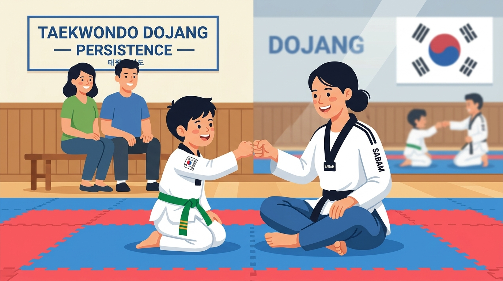

# Part 5: Psikologi Retensi & Mengelola 'Orang Tua Helikopter'

> 📖 Hub Buku: **[DAYS: Dojang & Athlete Yield System](index.md)**

---

<div align="center">
  
  <p><sub><em>Ilustrasi 5: Menembus 'Green Belt Plateau' melalui dialog empati antara Sabam dan siswa, didukung keterlibatan positif orang tua di zona observasi.</em></sub></p>
</div>

---

## 📖 Narasi Pembuka: Misteri Hilangnya Murid Sabuk Hijau

Jika Anda mengamati piramida keanggotaan di hampir seluruh dojang taekwondo di dunia, Anda akan menemukan sebuah anomali statistik yang sangat mencolok:
- Kelas sabuk putih (*baek-tti*) dan sabuk kuning selalu dipadati oleh puluhan anak-anak baru yang riang dan antusias.
- Namun begitu memasuki tingkatan **sabuk hijau (*nok-tti*) dan sabuk biru**, terjadi eksodus massal secara misterius. Lebih dari 50% siswa berhenti di fase ini sebelum mereka sempat menyentuh sabuk merah, apalagi sabuk hitam (*poom/dan*).

Kisah Dimas adalah contoh klasik. Ketika Dimas pertama kali masuk dojang di usia 8 tahun dengan sabuk putih, ia begitu bersemangat. Setiap hari ia memamerkan tendangan lurusnya (*ap chagi*) di ruang tamu rumahnya. Orang tuanya bangga dan rajin mengunggah video latihan Dimas ke media sosial. Ujian sabuk kuning dilalui Dimas dengan senyum lebar dan pujian meriah.

Namun, satu tahun kemudian, ketika Dimas melilitkan sabuk hijau di pinggangnya, dinamika berubah secara drastis:
- Materi latihan tidak lagi sekadar menendang bantalan busa empuk sambil tertawa. Sabam mulai mengajarkan jurus *Taegeuk Sam Jang* yang menuntut koordinasi putaran badan rumit, kuda-kuda panjang (*ap koobi*) yang membuat otot paha terbakar pegal, serta sesi kontak tanding ringan (*sparring*) yang membuat Dimas merasakan benturan fisik yang menyakitkan.
- Dimas mulai beralasan sakit perut setiap kali jam latihan tiba. Di matras, ia sering menundukkan kepala dan kehilangan kilau semangat di matanya.
- Di sisi lain, orang tua Dimas—yang tidak memahami kurikulum taekwondo—mulai cemas dan frustrasi. Sang ayah mendatangi sabam dengan nada menuntut: *"Sabam, kenapa anak saya sekarang jarang disuruh maju ke depan? Kenapa anak tetangga saya yang baru masuk sabuk kuning gerakannya tampak lebih lincah daripada Dimas? Apakah pelatih di sini pilih kasih?"*

Dua minggu kemudian, Dimas tidak pernah terlihat lagi di matras latihan. Sebuah bakat muda kembali padam di tengah jalan.

Fenomena ini dikenal dalam literatur psikologi olahraga DAYS sebagai **The Green Belt Plateau (Dataran Tinggi Sabuk Hijau)**. Ini adalah titik kritis di mana 'fase bulan madu' bela diri telah usai, dan fase 'kerja keras yang membosankan' dimulai. Tanpa pemahaman psikologi retensi dan manajemen komunikasi dengan para orang tua murid modern, dojang akan selalu menjadi ember bocor yang terus kehilangan generasi penerusnya.

---

## 🔬 Teardown Konsep & Wawasan Utama

```text
┌────────────────────────────────────────────────────────────────────────┐
│           DINAMIKA RETENSI & 'THE GREEN BELT PLATEAU'                   │
├────────────────────────────────────────────────────────────────────────┤
│                                                                        │
│   FASE 1: SABUK PUTIH/KUNING   ──> "Fase Kegembiraan Instan"           │
│                                    Teknik mudah, pujian melimpah.      │
│                                                                        │
│   FASE 2: SABUK HIJAU/BIRU     ──> "LEMBAH KEMANDEKAN (PLATEAU)"       │
│                                    Koreksi ketat, otot pegal, jenuh.   │
│                                    [ TITIK 50% SISWA DROP OUT ]        │
│                                                                        │
│   FASE 3: SABUK MERAH/HITAM    ──> "Fase Penguasaan & Identitas Diri"  │
│                                    Ketangguhan mental sejati terbentuk.│
│                                                                        │
└────────────────────────────────────────────────────────────────────────┘
```

---

### 1. Menembus 'The Green Belt Plateau': Mengapa Anak Jenuh dan Menyerah?

Mengapa krisis mental ini selalu meledak di tingkatan sabuk hijau?
1. **Lompatan Kompleksitas Kognitif**:
   Di sabuk putih, anak hanya menghafal satu atau dua arah gerakan. Di sabuk hijau (Taegeuk 3 dan 4 Jang), otak anak dipaksa melakukan koordinasi bilateral: tangan kanan menangkis ke luar (*momtong an makki*), tangan kiri bersiap memukul, sementara kedua kaki harus berpindah ke kuda-kuda belakang (*dwit koobi*) secara serentak. Anak merasa dirinya 'bodoh' karena otak dan tubuhnya belum sinkron.
2. **Ketiadaan Hadiah Dopamin Instan**:
   Di bulan-bulan pertama, kemajuan terasa begitu cepat dan kasat mata. Namun di sabuk hijau, peningkatan kelenturan dan kecepatan tendangan membutuhkan akumulasi latihan berminggu-minggu tanpa hasil instan. Anak generasi modern yang terbiasa dengan kepuasan instan (*instant gratification*) layar gawai merasa usahanya sia-sia.
3. **Koreksi Pelatih yang Terdengar Seperti Penolakan**:
   Ketika pelatih mulai menuntut presisi dan menegur kesalahan posisi kaki, anak yang belum matang secara emosional mengartikannya sebagai: *"Sabam tidak menyukai saya lagi."*

**Bagaimana DAYS Memecahkan Masalah Ini Melalui Gamifikasi Data?**
DAYS mengubah kurikulum yang abstrak menjadi pencapaian mikro (*micro-achievements*) yang terlihat nyata di aplikasi siswa:
- Sistem tidak hanya mencatat hadir atau tidak, melainkan memberikan lencana digital (*skill badges*): *"Master Kuda-Kuda Ap Koobi"*, *"Ketahanan Fisik 30 Menit"*, atau *"Prajurit Konsisten 10 Sesi"*.
- Anak dan orang tua dapat melihat diagram radar perkembangan motorik mereka. Ketika anak merasa dirinya jalan di tempat, grafik membuktikan bahwa kekuatan tendangannya telah naik 25% dibandingkan tiga bulan lalu. Data memberikan kepastian visual yang memulihkan motivasi sang anak.

---

### 2. Mengelola Tipologi Orang Tua Modern: Dari 'Helikopter' Menjadi Sekutu

Orang tua murid di era sekarang sangat berbeda dengan orang tua tiga puluh tahun lalu. Mereka lebih terdidik, sangat protektif, namun sering kali diliputi kecemasan berlebih (*parental anxiety*). 

Days Prestasi memetakan tiga tipologi orang tua yang kerap dijumpai di pinggir matras:

1. **The Helicopter Parent (Orang Tua Helikopter)**:
   Selalu melayang-layang mengawasi setiap detik sesi latihan. Begitu anaknya tersandung atau dimarahi pelatih, mereka langsung melangkah ke matras membawa handuk dan botol minum. Mereka mencampuri instruksi pelatih dari tribun dengan berteriak: *"Ayo tendang kepalanya! Kenapa diam saja?!"*
2. **The Phantom Parent (Orang Tua Bayangan)**:
   Hanya menurunkan anak di gerbang dojang dari mobil lalu tancap gas pergi. Mereka tidak pernah mengenal nama pelatih anaknya, tidak pernah hadir saat ujian sabuk, dan hanya bereaksi ketika menerima notifikasi tagihan iuran bulanan.
3. **The Scorekeeper Parent (Orang Tua Pemburu Trofi)**:
   Mengukur keberhasilan anak semata-mata dari medali emas. Jika anak mereka kalah di babak penyisihan turnamen, mereka memarahi sang anak di mobil dalam perjalanan pulang, mengikis rasa percaya diri anak hingga ke titik nadir.

**Pendekatan Edukasi Kemitraan (*The Parent Onboarding Protocol*)**:
Dojang modern tidak boleh memusuhi orang tua, melainkan harus mendidik mereka:
* **Batas Suci Tribun (*The Mat-Tribun Boundary*)**: Menetapkan aturan kehormatan bahwa orang tua dilarang memberi instruksi teknik dari luar matras. Di matras, hanya ada satu suara yang didengar anak: suara sabam.
* **Edukasi Makna Kekalahan**: Menjelaskan bahwa kekalahan di kejuaraan taekwondo adalah laboratorium terbaik untuk menumbuhkan ketahanan mental (*grit*). Anak yang tidak pernah belajar kalah di atas matras akan tumbuh menjadi orang dewasa yang rapuh saat menghadapi penolakan di dunia nyata.
* **Komunikasi Asinkron yang Menenangkan via DAYS**: Orang tua helikopter menjadi cerewet karena mereka merasa cemas dan tidak tahu apa yang sedang terjadi. Ketika DAYS secara otomatis mengirimkan pembaruan progres bulanan dan rekaman kehadiran anak, kecemasan mereka bertransformasi menjadi rasa percaya dan kekaguman pada profesionalisme dojang.

---

### 3. Taekwondo Sebagai Penawar Epidemi Perundungan (*Anti-Bullying & Self-Worth*)

Salah satu alasan terbesar mengapa orang tua mendaftarkan anaknya ke dojang taekwondo adalah ketakutan akan perundungan (*bullying*) di sekolah. Namun ada salah kaprah besar: sebagian orang tua mengira solusinya adalah melatih anak mereka menjadi jagoan yang bisa memukul balik si pelaku perundungan.

Buku ini menegaskan prinsip filosofis taekwondo sejati:

> **"Kemenangan terbesar dari seorang anak taekwondo bukanlah ketika ia merobohkan lawannya di halaman sekolah, melainkan ketika bahasa tubuhnya, sorot matanya, dan ketenangan jiwanya membuat si perundung mengurungkan niatnya sejak awal."**

Pelaku perundungan di sekolah secara naluriah hanya memangsa anak-anak yang menunjukkan bahasa tubuh korban: pundak membungkuk, tatapan mata menghindar, dan langkah kaki ragu-ragu. Melalui pembiasaan kuda-kuda tegap (*charyeot seogi*), tatapan mata lurus ke depan, dan teriakan penuh tenaga (*kihap*) setiap minggu di dojang, postur fisik dan aura psikologis anak berubah total. Anak memancarkan ketenangan ksatria yang tidak mudah diintimidasi.

---

## 🧠 Eksperimen Pikiran: Dua Reaksi Menghadapi Air Mata di Matras

Bayangkan seorang murid perempuan sabuk hijau berusia 9 tahun bernama Naila. Saat sesi latihan tanding (*kyorugi*), tulang keringnya berbenturan keras dengan lawan. Naila duduk di matras sambil menangis tersedu-sedu memegangi kakinya:

* **Respons Dojang Konvensional Tanpa Pemahaman Psikologi**:
  Pelatih berteriak dari seberang matras: *"Ayo jangan cengeng! Begitu saja nangis! Taekwondo harus keras!"* 
  Sementara ibu Naila dari tribun bergegas lari menerobos matras sambil mengomel pada lawan tanding Naila, lalu membawa Naila pulang. Malam harinya, sang ibu mengirim pesan WhatsApp panjang menuduh dojang tidak aman dan mengeluarkan Naila secara permanen.

* **Respons Dojang Modern Menggunakan Protokol DAYS**:
  Sabam wanita menghampiri Naila, berlutut sejajar dengan matanya. Sabam memeriksa kakinya secara medis tenang, memastikan tidak ada cedera tulang, lalu menempelkan kompres es sambil berkata lembut: *"Sakit sekali ya Naila? Tidak apa-apa, menangis itu wajar saat sakit. Tarik napas panjang. Kakimu kuat, sebentar lagi rasa sakitnya akan hilang."* 
  Sang ibu duduk tenang di bangku observasi karena dojang telah membekali orang tua dalam sesi orientasi tentang protokol penanganan benturan. Lima menit kemudian, Naila berdiri, mengusap air matanya, dan kembali menendang bantalan sasaran dengan senyum bangga. Di aplikasi DAYS, sabam menyematkan catatan medis kecil: *"Naila: sempat mengalami memar ringan di tulang kering kanan, mental sangat kuat, siap kembali berlatih normal."* 

Sang ibu membaca catatan itu di rumah dengan rasa haru. Naila tidak berhenti; justru hari itu adalah hari di mana jiwa ksatria di dalam dirinya lahir untuk selamanya.

---

## ⚡ Panduan Aksi Nyata dari Part 5

Langkah praktis menjaga retensi dan kemitraan dengan orang tua di dojang Anda:

1. [ ] **Audit Titik Kritis Sabuk Hijau**: Identifikasi murid-murid di dojang Anda yang saat ini memegang sabuk hijau dan biru. Jadwalkan sesi evaluasi santai atau *fist-bump check-in* 5 menit di akhir latihan untuk mendengarkan keluh kesah mereka.
2. [ ] **Gelar Sesi 'Parent Welcome Gathering'**: Di setiap awal tahun ajaran baru, adakan pertemuan 45 menit bersama seluruh orang tua murid baru. Jelaskan filosofi taekwondo, etika di bangku tribun, dan bagaimana sistem DAYS akan mendampingi putra-putri mereka.
3. [ ] **Berikan Apresiasi Karakter, Bukan Hanya Teknik**: Mulai sematkan penghargaan mingguan bukan hanya untuk anak yang tendangannya paling tinggi, melainkan untuk anak yang menunjukkan sikap paling hormat, paling rajin datang tepat waktu, atau paling berani bangkit setelah terjatuh di matras.

---

## 💬 Kutipan Pilihan & Catatan Reflektif

> *"Seorang pelatih amatir melatih tendangan seorang anak. Seorang pelatih hebat melatih keyakinan di balik tendangan tersebut, dan merangkul orang tua sang anak agar bersama-sama menjaga api keyakinan itu tetap menyala."*  
> — **Days Prestasi**, *DAYS Manifesto*

**Pertanyaan Refleksi Diri**:
- *Apakah selama ini dojang Anda memperlakukan orang tua murid sebagai 'pihak luar yang merepotkan', ataukah Anda telah menjadikan mereka sekutu terdekat dalam membangun karakter sang atlet masa depan?*

---

## 🧭 Navigasi Bab Selanjutnya

⬅️ **[Kembali ke Part 4: Kemandirian Finansial & Masa Depan Dojang](04-kemandirian-finansial-dan-masa-depan.md)** &nbsp;&nbsp;•&nbsp;&nbsp; 📖 **[Hub Buku Utama](index.md)** &nbsp;&nbsp;•&nbsp;&nbsp; ➡️ **[Lanjut ke Part 6: Sports Science Sederhana & Pencegahan Cedera di Matras →](06-sports-science-dan-pencegahan-cedera.md)**
