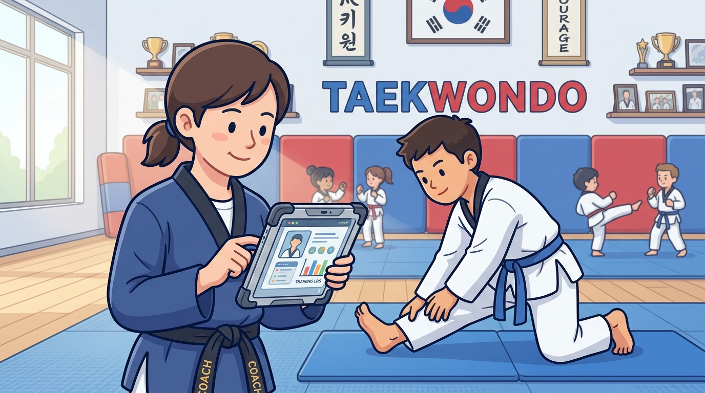

# Part 6: Sports Science Sederhana & Pencegahan Cedera di Matras

> 📖 Hub Buku: **[DAYS: Dojang & Athlete Yield System](index.md)**

---

<div align="center">
  
  <p><sub><em>Ilustrasi 6: Penerapan Sports Science terapan dalam Taekwondo Dojang—pemantauan beban latihan longitudinal (ACWR), peregangan dinamis, dan stasiun pemulihan demi memperpanjang karier atlet.</em></sub></p>
</div>

---

## 📖 Narasi Pembuka: Tragedi di Usia Tujuh Belas Tahun

Namanya Rendy. Di usia 15 tahun, Rendy adalah sensasi baru di gelanggang taekwondo kyorugi junior. Jangkauan kakinya luar biasa panjang, refleks menghindarnya bagai kilat, dan tendangan memutar belakangnya (*dwi chagi*) mampu merobohkan lawan dalam hitungan detik. Semua pelatih di kotanya sepakat: Rendy adalah calon atlet olimpiade masa depan Indonesia.

Namun, di balik kegemilangan medali emasnya, tersimpan metode latihan kuno yang brutal dan tanpa dasar ilmu keolahragaan modern. 

Menjelang Kejuaraan Nasional, berat badan Rendy tercatat 58 kg, sementara pelatih kepalanya ngotot mendaftarkan Rendy di kelas Under 54 kg demi mengejar peluang medali yang lebih besar. Empat kilogram harus dipangkas dalam waktu lima hari. Caranya? Rendy dilarang minum air putih, dipaksa berlari keliling lapangan di bawah terik matahari siang bolong mengenakan dua lapis jaket sauna berbahan plastik parasut, dan hanya diperbolehkan makan satu butir apel sehari.

Tubuh Rendy gemetar hebat. Ginjalnya berteriak menahan dehidrasi akut. Sel-sel ototnya kehilangan cairan elektrolit penyeimbang, membuat ligamen dan tendon di kedua kakinya menjadi kering, getas, dan rapuh bagaikan karet gelang tua yang dijemur di terik matahari.

Hari pertandingan tiba. Rendy berhasil lolos timbang badan dengan tubuh pucat pasi dan mata cekung. Di babak semifinal, saat ia melompat mengeksekusi tendangan cangkul (*naeryo chagi*) dan mendarat dengan kaki tumpuan yang lelah, terdengar suara mengerikan: *kreeek... plak!*

Lutut kanan Rendy bergeser keluar dari mangkuk sendinya. Ligamen krusiat anterior (*ACL*)-nya robek total. Teriakan histeris Rendy mengguncang seisi gelanggang.

Di usia 17 tahun—usia di mana karier seorang atlet seharusnya baru mulai mekar—perjalanan Rendy di dunia taekwondo tamat untuk selamanya. Operasi rekonstruksi lutut memakan biaya puluhan juta rupiah, dan rasa trauma psikologis membuatnya tidak pernah lagi berani menginjak matras kompetisi.

Kisah Rendy bukanlah tragedi tunggal. Di berbagai penjuru negeri, ada ratusan "Rendy-Rendy lain" yang bakat emasnya dibinasakan sebelum berkembang, semata-mata karena **kebodohan metodologi latihan yang mengatasnamakan 'mental baja', padahal sebenarnya adalah penyiksaan fisik yang melanggar hukum biologis tubuh manusia**.

DAYS hadir membawa angin pencerahan: **Sports Science bukan barang mewah milik laboratorium universitas asing**. Prinsip ilmu keolahragaan modern dapat dan harus diterapkan di tingkat dojang akar rumput melalui pemantauan beban latihan yang cerdas, pencegahan cedera terstruktur, dan pemahaman anatomi yang humanis.

---

## 🔬 Teardown Konsep & Wawasan Utama

### 1. Menghancurkan Mitos "No Pain, No Gain" yang Mematikan

Seni bela diri tradisional sering kali mengagungkan rasa sakit secara membabi buta. Ada pepatah keliru yang diwariskan turun-temurun: *"Makin remuk badanmu saat latihan, makin kuat mentalmu di kejuaraan."*

Fisiologi olahraga modern membuktikan sebaliknya:
- Tubuh manusia tidak berkembang saat ia dihancurkan; **tubuh berkembang saat ia pulih (*recovery & supercompensation*)**.
- Latihan fisik di matras memberikan stimulus kerusakan mikro pada serat otot. Jika stimulus tersebut diikuti oleh nutrisi berkualitas dan tidur nyenyak, otot akan berekonstruksi menjadi lebih kuat dan cepat.
- Namun jika atlet dihajar latihan berlebih (*overtraining*) setiap hari tanpa fase pemulihan yang cukup, jaringan tubuh mengalami peradangan kronis (*chronic systemic inflammation*). Hasilnya bukan kekuatan, melainkan penurunan daya refleks, kekebalan tubuh drop, dan kehancuran struktur sendi.

```text
  [ STIMULUS LATIHAN ] ──> Kerusakan Mikro Otot Terukur
          │
          ▼ (Nutrisi + Tidur + Data Log DAYS)
  [ SUPERKOMPENSASI  ] ──> Tubuh Pulih Lebih Kuat & Cepat (PEAK PERFORMANCE!)
          │
  VS. JIKA DIPAKSA TANPA RECOVERY:
          ▼
  [ OVERTRAINING     ] ──> Kelelahan Saraf Kronis ──> CEDERA FATAL / RETSI!
```

---

### 2. Manajemen Rasio Beban Latihan (The Acute-to-Chronic Workload Ratio)

Salah satu penemuan terpenting dalam sports science dekade terakhir oleh Dr. Tim Gabbett adalah konsep **ACWR (Acute to Chronic Workload Ratio)**:

* **Beban Akut (Acute Load)**: Volume dan intensitas latihan yang dilakukan atlet dalam 1 minggu terakhir.
* **Beban Kronis (Chronic Load)**: Rata-rata volume latihan yang telah diadaptasi atlet selama 4 minggu terakhir.

Ketika pelatih tiba-tiba melipatgandakan porsi latihan atlet dari 6 jam seminggu menjadi 15 jam seminggu karena panik kejuaraan tinggal dua minggu lagi, rasio ACWR melompat melewati angka aman 1,5. Secara medis, **lonjakan beban latihan di atas 15% per minggu meningkatkan risiko cedera jaringan lunak hingga 400%**.

Melalui modul pelatih DAYS, sistem memantau akumulasi jam latihan masing-masing atlet:
- Jika seorang atlet muda menunjukkan tren lonjakan jam latihan yang ekstrem di luar batas adaptasinya, dasbor DAYS memunculkan peringatan kuning (*Fatigue Warning*).
- Pelatih diingatkan untuk menurunkan intensitas (*deload week*) atau mengubah porsi latihan menjadi pengasahan strategi taktik dan kelenturan, alih-alih menguras fisik atlet hingga batas kehancuran.

---

### 3. Mengakhiri Praktik Pembunuhan Karakter: "Pemotongan Berat Badan Ekstrem"

Taekwondo adalah cabang olahraga berbasis kategori berat badan (*weight-class sport*). Selama puluhan tahun, tradisi memotong berat badan dengan cara dehidrasi ekstrem (tidak minum, sauna suit, laksatif/obat pencahar) dianggap sebagai tanda keseriusan atlet.

Days Prestasi menyatakan perang terbuka terhadap praktik biadab ini:
1. **Dampak Otak yang Menyusut**: Ketika tubuh kehilangan cairan secara drastis (dehidrasi > 4% berat badan), cairan serebrospinal yang melindungi otak di dalam tengkorak ikut menyusut. Akibatnya, benturan tendangan ke kepala (*head kick*) yang semestinya ringan dapat memicu geger otak parah (*severe concussion*) karena otak membentur dinding tengkorak secara langsung.
2. **Kehilangan Daya Ledak Otot**: Atlet yang dehidrasi kehilangan hingga 30% daya ledak (*anaerobic power*). Mereka mungkin lolos timbang badan, tetapi di atas matras tanding beberapa jam kemudian, kaki mereka terasa seberat timah.

**Solusi Modern Bersama DAYS**:
Dojang menetapkan pemantauan berat badan longitudinal sepanjang tahun. Atlet diarahkan bertanding di **kelas berat badan alaminya (*natural weight division*)**, bukan kelas yang dipaksakan. Jika penurunan berat badan diperlukan, sistem menyusun kalender penurunan bertahap berbasis defisit kalori higienis maksimal 0,5 kg per minggu, memastikan massa otot dan cairan tubuh atlet tetap utuh 100%.

---

### 4. Protokol Cedera Jaringan Lunak Modern: Dari R.I.C.E. ke P.E.A.C.E. & L.O.V.E.

Banyak pelatih tradisional masih menempelkan balsem panas pada engkel murid yang baru terkilir, sebuah kesalahan fatal yang memperparah pembengkakan pembuluh darah. Bahkan protokol lama R.I.C.E. (*Rest, Ice, Compression, Elevation*) kini telah disempurnakan oleh *British Journal of Sports Medicine* menjadi protokol **P.E.A.C.E. & L.O.V.E.**:

* **P - Protect**: Batasi gerakan selama 24-48 jam pertama untuk mencegah kerusakan jaringan lebih lanjut.
* **E - Elevate**: Posisikan area yang cedera lebih tinggi dari jantung untuk mengalirkan cairan bengkak.
* **A - Avoid Anti-Inflammatory**: Hindari konsumsi obat anti-inflamasi bebas dan kompres es berlebihan, karena peradangan alami tubuh adalah fase pertama yang dibutuhkan sel untuk menyembuhkan dirinya sendiri.
* **C - Compress**: Balut perban elastis secara pas (tidak terlalu ketat) untuk membatasi pembengkakan.
* **E - Educate**: Edukasi atlet dan orang tua bahwa tubuh butuh waktu biologis untuk pulih, bukan suntikan penghilang rasa sakit sesaat.

Di fase pemulihan lanjutannya (*L.O.V.E.*: *Load, Optimism, Vascularization, Exercise*), atlet diarahkan kembali bergerak secara bertahap di bawah pengawasan data log DAYS.

---

## 🧠 Eksperimen Pikiran: Dua Cara Mempersiapkan Atlet Menjelang Porprov

Bayangkan dua tim taekwondo daerah yang sedang mempersiapkan atlet andalan mereka menuju Pekan Olahraga Provinsi:

* **Tim Konvensional (Metode Kuno Spartaan)**:
  Pelatih menuntut latihan 3 kali sehari tanpa hari libur. Atlet yang mengeluh nyeri tumit diancam akan dicoret dari kontingen karena dianggap 'bermental lembek'. Dua hari menjelang tanding, seluruh atlet dipaksa lari siang bolong memakai jas hujan plastik untuk memangkas sisa berat badan. 
  
  Hasilnya? Pada hari pertandingan, satu atlet andalan mereka mengalami dislokasi bahu di babak pertama, dua atlet pingsan di ruang pemanasan karena hipoglikemia, dan kontingen hanya membawa pulang satu medali perunggu dengan rasa kecewa mendalam.

* **Tim Modern (Didukung Sports Science DAYS)**:
  Pelatih menggunakan sistem pemantauan beban latihan DAYS. Tiga minggu menjelang tanding, intensitas latihan dikurangi secara terukur (*tapering phase*) untuk membiarkan serat otot memulihkan cadangan glikogen secara penuh. Atlet tidur rata-rata 8,5 jam per malam dan berat badan mereka stabil di kelas alaminya tanpa dehidrasi. 
  
  Hasilnya? Di atas matras, para atlet bergerak dengan kecepatan mata elang dan daya ledak yang meledak-ledak. Mereka mendominasi seluruh ronde kejuaraan, memborong 5 medali emas tanpa ada satu pun atlet yang menderita cedera serius pasca-turnamen.

---

## ⚡ Panduan Aksi Nyata dari Part 6

Langkah praktis menerapkan sports science sederhana di dojang Anda:

1. [ ] **Musnahkan Jaket Sauna Plastik di Dojang**: Buat larangan tegas di dojang Anda terhadap penggunaan pakaian parasut kedap udara untuk penurunan berat badan instan. Edukasi atlet bahwa air keringat yang keluar bukanlah lemak yang terbakar, melainkan dehidrasi organ vital.
2. [ ] **Sediakan Perlengkapan 'First-Aid' Modern di Pinggir Matras**: Lengkapi dojang dengan kotak P3K resmi: perban kompresi elastis (*crepe bandage*), kantong kompres instan, bantalan busa pelindung, dan nomor darurat rumah sakit terdekat.
3. [ ] **Catat Riwayat Cedera Atlet di DAYS**: Setiap kali ada murid yang mengalami keseleo, memar tulang kering, atau benturan kepala, catat tanggal kejadian dan durasi istirahat di profil digital mereka agar tidak ada pelatih pengganti yang memaksakan latihan berlebih.

---

## 💬 Kutipan Pilihan & Catatan Reflektif

> *"Keberanian seorang pelatih sejati tidak diukur dari seberapa keras ia mampu menyiksa fisik anak didiknya hingga pingsan, melainkan seberapa bijak ia mampu mengantarkan atletnya ke puncak prestasi tanpa merusak masa depan tubuh mereka."*  
> — **Days Prestasi**, *DAYS Manifesto*

**Pertanyaan Refleksi Diri**:
- *Berapa banyak atlet muda di sekitar Anda yang terpaksa pensiun dini bukan karena kalah bersaing, melainkan karena kebodohan metodologi latihan masa lalu yang tidak menghargai batasan biologis tubuh manusia?*

---

## 🧭 Navigasi Bab Selanjutnya

⬅️ **[Kembali ke Part 5: Psikologi Retensi & Mengelola Orang Tua](05-psikologi-retensi-dan-wali-murid.md)** &nbsp;&nbsp;•&nbsp;&nbsp; 📖 **[Hub Buku Utama](index.md)** &nbsp;&nbsp;•&nbsp;&nbsp; ➡️ **[Lanjut ke Part 7: Seni Ekspansi: Membuka Cabang Sekolah & Waralaba Dojang →](07-seni-ekspansi-dan-waralaba-dojang.md)**
