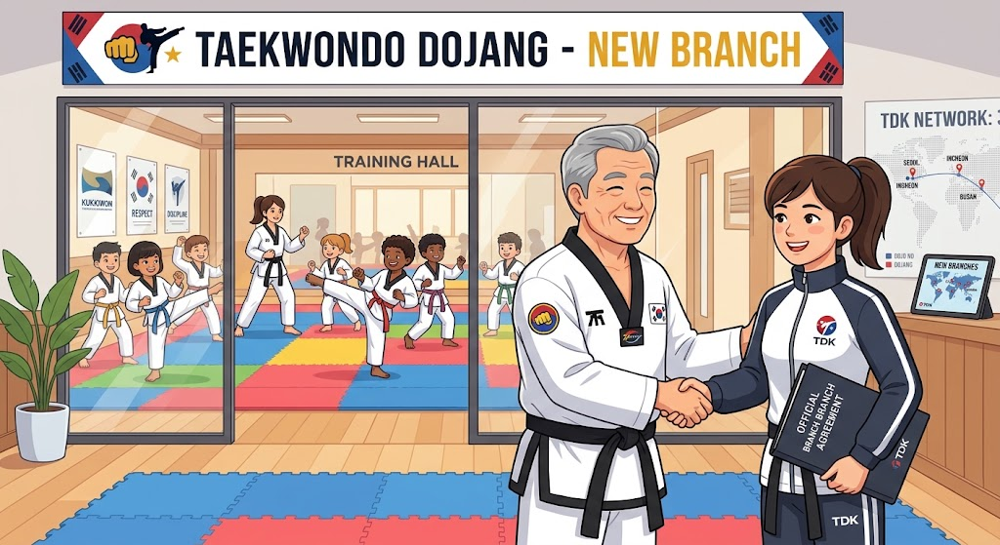

# Part 7: Seni Ekspansi: Membuka Cabang Sekolah & Waralaba Dojang

> 📖 Hub Buku: **[DAYS: Dojang & Athlete Yield System](index.md)**

---

<div align="center">
  
  <p><sub><em>Ilustrasi 7: Cetak biru ekspansi multi-cabang Taekwondo Dojang—kemitraan Managing Partner pelatih muda, peresmian cabang baru, dan keterhubungan jaringan dojang modern.</em></sub></p>
</div>

---

## 📖 Narasi Pembuka: Jebakan Sukses di Satu Cabang

Kisah Master Suseno adalah cerminan dari tragedi yang dialami ratusan pendiri dojang di seluruh Indonesia.

Di dojang pusatnya yang berlokasi di sebuah ruko berlantai dua, Master Suseno adalah sosok legendaris. Setiap hari Selasa, Kamis, dan Sabtu sore, rukonya dipadati oleh 120 murid. Dengan kharisma alaminya, Master Suseno menyapa setiap anak, membetulkan setiap kuda-kuda, dan bercengkerama akrab dengan para orang tua murid. Reputasi dojangnya harum, pundi-pundi kasnya surplus, dan para muridnya kerap memborong medali di kejuaraan kota.

Melihat keberhasilan tersebut, Master Suseno tergiur untuk berekspansi. *"Jika satu dojang bisa menghasilkan 120 murid, bayangkan jika saya membuka empat cabang sekaligus di empat kecamatan berbeda!"* gumamnya penuh optimisme.

Ia menyewa gelanggang di sebuah sekolah swasta elite, sebuah aula serbaguna di perumahan barat, dan sebuah studio kebugaran di pusat kota. Karena Master Suseno tidak mungkin berada di empat tempat secara bersamaan, ia menugaskan empat murid sabuk hitam mudanya untuk menjadi kepala pelatih di masing-masing cabang. Master Suseno hanya memantau dari jauh dan meminta para pelatih muda menyetorkan uang iuran setiap tanggal 30.

Satu tahun kemudian, mimpi ekspansi itu berubah menjadi mimpi buruk yang menghancurkan reputasinya:
1. **Di Cabang Barat**: Pelatih mudanya kerap datang terlambat karena macet. Orang tua murid marah-marah karena anak-anak dibiarkan berlarian tanpa pengawasan di matras. Kualitas teknik anak-anak di cabang tersebut sangat tertinggal dibanding dojang pusat.
2. **Di Cabang Sekolah**: Terjadi sengketa keuangan pelik. Uang iuran yang terkumpul dari murid tidak cocok dengan jumlah presensi. Pelatih mudanya merasa telah bekerja sangat keras namun hanya diberi upah harian yang minim, memicu rasa sakit hati dan ketidakjujuran pencatatan kas.
3. **Puncak Bencana di Cabang Timur**: Sang pelatih muda yang cerdas dan karismatik diam-diam menjalin kedekatan dengan seluruh orang tua murid. Tanpa sepengetahuan Master Suseno, sang pelatih muda mendirikan perguruan taekwondo baru dengan nama lain, lalu membawa lari seluruh 60 murid di cabang tersebut untuk berlatih di tempat barunya.

Master Suseno terpukul hebat. Cabang-cabang barunya tutup, hutang sewa tempat membengkak, dan nama besarnya tercoreng. Dengan lesu, ia kembali ke ruko lamanya dan bersumpah: *"Saya kapok membuka cabang baru. Lebih baik mengurus satu tempat saja sampai tua."*

Tragedi Master Suseno terjadi bukan karena ide ekspansi itu salah, melainkan karena ia terjebak dalam **Hero-Dependent Trap (Perangkap Ketergantungan Figur)**. Ia mencoba mengekspansi dojang sebelum memiliki **infrastruktur replikasi mutu dan sistem kemitraan yang adil**.

---

## 🔬 Teardown Konsep & Wawasan Utama

### 1. Mengapa Dojang Tradisional Selalu Pecah Kongsi Saat Membesar?

Hampir semua perguruan bela diri di Indonesia memiliki sejarah perpecahan internal (*schism*). Murid senior membelot membawa murid, dewan guru bersengketa soal uang ujian, atau cabang melepaskan diri menjadi entitas liar.

Days Prestasi membedah tiga akar penyebab utamanya:
* **Sistem Perburuhan yang Eksploitatif (*The Daily Wage Trap*)**:
  Banyak pemilik dojang memperlakukan asisten pelatih muda layaknya buruh harian lepas: dibayar Rp30.000 hingga Rp50.000 per sesi mengajar, sementara sang pemilik menikmati seluruh sisa keuntungan kas. Pelatih muda yang merasa dirinya yang bermandikan keringat mengajar murid tentu merasa dieksploitasi. Ketika mereka merasa sudah cukup kuat, membelot dan mendirikan dojang sendiri adalah tindakan rasional bagi kelangsungan hidup mereka.
* **Ketiadaan Transparansi Data Keuangan**:
  Pelatih cabang tidak pernah diberi tahu berapa total pendapatan cabang yang mereka kelola. Sikap serba rahasia ini memicu prasangka dan saling curiga antar-pelatih dan dewan pusat.
* **Kurikulum yang Bergantung pada Ingatan (*Unstandardized Curriculum*)**:
  Di cabang A, anak diajarkan tendangan dengan gaya pelatih A; di cabang B, gayanya berbeda. Ketika murid dari berbagai cabang dipertemukan dalam ujian gabungan, terjadi kekacauan standar mutu yang memalukan.

```text
  [ SISTEM LAMA: BURUH HARIAN LEPAS ]
  Owner Menikmati Semua ──> Pelatih Muda Merasa Dieksploitasi ──> MEMBELOT & PECAH!
             │
  VS.
             ▼
  [ SISTEM MODERN DAYS: KEMITRAAN MANAGING PARTNER ]
  Pelatih Muda = Managing Partner Cabang (Bagi Hasil Transparan di DAYS)
  Mutu Dikunci Standardisasi Digital ──> LOYALITAS SEUMUR HIDUP & EKSPANSI SEHAT!
```

---

### 2. Mengubah Pelatih Muda Menjadi 'Managing Partner'

DAYS memperkenalkan paradigma revolusioner: **The Young Coach Partnership Model**. 

Alih-alih memperlakukan sabam muda sebagai pekerja upahan yang rentan berkhianat, jadikan mereka sebagai **Mitra Pengelola (*Managing Partner*) Cabang**:
* **Bagi Hasil Otomatis yang Terkunci di Sistem (*Transparent Profit-Sharing*)**:
  Melalui sistem DAYS, setiap cabang memiliki akun sub-ledger tersendiri. Ditetapkan formula bagi hasil yang adil sejak awal: misalnya 50% untuk operasional dan honor tim pelatih cabang, 30% untuk biaya sewa tempat dan logistik, serta 20% royalti untuk dojang pusat atas lisensi merek, sistem, dan kurikulum.
* **Tidak Ada Ruang untuk Ketidakjujuran**:
  Uang iuran dari seluruh siswa di cabang tersebut masuk langsung via transfer digital ke rekening terpusat. Pelatih muda tidak perlu repot menagih atau menyetor uang tunai; setiap akhir bulan, sistem DAYS secara otomatis mentransfer bagi hasil keuntungan bersih langsung ke rekening pribadi sang pelatih muda.
* **Rasa Kepemilikan yang Luar Biasa (*Sense of Ownership*)**:
  Ketika pelatih muda melihat bahwa semakin banyak murid yang bergabung dan bertahan di cabangnya, semakin besar penghasilan legal yang ia bawa pulang, dedikasinya akan meledak. Ia akan menyapa setiap orang tua dengan senyum tulus, merawat matras dengan hati-hati, dan menjaga nama baik perguruan seperti menjaga kehormatan keluarganya sendiri. Mereka tidak akan pernah berpikir untuk membelot, karena sistem telah memberi mereka kemakmuran dan masa depan yang terhormat di bawah naungan bendera perguruan yang sama.

---

### 3. Dua Jalur Ekspansi: Ekstrakurikuler Sekolah vs Dojang Prestasi

Dalam strategi ekspansi modern, dojang harus memisahkan dua fungsi yang berbeda agar tidak saling mematikan:

1. **Jalur Pipa Akar Rumput: Ekstrakurikuler Sekolah (School Feeder)**
   - Fokus: Pengenalan dasar taekwondo, pembentukan karakter, anti-bullying, dan rekreasi kebugaran anak-anak sekolah.
   - Durasi: 1 kali seminggu selama jam ekstrakurikuler sekolah.
   - Fungsi Strategis: Menjadi corong penjaringan bakat (*talent pool*) massal yang menyerap ratusan siswa baru setiap tahun ajaran.
2. **Jalur Elit: Dojang Prestasi Pusat (High-Performance Hub)**
   - Fokus: Penggemblengan atlet tanding kyorugi dan poomsae untuk kejuaraan daerah dan nasional.
   - Durasi: 3 hingga 5 kali seminggu dengan kurikulum fisik dan taktik intensif.
   - Fungsi Strategis: Siswa berbakat dari berbagai ekstrakurikuler sekolah yang menunjukkan disiplin dan talenta tinggi dipromosikan (*scouted*) untuk masuk ke kelas prestasi di dojang pusat.

Melalui sistem DAYS, integrasi kedua jalur ini berjalan mulus: data murid yang berprestasi di ekstrakurikuler sekolah langsung terkoneksi ke dasbor dewan pelatih dojang pusat tanpa perlu pendaftaran ulang yang merepotkan.

---

## 🧠 Eksperimen Pikiran: Master Hendra dan Jaringan Sepuluh Cabang

Bayangkan Master Hendra yang mengadopsi prinsip DAYS untuk membangun jaringan perguruan taekwondo di provinsinya:

* **Tahun ke-1**: Master Hendra memantapkan dojang pusatnya. Seluruh kurikulum video teknik, janji dojang, dan sistem administrasi DAYS telah terpasang rapi.
* **Tahun ke-3**: Master Hendra merekrut 3 mantan atlet seniornya yang baru lulus kuliah. Ia membantu mereka membuka 3 cabang baru di sekolah unggulan sebagai *Managing Partner*. Master Hendra tidak perlu hadir setiap sore di cabang-cabang tersebut; di layar ponselnya, ia memantau presensi kelas yang dibuka tepat pukul 16.00 dan grafik kehadiran murid secara real-time.
* **Tahun ke-6**: Jaringan dojang Master Hendra telah berkembang menjadi 10 cabang dengan 1.200 murid aktif dan 15 orang pelatih muda yang sejahtera. Setiap cabang memiliki standar mutu gerakan yang identik karena semua pelatih mengacu pada silabus digital DAYS.

Ketika ditanya oleh wartawan olahraga apa rahasia keberhasilannya mendirikan jaringan perguruan bela diri terbesar di daerahnya tanpa pernah mengalami perpecahan kongsi, Master Hendra menjawab dengan tenang:

> *"Rahasia saya sederhana: saya tidak pernah membangun kerajaan di atas rahasia dan ketidakpastian. Saya membangunnya di atas keadilan, transparansi data, dan sistem yang memastikan bahwa setiap pelatih muda yang berjuang di matras mendapatkan hak dan masa depannya secara terhormat."*

---

## ⚡ Panduan Aksi Nyata dari Part 7

Langkah konkret menyiapkan cetak biru ekspansi perguruan Anda:

1. [ ] **Dokumentasikan Standard Operating Procedure (SOP) Dojang**: Tuliskan panduan baku 5 halaman: bagaimana cara membuka kelas, urutan pemanasan 15 menit, penanganan insiden cedera, hingga etika menutup kelas. Pastikan setiap calon pelatih cabang lulus ujian pemahaman SOP ini.
2. [ ] **Rancang Skema Bagi Hasil Kemitraan Transparan**: Tinggalkan upah harian flat yang mematikan motivasi; susun skema kemitraan persentase di mana pelatih cabang merasa ikut memiliki (*ownership*) keberhasilan cabang tersebut.
3. [ ] **Uji Coba 1 Cabang Sekolah Satelit**: Mulailah dari satu kerja sama ekstrakurikuler di sekolah terdekat menggunakan sistem DAYS untuk menguji kelancaran sinkronisasi presensi dan aliran iuran sebelum membuka cabang-cabang berikutnya.

---

## 💬 Kutipan Pilihan & Catatan Reflektif

> *"Seorang pemimpin yang picik ingin menjadi bintang tunggal yang paling bersinar di dojangnya. Seorang pemimpin yang bijak membangun panggung dan sistem agar lahir ratusan bintang-bintang baru yang bersinar di bawah kepemimpinannya."*  
> — **Days Prestasi**, *DAYS Manifesto*

**Pertanyaan Refleksi Diri**:
- *Apakah perguruan taekwondo yang Anda pimpin saat ini dirancang untuk mati bersama usia fisik Anda, ataukah telah memiliki arsitektur sistem yang siap diwariskan dan bertumbuh melintasi generasi?*

---

## 🧭 Navigasi Akhir Literatur

⬅️ **[Kembali ke Part 6: Sports Science & Pencegahan Cedera](06-sports-science-dan-pencegahan-cedera.md)** &nbsp;&nbsp;•&nbsp;&nbsp; 📖 **[Kembali ke Hub Buku Utama (index.md)](index.md)** &nbsp;&nbsp;•&nbsp;&nbsp; 📚 **[Kembali ke Katalog Lengkap (CATALOG.md)](../../CATALOG.md)**
