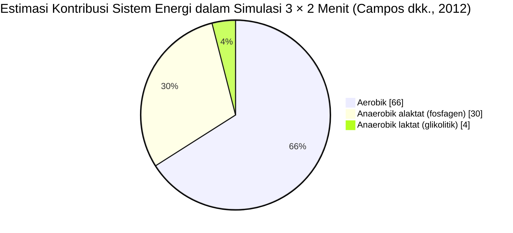
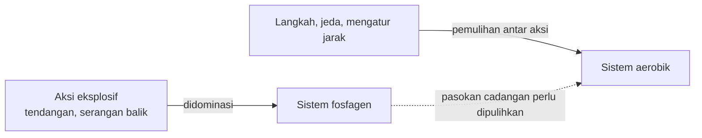
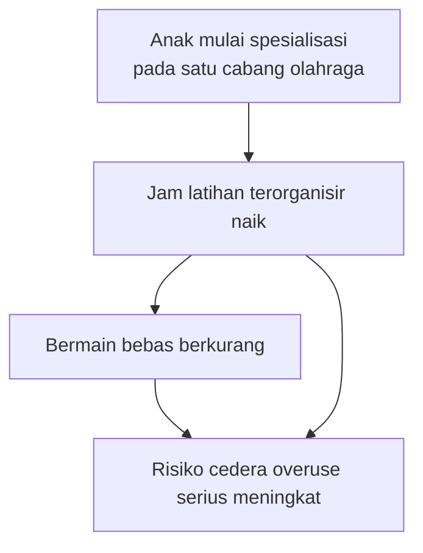

# Bab 1: Tubuh Atlet Taekwondo — Bioenergetika, Profil Fisik & Perkembangan Atlet Muda

> 📖 Hub Buku: **[Seni Melatih Atlet: Fondasi Ilmiah Pembinaan Atlet Taekwondo](index.md)**

---

## 📖 Narasi Pembuka: Dua Menit yang Terasa Seperti Satu Jam

Bagi penonton, satu ronde taekwondo terlihat seperti rangkaian ledakan singkat: langkah ringan, jeda yang tampak "santai", lalu tendangan yang melesat dalam sekejap. Bagi atlet di dalamnya, dua menit itu bisa terasa seperti satu jam.

Banyak pelatih berusaha menyiapkan atlet untuk dua menit itu dengan cara yang paling mudah dibayangkan: *bikin atlet capek sebanyak-banyaknya*. Lari lebih jauh, sprint lebih banyak, sparring lebih lama tanpa jeda. Logikanya terdengar masuk akal: kalau latihan lebih berat dari pertandingan, pertandingan pasti terasa ringan.

Masalahnya, tubuh tidak bekerja dengan logika "makin capek makin siap". Tubuh bekerja dengan **jalur energi** yang spesifik. Setiap jalur punya kapasitas, kecepatan, dan cara pemulihannya sendiri. Jika latihan tidak meniru pola kerja itu, atlet bisa menjadi sangat letih tanpa menjadi lebih siap.

Bab ini membuka buku dengan pertanyaan paling dasar: **apa sebenarnya yang dilakukan tubuh atlet taekwondo selama bertanding, dan bagaimana menyiapkannya tanpa merusaknya, terutama bila atletnya masih anak-anak?**

> ℹ️ **Catatan cara baca:** angka dan klaim penting di bab ini menggunakan sistem sitasi bernomor resmi (*Numbered In-text Citation / Citation-Sequence System*) `[[n]](#daftar-pustaka-bab-1)` yang **dapat diklik langsung** untuk melompat ke daftar pustaka di akhir bab. Level bukti 🟢🟡🟠🔴 dijelaskan di [Hub Buku](index.md#-2-sistem-label-bukti-wajib-di-setiap-bab).

---

## 🔬 Teardown Konsep & Wawasan Utama

### 1. Dari Mana Energi Satu Pertandingan Berasal?

#### Temuan

Salah satu studi yang paling sering dirujuk untuk menjawab pertanyaan ini dilakukan oleh Campos dan rekan (2012). Mereka meminta **10 atlet taekwondo putra** tingkat nasional atau internasional (usia rata-rata 21 ± 6 tahun) menjalani **simulasi pertandingan**: tiga ronde masing-masing 2 menit, dengan jeda 1 menit di antaranya. Seluruh pertarungan difilmkan untuk menghitung waktu bertarung sebenarnya. Kontribusi tiap sistem energi diperkirakan dari konsumsi oksigen selama aktivitas, komponen cepat konsumsi oksigen pasca-latihan, dan perubahan kadar laktat darah [[1]](#ref-1).

Hasilnya:

| Sistem energi | Estimasi kontribusi | Peran umum |
|---|:-:|---|
| **Aerobik** | **66 ± 6%** (±120 kJ) | Menopang kerja berkepanjangan dan pemulihan |
| **Anaerobik alaktat** (fosfagen/PCr) | **30 ± 6%** (±54 kJ) | Menggerakkan aksi eksplosif sangat singkat |
| **Anaerobik laktat** (glikolitik) | **4 ± 2%** (±8,5 kJ) | Menjembatani usaha intens berdurasi lebih panjang |

Rasio aksi intensitas tinggi terhadap momen intensitas rendah (langkah dan jeda) kira-kira **1 : 7** [[1]](#ref-1).

#### Mengapa Ini Berlawanan dengan Intuisi

Taekwondo sering disebut "olahraga anaerobik" karena tendangannya meledak-ledak. Data di atas menunjukkan gambaran yang lebih bernuansa: **sebagian besar energi total justru dipasok jalur aerobik**, sementara jalur fosfagen memasok aksi-aksi penentu. Kontribusi glikolitik yang kecil juga berbeda dari bayangan umum bahwa "latihan sampai asam laktat tinggi" adalah inti persiapan.

Para penulis sendiri menarik kesimpulan praktis: sesi latihan **sebaiknya diarahkan terutama pada peningkatan sistem anaerobik alaktat** (penyokong aksi intensitas tinggi) **dan sistem aerobik** (penyokong pemulihan di antara aksi-aksi itu) `[1]`.

> **Interpretasi.** Garis putus-putus pada diagram adalah tafsir penyusun berdasarkan kesimpulan Campos dkk. bahwa sistem aerobik berperan dalam proses pemulihan di antara aksi intensitas tinggi `[1]`. Ia bukan hasil pengukuran langsung dalam studi tersebut.

#### Catatan Kehati-hatian (Penting)

- Sampel **kecil (n = 10)** dan **seluruhnya putra dewasa muda** `[1]`. Data untuk atlet putri dan atlet anak sangat terbatas.
- Kontribusi energi **diestimasi**, bukan diukur langsung. Besarnya angka, terutama porsi glikolitik, dapat bergeser bila metode estimasinya berbeda.
- Pertarungan adalah **simulasi**. Pertandingan resmi dengan taruhan sebenarnya bisa memunculkan respons fisiologis yang berbeda.
- Aturan dan sistem penilaian taekwondo berubah dari waktu ke waktu. Data lama dapat tidak mencerminkan tuntutan kompetisi masa kini `[1]`.

**Level bukti: 🟠 C** (studi kecil, hasil estimasi). Konsisten sebagai arah umum, belum cukup untuk menetapkan angka latihan yang pasti.

---

### 2. Profil Fisik Atlet Taekwondo Internasional

#### Temuan

Tinjauan Bridge dan rekan (2014) merangkum karakteristik fisik dan fisiologis atlet taekwondo. Poin-poin kuncinya `[2]`:

| Aspek | Ringkasan temuan tinjauan |
|---|---|
| **Komposisi tubuh** | Kadar lemak tubuh rendah. Somatotipe memadukan massa otot-rangka sedang dengan tubuh yang relatif ramping/linear |
| **Kebugaran kardiorespirasi** | Bervariasi, tetapi tingkat sedang hingga tinggi diperlukan untuk mendukung kebutuhan metabolik bertarung dan **pemulihan antar-pertandingan beruntun** |
| **Daya anaerobik** | Daya puncak tungkai tinggi. Atribut ini tampak sejalan dengan keberhasilan di kompetisi internasional |
| **Kemampuan daya** | Kemampuan menghasilkan dan mempertahankan tenaga lewat kontraksi konsentrik dan siklus regang-pendek (*stretch-shortening cycle*) pada tungkai dianggap penting untuk aksi teknis-taktis |
| **Kekuatan maksimal** | Sedang hingga tinggi, pada tungkai dan tubuh bagian atas |
| **Daya tahan otot inti** | Sedang, pada otot batang tubuh dan fleksor pinggul |
| **Fleksibilitas** | Tinggi pada tungkai, sesuai tuntutan teknik |

Para penulis menutup dengan catatan penting: **diperlukan penelitian lebih banyak** agar pengondisian dapat dikhususkan untuk populasi yang berbeda di dalam olahraga ini `[2]`.

> **Interpretasi.** Profil ini menunjukkan bahwa atlet taekwondo tingkat atas adalah *atlet serba-bisa*: daya, kekuatan, fleksibilitas, dan kebugaran aerobik semuanya dibutuhkan. Tidak ada satu kualitas pun yang cukup berdiri sendiri. Konsekuensinya bagi pelatih: **jangan membangun program dari satu kualitas saja** (misalnya hanya fleksibilitas atau hanya sparring).

**Level bukti: 🟠 C** (tinjauan naratif, profil kelompok elit). Profil menggambarkan *siapa yang berhasil*, bukan membuktikan bahwa kualitas itu *penyebab* keberhasilan.

---

### 3. "Pemanasan Ajaib"? Meluruskan PAP dan PAPE

Di kalangan pelatih beredar gagasan bahwa kontraksi berat singkat sebelum bertanding dapat membuat atlet "lebih meledak". Fenomena yang sering disebut adalah *post-activation potentiation* (PAP). Tinjauan Blazevich dan Babault (2019) menjelaskan bahwa istilah ini sering dicampuradukkan `[3]`:

| | **PAP** (klasik) | **PAPE** |
|---|---|---|
| Yang diukur | Respons sentakan otot yang dirangsang listrik | Peningkatan performa sukarela (tenaga, lompatan, dll.) |
| Waktu paruh / jangka | Sangat singkat (waktu paruh ±28 detik) | Terlihat beberapa menit setelah kontraksi intens |
| Mekanisme yang diajukan | Fosforilasi rantai ringan miosin pada serat tipe II | Perubahan suhu otot, kadar air sel otot, dan aktivasi otot |

Temuan penting untuk praktik: waktu berlangsungnya PAP **jarang cocok** dengan waktu peningkatan performa sukarela. Sebagian peneliti mempertanyakan apakah PAP benar-benar menyumbang pada PAPE dalam kondisi nyata. Selain itu, bukti bahwa PAP penting secara praktis **minim** bila atlet sudah melakukan **pemanasan aktif yang menyeluruh** `[3]`.

**Pelajaran praktis (interpretasi):** daripada mencari "trik" kontraksi berat sebelum naik matras, prioritaskan **pemanasan aktif yang lengkap**. Bila pelatih ingin bereksperimen dengan aktivasi tambahan, lakukan secara hati-hati, uji pada sesi latihan, dan jangan menjanjikan efek pasti kepada atlet.

**Level bukti: 🟠 C** (tinjauan naratif; topik masih diperdebatkan).

---

### 4. Anak Bukan "Atlet Dewasa Versi Kecil"

#### Temuan: Risiko Spesialisasi dan Beban Berlebih

Studi kasus-kontrol Jayanthi dan rekan (2015) membandingkan **822 atlet muda cedera** dengan **368 atlet muda tidak cedera** (usia 7–18 tahun) dari klinik kedokteran olahraga dan layanan primer di Chicago `[4]`. Setelah memperhitungkan usia dan jumlah jam latihan per minggu:

| Faktor | Hasil (*odds ratio*, 95% CI) |
|---|:-:|
| Spesialisasi pada satu cabang olahraga → cedera | OR 1,27 (1,07–1,52) |
| Spesialisasi pada satu cabang olahraga → cedera *overuse* serius | OR 1,36 (1,08–1,72) |
| Jam olahraga per minggu **lebih banyak dari usia dalam tahun** → cedera *overuse* serius | OR 2,07 (1,40–3,05) |
| Rasio olahraga terorganisir **:** bermain bebas **> 2 : 1** per minggu → cedera *overuse* serius | OR 1,87 (1,26–2,76) |

Satu temuan lagi layak dicatat: **laju pertumbuhan tidak berhubungan dengan risiko cedera** dalam studi ini (4,8 cm/tahun pada kedua kelompok) `[4]`.

> **Peringatan membaca.** Studi kasus-kontrol menunjukkan **keterkaitan**, bukan bukti sebab-akibat. Data dikumpulkan lewat survei dan catatan medis, sehingga rentan bias ingatan. Peneliti sendiri menyebutnya sebagai panduan bagi klinisi saat berkonsultasi dengan atlet muda dan orang tua `[4]`. Studi ini juga **bukan studi taekwondo**, melainkan atlet muda dari berbagai cabang.

**Level bukti: 🟡 B** (observasional terkontrol; transfer ke taekwondo anak belum diverifikasi).

#### Kerangka Perkembangan: Model YPD

Sebagai kerangka konseptual, Lloyd dan Oliver (2012) mengajukan **Youth Physical Development (YPD) Model**, sebuah pendekatan perkembangan atletik jangka panjang yang mempertimbangkan kematangan biologis anak, bukan semata-mata usia kalender `[5]`.

> **Catatan penyusun.** Rincian isi model YPD (misalnya penekanan komponen di tiap tahap kematangan) harus dibaca langsung dari sumber aslinya `[5]` sebelum dijadikan pedoman program. Pada draf ini hanya DOI yang diverifikasi. Ringkasan rincian akan ditambahkan setelah naskah aslinya ditelaah.

**Level bukti: 🟠 C** (model konseptual).

---

## 🧪 Kotak Bukti Bab 1

| # | Klaim | Level | Sumber | Catatan transfer ke taekwondo |
|:-:|---|:-:|---|---|
| 1 | Simulasi 3 × 2 menit: aerobik ±66%, fosfagen ±30%, glikolitik ±4% | 🟠 C | `[1]` | Langsung taekwondo, tetapi n = 10 putra dewasa |
| 2 | Rasio aksi intens : non-intens ≈ 1 : 7 | 🟠 C | `[1]` | Langsung taekwondo |
| 3 | Atlet elit: lemak rendah, daya tungkai tinggi, fleksibilitas tinggi, kebugaran aerobik sedang–tinggi | 🟠 C | `[2]` | Langsung taekwondo; deskriptif |
| 4 | PAP ≠ PAPE; PAP kecil perannya bila pemanasan aktif menyeluruh | 🟠 C | `[3]` | Umum (bukan khusus taekwondo) |
| 5 | Spesialisasi satu cabang dan jam olahraga > usia meningkatkan odds cedera overuse serius | 🟡 B | `[4]` | Atlet muda lintas cabang |
| 6 | Perkembangan atletik anak sebaiknya mempertimbangkan kematangan biologis | 🟠 C | `[5]` | Kerangka konseptual |

## ❓ Batas Pengetahuan

- **Belum jelas** berapa kontribusi energi sebenarnya pada atlet putri, anak, dan pada pertandingan resmi.
- **Diperdebatkan**: seberapa besar peran PAP/PAPE dalam praktik nyata `[3]`.
- **Belum diverifikasi** dalam draf ini: perbandingan antar-studi kontribusi energi taekwondo, serta temuan khusus tentang spesialisasi dini di taekwondo anak.
- **Mengikuti perubahan aturan**: sistem penilaian modern dapat mengubah pola aksi dan pemulihan yang diukur pada studi lama.

---

## 🧠 Eksperimen Pikiran & Contoh Kasus

> ℹ️ Skenario berikut adalah **ilustrasi fiktif** untuk membantu membayangkan konsep, bukan data penelitian.

- **Kasus pelatih (ilustrasi):** Seorang pelatih membuat latihan "ronde penuh" berupa 2 menit sparring tanpa jeda, diulang tujuh kali. Atlet kelelahan, pelatih puas. Bila pola pertandingan memang berkisar pada aksi singkat dengan banyak momen intensitas rendah (kira-kira 1 : 7) `[1]`, latihan seperti itu menguji hal yang berbeda dari tuntutan pertandingan. *Pertanyaan yang layak diajukan: apakah latihan ini meniru pola kerja pertandingan, atau hanya membuat atlet lelah?*
- **Kasus orang tua (ilustrasi):** Orang tua dari anak berusia 10 tahun ingin anaknya latihan taekwondo setiap hari sepanjang tahun "supaya cepat juara". Data atlet muda menunjukkan bahwa jam olahraga terorganisir yang melebihi usia anak dalam tahun dan porsi bermain bebas yang sangat kecil berkaitan dengan risiko cedera *overuse* serius yang lebih tinggi `[4]`. *Pertanyaannya bukan "berapa jam", melainkan "apakah anak masih punya ruang bermain dan beragam gerak?"*

---

## ⚡ Panduan Aksi Nyata dari Bab Ini (Action Checklist)

1. [ ] **Audit sesi latihan**: catat berapa menit aksi intens dibandingkan menit latihan total. Apakah jeda dan pemulihan dirancang, atau hanya tidak sengaja ada?
2. [ ] **Pemanasan aktif lengkap**: pastikan rutinitas pemanasan meningkatkan suhu tubuh dan mengaktifkan tungkai serta inti sebelum aksi eksplosif `[3]`.
3. [ ] **Bangun profil serba-bisa**: periksa apakah program memuat daya tungkai, kekuatan, fleksibilitas, dan kebugaran aerobik, bukan hanya satu `[2]`.
4. [ ] **Untuk atlet anak**: hitung jam olahraga terorganisir per minggu dibandingkan usia (tahun) dan dibandingkan waktu bermain bebas `[4]`. Beri ruang bagi variasi gerak dan olahraga lain.
5. [ ] **Libatkan ahli**: konsultasikan beban pada atlet muda dengan tenaga kesehatan olahraga.

---

## 💬 Kutipan Pilihan & Catatan Reflektif

> *"Sesi latihan sebaiknya diarahkan terutama pada peningkatan sistem anaerobik alaktat (bertanggung jawab atas aksi berintensitas tinggi) dan sistem aerobik (bertanggung jawab atas proses pemulihan di antara aksi-aksi itu)."*  
> — Campos dkk. (2012), parafrase terjemahan penyusun dari kesimpulan abstrak `[1]`

**Pertanyaan Refleksi Diri**:
- *Dari semua yang saya lakukan di sesi latihan, mana yang benar-benar meniru pola kerja pertandingan, dan mana yang hanya "membuat capek"?*
- *Untuk atlet muda yang saya bina: apakah ia masih punya kesempatan bermain dan bergerak di luar taekwondo?*
- *Klaim mana tentang "yang terbaik untuk atlet" yang selama ini saya terima tanpa pernah menanyakan buktinya?*

---

## 📚 Daftar Pustaka Bab 1

1. Campos FAD, Bertuzzi R, Dourado AC, Santos VG, Franchini E. Energy demands in taekwondo athletes during combat simulation. *Eur J Appl Physiol*. 2012;112(4):1221–1228. doi:[10.1007/s00421-011-2071-4](https://doi.org/10.1007/s00421-011-2071-4). PMID: [21769736](https://pubmed.ncbi.nlm.nih.gov/21769736/)

2. Bridge CA, Ferreira da Silva Santos J, Chaabène H, Pieter W, Franchini E. Physical and physiological profiles of taekwondo athletes. *Sports Med*. 2014;44(6):713–733. doi:[10.1007/s40279-014-0159-9](https://doi.org/10.1007/s40279-014-0159-9). PMID: [24549477](https://pubmed.ncbi.nlm.nih.gov/24549477/)

3. Blazevich AJ, Babault N. Post-activation potentiation versus post-activation performance enhancement in humans: historical perspective, underlying mechanisms, and current issues. *Front Physiol*. 2019;10:1359. doi:[10.3389/fphys.2019.01359](https://doi.org/10.3389/fphys.2019.01359). PMID: [31736781](https://pubmed.ncbi.nlm.nih.gov/31736781/)

4. Jayanthi NA, LaBella CR, Fischer D, Pasulka J, Dugas LR. Sports-specialized intensive training and the risk of injury in young athletes: a clinical case-control study. *Am J Sports Med*. 2015;43(4):794–801. doi:[10.1177/0363546514567298](https://doi.org/10.1177/0363546514567298). PMID: [25646361](https://pubmed.ncbi.nlm.nih.gov/25646361/)

5. Lloyd RS, Oliver JL. The Youth Physical Development Model: a new approach to long-term athletic development. *Strength Cond J*. 2012. doi:[10.1519/SSC.0b013e31825760ea](https://doi.org/10.1519/SSC.0b013e31825760ea)

> ⚕️ **Catatan medis:** isi bab ini bersifat edukatif dan bukan pengganti penilaian dokter olahraga atau tenaga kesehatan berwenang.

---

## 🧭 Navigasi Bab Selanjutnya

📖 **[Hub Buku](index.md)** &nbsp;&nbsp;|&nbsp;&nbsp; ➡️ **[Lanjut ke Bab 2: Beban, Periodisasi & Tapering — Seni Mengatur Dosis Latihan](02-periodisasi-beban-dan-tapering.md)**
