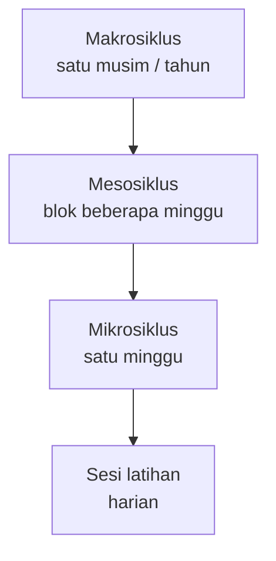
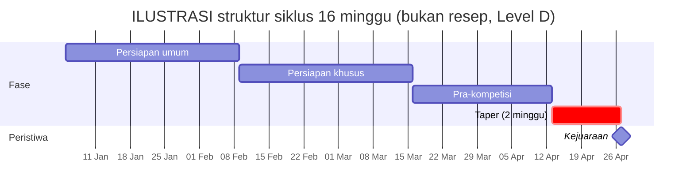
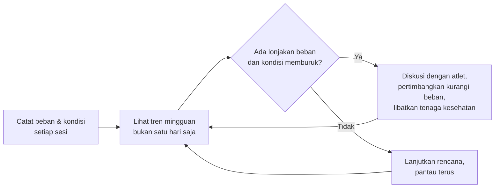
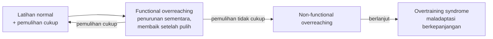
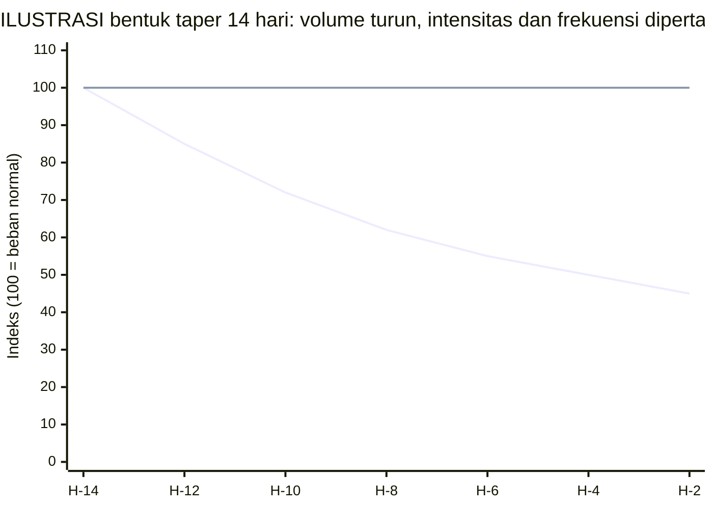

# Bab 2: Beban, Periodisasi & Tapering — Seni Mengatur Dosis Latihan

> 📖 Hub Buku: **[Seni Melatih Atlet: Fondasi Ilmiah Pembinaan Atlet Taekwondo](index.md)**

---

## 📖 Narasi Pembuka: Dua Minggu Sebelum Kejuaraan

> ℹ️ Skenario berikut adalah **ilustrasi fiktif**, bukan data penelitian.

Empat belas hari menjelang kejuaraan provinsi, seorang pelatih membuka catatan latihannya dan merasa gelisah. Atletnya terlihat belum "tajam". Naluri pertamanya: **tambah porsi**. Sesi pagi ditambah, sparring dilipatgandakan, hari libur dihapus. Alasannya terdengar logis, *"waktu kita tinggal sedikit, jadi harus dikejar."*

Tiga hari kemudian, atlet mengeluh kaki berat, tidurnya tidak nyenyak, dan teknik yang biasanya rapi mulai berantakan. Pelatih menganggapnya "lemah mental" dan menambah beban lagi.

Pertanyaan yang jarang diajukan di momen seperti ini: **apakah masalahnya kekurangan latihan, atau kelebihan latihan yang belum sempat diserap tubuh?**

Sains olahraga punya perangkat untuk menjawabnya. Ada cara mengukur beban, cara membaca respons atlet, cara menyusun siklus latihan, dan, untuk dua minggu terakhir itu, ada bukti tentang *menurunkan beban* alih-alih menaikkannya. Namun bab ini juga harus jujur: sebagian perangkat itu **diperdebatkan**, dan sebagian besar datanya **bukan berasal dari taekwondo**.

> ℹ️ **Catatan cara baca:** angka dan klaim penting di bab ini menggunakan sistem sitasi bernomor resmi (*Numbered In-text Citation / Citation-Sequence System*) `[[n]](#daftar-pustaka-bab-2)` yang **dapat diklik langsung** untuk melompat ke daftar pustaka di akhir bab. Level bukti 🟢🟡🟠🔴 dijelaskan di [Hub Buku](index.md#-2-sistem-label-bukti-wajib-di-setiap-bab).

---

## 🔬 Teardown Konsep & Wawasan Utama

### 1. Periodisasi: Apa yang Sebenarnya Terbukti?

#### Esensi Gagasan

Periodisasi adalah cara mengorganisasi latihan ke dalam **fase-fase berurutan dan siklus waktu** agar peluang mencapai target performa tertentu meningkat sambil meminimalkan risiko *overtraining* [[9]](#ref-9).

#### Temuan

Meta-analisis Williams dan rekan (2017) membandingkan **latihan beban berperiodisasi** dengan **tidak berperiodisasi** terhadap kekuatan maksimal (1RM). Mereka menggabungkan **81 efek dari 18 studi** (terbit 1988–2015) [[9]](#ref-9):

| Hasil | Nilai |
|---|---|
| Periodisasi vs non-periodisasi (peningkatan 1RM) | **ES = 0,43** (95% CI 0,27–0,58), efek **sedang**, berpihak pada periodisasi |
| Model *undulating* (bervariasi) | Lebih menguntungkan untuk kenaikan kekuatan |
| Status latihan | Peningkatan lebih besar pada peserta **belum terlatih** |
| Frekuensi latihan & lama studi | Frekuensi lebih tinggi dan studi lebih lama berkaitan dengan peningkatan lebih besar |

Kesimpulan penulisnya: variasi stimulus latihan tampak penting untuk meningkatkan kekuatan maksimal [[9]](#ref-9).

#### Batas yang Harus Diingat

- Studi ini hanya meneliti **latihan beban** dan **kekuatan maksimal** (squat, bench press, leg press), bukan performa bertanding taekwondo [[9]](#ref-9).
- Efeknya **sedang**, bukan dramatis, dan lebih besar pada orang yang belum terlatih. Atlet elit bisa merespons berbeda.
- Meta-analisis ini mendapat **komentar kritis** dan balasan penulis di jurnal yang sama (*Sports Med*, 2018), tanda bahwa tafsirnya masih diperdebatkan [[9b]](#ref-9b).

> **Interpretasi.** Bukti yang ada mendukung gagasan *umum* bahwa latihan yang **terencana dan bervariasi** cenderung lebih baik daripada latihan monoton, setidaknya untuk kekuatan. Tidak ada bukti dalam sumber-sumber bab ini bahwa satu model periodisasi tertentu (klasik, blok, dan sebagainya) *terbukti terbaik untuk taekwondo*. Karena itu, contoh siklus di bawah ini hanyalah **ilustrasi struktur**, bukan resep.

**Level bukti: 🟢 A** untuk efek periodisasi pada *kekuatan maksimal*; **🔴 D** untuk struktur siklus spesifik taekwondo di atas (ilustratif).

---

### 2. Beban Latihan: Paradoks, Rasio, dan Kritiknya

#### Esensi Gagasan: *Training–Injury Prevention Paradox*

Gabbett (2016) menyajikan gagasan bahwa atlet yang **terbiasa dengan beban latihan tinggi** justru cenderung **lebih sedikit cedera** daripada atlet yang berlatih pada beban rendah. Argumennya: cedera jaringan lunak tanpa kontak lebih mungkin disebabkan oleh **program latihan yang tidak tepat**, terutama **kenaikan beban yang berlebihan dan cepat**, bukan oleh latihan itu sendiri [[7]](#ref-7).

Gabbett menekankan bahwa beban perlu diukur secara akurat, baik **internal** (respons tubuh atlet) maupun **eksternal** (kerja yang dilakukan), dengan membandingkan beban **akut** (terbaru) dan **kronis** (jangka menengah) [[7]](#ref-7).

#### Rasio Akut:Kronis (ACWR) dan Angkanya

Dalam teks lengkapnya, Gabbett menggambarkan ACWR sebagai beban minggu terkini dibagi rata-rata beban jangka menengah, dan merangkum temuan dari **kriket, sepak bola Australia, dan rugbi liga** [[7]](#ref-7):

| Pengamatan yang dilaporkan | Angka |
|---|---|
| ACWR ≤ 0,99 (beban minggu ini serupa/lebih rendah dari kronis) | Kemungkinan cedera 7 hari berikutnya ±4% (pada pelempar cepat kriket) |
| ACWR ≥ 1,5 | Risiko cedera **2–4 kali lipat** dalam 7 hari berikutnya |
| "Sweet spot" yang diusulkan | ACWR ≈ **0,8–1,3** |
| "Danger zone" yang diusulkan | ACWR ≥ **1,5** |

Gabbett sendiri menambahkan peringatan: kemungkinan **hubungan beban–cedera berbeda antar olahraga**, dan penerapan pada atlet **olahraga individu** harus dilakukan **dengan hati-hati** sampai ada data lebih banyak [[7]](#ref-7).

#### Kritik Metodologis yang Serius

Impellizzeri dan rekan (2020) mengajukan kritik tajam terhadap penggunaan ACWR [[8]](#ref-8):

- Merekomendasikan *memanipulasi* ACWR untuk mengubah angka cedera mengandaikan hubungan **sebab-akibat**. Menurut mereka, **belum ada studi yang mencoba memperkirakan efek kausal secara memadai**, sehingga manipulasi ACWR untuk menurunkan cedera masih berupa dugaan.
- Ada masalah bawaan pada **data rasio**: ACWR dinilai metrik yang tidak akurat (tidak menormalkan pembilang terhadap penyebut), **ambigu**, dan tidak konsisten searah dengan risiko cedera.
- Kesimpulan mereka tegas: **tidak ada bukti yang mendukung penggunaan ACWR dalam sistem manajemen beban latihan atau rekomendasi latihan untuk menurunkan risiko cedera**. Metrik ini bahkan dapat menambah *noise* dan artefak statistik [[8]](#ref-8).

| | Gabbett (2016) [[7]](#ref-7) | Impellizzeri dkk. (2020) [[8]](#ref-8) |
|---|---|---|
| Posisi | ACWR sebagai prediktor praktis; zona 0,8–1,3 dan ≥1,5 | ACWR tidak punya dasar kausal; tidak layak untuk preskripsi latihan |
| Sumber data | Kriket, sepak bola Australia, rugbi liga | Kritik konseptual dan statistik |
| Peringatan | Hati-hati untuk olahraga individu | Rasio menimbulkan artefak dan ambiguitas |

> **Posisi buku ini (interpretasi).**  
> 1. **Jangan** mengutip "zona aman 0,8–1,3" atau "bahaya ≥1,5" sebagai aturan baku untuk atlet taekwondo. Angka itu berasal dari olahraga lain dan sedang dikritik secara metodologis.  
> 2. **Boleh** memakai catatan beban mingguan secara **deskriptif**: untuk melihat apakah ada *lonjakan mendadak* dibandingkan kebiasaan atlet, lalu **berdiskusi** dengan atlet dan tenaga kesehatan.  
> 3. Gagasan inti Gabbett bahwa *lonjakan beban yang cepat patut diwaspadai* masuk akal sebagai **hipotesis kerja**. Statusnya bukan fakta terbukti.

**Level bukti: 🟠 C** untuk kedua sumber (narasi/model dan kritik metodologis). **Validasi ACWR khusus taekwondo belum ditelusuri dalam draf ini.**

---

### 3. Memantau Atlet: Sederhana, Murah, dan Ada Dasarnya

#### Session-RPE: Metode dan Buktinya

Metode *session-RPE* mengalikan **skor kelelahan yang dirasakan atlet** dengan **durasi sesi** untuk mendapatkan satuan beban latihan. Foster dan rekan (2001) mengevaluasinya terhadap standar objektif berbasis detak jantung, pada bersepeda dan bola basket. Hasilnya: hubungan antara kedua metode **konsisten**, dan mereka menyimpulkan metode ini valid untuk menghitung beban latihan pada beragam jenis latihan [[10]](#ref-10).

Lalu bagaimana di taekwondo?

| Studi | Peserta | Temuan |
|---|---|---|
| Haddad dkk. (2011) [[11]](#ref-11) | 10 atlet taekwondo muda (usia 13,1 ± 2,4 tahun), 308 sesi | Hubungan signifikan antara session-RPE dan beban berbasis detak jantung (r = 0,55–0,90) pada semua mode latihan; session-RPE dinilai **valid** |
| Lupo dkk. (2017) [[12]](#ref-12) | 9 atlet taekwondo pra-pubertas (±12 tahun), 100 sesi | Session-RPE berkorelasi signifikan dengan metode Edwards (detak jantung); hubungan **besar** (r = 0,71) hanya untuk sesi pra-kompetisi yang dinilai **30 menit** setelah sesi |
| Slimani dkk. (2017) [[13]](#ref-13) | Tinjauan olahraga tarung | RPE valid untuk atlet pemula dan elite; korelasi dengan detak jantung cenderung **lebih lemah pada olahraga berbasis anaerobik (mis. taekwondo)** dan pada atlet muda; RPE lebih andal bila sistem anaerobik dan aerobik sama-sama aktif |

> **Catatan hati-hati.** Studi taekwondo di atas **berukuran kecil** (9–10 atlet) dan **semuanya atlet muda**. Slimani dkk. juga mencatat bahwa korelasi lebih lemah pada olahraga seperti taekwondo [[13]](#ref-13). Jadi session-RPE sebaiknya dianggap **alat pantau yang berguna**, bukan pengukur presisi.

#### Mengapa Cukup Bertanya kepada Atlet?

Tinjauan sistematik Saw dan rekan (2016) menelaah **56 studi** yang membandingkan ukuran **subjektif** (mood, stres yang dirasakan) dengan **objektif** (penanda darah, detak jantung, konsumsi oksigen) kondisi atlet. Temuannya [[14]](#ref-14):

- Ukuran subjektif dan objektif **umumnya tidak berkorelasi**.
- Ukuran subjektif mencerminkan beban latihan akut maupun kronis dengan **sensitivitas dan konsistensi lebih baik** daripada ukuran objektif.
- Kesejahteraan subjektif umumnya **menurun** saat beban akut naik, dan **membaik** saat beban akut turun.

Para penulis menyimpulkan bahwa ukuran subjektif dapat dipakai sendiri atau dipadukan dalam pendekatan metode campuran [[14]](#ref-14).

#### Contoh Catatan Sederhana (Bebas Alat)

Cukup kertas atau *spreadsheet*. Contoh kolomnya:

| Tanggal | Durasi sesi (menit) | RPE sesi (0–10) | Beban (RPE × durasi) | Tidur semalam (baik/kurang) | Nyeri otot/sendi (0–10) | Suasana hati (0–10) | Catatan |
|---|:-:|:-:|:-:|:-:|:-:|:-:|---|
| … | … | … | … | … | … | … | … |

> **Interpretasi.** Bentuk kolom di atas adalah contoh praktis yang konsisten dengan dukungan bukti untuk ukuran subjektif [[14]](#ref-14) dan session-RPE [[10]](#ref-10), [[11]](#ref-11), [[12]](#ref-12). Instrumen kuesioner tervalidasi yang spesifik belum diverifikasi dalam draf ini. Pemilihannya dibahas di Bab 7. Untuk atlet anak, perhatikan temuan Lupo dkk. bahwa penilaian ±30 menit setelah sesi lebih andal pada sesi tertentu [[12]](#ref-12).

> Alur di atas adalah **interpretasi penyusun**, bukan algoritma tervalidasi. Ia sengaja tidak memuat ambang angka karena tidak ada ambang yang terverifikasi untuk taekwondo.

**Level bukti: 🟡 B** untuk validitas session-RPE terhadap detak jantung (observasional); **🟢 A** untuk keunggulan ukuran subjektif (tinjauan sistematik, [[14]](#ref-14)); transfer ke taekwondo: **sebagian** (studi kecil, atlet muda).

---

### 4. Batas Antara "Menantang" dan "Merusak": Overreaching dan Overtraining

Pernyataan konsensus Meeusen dan rekan (2013) dari European College of Sport Science dan American College of Sports Medicine memberi kerangka yang jelas [[15]](#ref-15):

- Latihan yang berhasil **harus melibatkan beban berlebih (*overload*)**, tetapi harus **menghindari kombinasi beban berlebih dan pemulihan yang tidak memadai**.
- ***Functional overreaching* (FOR)**: penurunan performa jangka pendek tanpa gejala psikologis atau gejala lain yang berat. Setelah pemulihan, performa **meningkat**.
- ***Non-functional overreaching* (NFOR)**: terjadi bila keseimbangan latihan dan pemulihan tidak dijaga.
- ***Overtraining syndrome* (OTS)**: ditandai "maladaptasi berkepanjangan" pada atlet dan berbagai mekanisme regulasi biologis, neurokimia, dan hormonal. Membedakan NFOR dari OTS **sangat sulit** dan bergantung pada hasil klinis serta diagnosis eksklusi.

Dua poin yang sangat relevan bagi pelatih:

1. **Belum ada satu penanda pun** (hormon, tes performa, tes psikologis, biokimia, imun) yang memenuhi semua kriteria untuk dipakai secara umum mendiagnosis OTS [[15]](#ref-15).
2. Dalam proses diagnosis, penyebab lain harus disingkirkan lebih dulu: penyakit organik atau infeksi, serta faktor seperti **pembatasan kalori (keseimbangan energi negatif)**, kurang karbohidrat dan/atau protein, kekurangan zat besi atau magnesium, alergi, dan lainnya [[15]](#ref-15).

> **Interpretasi.** Poin 2 adalah jembatan penting ke Bab 4. Pada olahraga **berkelas berat badan** seperti taekwondo, pembatasan asupan energi untuk menurunkan berat badan dapat bercampur dengan gejala kelelahan akibat latihan. Karena itu, menyalahkan "kurang mental" atas atlet yang mendadak menurun adalah kesalahan yang berisiko.

**Level bukti: 🟢 A** (pernyataan konsensus dua organisasi besar).

---

### 5. Tapering: Mengurangi untuk Tampil Puncak

#### Temuan Utama

Kembali ke pelatih di awal bab. Apa kata bukti tentang dua minggu terakhir? Bosquet dan rekan (2007) melakukan meta-analisis **27 studi** (dari 182 kandidat) pada **atlet kompetitif** yang menjalani *tapering* [[6]](#ref-6):

| Komponen taper | Strategi dengan efek terbaik | Ukuran efek keseluruhan |
|---|---|:-:|
| **Durasi** | 2 minggu | 0,59 ± 0,33 |
| **Volume latihan** | Diturunkan secara eksponensial sebesar **41–60%** | 0,72 ± 0,36 |
| **Intensitas** | **Tidak diubah** | 0,33 ± 0,14 |
| **Frekuensi** | **Tidak diubah** | 0,35 ± 0,17 |

Kesimpulan mereka: taper 2 minggu dengan volume diturunkan secara eksponensial 41–60% tampaknya strategi paling efisien untuk memaksimalkan peningkatan performa [[6]](#ref-6).

> Garis menurun menggambarkan **volume**; garis datar menggambarkan **intensitas**. Ini ilustrasi **bentuk kurva** yang konsisten dengan parameter Bosquet dkk. [[6]](#ref-6), bukan data pengukuran dan bukan jadwal siap pakai.

#### Cerminan pada Bidang Lain

Meta-analisis tapering pada **olahraga beregu** (Vachon dkk., 2021; 14 artikel) menemukan tapering efektif meningkatkan **daya maksimal**, **VO₂maks**, **kemampuan sprint berulang** (bukti terbatas), dan **kecepatan ganti arah**. Namun, para penulisnya mencatat bahwa **kekurangan studi yang membandingkan berbagai strategi taper** untuk membuat rekomendasi berbasis bukti yang lebih rinci [[16]](#ref-16).

#### Catatan Transfer ke Taekwondo

- Abstrak Bosquet dkk. menyebut populasinya **atlet kompetitif** secara umum. Data khusus **taekwondo atau olahraga tarung** tidak diperiksa dalam draf ini [[6]](#ref-6).
- Vachon dkk. meneliti **olahraga beregu**, bukan olahraga tarung [[16]](#ref-16).
- Pada olahraga berkelas berat badan, **periode taper beririsan dengan periode pengaturan berat badan** menjelang timbang badan. Koordinasi keduanya adalah isu tersendiri yang dibahas di Bab 4. Interaksinya **belum diverifikasi** dalam draf ini.

**Level bukti: 🟢 A** (meta-analisis) untuk pola taper secara umum; **transfer ke taekwondo: belum diverifikasi**.

---

## 🧪 Kotak Bukti Bab 2

| # | Klaim | Level | Sumber | Catatan transfer ke taekwondo |
|:-:|---|:-:|---|---|
| 1 | Periodisasi memberi efek sedang pada kekuatan maksimal (ES 0,43) dibanding non-periodisasi | 🟢 A | [[9]](#ref-9) | Hanya latihan beban; bukan performa taekwondo |
| 2 | Beban latihan tinggi yang dibangun bertahap mungkin protektif; kenaikan cepat patut diwaspadai | 🟠 C | [[7]](#ref-7) | Data dari olahraga beregu/kriket; hati-hati untuk olahraga individu |
| 3 | ACWR 0,8–1,3 "aman", ≥1,5 "bahaya" | 🟠 C | [[7]](#ref-7) | **Tidak untuk dipakai sebagai aturan baku** |
| 4 | Tidak ada bukti mendukung penggunaan ACWR untuk preskripsi latihan penurun cedera | 🟠 C | [[8]](#ref-8) | Kritik umum; relevan untuk semua olahraga |
| 5 | Session-RPE valid dibanding beban berbasis detak jantung | 🟡 B | [[10]](#ref-10), [[11]](#ref-11), [[12]](#ref-12), [[13]](#ref-13) | Studi taekwondo kecil dan atlet muda |
| 6 | Ukuran subjektif lebih sensitif dan konsisten dibanding ukuran objektif | 🟢 A | [[14]](#ref-14) | Umum lintas olahraga |
| 7 | Kontinum FOR → NFOR → OTS; belum ada penanda tunggal yang andal | 🟢 A | [[15]](#ref-15) | Konsensus umum |
| 8 | Taper terbaik: 2 minggu, volume turun 41–60%, intensitas dan frekuensi tetap | 🟢 A | [[6]](#ref-6) | Belum diverifikasi khusus taekwondo |
| 9 | Taper efektif untuk daya maksimal, VO₂maks, RSA, kecepatan ganti arah pada olahraga beregu | 🟢 A | [[16]](#ref-16) | Olahraga beregu |

## ❓ Batas Pengetahuan

- **Diperdebatkan**: kegunaan ACWR untuk memprediksi atau mencegah cedera [[7]](#ref-7), [[8]](#ref-8).
- **Belum jelas**: model periodisasi mana yang terbaik untuk performa *bertarung* taekwondo. Bukti yang ada menyangkut kekuatan maksimal [[9]](#ref-9).
- **Belum ditelusuri dalam draf ini**: validasi ACWR khusus taekwondo; studi taper khusus taekwondo atau olahraga tarung.
- **Keterbatasan session-RPE di taekwondo**: studi kecil, atlet muda, dan korelasi cenderung lebih lemah pada olahraga berbasis anaerobik [[11]](#ref-11), [[12]](#ref-12), [[13]](#ref-13).
- **Belum ada** penanda tunggal yang andal untuk mendiagnosis *overtraining syndrome* [[15]](#ref-15).

---

## 🧠 Eksperimen Pikiran & Contoh Kasus

> ℹ️ **Ilustrasi fiktif**, untuk melatih cara berpikir, bukan data penelitian.

- **Kasus pelatih (kembali ke narasi pembuka):** Pelatih menambah beban menjelang kejuaraan. Dengan perangkat bab ini ia bisa bertanya: *Berapa beban minggu ini dibandingkan minggu-minggu sebelumnya? Bagaimana tidur dan nyeri atlet? Apakah ada penurunan performa yang sebenarnya tanda kelelahan?* Menurut data taper, dua minggu terakhir justru saatnya **menurunkan volume** sambil mempertahankan intensitas dan frekuensi [[6]](#ref-6). Bila perlu, pelatih mendiskusikannya dengan tenaga kesehatan.
- **Kasus atlet berkelas berat badan:** Seorang atlet tiba-tiba lesu dan performanya turun di pekan-pekan akhir persiapan. Penyebabnya bisa kelelahan latihan, tetapi juga bisa pembatasan energi untuk mengejar kelas berat [[15]](#ref-15). Menyimpulkan "kurang semangat" tanpa memeriksa kemungkinan lain adalah risiko yang bisa dihindari.

---

## ⚡ Panduan Aksi Nyata dari Bab Ini (Action Checklist)

1. [ ] **Mulai catatan sederhana**: durasi dan RPE tiap sesi, ditambah tidur, nyeri, suasana hati. Cukup kertas atau spreadsheet [[10]](#ref-10), [[14]](#ref-14).
2. [ ] **Baca tren, bukan satu hari**: bandingkan beban minggu ini dengan kebiasaan atlet beberapa minggu terakhir [[7]](#ref-7).
3. [ ] **Jangan memakai ambang ACWR sebagai vonis**. Perlakukan sebagai catatan deskriptif [[8]](#ref-8).
4. [ ] **Rencanakan taper sejak awal siklus**: dua minggu, volume turun bertahap, intensitas dan frekuensi tetap [[6]](#ref-6).
5. [ ] **Waspadai tanda maladaptasi berkepanjangan**: penurunan performa disertai gangguan suasana hati dan kelelahan yang tidak membaik dengan istirahat cukup → rujuk ke tenaga kesehatan [[15]](#ref-15).
6. [ ] **Pisahkan sebab**: sebelum menilai atlet "kurang mental", periksa asupan energi, tidur, dan kesehatan [[15]](#ref-15).

---

## 💬 Kutipan Pilihan & Catatan Reflektif

> *"Latihan yang berhasil tidak hanya harus melibatkan beban berlebih, tetapi juga harus menghindari kombinasi beban berlebih dan pemulihan yang tidak memadai."*  
> — Meeusen dkk. (2013), parafrase terjemahan penyusun dari abstrak [[15]](#ref-15)

**Pertanyaan Refleksi Diri**:
- *Kapan terakhir kali saya menurunkan beban latihan atlet dengan sengaja, dan apakah saya bisa menjelaskan alasannya?*
- *Apakah saya mengukur sesuatu yang dasar (durasi, kelelahan, tidur), atau hanya mengandalkan firasat?*
- *Ketika atlet menurun, apakah saya bertanya "apa yang terjadi pada tubuhnya?" sebelum bertanya "mengapa ia lemah?"*

---

## 📚 Daftar Pustaka Bab 2

6. Bosquet L, Montpetit J, Arvisais D, Mujika I. Effects of tapering on performance: a meta-analysis. *Med Sci Sports Exerc*. 2007;39(8):1358–1365. doi:[10.1249/mss.0b013e31806010e0](https://doi.org/10.1249/mss.0b013e31806010e0). PMID: [17762369](https://pubmed.ncbi.nlm.nih.gov/17762369/)

7. Gabbett TJ. The training–injury prevention paradox: should athletes be training smarter and harder? *Br J Sports Med*. 2016;50(5):273–280. doi:[10.1136/bjsports-2015-095788](https://doi.org/10.1136/bjsports-2015-095788). PMID: [26758673](https://pubmed.ncbi.nlm.nih.gov/26758673/) (teks lengkap: PMC4789704)

8. Impellizzeri FM, Tenan MS, Kempton T, Novak A, Coutts AJ. Acute:chronic workload ratio: conceptual issues and fundamental pitfalls. *Int J Sports Physiol Perform*. 2020;15(6):907–913. doi:[10.1123/ijspp.2019-0864](https://doi.org/10.1123/ijspp.2019-0864). PMID: [32502973](https://pubmed.ncbi.nlm.nih.gov/32502973/)

9. Williams TD, Tolusso DV, Fedewa MV, Esco MR. Comparison of periodized and non-periodized resistance training on maximal strength: a meta-analysis. *Sports Med*. 2017;47(10):2083–2100. doi:[10.1007/s40279-017-0734-y](https://doi.org/10.1007/s40279-017-0734-y). PMID: [28497285](https://pubmed.ncbi.nlm.nih.gov/28497285/)
   - 9b. Williams TD, Tolusso DV, Fedewa MV, Esco MR. Author's reply to Nunes et al.: comment on "Comparison of periodized and non-periodized resistance training on maximal strength: a meta-analysis". *Sports Med*. 2018;48(2):495–496. doi:[10.1007/s40279-017-0822-z](https://doi.org/10.1007/s40279-017-0822-z). PMID: [29178085](https://pubmed.ncbi.nlm.nih.gov/29178085/)

10. Foster C, Florhaug JA, Franklin J, et al. A new approach to monitoring exercise training. *J Strength Cond Res*. 2001;15(1):109–115. PMID: [11708692](https://pubmed.ncbi.nlm.nih.gov/11708692/)

11. Haddad M, Chaouachi A, Castagna C, Wong DP, Behm DG, Chamari K. The construct validity of session RPE during an intensive camp in young male taekwondo athletes. *Int J Sports Physiol Perform*. 2011;6(2):252–263. doi:[10.1123/ijspp.6.2.252](https://doi.org/10.1123/ijspp.6.2.252). PMID: [21725110](https://pubmed.ncbi.nlm.nih.gov/21725110/)

12. Lupo C, Capranica L, Cortis C, Guidotti F, Bianco A, Tessitore A. Session-RPE for quantifying load of different youth taekwondo training sessions. *J Sports Med Phys Fitness*. 2017;57(3):189–194. doi:[10.23736/S0022-4707.16.06021-X](https://doi.org/10.23736/S0022-4707.16.06021-X). PMID: [26796074](https://pubmed.ncbi.nlm.nih.gov/26796074/)

13. Slimani M, Davis P, Franchini E, Moalla W. Rating of perceived exertion for quantification of training and combat loads during combat sport-specific activities: a short review. *J Strength Cond Res*. 2017;31(10):2889–2902. doi:[10.1519/JSC.0000000000002047](https://doi.org/10.1519/JSC.0000000000002047). PMID: [28933715](https://pubmed.ncbi.nlm.nih.gov/28933715/)

14. Saw AE, Main LC, Gastin PB. Monitoring the athlete training response: subjective self-reported measures trump commonly used objective measures: a systematic review. *Br J Sports Med*. 2016;50(5):281–291. doi:[10.1136/bjsports-2015-094758](https://doi.org/10.1136/bjsports-2015-094758). PMID: [26423706](https://pubmed.ncbi.nlm.nih.gov/26423706/)

15. Meeusen R, Duclos M, Foster C, et al. Prevention, diagnosis, and treatment of the overtraining syndrome: joint consensus statement of the European College of Sport Science and the American College of Sports Medicine. *Med Sci Sports Exerc*. 2013;45(1):186–205. doi:[10.1249/MSS.0b013e318279a10a](https://doi.org/10.1249/MSS.0b013e318279a10a). PMID: [23247672](https://pubmed.ncbi.nlm.nih.gov/23247672/)

16. Vachon A, Berryman N, Mujika I, Paquet JB, Arvisais D, Bosquet L. Effects of tapering on neuromuscular and metabolic fitness in team sports: a systematic review and meta-analysis. *Eur J Sport Sci*. 2021;21(3):300–311. doi:[10.1080/17461391.2020.1736183](https://doi.org/10.1080/17461391.2020.1736183). PMID: [32172680](https://pubmed.ncbi.nlm.nih.gov/32172680/)

> ⚕️ **Catatan medis:** isi bab ini bersifat edukatif dan bukan pengganti penilaian dokter olahraga atau tenaga kesehatan berwenang. Gejala kelelahan berkepanjangan, penurunan performa tanpa sebab jelas, atau gangguan suasana hati pada atlet perlu dievaluasi tenaga kesehatan.

---

## 🧭 Navigasi Bab Selanjutnya

⬅️ **[Bab Sebelumnya: Bab 1 — Tubuh Atlet Taekwondo](01-bioenergetika-dan-fisiologi-taekwondo.md)** &nbsp;&nbsp;|&nbsp;&nbsp; 📖 **[Hub Buku](index.md)** &nbsp;&nbsp;|&nbsp;&nbsp; ➡️ **[Lanjut ke Bab 3: Sports Medicine — Biomekanika Cedera, Protokol Akut & Kriteria Kembali ke Matras](03-sports-medicine-dan-biomekanika-cedera.md)**
