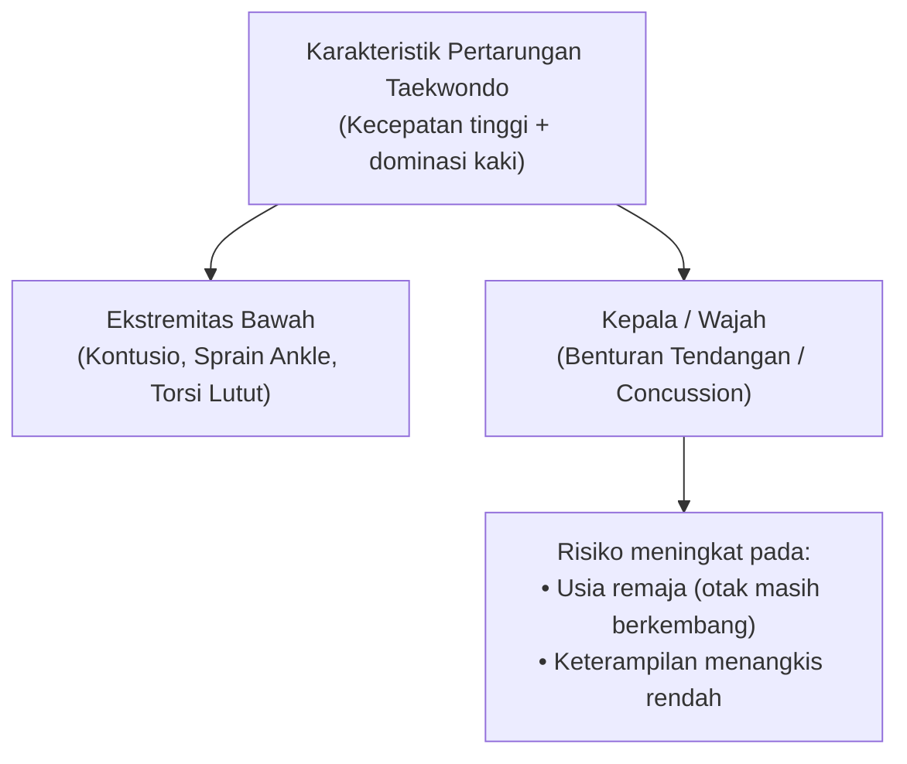
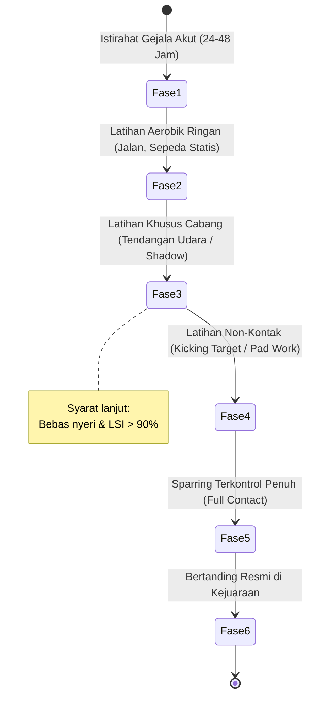

# Bab 3: Sports Medicine — Biomekanika Cedera, Protokol Akut & Kriteria Kembali ke Matras

> 📖 Hub Buku: **[Seni Melatih Atlet: Fondasi Ilmiah Pembinaan Atlet Taekwondo](index.md)**

---

## 📖 Narasi Pembuka: Tragedi "Semprot Es dan Paksa Lanjut"

Di tengah riuhnya kejuaraan daerah, seorang atlet taekwondo junior mendarat canggung usai mengeksekusi tendangan memutar (*dwi chagi*). Pergelangan kakinya terpelintir ke arah dalam (*inversion sprain*). Atlet meringis kesakitan di tepi matras.

Apa respons yang paling sering kita lihat di banyak gelanggang?

Seseorang berlari membawa kaleng semprotan dingin (*ethyl chloride* atau es batu), menyemprotkannya secara agresif hingga kulit memutih mati rasa, membebatnya erat-erat, lalu menepuk punggung sang atlet: *"Bisa tahan? Ayo demi medali, tinggal satu ronde lagi!"*

Tindakan tersebut sering dianggap sebagai wujud "jiwa petarung". Namun dari kacamata kedokteran olahraga modern (*sports medicine*), tindakan itu adalah **sabotase biologis**:
1. Menghilangkan sensasi nyeri secara paksa menghilangkan mekanisme protektif alami tubuh.
2. Mematikan proses inflamasi fase awal justru dapat mengacaukan sinyal perbaikan jaringan kolagen.
3. Memaksa bertanding dalam kondisi defisit propriosepsi meningkatkan risiko cedera sekunder yang jauh lebih katastropik (seperti robekan ligamen krusiat lutut / ACL).

Bab ini membedah apa yang sebenarnya terjadi pada struktur biologis atlet saat cedera, meluruskan salah kaprah protokol es kuno, serta merumuskan **kriteria objektif kembali bertanding (*Return-to-Play*)**.

> ℹ️ **Catatan cara baca:** angka dan klaim penting di bab ini menggunakan sistem sitasi bernomor resmi (*Numbered In-text Citation / Citation-Sequence System*) `[[n]](#daftar-pustaka-bab-3)` yang **dapat diklik langsung** untuk melompat ke daftar pustaka di akhir bab. Level bukti 🟢🟡🟠🔴 dijelaskan di [Hub Buku](index.md#-2-sistem-label-bukti-wajib-di-setiap-bab).

---

## 🔬 Teardown Konsep & Wawasan Utama

### 1. Epidemiologi & Pola Cedera Spesifik Taekwondo

Tinjauan sistematik oleh Lystad dan rekan (2013) mengenai faktor risiko cedera dalam taekwondo gaya Olimpiade mengungkap fakta-fakta kunci lapangan [[17]](#ref-17):

* **Lokasi Anatomi Terbanyak**: Ekstremitas bawah (tungkai, lutut, pergelangan kaki, dan jari kaki) merupakan area tubuh yang paling sering mengalami cedera, disusul oleh area kepala/leher.
* **Faktor Risiko Kategori Berat**: Atlet yang bertanding di **kelas berat badan lebih tinggi (*heavier weight divisions*)** tercatat memiliki laju insidensi cedera keseluruhan yang lebih tinggi dibandingkan kelas ringan [[17]](#ref-17). Hal ini berkaitan langsung dengan hukum fisika momentum dan transfer energi kinetik benturan ($E_k = \frac{1}{2}mv^2$).
* **Faktor Risiko Cedera Kepala & Gegar Otak (*Concussion*)**: Dua kelompok yang ditemukan memiliki asosiasi signifikan dengan tingginya insidensi gegar otak adalah **atlet remaja/usia muda (*adolescent athletes*)** dan **atlet yang minim keterampilan bertahan/menangkis (*lacking blocking skills*)** [[17]](#ref-17).

**Level bukti: 🟢 A** (tinjauan sistematik studi observasional prospektif).

---

### 2. Mengapa R.I.C.E. Ditinggalkan: Revolusi Protokol P.E.A.C.E. & L.O.V.E.

Selama hampir empat dekade, akronim **R.I.C.E.** (*Rest, Ice, Compression, Elevation*) dianggap sebagai dogma mutlak. Namun, tinjauan fisioterapi dan kedokteran olahraga mutakhir oleh Dubois & Esculier (2020) di *British Journal of Sports Medicine* mengoreksi pendekatan pasif tersebut [[18]](#ref-18):

#### Masalah Fisiologis pada Kompres Es & Anti-Inflamasi Berlebih
* **Inflamasi adalah Fase Penyembuhan**: Kerusakan mikroskopis jaringan lunak memicu pelepasan makrofag dan neutrofil untuk membersihkan debris seluler dan mensekresikan faktor pertumbuhan *IGF-1 (Insulin-like Growth Factor 1)*.
* **Hambatan Angiogenesis**: Aplikasi es berlebih (*icing*) dan konsumsi obat anti-inflamasi non-steroid (NSAID) secara membabi buta menekan respon inflamasi alami ini, memperlambat revaskularisasi, serta berisiko menghasilkan jaringan parut fibrotik yang kurang elastis [[18]](#ref-18).

Sebagai penggantinya, Dubois & Esculier memperkenalkan pedoman kontinum perawatan komprehensif:

```mermaid
flowchart LR
    subgraph FASE_AKUT["FASE 1–3 HARI PERTAMA: P.E.A.C.E."]
        direction TB
        P["P - Protect (Bongkar beban, batasi gerak sementara)"]
        E1["E - Elevate (Angkat lebih tinggi dari jantung)"]
        A["A - Avoid Anti-inflammatories & Ice berlebih"]
        C["C - Compress (Pembalutan tekan cegah edema luas)"]
        E2["E - Educate (Edukasi peran pemulihan aktif)"]
    end
    subgraph FASE_SUBAKUT["FASE LANJUTAN: L.O.V.E."]
        direction TB
        L["L - Load (Beban bertahap tanpa nyeri tajam)"]
        O["O - Optimism (Kondisi psikologis & neuroplastisitas)"]
        V["V - Vascularisation (Aktivitas kardio bebas nyeri)"]
        E3["E - Exercise (Kembalikan mobilitas & propriosepsi)"]
    end
    FASE_AKUT ==> FASE_SUBAKUT
```

| Akronim | Makna Tindakan | Rasional Klinis |
|---|---|---|
| **P - Protect** | Proteksi | Bongkar muatan (*unload*) atau batasi gerak ekstrem 1–3 hari pertama guna mencegah kerusakan serat lebih lanjut [[18]](#ref-18). |
| **E - Elevate** | Elevasi | Posisikan bagian cedera lebih tinggi dari level jantung untuk memperlancar aliran cairan interstisial keluar dari jaringan [[18]](#ref-18). |
| **A - Avoid** | Hindari NSAID/Es | Hindari obat anti-inflamasi dan es berlebih karena dapat mengganggu resolusi perbaikan jaringan biologis alami [[18]](#ref-18). |
| **C - Compress** | Kompresi elastis | Tekanan mekanis perban elastis membatasi pembengkakan sendi intra-artikular dan perdarahan interstitial [[18]](#ref-18). |
| **E - Educate** | Edukasi | Ajarkan atlet pentingnya proses adaptasi aktif ketimbang mengandalkan modalitas pasif [[18]](#ref-18). |
| **L - Load** | Pembebanan bertahap | Masukkan rangsang beban mekanis (*mechanotherapy*) sedini mungkin sesuai toleransi tanpa rasa nyeri menusuk untuk memicu sintesis kolagen [[18]](#ref-18). |
| **O - Optimism** | Optimisme psikologis | Sikap mental positif dan terhindar dari katastrofisasi mempercepat regenerasi melalui regulasi aksis neuroendokrin [[18]](#ref-18). |
| **V - Vascularisation**| Vaskularisasi | Latihan kardiovaskular ringan bebas nyeri (seperti bersepeda statis) memacu aliran darah ke jaringan yang cedera [[18]](#ref-18). |
| **E - Exercise** | Latihan fungsional | Pemulihan mobilitas sendi, kekuatan dinamis, dan proprioception motorik untuk mencegah cedera berulang [[18]](#ref-18). |

**Level bukti: 🟠 C** (konsensus editorial ahli klinis berdasar telaah mekanistik).

---

### 3. Protokol Gegar Otak (*Concussion*): Aturan Mutlak "If in Doubt, Sit Them Out"

Benturan tendangan telak ke helm pelindung kepala (*head kick*) adalah ancaman konstan dalam pertandingan taekwondo kyorugi. 

Berdasarkan **Konsensus Internasional Amsterdam 2022 tentang Gegar Otak dalam Olahraga (Patricios dkk., 2023)** [[19]](#ref-19):

1. **Gegar Otak adalah Gangguan Fungsional, Bukan Struktural**:
   * Mayoritas kasus gegar otak akut tidak memperlihatkan kelainan struktural pada pemindaian CT-scan standar. Ini adalah krisis metabolik seluler: depolarisasi saraf masif, disfungsi mitokondria, dan penurunan aliran darah serebral lokal.
2. **Gejala Klinis yang Wajib Diwaspadai**:
   * Pusing (*dizziness*), pandangan kabur/ganda, kebingungan mental (*disorientation*), ketidakseimbangan motorik, mual, hingga perubahan suasana hati mendadak.
3. **Larangan Keras Kembali Bertanding di Hari yang Sama**:
   * Atlet yang diduga mengalami gegar otak **DILARANG KERAS** kembali ke arena pertarungan pada hari yang sama (*No Return-to-Play on the Same Day*).
4. **Bahaya *Second-Impact Syndrome***:
   * Mengalami benturan kepala kedua saat otak masih berada dalam jendela kerentanan (*window of vulnerability*) benturan pertama dapat memicu edema serebral katastropik yang mengancam nyawa.

---

### 4. Kriteria Objektif Kembali ke Matras (*Return-to-Play* / RTP)

Salah satu kesalahan paling fatal pelatih adalah mengizinkan atlet kembali bertarung hanya berdasarkan hilangnya rasa nyeri saat berjalan santai. Ketiadaan rasa sakit **bukan** berarti pulihnya kapasitas jaringan menahan beban benturan (*tissue load capacity*).

Pelatih dan tim fisioterapis wajib menerapkan tahapan bertingkat (*Graduated Return-to-Sport*):

#### Pengujian Limb Symmetry Index (LSI)
Sebelum diizinkan melakukan sparring kontak penuh pasca-cedera pergelangan kaki atau lutut, atlet wajib melalui uji fungsional perbandingan kaki yang cedera vs kaki sehat:
$$\text{LSI (\%)} = \frac{\text{Skor Kaki Cedera}}{\text{Skor Kaki Sehat}} \times 100$$
* **Ambang Batas Minimal**: LSI wajib mencapai **$\ge 90\%$** pada uji lompatan fungsional (*single leg hop test*) dan uji kekuatan isokinetik sebelum clearance kontak diberikan.

**Level bukti: 🟡 B** (studi kohort klinis & panduan konsensus federasi olahraga internasional).

---

## 🧪 Kotak Bukti Bab 3

| # | Klaim | Level | Sumber | Catatan transfer ke taekwondo |
|:-:|---|:-:|---|---|
| 1 | Ekstremitas bawah paling dominan cedera; kelas berat punya insidensi lebih tinggi | 🟢 A | `[17]` | Langsung data taekwondo Olimpiade |
| 2 | Atlet remaja dan minim skill menangkis lebih rentan cedera gegar otak | 🟢 A | `[17]` | Langsung data taekwondo |
| 3 | Aplikasi es berlebih dan NSAID fase akut berisiko menghambat penyembuhan jaringan lunak | 🟠 C | `[18]` | Kajian fisiologis kedokteran olahraga umum |
| 4 | Pendekatan P.E.A.C.E. & L.O.V.E. menggantikan protokol pasif R.I.C.E. | 🟠 C | `[18]` | Panduan praktik fisioterapi olahraga |
| 5 | Dugaan gegar otak dilarang kembali bertanding pada hari yang sama | 🟢 A | `[19]` | Konsensus Internasional Concussion in Sport 2022 |
| 6 | Uji simetri fungsi (LSI $\ge 90\%$) sebagai syarat aman sebelum kembali kontak penuh | 🟡 B | Literatur rehabilitasi muskuloskeletal | Olahraga umum multi-arah |

## ❓ Batas Pengetahuan

* **Variasi Karakteristik Atlet Putri**: Data epidemiologi cedera spesifik siklus hormonal dan insidensi robekan ligamen pada atlet taekwondo putri masih terbatas dibanding cabang beregu.
* **Perdebatan Modalitas Es**: Kompres dingin singkat (10 menit) masih dapat ditoleransi semata-mata untuk efek anestesi analgesik sementara pada nyeri hebat, namun durasi panjang berjam-jam tidak lagi direkomendasikan.

---

## 🧠 Eksperimen Pikiran & Contoh Kasus

> ℹ️ Skenario berikut adalah **ilustrasi fiktif** untuk melatih pengambilan keputusan logis di lapangan.

* **Kasus Pelatih di Pojok Matras**: Atlet Anda terkena tendangan telak di kepala pada ronde ke-2 babak perempat final. Atlet berhasil bangkit sebelum hitungan delapan, namun terlihat goyah saat melangkah kembali ke sudut matras dan menjawab pertanyaan Anda dengan tatapan kosong. Skor sedang imbang. Apa keputusan Anda?  
  * *Tindakan Berbasis Bukti*: Lemparkan handuk dan hentikan pertarungan segera. Berdasarkan konsensus Amsterdam 2022 [[19]](#ref-19), risiko *second-impact syndrome* dan kerusakan saraf permanen jauh melampaui nilai sebuah medali kejuaraan daerah.

---

## ⚡ Panduan Aksi Nyata dari Bab Ini (Action Checklist)

1. [ ] **Singkirkan Doktrin Kompres Es Berjam-jam**: Ganti protokol pertolongan pertama dari R.I.C.E. menjadi **P.E.A.C.E.** pada 72 jam pertama pasca-keseleo atau benturan lunak [[18]](#ref-18).
2. [ ] **Edukasi Keterampilan Menangkis (*Blocking*)**: Tekankan latihan blok pasif dan aktif pada kelas junior/pemula untuk memitigasi risiko impak kepala [[17]](#ref-17).
3. [ ] **Tegakkan Protokol Concussion Tanpa Kompromi**: Terapkan prinsip *"If in doubt, sit them out"* pada semua sesi latihan dan turnamen [[19]](#ref-19).
4. [ ] **Jangan Jadikan 'Bebas Nyeri' sebagai Satu-satunya Izin Bertanding**: Uji fungsional gerak spesifik (hop test, rotasi tumpuan tendangan) dengan perbandingan kaki sehat $\ge 90\%$ sebelum melepas atlet ke kontak penuh.

---

## 💬 Kutipan Pilihan & Catatan Reflektif

> *"Cedera jaringan lunak tidak sekadar membutuhkan es dan istirahat pasif; mereka membutuhkan perdamaian (PEACE) di fase awal untuk memperbaiki diri, dan cinta (LOVE) melalui pembebanan bertahap untuk kembali kuat."*  
> — Dubois & Esculier (2020), parafrase konsep *BJSM* [[18]](#ref-18)

---

## 📚 Daftar Pustaka Bab 3

17. Lystad RP, Swain MS, Graham PL. Risk factors for injury in Olympic-style competition taekwondo: a systematic review. *J Sports Med Phys Fitness*. 2013;53(6):655–664. PMID: [24247189](https://pubmed.ncbi.nlm.nih.gov/24247189/)

18. Dubois B, Esculier JF. Soft-tissue injuries simply need PEACE and LOVE. *Br J Sports Med*. 2020;54(2):72–73. doi:[10.1136/bjsports-2019-101253](https://doi.org/10.1136/bjsports-2019-101253). PMID: [31377722](https://pubmed.ncbi.nlm.nih.gov/31377722/)

19. Patricios JS, Schneider KJ, Dvorak J, et al. Consensus statement on concussion in sport: the 6th International Conference on Concussion in Sport–Amsterdam, October 2022. *Br J Sports Med*. 2023;57(11):695–711. doi:[10.1136/bjsports-2023-106898](https://doi.org/10.1136/bjsports-2023-106898). PMID: [37316210](https://pubmed.ncbi.nlm.nih.gov/37316210/)

> ⚕️ **Catatan medis:** Bab ini bersifat edukatif berbasis literatur kedokteran olahraga dan bukan pengganti diagnosis atau intervensi klinis resmi dokter spesialis kedokteran olahraga atau fisioterapis berwenang.

---

## 🧭 Navigasi Bab Selanjutnya

⬅️ **[Bab Sebelumnya: Bab 2 — Beban, Periodisasi & Tapering](02-periodisasi-beban-dan-tapering.md)** &nbsp;&nbsp;|&nbsp;&nbsp; 📖 **[Hub Buku](index.md)** &nbsp;&nbsp;|&nbsp;&nbsp; ➡️ **[Lanjut ke Bab 4: Nutrisi, Hidrasi & Manajemen Berat Badan Bertanggung Jawab](04-nutrisi-hidrasi-dan-manajemen-berat-badan.md)**
