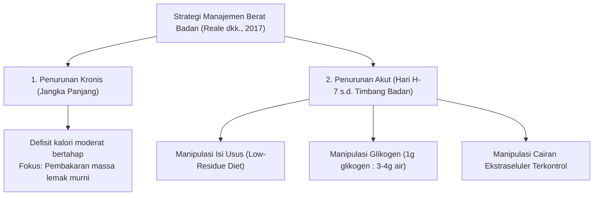
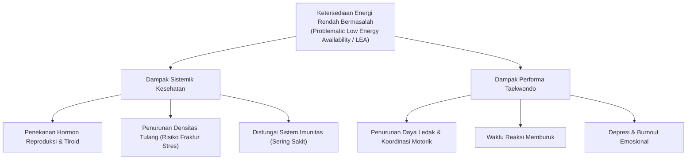
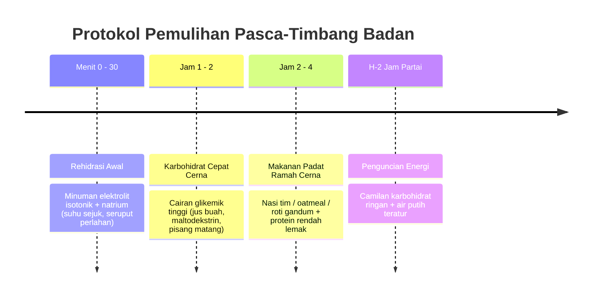

# Bab 4: Nutrisi, Hidrasi & Manajemen Berat Badan Bertanggung Jawab

> 📖 Hub Buku: **[Seni Melatih Atlet: Fondasi Ilmiah Pembinaan Atlet Taekwondo](index.md)**

---

## 📖 Narasi Pembuka: Neraca Timbangan dan Kematian Sel

Dua puluh empat jam sebelum pertandingan perdana dimulai, sebuah ritual yang mencemaskan berlangsung di lorong-lorong hotel kejuaraan taekwondo. 

Seorang atlet remaja berlari bolak-balik mengenakan jaket parasut tebal berlapis dua (*sauna suit*) di bawah suhu ruangan pengap. Mulutnya terasa kering seperti padang pasir, ludahnya kental hingga sulit ditelan, dan jari-jemari tangannya gemetar. Setiap kali ia meludah ke dalam botol plastik, ia berharap timbangan digital keesokan paginya akan turun beberapa puluh gram.

Ketika ia akhirnya berhasil mencatatkan angka timbang badan yang sesuai dengan batas kelasnya, sang pelatih bernapas lega: *"Bagus, timbang badan aman! Sekarang makan dan minum sepuasnya."*

Namun apa yang terjadi di dalam sel-sel tubuh atlet tersebut?
1. **Volum Plasma Darah Anjlok**: Dehidrasi berat menyusutkan volume plasma darah, memaksa jantung berdenyut jauh lebih cepat (*cardiac drift*) hanya untuk memompa jumlah oksigen yang sama ke otot.
2. **Glukosa dan Glikogen Terkuras**: Otot yang kelaparan tidak mampu mengeksekusi tendangan eksplosif dengan kecepatan puncak.
3. **Penyusutan Bantalan Otak**: Hilangnya cairan tubuh secara masif mengurangi efisiensi dinamis cairan serebrospinal di sekitar tengkorak, meningkatkan kerentanan gaya geser saraf (*axonal shear strain*) saat menerima benturan kepala [[20]](#ref-20).

Memotong berat badan dengan metode penyiksaan cairan (*rapid dehydration*) bukanlah tanda disiplin, melainkan **malapraktik fisiologis**. Bab ini mengupas bagaimana sains nutrisi olahraga memandu manajemen berat badan yang aman, beradab, dan menjaga daya tempur atlet di atas matras.

> ℹ️ **Catatan cara baca:** angka dan klaim penting di bab ini menggunakan sistem sitasi bernomor resmi (*Numbered In-text Citation / Citation-Sequence System*) `[[n]](#daftar-pustaka-bab-4)` yang **dapat diklik langsung** untuk melompat ke daftar pustaka di akhir bab. Level bukti 🟢🟡🟠🔴 dijelaskan di [Hub Buku](index.md#-2-sistem-label-bukti-wajib-di-setiap-bab).

---

## 🔬 Teardown Konsep & Wawasan Utama

### 1. Anatomi Penurunan Berat Badan: Kronis vs Akut

Reale, Slater, dan Burke (2017) memetakan strategi manipulasi massa tubuh dalam olahraga tarung Olimpiade ke dalam dua domain yang berbeda [[20]](#ref-20):

#### Komponen Penurunan Akut yang Rasional:
1. **Manipulasi Isi Saluran Cerna (*Gut Content / Low-Residue Diet*)**:
   * Makanan berserat tinggi menetap di saluran pencernaan sebagai massa feses dan mengikat air.
   * Mengonsumsi makanan padat energi namun rendah serat (*low-bulk / low-residue*, misal: nasi putih, telur, dada ayam tanpa kulit) selama 48–72 jam sebelum timbang badan dapat memangkas massa feses hingga **1–2% bobot tubuh** tanpa memengaruhi performa otot sama sekali [[20]](#ref-20).
2. **Deplesi Glikogen Terkendali**:
   * Setiap 1 gram glikogen disimpan di otot dan hati bersama sekitar **3 hingga 4 gram air**. 
   * Mengurangi asupan karbohidrat terukur selama 2–3 hari sebelum timbang badan melepaskan cadangan air terikat ini, yang dapat dengan cepat diisi ulang (*glycogen supercompensation*) pasca-timbang badan jika jeda kompetisi mencukupi [[20]](#ref-20).
3. **Dehidrasi Akut (Paling Berbahaya)**:
   * Penggunaan jaket sauna plastik, mandi air panas berlebih, dan pembatasan minum ekstrem. Pembatasan cairan >4% massa tubuh terbukti menurunkan kapasitas aerobik, daya tahan anaerobik, serta fungsi kognitif pengambilan keputusan di matras [[20]](#ref-20).

**Level bukti: 🟢 A** (kajian sistematik dan kerangka keputusan fisiologi olahraga).

---

### 2. Bahaya Dehidrasi Akut Terhadap Rentannya Gegar Otak

Salah satu argumen paling krusial dalam menolak pemotongan berat badan ekstrem lewat dehidrasi adalah **biomekanika perlindungan otak**:
* Otak manusia terapung di dalam rongga tengkorak, dilindungi oleh cairan serebrospinal (*cerebrospinal fluid* / CSF) yang berfungsi sebagai peredam kejut mekanis (*shock absorber*).
* Dehidrasi termal dan sistemik berat mengurangi volume cairan intrakranial. Dalam kondisi hipohidrasi berat, bantalan fluida ini terganggu sehingga gerakan translasi dan rotasi otak saat terbentur tendangan kaki (*head kick*) mengalami akselerasi lebih tinggi, memperparah regangan aksonal saraf [[20]](#ref-20).
* Selain itu, dehidrasi akut menyebabkan gejala yang tumpang tindih (*symptom crossover*) dengan gegar otak: pusing, sakit kepala tumpul, disorientasi, dan respon visual lambat, yang menyulitkan tim medis membedakan antara kelelahan dehidrasi atau trauma kepala serius.

**Level bukti: 🟠 C** (telaah biomekanik dan observasi neuroimaging; bukti kausal RCT langsung pada manusia dibatasi oleh pertimbangan etik medis).

---

### 3. Sindrom REDs: Ketika Tubuh Dipaksa Bangkrut Energi

Selama bertahun-tahun, dunia olahraga hanya mengenal konsep "Triad Atlet Putri" (*Female Athlete Triad*). Namun, **Konsensus International Olympic Committee (IOC) 2023 yang dipimpin Prof. Margo Mountjoy** memperbarui dan memperluas kerangka ini menjadi **REDs (*Relative Energy Deficiency in Sport*)** [[21]](#ref-21):

#### Poin-Poin Kunci Konsensus IOC 2023:
* **Mengenai Atlet Pria**: REDs bukan hanya masalah atlet wanita. Atlet pria yang menjalani pemotongan kalori ekstrem mengalami penurunan kadar testosteron bebas, hilangnya libido, gangguan metabolisme tulang, dan letargi kronis [[21]](#ref-21).
* **Peran Karbohidrat**: Konsensus 2023 menegaskan bahwa **rendahnya ketersediaan karbohidrat (*low carbohydrate availability*)** secara independen mempercepat keparahan sindrom REDs, bahkan ketika total asupan kalori terlihat cukup [[21]](#ref-21).
* **Alat Skrining IOC REDs CAT2**: Diperkenalkannya sistem lampu lalu lintas (*traffic-light risk stratification*) untuk menentukan apakah seorang atlet aman bertanding (Hijau), memerlukan modifikasi beban (Kuning), atau wajib ditarik dari kompetisi demi keselamatan nyawa (Merah) [[21]](#ref-21).

**Level bukti: 🟢 A** (pernyataan konsensus resmi komite medis IOC).

---

### 4. Protokol Rehidrasi & Pengisian Bahan Bakar Pasca-Timbang Badan

Keberhasilan seorang atlet taekwondo di hari pertandingan sangat ditentukan oleh apa yang masuk ke dalam tubuhnya dalam rentang **jendela pemulihan (*recovery window*)** antara timbang badan resmi dan partai pertama di matras.

Berdasarkan rekomendasi sains nutrisi olahraga (Burke dkk.; Reale dkk., 2017) [[20]](#ref-20):

#### Formula Utama Rehidrasi:
1. **Volume Cairan**: Gantikan cairan tubuh sebesar **125% hingga 150%** dari defisit berat badan yang hilang saat proses timbang badan (misal: jika kehilangan 1 kg cairan, konsumsi 1,25–1,5 liter cairan secara bertahap selama 4–6 jam, bukan sekaligus).
2. **Kandungan Natrium**: Air putih murni (*hypotonic plain water*) dalam jumlah masif pasca-dehidrasi justru memicu diuresis (buang air kecil berlebih) dan risiko hiponatremia. Cairan rehidrasi wajib mengandung natrium (50–60 mmol/L) untuk menahan cairan di kompartemen intravaskular [[20]](#ref-20).
3. **Pemulihan Glikogen**: Konsumsi karbohidrat 1,0–1,2 g/kg berat badan per jam selama 4 jam pertama pasca-timbang badan untuk memaksimalkan laju resintesis glikogen otot.

**Level bukti: 🟢 A** (pedoman konsensus nutrisi olahraga internasional).

---

## 🧪 Kotak Bukti Bab 4

| # | Klaim | Level | Sumber | Catatan transfer ke taekwondo |
|:-:|---|:-:|---|---|
| 1 | Diet rendah residu (low-bulk) memangkas 1-2% bobot via massa feses tanpa rugi otot | 🟢 A | `[20]` | Langsung cabang olahraga tarung Olimpiade |
| 2 | Glikogen mengikat 3–4 gram air per 1 gram glikogen | 🟢 A | Fisiologi nutrisi umum | Prinsip biokimia universal manusia |
| 3 | Dehidrasi berat mengurangi bantalan peredam intrakranial & tingkatkan risiko regangan otak | 🟠 C | `[20]` | Kajian mekanisme biomekanika & neuroimaging |
| 4 | Konsensus IOC 2023 REDs: defisit energi merusak tulang, hormon & performa pria/wanita | 🟢 A | `[21]` | Konsensus medis IOC lintas cabang |
| 5 | Rehidrasi optimal menuntut penggantian cairan 125-150% + natrium (cegah diuresis) | 🟢 A | `[20]` | Standar baku kedokteran olahraga |

## ❓ Batas Pengetahuan

* **Waktu Timbang Badan (Same-Day vs Day-Before)**: Aturan federasi taekwondo terus berkembang (misal: penimbangan acak pagi hari pertandingan / *random weigh-in* batas toleransi 5%). Strategi penurunan akut harus disesuaikan secara dinamis dengan durasi jendela pemulihan.
* **Protokol Water Loading**: Praktik minum air volume besar (8–10 L/hari) lalu memotongnya secara drastis sering dipakai atlet tarung, namun bukti uji klinis kontrol acak (RCT) mengenai keamanan metabolik jangka panjangnya masih sangat terbatas.

---

## 🧠 Eksperimen Pikiran & Contoh Kasus

> ℹ️ Skenario berikut adalah **ilustrasi fiktif** untuk membantu membayangkan penerapan praktis.

* **Kasus Pelatih & Orang Tua Siswa Cadet (Usia 12 Tahun)**:  
  Seorang siswa cadet berbakat memiliki berat harian 43,5 kg. Pelatih ingin memasukkannya ke kelas Under 41 kg (harus memangkas 2,5 kg atau >5,7% bobot tubuh) agar memiliki keunggulan tinggi badan.  
  * *Tindakan Berbasis Bukti*: **Tolak pemotongan berat badan tersebut.** Berdasarkan konsensus IOC REDs 2023 [[21]](#ref-21) dan tinjauan atlet muda [[4]](#ref-4), membatasi energi pada anak yang sedang dalam masa pertumbuhan pesat (*peak height velocity*) berisiko merusak densitas mineral tulang permanen dan memicu retardasi pertumbuhan. Atlet muda wajib bertanding pada kelas berat alaminya.

---

## ⚡ Panduan Aksi Nyata dari Bab Ini (Action Checklist)

1. [ ] **Hentikan Penggunaan Jas Hujan Sauna Parasut untuk Anak/Remaja**: Dehidrasi paksa merusak termoregulasi ginjal dan menghilangkan bantalan cairan otak [[20]](#ref-20).
2. [ ] **Gunakan Strategi Diet Rendah Serat (Low-Residue) 48 Jam Sebelum Timbang Badan**: Pangkas massa kotoran di usus dengan memilih makanan rendah serat padat nutrisi alih-alih berpuasa total [[20]](#ref-20).
3. [ ] **Siapkan Cairan Elektrolit Natrium Pasca-Timbang Badan**: Jangan berikan air putih polos dingin dalam jumlah besar; gunakan larutan ber-natrium dan karbohidrat glikemik tinggi [[20]](#ref-20).
4. [ ] **Waspadai Siklus Menstruasi Terhenti pada Atlet Putri**: Amenore atau siklus haid tidak teratur adalah sinyal merah defisiensi energi berat (REDs) yang wajib dikonsultasikan ke dokter spesialis [[21]](#ref-21).

---

## 💬 Kutipan Pilihan & Catatan Reflektif

> *"Keberhasilan menurunkan berat badan sebelum menimbang bukanlah kemenangan; kemenangan yang sesungguhnya adalah seberapa banyak kapasitas fisiologis dan daya ledak yang berhasil Anda pulihkan saat Anda melangkah ke tengah gelanggang."*  
> — Reale, Slater & Burke (2017), intisari pemikiran *IJSPP* [[20]](#ref-20)

---

## 📚 Daftar Pustaka Bab 4

20. Reale R, Slater G, Burke LM. Acute-weight-loss strategies for combat sports and applications to Olympic success. *Int J Sports Physiol Perform*. 2017;12(2):142–151. doi:[10.1123/ijspp.2016-0211](https://doi.org/10.1123/ijspp.2016-0211). PMID: [27347784](https://pubmed.ncbi.nlm.nih.gov/27347784/)

21. Mountjoy M, Ackerman KE, Bailey DM, et al. 2023 International Olympic Committee’s (IOC) consensus statement on Relative Energy Deficiency in Sport (REDs). *Br J Sports Med*. 2023;57(17):1073–1097. doi:[10.1136/bjsports-2023-106994](https://doi.org/10.1136/bjsports-2023-106994). PMID: [37752011](https://pubmed.ncbi.nlm.nih.gov/37752011/)

> ⚕️ **Catatan medis:** Bab ini bersifat edukatif dan bukan pengganti konsultasi dengan dokter spesialis gizi klinis (*clinical nutritionist*) atau dokter kedokteran olahraga berwenang.

---

## 🧭 Navigasi Bab Selanjutnya

⬅️ **[Bab Sebelumnya: Bab 3 — Sports Medicine & Biomekanika Cedera](03-sports-medicine-dan-biomekanika-cedera.md)** &nbsp;&nbsp;|&nbsp;&nbsp; 📖 **[Hub Buku](index.md)** &nbsp;&nbsp;|&nbsp;&nbsp; ➡️ **[Lanjut ke Bab 5: Neuropsikologi Bertarung & Ketahanan Mental Matras](05-psikologi-performa-dan-ketahanan-mental.md)**
