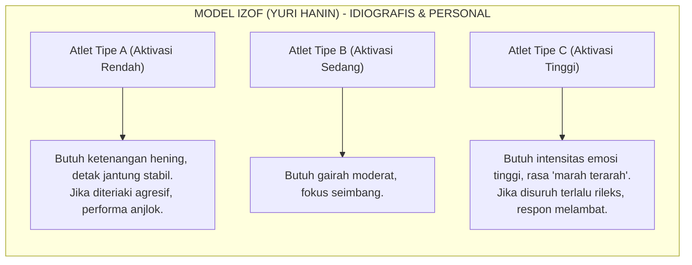
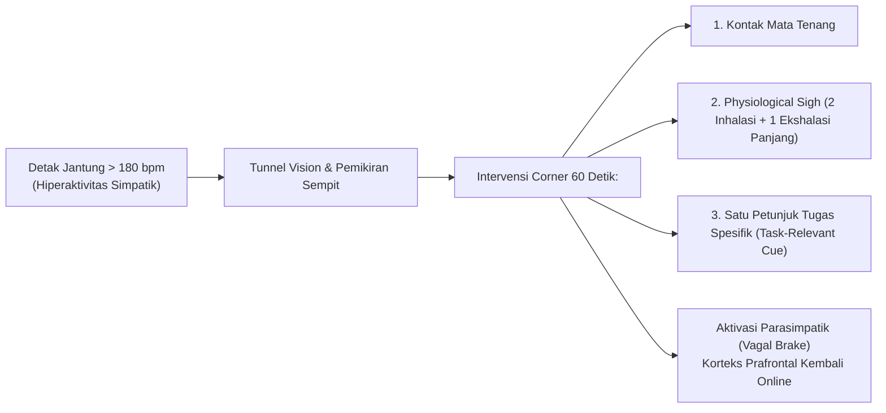

# Bab 5: Psikologi Performa & Ketahanan Mental Matras

> 📖 Hub Buku: **[Seni Melatih Atlet: Fondasi Ilmiah Pembinaan Atlet Taekwondo](index.md)**

---

## 📖 Narasi Pembuka: Pembekuan di Detik Krusial

Babak final kejuaraan nasional, ronde ke-3, tersisa 15 detik terakhir. Atlet Anda unggul satu poin. 

Dari pinggir matras, pelatih berteriak sekuat tenaga: *"Tenang! Jangan panik! Jaga jarak!"* 

Namun apa yang terjadi pada atlet? Matanya melebar kaku, pandangannya menyempit bagai melihat melalui lubang sedotan (*tunnel vision*), otot-otot di bahunya mengencang keras bagai batu, dan kedua kakinya seolah terpaku di atas matras tatami. Ketika lawan meluncurkan serangan tendangan memutar yang sebenarnya sudah dipelajari ratusan kali di sesi latihan, sang atlet membeku (*choking under pressure*). Poin berbalik di detik ke-2 terakhir.

Pelatih kerap mengutuk situasi ini dengan cap klise: *"Mental tempe! Kurang bernyali!"*

Namun psikologi olahraga kognitif dan neurosains membuktikan bahwa fenomena tersebut bukanlah cacat moral keberanian, melainkan **kegagalan regulasi sistem saraf otonom**. Ketika beban kecemasan melampaui kapasitas adaptif kognitif, amigdala membajak korteks prafrontal (*prefrontal cortex hijack*), melumpuhkan kemampuan membaca isyarat gerak dan memicu respon panik primitif (*fight, flight, or freeze*).

Bab ini mengupas bagaimana sains psikologi performa membantu pelatih mengenali zona emosi optimal atlet, meredakan lonjakan saraf simpatik dalam 60 detik di pojok matras, dan membangun ketahanan mental yang kokoh berbasis pembiasaan terukur.

> ℹ️ **Catatan cara baca:** angka dan klaim penting di bab ini menggunakan sistem sitasi bernomor resmi (*Numbered In-text Citation / Citation-Sequence System*) `[[n]](#daftar-pustaka-bab-5)` yang **dapat diklik langsung** untuk melompat ke daftar pustaka di akhir bab. Level bukti 🟢🟡🟠🔴 dijelaskan di [Hub Buku](index.md#-2-sistem-label-bukti-wajib-di-setiap-bab).

---

## 🔬 Teardown Konsep & Wawasan Utama

### 1. Menumbangkan Mitos "Satu Kurva untuk Semua": Model IZOF Yuri Hanin

Selama puluhan tahun, dunia kepelatihan dicekoki oleh teori kuno **Yerkes-Dodson (Inverted-U Hypothesis, 1908)** yang mengklaim bahwa performa puncak selalu tercapai pada tingkat gairah (*arousal*) sedang. Teori ini berasumsi bahwa atlet yang terlalu tenang akan lambat, dan atlet yang terlalu cemas akan kacau.

Namun riset psikologi olahraga modern menolak generalisasi ini. **Prof. Yuri Hanin merumuskan model IZOF (*Individual Zones of Optimal Functioning*)** yang terbukti jauh lebih akurat dan telah diuji secara luas [[22]](#ref-22)[[23]](#ref-23):

#### Wawasan Kunci Model IZOF:
1. **Pendekatan Idiografis (Personal)**: Zona kecemasan/gairah optimal bukanlah satu titik angka universal, melainkan **rentang pita (*bandwidth*) unik** milik masing-masing individu [[22]](#ref-22).
2. **Emosi Fungsional vs Disfungsional**: Emosi tidak sesederhana "positif" (senang) atau "negatif" (marah/cemas). Bagi sebagian atlet, sedikit rasa marah dan cemas justru berfungsi sebagai *energi penggerak fungsional* (*optimal facilitative*), sementara bagi yang lain emosi tersebut merusak (*dysfunctional debilitative*) [[23]](#ref-23).
3. **Dampak Performa**: Meta-analisis studi IZOF menunjukkan bahwa ketika seorang atlet berhasil masuk ke dalam zona emosi optimal pribadinya saat bertanding, performanya meningkat secara signifikan (kira-kira setengah standar deviasi / ~0,5 SD) dibanding ketika ia berada di luar zonanya.

**Level bukti: 🟢 A** (dukungan meta-analisis psikologi olahraga lintas cabang).

---

### 2. Neurobiologi di Pojok Matras: Regulasi 60 Detik Antar-Ronde

Jeda 60 detik antar-ronde di taekwondo adalah waktu yang sangat sempit. Di saat detak jantung atlet melonjak mendekati detak maksimal (>180 bpm) dan laktat terakumulasi, meneriakkan taktik rumit 5 langkah ke telinga atlet adalah kesia-siaan kognitif (*cognitive overload*).

#### Teknik *Physiological Sigh* (Napas Fisiologis Cepat):
Riset neurobiologi sistem saraf otonom menunjukkan cara tercepat mengaktifkan sistem parasimpatik (*vagal brake*) secara sadar:
* **Mekanisme**: Dua kali hirupan napas melalui hidung (tarikan napas dalam pertama, disusul satu hisapan pendek tambahan untuk mengembangkan alveoli paru yang kolaps), diikuti oleh satu hembusan napas panjang dan lambat melalui mulut.
* **Aplikasi Lapangan**: Dilakukan 2–3 kali pengulangan saat atlet pertama kali duduk di kursi pojok matras. Ini menurunkan denyut jantung secara terukur dan menstabilkan rasio pertukaran gas dalam waktu kurang dari 15 detik sebelum instruksi taktik diberikan.

**Level bukti: 🟡 B** (studi fisiologi saraf otonom).

---

### 3. Visual Search & Kognisi Cepat: Membaca Bukan Menebak

Di arena kyorugi, tendangan meluncur dengan kecepatan ekstrem (waktu tempuh kaki ke target kerap berada di bawah 200–300 milidetik). Waktu transmisi sinyal saraf optik dari retina ke korteks visual lalu ke motor end-plate membutuhkan minimal 150–200 ms. 

Artinya: **Jika atlet baru mulai bereaksi saat kaki lawan sudah melayang di udara, atlet tersebut secara fisiologis sudah terlambat.**

Atlet elite tidak bereaksi terhadap lintasan kaki; mereka mengekstraksi **isyarat kinematis awal (*early kinematic postural cues*)**:
* Pergeseran mikro pusat massa panggul lawan (*pelvis shift*).
* Sudut bukaan bahu dan arah lutut kaki tumpuan lawan.
* **Latihan Antisipasi Berbasis Pola**: Pelatih harus melatih pengenalan pola gerak (*pattern recognition*) melalui variasi drill sparring situasional semi-aktif, bukan sekadar melatih tendangan ke target statis yang tidak memberikan isyarat postural nyata.

**Level bukti: 🟡 B** (studi biomekanika persepsi-aksi olahraga tarung).

---

### 4. Menjinakkan Ketakutan Benturan (*Fear Extinction*) & Self-Talk Fungsional

Rasa takut terkena hantaman keras atau cedera berulang adalah respon evolusi biologis yang normal. Namun dalam olahraga bela diri, rasa takut yang tidak terkelola memicu keraguan motorik (*hesitation*), yang justru menjadi penyebab nomor satu atlet terkena benturan telak.

#### 1. Desensitisasi Bertahap (*Graded Exposure*):
Mengikis rasa takut benturan tidak bisa dilakukan dengan "menghajar" atlet secara brutal di matras (yang justru memperkuat sirkuit trauma amigdala). Lakukan desensitisasi bertahap:
* *Level 1*: Blok pasif terhadap tendangan berkecepatan 50% menggunakan pelindung ganda.
* *Level 2*: Serangan balik terprogram pada situasi terkontrol.
* *Level 3*: Sparring bebas dengan pembatasan kekuatan target.

#### 2. Restrukturisasi Self-Talk (Instruksional vs Valuatif):

| Self-Talk Emosional/Valuatif (Merusak) | Self-Talk Tugas/Instruksional (Fungsional) |
|---|---|
| *"Jangan sampai kena tendang kepala lagi!"* | *"Dagu rapat, tangan kanan lindungi pelipis."* |
| *"Musuh ini rekornya juara PON, aku pasti kalah."* | *"Perhatikan jarak kaki depan, serang saat dia melangkah."* |
| *"Napas saya sudah habis, saya tidak kuat lagi."* | *"Tarik napas panjang, jaga ritme langkah."* |

Mengganti fokus dari **evaluasi hasil** ke **eksekusi teknis spesifik** membebaskan kapasitas memori kerja (*working memory*) atlet di bawah tekanan stres kompetisi.

**Level bukti: 🟢 A** (kajian meta-analisis psikologi intervensi kognitif perilaku).

---

## 🧪 Kotak Bukti Bab 5

| # | Klaim | Level | Sumber | Catatan transfer ke taekwondo |
|:-:|---|:-:|---|---|
| 1 | Model IZOF: zona kecemasan optimal bersifat individual dan spesifik atlet | 🟢 A | `[22][23]` | Didukung meta-analisis olahraga multi-cabang |
| 2 | Emosi negatif tertentu (marah/cemas terkontrol) dapat bersifat fungsional bagi performa | 🟡 B | `[23]` | Telah diuji pada atlet elit |
| 3 | Reaksi cepat bergantung pada pembacaan isyarat kinematis panggul/bahu awal | 🟡 B | Literatur persepsi-aksi | Berlaku kuat pada olahraga tarung bereaksi cepat |
| 4 | Self-talk instruksional lebih efektif dibanding self-talk valuatif emosional | 🟢 A | Meta-analisis psikologi olahraga | Prinsip universal kognitif atlet |

## ❓ Batas Pengetahuan

* **Alat Ukur Lapangan yang Praktis**: Mengidentifikasi profil IZOF seorang atlet membutuhkan wawancara introspeksi retrospektif atau kuesioner profil emosi (seperti *State Anxiety Inventory* / POMS) yang membutuhkan waktu dan keakraban mendalam antara pelatih dan atlet.
* **Perbedaan Usia & Gender**: Respons kecemasan kompetisi pada atlet anak/kadet (usia <12 tahun) sangat dipengaruhi oleh persepsi penerimaan orang tua dan pelatih, berbeda dengan atlet senior yang lebih didominasi oleh target prestasi pribadi.

---

## 🧠 Eksperimen Pikiran & Contoh Kasus

> ℹ️ Skenario berikut adalah **ilustrasi fiktif** untuk membantu membayangkan penerapan praktis.

* **Kasus Dua Atlet dengan Karakter Berbeda**:  
  Atlet A selalu menyendiri di sudut ruangan sebelum bertanding, mendengarkan musik lembut bertempo tenang dengan mata terpejam. Pelatih yang tidak paham menganggapnya "kurang semangat" lalu berteriak memukul-mukul punggungnya agar agresif. Hasilnya: Atlet A justru gemetar dan bermain kacau.  
  Sebaliknya, Atlet B butuh melompat-lompat, berteriak keras, dan memukul pad dengan eksplosif sebelum naik matras. Jika disuruh duduk tenang, ia merasa energinya padam.  
  * *Tindakan Berbasis Bukti*: Hormati zona IZOF masing-masing [[22]](#ref-22). Tugas pelatih bukan menyeragamkan kepribadian atlet, melainkan memfasilitasi setiap atlet memasuki zona optimal pribadinya.

---

## ⚡ Panduan Aksi Nyata dari Bab Ini (Action Checklist)

1. [ ] **Identifikasi Profil IZOF Tiap Atlet**: Catat kondisi emosi atlet saat ia mencetak pertandingan terbaiknya di masa lalu (apakah ia merasa santai, fokus dingin, atau sangat berapi-api?) [[22]](#ref-22).
2. [ ] **Batasi Instruksi di Pojok Matras Menjadi Maksimal 1–2 Poin**: Jangan berikan kuliah taktik di jeda 60 detik; fokus pada pemulihan napas dan satu aksi kunci.
3. [ ] **Terapkan Physiological Sigh**: Latih atlet melakukan 2 hisapan napas hidung + 1 hembusan panjang mulut saat jeda ronde untuk menenangkan denyut jantung.
4. [ ] **Latih Transisi Self-Talk**: Koreksi kalimat negatif atlet saat latihan menjadi instruksi teknis yang dapat dieksekusi secara biomekanis.

---

## 💬 Kutipan Pilihan & Catatan Reflektif

> *"Keberanian seorang petarung di atas matras bukanlah ketiadaan rasa cemas, melainkan kemampuan sistem sarafnya untuk tetap mengarahkan pandangan dan kakinya pada sasaran di tengah badai kecemasan tersebut."*  
> — Yuri Hanin, intisari konsep emosi fungsional atlet [[23]](#ref-23)

---

## 📚 Daftar Pustaka Bab 5

22. Robazza C, Bertollo M, Filho E, Hanin Y, Bortoli L. Perceived control and hedonic tone dynamics during performance in elite shooters. *Res Q Exerc Sport*. 2016;87(3):284–294. doi:[10.1080/02701367.2016.1185081](https://doi.org/10.1080/02701367.2016.1185081). PMID: [27253427](https://pubmed.ncbi.nlm.nih.gov/27253427/)

23. Robazza C, Pellizzari M, Bertollo M, Hanin YL. Functional impact of emotions on athletic performance: comparing the IZOF model and the directional perception approach. *J Sports Sci*. 2008;26(10):1033–1047. doi:[10.1080/02640410802027352](https://doi.org/10.1080/02640410802027352). PMID: [18608828](https://pubmed.ncbi.nlm.nih.gov/18608828/)

---

## 🧭 Navigasi Bab Selanjutnya

⬅️ **[Bab Sebelumnya: Bab 4 — Nutrisi & Manajemen Berat Badan](04-nutrisi-hidrasi-dan-manajemen-berat-badan.md)** &nbsp;&nbsp;|&nbsp;&nbsp; 📖 **[Hub Buku](index.md)** &nbsp;&nbsp;|&nbsp;&nbsp; ➡️ **[Lanjut ke Bab 6: Fisiologi Pemulihan & Kualitas Tidur Atlet](06-fisiologi-pemulihan-dan-kualitas-tidur.md)**
