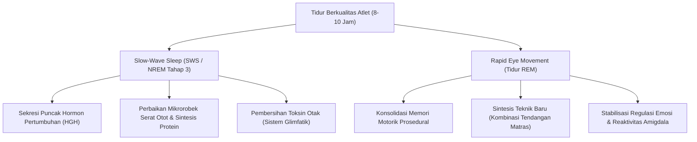
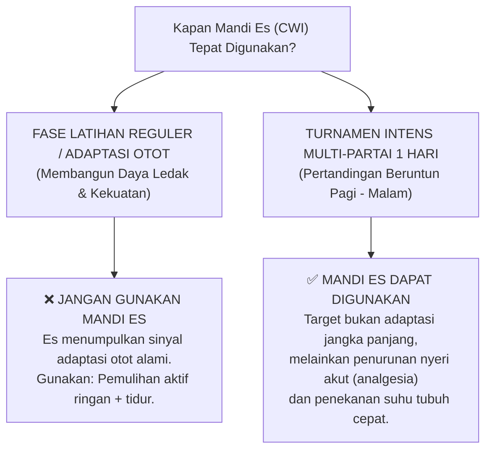
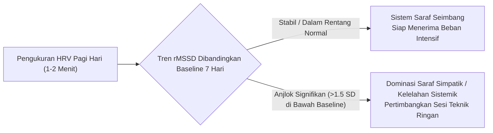

# Bab 6: Fisiologi Pemulihan, Neurosains Tidur & Monitoring Kesiapan Atlet

> 📖 Hub Buku: **[Seni Melatih Atlet: Fondasi Ilmiah Pembinaan Atlet Taekwondo](index.md)**

---

## 📖 Narasi Pembuka: Paradoks Kamar Tidur

Seorang pelatih taekwondo menghabiskan waktu berjam-jam merancang variasi tendangan kombinasi, membeli target tendangan paling mutakhir, dan memprogram sesi latihan fisik dengan presisi militer. Namun ketika ditanya bagaimana para atletnya tidur malam ini, pelatih tersebut menjawab: *"Itu urusan pribadi mereka di rumah. Yang penting saat di matras mereka disiplin."*

Pernyataan tersebut mencerminkan titik buta terbesar dalam metodologi kepelatihan tradisional. 

Fisiologi olahraga modern membuktikan sebuah kebenaran biologis yang tidak terbantahkan:
> **Stimulus latihan di atas matras tatami tidak pernah membuat atlet menjadi lebih kuat; stimulus latihan justru merusak serat otot, menguras neurotransmiter, dan menekan sistem saraf pusat. Atlet hanya menjadi lebih kuat, lebih cepat, dan lebih eksplosif saat ia beristirahat dan tidur.**

Jika fase pemulihan diabaikan, sesi latihan berikutnya bukanlah proses peningkatan kapasitas, melainkan akumulasi kerusakan jaringan. Bab ini membedah arsitektur tidur gelombang lambat, peran tidur terhadap retensi memori motorik teknik baru, serta meluruskan mitos modalitas pemulihan pasif (seperti mandi es) yang kerap disalahgunakan.

> ℹ️ **Catatan cara baca:** angka dan klaim penting di bab ini menggunakan sistem sitasi bernomor resmi (*Numbered In-text Citation / Citation-Sequence System*) `[[n]](#daftar-pustaka-bab-6)` yang **dapat diklik langsung** untuk melompat ke daftar pustaka di akhir bab. Level bukti 🟢🟡🟠🔴 dijelaskan di [Hub Buku](index.md#-2-sistem-label-bukti-wajib-di-setiap-bab).

---

## 🔬 Teardown Konsep & Wawasan Utama

### 1. Neurosains Tidur Atlet: Pabrik Hormon & Konsolidasi Memori Motorik

Tidur bukanlah kondisi pasif di mana otak "mati suri", melainkan proses metabolik dan neurologis yang sangat aktif [[24]](#ref-24):

#### 1. Fase Tidur Gelombang Lambat (*Slow-Wave Sleep* / SWS)
* Berlangsung dominan pada sepertiga awal malam.
* Merupakan jendela utama pelepasan **Hormon Pertumbuhan Manusia (*Human Growth Hormone* / HGH)** dari kelenjar hipofisis anterior. HGH memicu penyerapan asam amino dan memfasilitasi perbaikan mikroskopis miofibril otot yang robek akibat latihan beban atau benturan kyorugi [[24]](#ref-24).
* Mengalami restriksi tidur (<6–7 jam) secara kronis menekan pelepasan HGH, menaikkan hormon katabolik kortisol, serta memperlambat pemulihan glikogen otot.

#### 2. Fase Tidur REM (*Rapid Eye Movement*)
* Berlangsung dominan pada sepertiga akhir siklus tidur menjelang pagi.
* Berperan sentral dalam **konsolidasi memori prosedural**: gerakan baru yang dipelajari di matras (misalnya koordinasi langkah tipuan / *feinting* dan sudut putaran lutut) ditransfer dari memori kerja jangka pendek di hipokampus ke korteks motorik permanen.
* Tanpa fase REM yang cukup, teknik baru yang dilatih ratusan kali di dojang akan sulit dieksekusi secara otomatis (*subconscious execution*) di bawah tekanan kejuaraan.

**Level bukti: 🟢 A** (kajian neurobiologi dan fisiologi tidur atlet).

---

### 2. Bahaya Pembatasan Tidur (*Sleep Restriction*) pada Atlet Bela Diri

Tinjauan ilmiah mengenai pemantauan atlet dan kelelahan (Halson, 2014) menegaskan bahwa kuantitas dan kualitas tidur adalah salah satu pilar penentu adaptasi latihan [[24]](#ref-24):
* **Penurunan Akurasi & Waktu Reaksi**: Kurang tidur 2 jam per malam selama beberapa hari berturut-turut menurunkan kecepatan reaksi visual dan akurasi tendangan secara signifikan. Dalam taekwondo, selisih reaksi 50 milidetik adalah pembeda antara berhasil menangkis atau terkena tendangan kepala telak.
* **Sensitivitas Insulin & Metabolisme Glukosa**: Restriksi tidur menurunkan sensitivitas insulin jaringan perifer hingga 20–30%, membuat penyimpanan kembali glikogen pasca-latihan menjadi tidak efisien.
* **Kerentanan Imunitas**: Atlet yang tidur kurang dari 7 jam per malam berisiko mengalami infeksi saluran pernapasan atas (ISPA) 3 kali lebih tinggi dibanding atlet yang tidur cukup.

**Level bukti: 🟡 B** (studi kohort observasional & intervensi tidur atlet elit).

---

### 3. Meluruskan Mitos Mandi Es (*Cold Water Immersion* / CWI)

Mandi air es bersuhu 10–15°C (*ice bath*) sangat populer di kalangan atlet bela diri. Namun, penelitian penting oleh **Roberts dan rekan (2015) di *The Journal of Physiology*** membongkar salah kaprah besar mengenai modalitas ini [[25]](#ref-25):

#### Temuan Riset Roberts dkk. (2015):
* Dalam studi latihan beban selama 12 minggu, kelompok yang rutin melakukan mandi es (CWI 10 menit) mengalami **peningkatan massa otot dan kekuatan maksimal yang lebih rendah** secara signifikan dibandingkan kelompok yang hanya melakukan pemulihan aktif (*active recovery*) [[25]](#ref-25).
* Biopsi otot menunjukkan bahwa paparan es dingin menekan proliferasi sel satelit otot (*satellite cells*) dan menumpulkan fosforilasi enzim regulator hipertrofi (*p70S6 kinase*) hingga 48 jam pasca-latihan [[25]](#ref-25).

> **Aturan Praktis Pelatih**:
> * **Hindari** mandi es rutin pada masa pemusatan latihan (*training camp*) fase pembentukan kekuatan dan daya ledak, karena mereduksi hasil adaptasi latihan [[25]](#ref-25).
> * **Gunakan** mandi es semata-mata pada situasi kompetisi turnamen padat di mana atlet harus bertanding 3–4 partai dalam satu hari dan butuh peredaan rasa sakit sementara.

**Level bukti: 🟡 B** (uji eksperimental biopsi kontrol acak).

---

### 4. Heart Rate Variability (HRV) Sederhana: Membaca Sinyal Saraf Otonom

Variabilitas detak jantung (*Heart Rate Variability* / HRV)—khususnya parameter **rMSSD** (*Root Mean Square of Successive Differences*)—adalah ukuran fluktuasi waktu (milidetik) antar-detak jantung yang dipicu oleh dominasi tonus saraf parasimpatik (vagal).

#### Prinsip Penting Penggunaan HRV (Halson, 2014) [[24]](#ref-24):
1. **Bukan Alat Vonis Tunggal**: Angka HRV harian yang rendah tidak boleh langsung dijadikan alasan atlet membatalkan latihan. HRV harus selalu disandingkan dengan skor kuesioner subjektif (*mood, nyeri otot DOMS, kualitas tidur*).
2. **Lihat Tren Longitudinal, Bukan Angka Terisolasi**: Nilai HRV dipengaruhi oleh dehidrasi, konsumsi kafein, dan stres mental di luar matras. Amati tren bergerak 7 hari (*7-day rolling average*).

**Level bukti: 🟡 B** (kajian pemantauan beban latihan fisiologi terapan).

---

## 🧪 Kotak Bukti Bab 6

| # | Klaim | Level | Sumber | Catatan transfer ke taekwondo |
|:-:|---|:-:|---|---|
| 1 | Fase tidur gelombang lambat (SWS) merupakan jendela sekresi puncak HGH untuk sintesis otot | 🟢 A | Neurosains & Fisiologi Tidur | Prinsip biologi universal manusia |
| 2 | Fase REM krusial untuk konsolidasi memori motorik teknik gerak baru | 🟢 A | Neurosains motorik kognitif | Sangat relevan untuk keterampilan gerak bela diri |
| 3 | Restriksi tidur menurunkan akurasi, waktu reaksi, dan sensitivitas metabolik atlet | 🟡 B | `[24]` | Literatur atlet elit multi-cabang |
| 4 | Mandi es (CWI) rutin menumpulkan adaptasi hipertrofi dan kekuatan jangka panjang | 🟡 B | `[25]` | Eksperimen biopsi otot latihan beban |
| 5 | HRV (rMSSD) mencerminkan pemulihan tonus vagal parasimpatik sistem saraf | 🟡 B | `[24]` | Alat pantau fisiologi terapan |

## ❓ Batas Pengetahuan

* **Intervensi Suplemen Tidur (Melatonin, Tart Cherry, Magnesium)**: Meskipun populer, bukti bahwa suplemen tidur meningkatkan performa bertanding atlet taekwondo secara langsung masih berstatus lemah hingga moderat.
* **Optimalisasi Power Nap**: Tidur siang singkat (20–30 menit) terbukti memulihkan kewaspadaan pasca-makan siang, namun durasi nap >45 menit berisiko memicu inersia tidur (*grogginess*) yang justru menurunkan performa jika jeda ke latihan terlalu dekat.

---

## 🧠 Eksperimen Pikiran & Contoh Kasus

> ℹ️ Skenario berikut adalah **ilustrasi fiktif** untuk membantu membayangkan penerapan praktis.

* **Kasus Pelatih yang Memaksakan Sesi Subuh**:  
  Seorang pelatih menjadwalkan latihan fisik lari pukul 05.00 pagi. Mayoritas atletnya adalah pelajar SMA yang baru selesai belajar dan tidur pukul 23.30 malam (hanya tidur 5 jam per malam).  
  * *Tindakan Berbasis Bukti*: Latihan fisik pada kondisi defisit tidur kronis memicu lonjakan kortisol, merusak sistem imun, dan menaikkan risiko cedera ligamen [[24]](#ref-24). Memundurkan jadwal latihan ke pukul 06.30 pagi atau sore hari untuk menjamin atlet tidur minimal 7,5–8 jam memberikan imbal hasil adaptasi fisik yang jauh lebih tinggi daripada memaksakan "latihan buta" di waktu subuh.

---

## ⚡ Panduan Aksi Nyata dari Bab Ini (Action Checklist)

1. [ ] **Tegakkan Disiplin Higienitas Tidur (*Sleep Hygiene*)**: Matikan paparan layar ponsel/layar biru 45 menit sebelum tidur dan pastikan suhu kamar sejuk (18–21°C) [[24]](#ref-24).
2. [ ] **Hentikan Mandi Es Rutin Pasca-Latihan Kekuatan**: Biarkan proses adaptasi inflamasi alami bekerja untuk memaksimalkan hipertrofi dan daya ledak [[25]](#ref-25).
3. [ ] **Manfaatkan Tidur Siang Taktis (*Tactical Nap*)**: Berikan waktu 20–30 menit tidur siang di antara sesi latihan pagi dan sore untuk memulihkan fungsi kognitif.
4. [ ] **Gunakan Kuesioner Kesiapan Sederhana Setiap Pagi**: Catat durasi tidur semalam dan skala kesegaran tubuh (1–5) sebagai barometer harian sebelum merancang intensitas latihan.

---

## 💬 Kutipan Pilihan & Catatan Reflektif

> *"Tidur adalah instrumen peningkatan performa biologis paling ampuh dan bebas biaya yang pernah diciptakan alam; menukarnya demi jam latihan tambahan adalah ilusi yang menghancurkan karier atlet secara perlahan."*  
> — Shona L. Halson, intisari fisiologi pemantauan atlet [[24]](#ref-24)

---

## 📚 Daftar Pustaka Bab 6

24. Halson SL. Monitoring training load to understand fatigue in athletes. *Sports Med*. 2014;44 Suppl 2(Suppl 2):S139–S147. doi:[10.1007/s40279-014-0253-z](https://doi.org/10.1007/s40279-014-0253-z). PMID: [25200666](https://pubmed.ncbi.nlm.nih.gov/25200666/)

25. Roberts LA, Raastad T, Markworth JF, et al. Post-exercise cold water immersion attenuates acute anabolic signalling and long-term adaptations in muscle to strength training. *J Physiol*. 2015;593(18):4285–4301. doi:[10.1113/JP270570](https://doi.org/10.1113/JP270570). PMID: [26174323](https://pubmed.ncbi.nlm.nih.gov/26174323/)

---

## 🧭 Navigasi Bab Selanjutnya

⬅️ **[Bab Sebelumnya: Bab 5 — Psikologi Performa & Ketahanan Mental](05-psikologi-performa-dan-ketahanan-mental.md)** &nbsp;&nbsp;|&nbsp;&nbsp; 📖 **[Hub Buku](index.md)** &nbsp;&nbsp;|&nbsp;&nbsp; ➡️ **[Lanjut ke Bab 7: Menyusun Program Terpadu Tanpa Bergantung Aplikasi Tertentu](07-menyusun-program-terpadu.md)**
