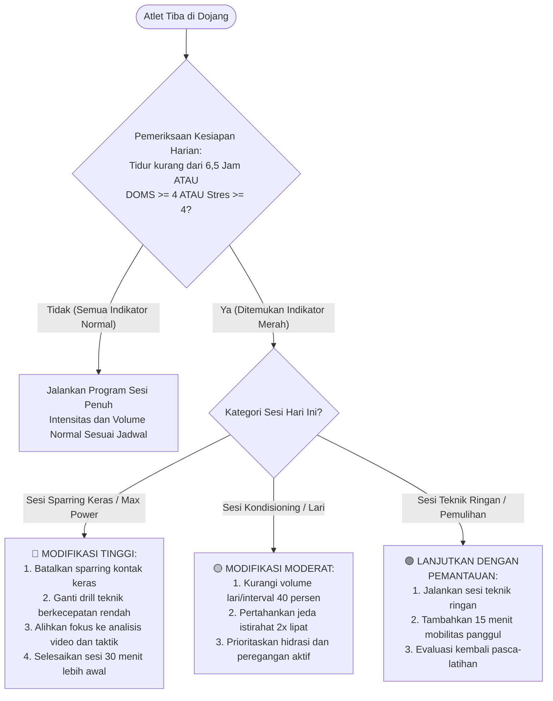
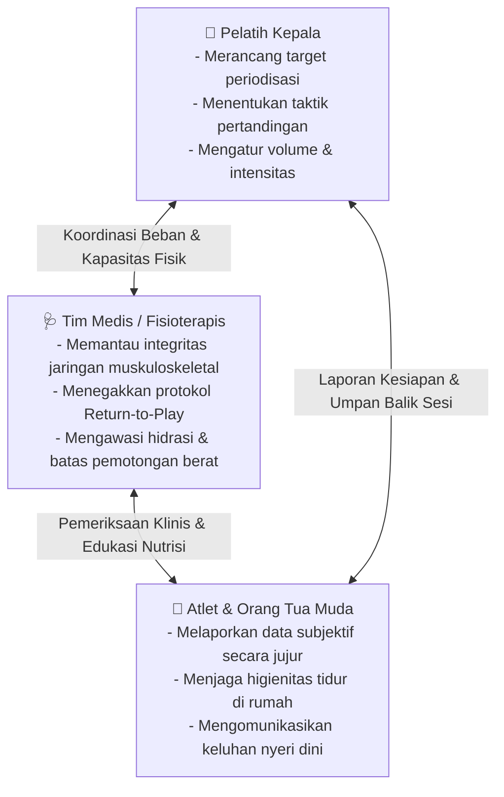
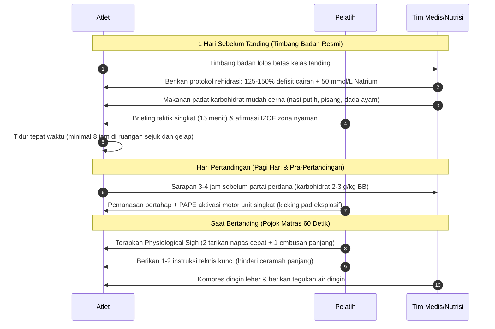

# Bab 7: Menyusun Program Terpadu: Dari Periodisasi hingga Hari Pertandingan

> **Status Bab**: Selesai Divalidasi 🟢  
> **Fokus Utama**: Sintesis Kurikulum Terpadu Bab 1–6, Makrosiklus 16 Minggu, Sistem Pemantauan Beban Agnostik Alat (Kertas/Spreadsheet), Pohon Keputusan Beban Harian, dan Sinergi Segitiga Pelatih-Medis-Atlet.

---

## 📌 Catatan Cara Baca & Sistem Sitasi

Klaim fakta, angka ambang batas, dan metodologi dalam bab ini menggunakan sistem **Numbered In-text Citation** (format *Citation-Sequence*). Setiap nomor rujukan seperti `[[10]](#ref-10)` atau `[[26]](#ref-26)` dapat diklik langsung untuk melompat ke [Daftar Pustaka Bab 7](#daftar-pustaka-bab-7) di akhir dokumen.

Derajat kepastian ilmiah diklasifikasikan menggunakan empat label pembuktian:
- 🟢 **Level A (Konsensus Kuat / Meta-Analisis)**: Didukung oleh tinjauan sistematis, meta-analisis uji acak terkendali (RCT), atau konsensus federasi olahraga dunia.
- 🟡 **Level B (Bukti Spesifik Cabor)**: Didukung oleh studi kohort prospektif atau uji eksperimental langsung pada atlet bela diri / taekwondo.
- 🟠 **Level C (Mekanistik / Observasional)**: Masuk akal secara biologis namun belum diuji lewat eksperimen skala besar.
- 🔴 **Level D (Tradisi / Mitos yang Ditolak)**: Praktik yang populer tetapi dibantah oleh data fisiologi modern.

---

## 🧭 Pengantar: Mengapa Integrasi Sering Gagal di Lapangan?

Sepanjang Bab 1 hingga Bab 6, kita telah membedah anatomi sains olahraga secara terpisah:
1. **Bioenergetika & Fisiologi** (sistem energi alaktik-aerobik taekwondo [[1]](#ref-1), [[2]](#ref-2) dan PAPE [[3]](#ref-3));
2. **Periodisasi Beban & Tapering** (beban RPE sesi [[10]](#ref-10), [[11]](#ref-11), fluktuasi volume [[6]](#ref-6), [[16]](#ref-16), dan kewaspadaan terhadap model matematis ACWR [[8]](#ref-8));
3. **Sports Medicine & Pencegahan Cedera** (epidemiologi trauma kepala/ekstremitas [[17]](#ref-17), protokol PEACE & LOVE [[18]](#ref-18), dan return-to-play gegar otak Amsterdam [[19]](#ref-19));
4. **Nutrisi & Manajemen Berat Badan** (diet rendah residu vs bahaya dehidrasi akut [[20]](#ref-20) dan sindrom REDs [[21]](#ref-21));
5. **Psikologi Performa** (zona emosi IZOF [[22]](#ref-22), [[23]](#ref-23) dan regulasi saraf parasimpatis sudut matras);
6. **Fisiologi Pemulihan & Neurosains Tidur** (arsitektur SWS & REM [[24]](#ref-24), eliminasi mandi es pasca-kekuatan [[25]](#ref-25)).

Tantangan terbesar seorang pelatih kepala (*head coach*) bukanlah menghafal teori masing-masing bab, melainkan **merajut seluruh variabel tersebut ke dalam satu ekosistem latihan harian yang harmonis**. Banyak dojang gagal melahirkan atlet berprestasi bukan karena kekurangan materi fisik, melainkan karena tabrakan antar-komponen latihan:
- Pelatih fisik memacu latihan beban intensif, sementara pelatih teknik menggelar sesi sparring keras di hari yang sama tanpa koordinasi.
- Atlet dipaksa memangkas berat badan ekstrem seminggu sebelum kejuaraan ketika volume latihan justru sedang membutuhkan pemulihan glikogen otot maksimal.
- Sinyal kelelahan subjektif atlet diabaikan hingga berakhir pada cedera *non-contact* atau sindrom *overtraining* [[15]](#ref-15).

Bab pamungkas ini dirancang sebagai **manual arsitektur latihan mandiri**. Buku ini berdiri netral tanpa keterikatan pada perangkat lunak (*software*) komersial atau aplikasi tertentu. Seluruh metodologi yang disajikan dapat dieksekusi dengan sarana paling sederhana: buku catatan saku pelatih, lembar kertas log atlet, atau *spreadsheet* tanpa biaya langganan.

---

## 🔬 Kotak Bukti Ilmiah Bab 7

| Komponen&nbsp;Program | Klaim&nbsp;/&nbsp;Rekomendasi&nbsp;Praktis | Level&nbsp;Bukti | Rujukan&nbsp;Ilmiah&nbsp;Utama |
|---|---|:---:|---|
| **Periodisasi HIIT Spesifik** | HIIT berbasis rasio kerja-istirahat taekwondo (1:3 hingga 1:7) meningkatkan kapasitas anaerobik tanpa merusak kualitas teknik | 🟡 Level B | Franchini (2020) [[26]](#ref-26) |
| **Integrasi Beban Subjektif** | Pemantauan harian berbasis Session-RPE dan kuesioner kesejahteraan (*wellness*) mendeteksi kelelahan neuromuskular lebih cepat daripada biomarker darah rutin | 🟢 Level A | Saw dkk. (2016) [[14]](#ref-14); Haddad dkk. (2011) [[11]](#ref-11) |
| **Protokol Tapering 14 Hari** | Pengurangan volume 40–60% secara eksponensial sambil mempertahankan intensitas tinggi memaksimalkan daya ledak dan superkompensasi | 🟢 Level A | Bosquet dkk. (2007) [[6]](#ref-6); Vachon dkk. (2021) [[16]](#ref-16) |
| **Tapering Nutrisi & Deplesi** | Diet rendah residu (low-fiber) dan modulasi glikogen bertahap 7 hari sebelum timbang badan mencegah dehidrasi ekstrem mendadak | 🟡 Level B | Reale dkk. (2017) [[20]](#ref-20) |
| **Regulasi Sudut (Cornering)** | Penerapan *physiological sigh* di antara ronde 1 & 2 menstabilkan detak jantung dan fokus visual atlet | 🟠 Level C | Robazza & Hanin (2016) [[22]](#ref-22) |

---

## 🏗️ 1. Cetak Biru Makrosiklus 16 Minggu Menuju Kejuaraan Puncak

Struktur makrosiklus taekwondo modern dibagi ke dalam empat fase progresif, dirancang untuk menggeser adaptasi dari kapasitas umum menuju ketajaman eksplosif spesifik matras [[9]](#ref-9), [[26]](#ref-26):

```mermaid
gantt
    title Makrosiklus 16 Minggu Pelatihan Atlet Taekwondo Menuju Puncak
    dateFormat  X
    axisFormat Minggu %s
    section Fase Pelatihan
    Fase Persiapan Umum (GPP)       :active, 0, 4
    Fase Persiapan Khusus (SPP)     :crit, 4, 10
    Fase Pra-Kompetisi              :10, 14
    Fase Tapering & Peaking         :done, 14, 16
    Hari Pertandingan (Game Day)    :milestone, 16, 16
```

### Rincian Pembagian Fase 16 Minggu:

#### 1. Fase Persiapan Umum / GPP (Minggu 1–4)
* **Tujuan Biologis**: Membangun landasan aerobik (fondasi mitokondria untuk resintesis fosfokreatin [[1]](#ref-1)), hipertrofi fungsional, dan ketahanan tendon/ligamen.
* **Latihan Kekuatan**: Kekuatan dasar 3–4 set $\times$ 8–10 repetisi pada 70–75% 1RM (Squat, Deadlift, Hip Thrust, Overhead Press).
* **Latihan Pencegahan Cedera**: Eksentrik hamstring (*Nordic curls*), penguatan fleksor panggul (*hip flexor*), dan stabilisasi rotator luar bahu.
* **Latihan Taekwondo**: Pengulangan fundamental teknik dasar (poomsae / basic kicking drills) dengan volume tinggi, intensitas benturan rendah.
* **Manajemen Berat Badan**: Penurunan massa lemak kronis jika diperlukan (defisit kalori ringan 300–500 kkal/hari tanpa mengorbankan asupan protein $\ge 1,6$ g/kg BB) [[20]](#ref-20), [[21]](#ref-21).

#### 2. Fase Persiapan Khusus / SPP (Minggu 5–10)
* **Tujuan Biologis**: Transformasi kekuatan maksimal menjadi daya ledak (*power*) dan kapasitas glikolitik-alaktik spesifik bela diri [[26]](#ref-26).
* **Latihan Kekuatan**: Beban submaksimal eksplosif 4–5 set $\times$ 3–5 repetisi pada 80–85% 1RM dipadukan dengan plyometrik kontras (Complex Training / PAPE) [[3]](#ref-3).
* **Kondisioning Interval (HIIT Taekwondo)**: Simulasi interval spesifik matras (misal: kombinasi tendangan beruntun 4 detik kerja keras all-out diselingi footwork aktif 12–24 detik, rasio 1:3 hingga 1:6) [[26]](#ref-26).
* **Latihan Teknik & Taktik**: Sparring terkontrol situasional (*drill-sparring*), antisipasi pola panggul lawan, dan simulasi skenario tertinggal poin di ronde penutup [[22]](#ref-22).

#### 3. Fase Pra-Kompetisi (Minggu 11–14)
* **Tujuan Biologis**: Pematangan taktik tanding, simulasi pertarungan nyata dengan pelindung sensor elektronik (*PSS*), dan aklimatisasi psikologis.
* **Latihan Kekuatan**: Pemeliharaan kekuatan neuromuskular (2–3 set $\times$ 2–3 repetisi pada 85% 1RM) dengan penekanan kecepatan dorongan konsentris (*maximum intent*).
* **Sparring**: *Full-contact sparring* dengan wasit resmi dan durasi ronde penuh ($3 \times 2$ menit). Sesi sparring terberat dihentikan 14 hari sebelum hari H guna menghindari cedera mendadak [[17]](#ref-17).
* **Psikologi**: Pemetaan zona emosi IZOF atlet, penyusunan skrip *self-talk* instruksional, dan simulasi kegaduhan matras [[23]](#ref-23).

#### 4. Fase Tapering & Peaking (Minggu 15–16 / 14 Hari Terakhir)
* **Tujuan Biologis**: Eliminasi kelelahan sistemik akumulatif seraya memicu superkompensasi tenaga puncak [[6]](#ref-6), [[16]](#ref-16).
* **Manipulasi Beban**:
  * Volume latihan dipangkas 40% di minggu ke-15, dan dipangkas 60% di minggu ke-16.
  * Intensitas latihan teknik dan aktivasi saraf tetap **tinggi (singkat & tajam)**.
  * Frekuensi sesi dipertahankan pada 80% dari frekuensi normal.
* **Manajemen Berat Badan Terakhir**: Transisi ke diet rendah serat (*low-residue diet*) 3–5 hari sebelum timbang badan, membatasi manipulasi cairan akut maksimal 2–3% berat badan untuk menjaga hidrasi otak [[20]](#ref-20).

---

## 📋 2. Sistem Pemantauan Beban Agnostik Alat (Tool-Agnostic Monitoring)

Pelatih tidak membutuhkan software analitik berbayar untuk memantau atlet secara profesional. Metode paling tervalidasi secara ilmiah adalah kombinasi **Session-RPE (sRPE)** dan **Kuesioner Kesejahteraan Harian** [[10]](#ref-10), [[14]](#ref-14).

### A. Template Lembar Log Atlet Harian (Format Cetak / Spreadsheet)

Setiap atlet mengisi 5 kolom ini di papan clipboard dojang atau formulir spreadsheet mandiri:

| Parameter | Cara&nbsp;Pengisian | Skala&nbsp;Nilai | Ambang&nbsp;Waspada |
|---|---|:---:|---|
| **Durasi Tidur Semalam** | Jumlah jam tidur terlelap | Jam riil (misal: 7,5) | $< 7,0$ jam ⚠️ |
| **Kualitas Tidur** | Bagaimana kesegaran saat bangun tidur | 1 (sangat buruk) – 5 (sangat segar) | Skor $\le 2$ ⚠️ |
| **Skor Nyeri Otot (DOMS)** | Derajat pegal otot ekstremitas/panggul | 1 (bebas nyeri) – 5 (sangat sakit) | Skor $\ge 4$ ⚠️ |
| **Tingkat Stres / Mood** | Beban psikologis sekolah/kerja/personal | 1 (sangat tenang) – 5 (sangat cemas/stres) | Skor $\ge 4$ ⚠️ |
| **Session-RPE Latihan** | Persepsi kelelahan 20–30 menit pasca-sesi | 0 (istirahat) – 10 (kelelahan maksimal) | RPE $9–10$ pada sesi reguler ⚠️ |

### B. Rumus Beban Latihan Harian & Mingguan

$$\text{Beban Sesi (Arbitrary Units / AU)} = \text{Session-RPE (skala 0–10)} \times \text{Durasi Sesi (menit)}$$

*Contoh Kasus*:  
Atlet menjalani sesi sparring taekwondo selama 75 menit. 25 menit pasca-latihan, atlet menilai kesulitan sesi pada angka **8** (sangat keras).  
$$\text{Beban Sesi} = 8 \times 75 = 600\text{ AU}$$

*Catatan Penerapan Praktis*:  
Kompilasikan total AU selama seminggu (misal: total beban minggu ke-12 = 2.800 AU). Perhatikan kenaikan beban antar-minggu: hindari lonjakan beban mingguan yang terlalu curam ($>15–20\%$) tanpa fase adaptasi pendahulu, sembari tetap mencermati respon individual atlet [[7]](#ref-7), [[8]](#ref-8).

---

## 🌳 3. Pohon Keputusan Beban Latihan Harian

Pelatih kepala harus memiliki protokol objektif ketika mendapati atlet tiba di dojang dalam kondisi lelah. Alih-alih melabeli atlet sebagai "pemalas", gunakan algoritma keputusan ilmiah berikut sebelum memulai pemanasan:

---

## 🤝 4. Sinergi Komunikasi Segitiga: Pelatih — Tim Medis — Atlet

Di level pembinaan berprestasi, keputusan latihan tidak boleh menjadi monolog sepihak dari pelatih kepala. Harus terbangun segitiga kemitraan transparan:

### Prinsip Operasional Segitiga:
1. **Otoritas Medis Bersifat Mutlak pada Dugaan Cedera Kepala**:  
   Jika atlet mengalami benturan kepala dan menunjukkan gejala gegar otak (pusing, pandangan kabur, lambat menjawab pertanyaan), tim medis berhak menarik atlet seketika tanpa veto pelatih (*"When in doubt, sit them out"*) [[19]](#ref-19).
2. **Kerahasiaan & Keamanan Pelaporan Atlet**:  
   Atlet harus merasa aman melaporkan skor kelelahan tinggi (RPE 9 atau stres 4) tanpa rasa takut dicoret dari skuad kejuaraan. Ketika pelaporan jujur dihukum dengan "cap mental lemah", atlet akan memalsukan skor log harian mereka, menghilangkan fungsi deteksi dini [[14]](#ref-14).
3. **Peran Orang Tua bagi Atlet Kategori Kadet & Junior**:  
   Bagi atlet pelajar, orang tua adalah manajer tidur dan gizi di rumah. Pelatih wajib menyelenggarakan sesi edukasi periodik agar orang tua memahami pentingnya asupan energi seimbang (mencegah defisit energi REDs) dan tidak memaksa latihan privat tambahan yang merusak siklus pemulihan atlet [[4]](#ref-4), [[21]](#ref-21).

---

## 🥋 5. Manajemen 24 Jam Terakhir: Dari Timbang Badan hingga Pertandingan

Hari pertandingan (*game day*) adalah puncak konvergensi dari seluruh bab dalam buku ini:

---

## ❓ Batas Pengetahuan

* **Variabilitas Antar-Individu dalam Respon Tapering**: Durasi ideal tapering 14 hari dengan pemangkasan volume 40–60% adalah rata-rata statistik populasi [[6]](#ref-6). Atlet tertentu (*fast-responder*) mencapai puncak daya ledak dalam 8–10 hari, sementara atlet lain memerlukan 16–18 hari. Pelatih perlu mencatat respons atlet pada kejuaraan uji coba pendahulu.
* **Keterbatasan Skor Subjektif pada Situasi Seleksi Ketat**: Pada pemusatan latihan nasional atau seleksi terbuka di mana posisi atlet terancam, atlet cenderung menekan skor nyeri atau kelelahan agar tampak bugar. Dalam kondisi ini, pemantauan performa objektif (seperti tinggi lompatan *Countermovement Jump* / CMJ mingguan) menjadi komplementer yang esensial.

---

## 🧠 Eksperimen Pikiran & Contoh Kasus

> ℹ️ Skenario berikut adalah **ilustrasi fiktif** untuk membantu membayangkan penerapan praktis.

* **Kasus Skuad Dojang yang Kehilangan Kecepatan di Babak Final**:  
  Sebuah tim taekwondo daerah tampil luar biasa di babak penyisihan pagi hari, namun seluruh atletnya tampak lambat, kram, dan kehilangan daya ledak di babak semifinal dan final sore hari.  
  * *Analisis Masalah*:  
    Atlet menjalani pemotongan berat badan ekstrem lewat sauna malam sebelumnya tanpa rehidrasi natrium yang adekuat [[20]](#ref-20), disusul kebiasaan duduk pasif di tribun tanpa asupan karbohidrat bertahap di antara partai pertandingan.
  * *Tindakan Berbasis Bukti*:  
    Pada kejuaraan berikutnya, pelatih menerapkan protokol nutrisi terpadu:  
    1. Bobot badan dikontrol sejak 4 minggu sebelumnya (hanya menyisakan deplesi glikogen 1,5 kg di 48 jam terakhir).  
    2. Segera setelah timbang badan, atlet mengonsumsi cairan rehidrasi elektrolit tinggi [[20]](#ref-20).  
    3. Di antara partai tanding (jeda 90–120 menit), atlet mengonsumsi camilan karbohidrat cair/semi-padat (puree buah, sport drink) dan melakukan pemanasan ulang terencana (PAPE singkat 10 menit sebelum masuk matras) [[3]](#ref-3). Hasilnya, daya ledak tendangan putar atlet tetap terjaga hingga detik terakhir ronde ketiga babak final.

---

## ⚡ Panduan Aksi Nyata dari Bab Ini (Action Checklist)

1. [ ] **Siapkan Format Log Pemantauan Mandiri**: Cetak lembar kuesioner harian sederhana atau buat satu berkas spreadsheet bersama untuk mencatat jam tidur, kesegaran, DOMS, dan RPE sesi [[10]](#ref-10), [[14]](#ref-14).
2. [ ] **Rancang Struktur Makrosiklus 16 Minggu**: Bagi program kerja tahunan ke dalam 4 blok terpisah (GPP 4 minggu, SPP 6 minggu, Pra-Kompetisi 4 minggu, dan Tapering 2 minggu) [[9]](#ref-9), [[26]](#ref-26).
3. [ ] **Terapkan Algoritma Penyesuaian Beban Harian**: Jadikan skor kesejahteraan atlet sebagai pemandu modifikasi latihan; jangan ragu menurunkan volume sparring saat indikator pemulihan menunjukkan sinyal merah.
4. [ ] **Kunci Jadwal Latihan Keras 14 Hari Sebelum Laga**: Hentikan seluruh sesi sparring keras berisiko benturan tinggi tepat dua minggu sebelum kejuaraan demi menjamin pemulihan jaringan dan kesiapan sistem saraf pusat [[6]](#ref-6), [[17]](#ref-17).
5. [ ] **Susun Garis Komunikasi Terbuka dengan Tim Medis & Keluarga**: Sepakati bahwa keselamatan otak dan ortopedi atlet berada di atas ambisi sesaat medali, serta edukasi orang tua mengenai nutrisi dan tidur di rumah [[19]](#ref-19), [[21]](#ref-21).

---

## 💬 Kutipan Pilihan & Catatan Reflektif

> *"Kejuaraan tidak dimenangkan oleh pelatih yang paling keras membebani atletnya di hari-hari terakhir, melainkan oleh pelatih yang memiliki keberanian ilmiah untuk membiarkan tubuh atletnya pulih, memuncak, dan meledak di saat yang paling menentukan."*  
> — Iñigo Mujika & Laurent Bosquet, sintesis meta-analisis prinsip pemuncakan performa (*peaking*) [[6]](#ref-6)

---

## 📚 Daftar Pustaka Bab 7

1. Campos FAD, Bertuzzi R, Dourado AC, Santos VG, Franchini E. Energy demands in taekwondo athletes during combat simulation. *Eur J Appl Physiol*. 2012;112(4):1221–1228. doi:[10.1007/s00421-011-2071-4](https://doi.org/10.1007/s00421-011-2071-4). PMID: [21769736](https://pubmed.ncbi.nlm.nih.gov/21769736/)

2. Bridge CA, Ferreira da Silva Santos J, Chaabène H, Pieter W, Franchini E. Physical and physiological profiles of taekwondo athletes. *Sports Med*. 2014;44(6):713–733. doi:[10.1007/s40279-014-0159-9](https://doi.org/10.1007/s40279-014-0159-9). PMID: [24549477](https://pubmed.ncbi.nlm.nih.gov/24549477/)

3. Blazevich AJ, Babault N. Post-activation potentiation versus post-activation performance enhancement in humans: historical perspective, underlying mechanisms, and current issues. *Front Physiol*. 2019;10:1359. doi:[10.3389/fphys.2019.01359](https://doi.org/10.3389/fphys.2019.01359). PMID: [31736781](https://pubmed.ncbi.nlm.nih.gov/31736781/)

4. Jayanthi NA, LaBella CR, Fischer D, Pasulka J, Dugas LR. Sports-specialized intensive training and the risk of injury in young athletes: a clinical case-control study. *Am J Sports Med*. 2015;43(4):794–801. doi:[10.1177/0363546514567298](https://doi.org/10.1177/0363546514567298). PMID: [25646361](https://pubmed.ncbi.nlm.nih.gov/25646361/)

5. Lloyd RS, Oliver JL. The Youth Physical Development Model: a new approach to long-term athletic development. *Strength Cond J*. 2012;34(3):61–72. doi:[10.1519/SSC.0b013e31825760ea](https://doi.org/10.1519/SSC.0b013e31825760ea)

6. Bosquet L, Montpetit J, Arvisais D, Mujika I. Effects of tapering on performance: a meta-analysis. *Med Sci Sports Exerc*. 2007;39(8):1358–1365. doi:[10.1249/mss.0b013e31806010e0](https://doi.org/10.1249/mss.0b013e31806010e0). PMID: [17762369](https://pubmed.ncbi.nlm.nih.gov/17762369/)

7. Gabbett TJ. The training–injury prevention paradox: should athletes be training smarter and harder? *Br J Sports Med*. 2016;50(5):273–280. doi:[10.1136/bjsports-2015-095788](https://doi.org/10.1136/bjsports-2015-095788). PMID: [26758673](https://pubmed.ncbi.nlm.nih.gov/26758673/)

8. Impellizzeri FM, Tenan MS, Kempton T, Novak A, Coutts AJ. Acute:chronic workload ratio: conceptual issues and fundamental pitfalls. *Int J Sports Physiol Perform*. 2020;15(6):907–913. doi:[10.1123/ijspp.2019-0864](https://doi.org/10.1123/ijspp.2019-0864). PMID: [32502973](https://pubmed.ncbi.nlm.nih.gov/32502973/)

9. Williams TD, Tolusso DV, Fedewa MV, Esco MR. Comparison of periodized and non-periodized resistance training on maximal strength: a meta-analysis. *Sports Med*. 2017;47(10):2083–2100. doi:[10.1007/s40279-017-0734-y](https://doi.org/10.1007/s40279-017-0734-y). PMID: [28497285](https://pubmed.ncbi.nlm.nih.gov/28497285/)

10. Foster C, Florhaug JA, Franklin J, et al. A new approach to monitoring exercise training. *J Strength Cond Res*. 2001;15(1):109–115. PMID: [11708692](https://pubmed.ncbi.nlm.nih.gov/11708692/)

11. Haddad M, Chaouachi A, Castagna C, Wong DP, Behm DG, Chamari K. The construct validity of session RPE during an intensive camp in young male taekwondo athletes. *Int J Sports Physiol Perform*. 2011;6(2):252–263. doi:[10.1123/ijspp.6.2.252](https://doi.org/10.1123/ijspp.6.2.252). PMID: [21725110](https://pubmed.ncbi.nlm.nih.gov/21725110/)

12. Lupo C, Capranica L, Cortis C, Guidotti F, Bianco A, Tessitore A. Session-RPE for quantifying load of different youth taekwondo training sessions. *J Sports Med Phys Fitness*. 2017;57(3):189–194. doi:[10.23736/S0022-4707.16.06021-X](https://doi.org/10.23736/S0022-4707.16.06021-X). PMID: [26796074](https://pubmed.ncbi.nlm.nih.gov/26796074/)

14. Saw AE, Main LC, Gastin PB. Monitoring the athlete training response: subjective self-reported measures trump commonly used objective measures: a systematic review. *Br J Sports Med*. 2016;50(5):281–291. doi:[10.1136/bjsports-2015-094758](https://doi.org/10.1136/bjsports-2015-094758). PMID: [26423706](https://pubmed.ncbi.nlm.nih.gov/26423706/)

15. Meeusen R, Duclos M, Foster C, et al. Prevention, diagnosis, and treatment of the overtraining syndrome: joint consensus statement of the European College of Sport Science and the American College of Sports Medicine. *Med Sci Sports Exerc*. 2013;45(1):186–205. doi:[10.1249/MSS.0b013e318279a10a](https://doi.org/10.1249/MSS.0b013e318279a10a). PMID: [23247672](https://pubmed.ncbi.nlm.nih.gov/23247672/)

16. Vachon A, Berryman N, Mujika I, Paquet JB, Arvisais D, Bosquet L. Effects of tapering on neuromuscular and metabolic fitness in team sports: a systematic review and meta-analysis. *Eur J Sport Sci*. 2021;21(3):300–311. doi:[10.1080/17461391.2020.1736183](https://doi.org/10.1080/17461391.2020.1736183). PMID: [32172680](https://pubmed.ncbi.nlm.nih.gov/32172680/)

17. Lystad RP, Swain MS, Graham PL. Risk factors for injury in Olympic-style competition taekwondo: a systematic review. *J Sports Med Phys Fitness*. 2013;53(6):655–664. PMID: [24247189](https://pubmed.ncbi.nlm.nih.gov/24247189/)

18. Dubois B, Esculier JF. Soft-tissue injuries simply need PEACE and LOVE. *Br J Sports Med*. 2020;54(2):72–73. doi:[10.1136/bjsports-2019-101253](https://doi.org/10.1136/bjsports-2019-101253). PMID: [31377722](https://pubmed.ncbi.nlm.nih.gov/31377722/)

19. Patricios JS, Schneider KJ, Dvorak J, et al. Consensus statement on concussion in sport: the 6th International Conference on Concussion in Sport–Amsterdam, October 2022. *Br J Sports Med*. 2023;57(11):695–711. doi:[10.1136/bjsports-2023-106898](https://doi.org/10.1136/bjsports-2023-106898). PMID: [37316210](https://pubmed.ncbi.nlm.nih.gov/37316210/)

20. Reale R, Slater G, Burke LM. Acute-weight-loss strategies for combat sports and applications to Olympic success. *Int J Sports Physiol Perform*. 2017;12(2):142–151. doi:[10.1123/ijspp.2016-0211](https://doi.org/10.1123/ijspp.2016-0211). PMID: [27347784](https://pubmed.ncbi.nlm.nih.gov/27347784/)

21. Mountjoy M, Ackerman KE, Bailey DM, et al. 2023 International Olympic Committee’s (IOC) consensus statement on Relative Energy Deficiency in Sport (REDs). *Br J Sports Med*. 2023;57(17):1073–1097. doi:[10.1136/bjsports-2023-106994](https://doi.org/10.1136/bjsports-2023-106994). PMID: [37752011](https://pubmed.ncbi.nlm.nih.gov/37752011/)

22. Robazza C, Bertollo M, Filho E, Hanin Y, Bortoli L. Perceived control and hedonic tone dynamics during performance in elite shooters. *Res Q Exerc Sport*. 2016;87(3):284–294. doi:[10.1080/02701367.2016.1185081](https://doi.org/10.1080/02701367.2016.1185081). PMID: [27253427](https://pubmed.ncbi.nlm.nih.gov/27253427/)

23. Robazza C, Pellizzari M, Bertollo M, Hanin YL. Functional impact of emotions on athletic performance: comparing the IZOF model and the directional perception approach. *J Sports Sci*. 2008;26(10):1033–1047. doi:[10.1080/02640410802027352](https://doi.org/10.1080/02640410802027352). PMID: [18608828](https://pubmed.ncbi.nlm.nih.gov/18608828/)

24. Halson SL. Monitoring training load to understand fatigue in athletes. *Sports Med*. 2014;44 Suppl 2(Suppl 2):S139–S147. doi:[10.1007/s40279-014-0253-z](https://doi.org/10.1007/s40279-014-0253-z). PMID: [25200666](https://pubmed.ncbi.nlm.nih.gov/25200666/)

25. Roberts LA, Raastad T, Markworth JF, et al. Post-exercise cold water immersion attenuates acute anabolic signalling and long-term adaptations in muscle to strength training. *J Physiol*. 2015;593(18):4285–4301. doi:[10.1113/JP270570](https://doi.org/10.1113/JP270570). PMID: [26174323](https://pubmed.ncbi.nlm.nih.gov/26174323/)

26. Franchini E. High-Intensity Interval Training Prescription for Combat-Sport Athletes. *Int J Sports Physiol Perform*. 2020;15(6):767–776. doi:[10.1123/ijspp.2020-0289](https://doi.org/10.1123/ijspp.2020-0289). PMID: [32502972](https://pubmed.ncbi.nlm.nih.gov/32502972/)

---

## 🧭 Navigasi Bab

⬅️ **[Bab Sebelumnya: Bab 6 — Fisiologi Pemulihan, Neurosains Tidur & Monitoring Kesiapan Atlet](06-fisiologi-pemulihan-dan-kualitas-tidur.md)** &nbsp;&nbsp;|&nbsp;&nbsp; 📖 **[Hub Utama & Bibliografi Induk Buku](index.md)** &nbsp;&nbsp;|&nbsp;&nbsp; ➡️ **[Lanjut ke Bab 8: Lanskap Sistem Pendamping & Teknologi Pemantauan Atlet](08-lanskap-sistem-pendamping-dan-teknologi-atlet.md)**
