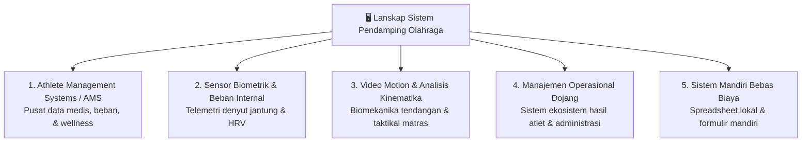
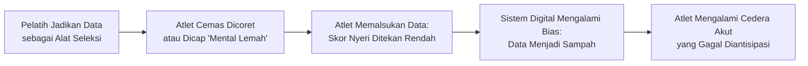

# Bab 8: Lanskap Sistem Pendamping: Ekosistem Teknologi Pemantauan & Manajemen Atlet (Tinjauan Netral)

> **Status Bab**: Selesai Divalidasi 🟢  
> **Fokus Utama**: Pemetaan Kategori Sistem Teknologi Olahraga, Tinjauan Netral Platform Pendamping yang Eksis, Fenomena Psikologis Pelaporan Atlet, dan Analisis Kritis Penerapan Digital di Lapangan.

---

## 📌 Catatan Cara Baca & Batasan Pernyataan (Disclaimer)

Klaim fakta dan temuan operasional dalam bab ini merujuk pada literatur ilmiah dengan format **Numbered In-text Citation** (seperti `[[27]](#ref-27)` dan `[[28]](#ref-28)`).

> ⚠️ **Pernyataan Netralitas & Batasan Komersial (Non-Endorsement Disclaimer)**:  
> Seluruh sistem, platform perangkat lunak, dan merek teknologi yang disebutkan dalam bab ini disajikan semata-mata sebagai **informasi lanskap industri dan bahan studi komparatif keolahragaan**. Penyebutan nama sistem **bukan merupakan rekomendasi, anjuran komersial, maupun penilaian sponsor**. Pembina, pelatih, dan pengurus dojang disarankan untuk mengevaluasi kebutuhan spesifik, kemampuan anggaran, serta etika perlindungan data pribadi sebelum memilih sarana operasional apa pun.

---

## 🧭 Pengantar: Mengapa Metode Ilmiah Membutuhkan Sistem Pendamping?

Ketika seorang pelatih hanya mengasuh 2–3 atlet elit, pemantauan beban latihan, jam tidur, dan perkembangan teknik masih dapat dikelola lewat ingatan atau buku saku sederhana. Namun, begitu dojang berkembang membina 20, 50, hingga ratusan atlet dari berbagai kelompok usia (usia dini, kadet, junior, hingga senior), pelatih kepala akan segera menghadapi hambatan kapasitas:
- Data kesiapan harian tercecer di obrolan pesan instan yang tidak terstruktur;
- Catatan riwayat cedera atlet lama terlupakan saat atlet kembali bertanding pasca-rehabilitasi;
- Dosis latihan sparring sering kali dipukul rata (*one size fits all*) karena pelatih tidak memiliki visibilitas atas beban kumulatif masing-masing atlet.

Di era olahraga modern, teknologi hadir bukan untuk menggantikan intuisi tajam pelatih, melainkan bertindak sebagai **sistem pendamping (*companion system*)** yang mendokumentasikan fakta biologis secara objektif. Studi kelayakan pada cabang olahraga bela diri Olimpiade menunjukkan bahwa pengumpulan data kesehatan dan paparan latihan melalui sistem elektronik terbukti layak (*feasible*) dan mampu mendeteksi pola beban yang tidak terlihat secara kasat mata [[27]](#ref-27).

---

## 🔬 Kotak Bukti Ilmiah Bab 8

| Komponen&nbsp;Teknologi | Temuan&nbsp;Ilmiah&nbsp;/&nbsp;Fakta&nbsp;Lapangan | Level&nbsp;Bukti | Rujukan&nbsp;Ilmiah&nbsp;Utama |
|---|---|:---:|---|
| **Kelayakan Sistem Elektronik Bela Diri** | Sistem pemantauan elektronik terbukti layak mengumpulkan data beban latihan dan riwayat cedera atlet bela diri Olimpiade secara prospektif | 🟡 Level B | Bromley dkk. (2018) [[27]](#ref-27) |
| **Kejujuran Data Subjektif Atlet** | Atlet elit rentan memalsukan (*"I lied a little bit"*) data kesiapan/nyeri pada sistem jika mereka merasa data tersebut akan dipakai untuk menghukum atau mencoret mereka dari tim | 🟢 Level A | Coventry dkk. (2023) [[28]](#ref-28) |
| **Superioritas Skor Subjektif vs Marker Darah** | Pemantauan subjektif (kuesioner kelelahan & RPE) dalam sistem digital lebih konsisten mencerminkan kelelahan daripada tes darah rutin | 🟢 Level A | Saw dkk. (2016) [[14]](#ref-14); Halson (2014) [[24]](#ref-24) |

---

## 🌐 1. Taksonomi 5 Kategori Sistem Pendamping di Industri Olahraga

Sistem teknologi pendamping olahraga yang beredar saat ini dapat dikelompokkan ke dalam 5 kategori fungsional:

Berikut adalah pemetaan sistem-sistem yang eksis di pasar internasional dan nasional beserta karakteristik fungsinya:

### Kategori 1: Athlete Management Systems (AMS)
Platform tersentralisasi yang mengintegrasikan data performa fisik, rekam medis cedera, kesiapan harian (*wellness*), dan program latihan ke dalam satu basis data.
* **Smartabase ([teamworks.com/smartabase](https://www.teamworks.com/smartabase))**: Platform AMS skala enterprise dari Teamworks yang digunakan oleh banyak komite olimpiade nasional dan institut olahraga dunia (termasuk Australian Institute of Sport).
* **Kitman Labs ([kitmanlabs.com](https://www.kitmanlabs.com))**: Platform intelijen performa olahraga yang berfokus kuat pada pemodelan risiko cedera (*injury surveillance*) dan rekam medis terpadu di liga-liga profesional internasional.
* **Kinduct ([kinduct.com](https://www.kinduct.com))**: Platform manajemen performa atlet (bagian dari Catapult) yang menghubungkan data pengetesan fisik laboratorium langsung dengan perancangan program latihan.

### Kategori 2: Sensor Biometrik & Pemantauan Beban Internal
Perangkat keras (*hardware*) telemetri yang mengukur respon kardiovaskular dan sistem saraf otonom atlet secara langsung.
* **Firstbeat Sports ([firstbeat.com](https://www.firstbeat.com/en/sports-platform/))**: Menggunakan sensor dada untuk mengukur variabilitas detak jantung (*HRV*), waktu pemulihan, dan *TRIMP* (Training Impulse) selama sesi latihan sirkuit atau sparring.
* **Polar Team Pro ([polar.com](https://www.polar.com/en/business/team-pro))**: Ekosistem sensor dada multi-atlet yang menampilkan telemetri detak jantung seluruh atlet secara langsung (*real-time*) di tablet pelatih saat sesi berlangsung.
* **Cincin Biometrik & Smartwatch (Oura, Whoop, Garmin)**: Sensor pasif personal untuk memantau durasi tidur gelombang lambat (*SWS*), tidur REM, dan kesiapan sistem saraf otonom saat bangun tidur di rumah [[24]](#ref-24).

### Kategori 3: Analisis Video & Kinematika Taktik
Perangkat lunak analisis gerakan untuk membedah kecepatan sudut tendangan, waktu reaksi, dan pola taktik lawan di kejuaraan.
* **Dartfish ([dartfish.com](https://www.dartfish.com))**: Perangkat lunak analisis video standar Olimpiade untuk penangkapan gerak lambat (*slow-motion*), pelacakan sudut sendi, dan penandaan aksi tanding (*match tagging*).
* **Hudl Sportscode ([hudl.com/products/sportscode](https://www.hudl.com/products/sportscode))**: Platform analisis video taktis tingkat lanjut untuk memetakan frekuensi tendangan yang menghasilkan poin sensor PSS (*Protector and Scoring System*).
* **Kinovea ([kinovea.org](https://www.kinovea.org))**: Perangkat lunak analisis video gerak *open-source* (bebas biaya) yang populer di kalangan pelatih independen untuk menganalisis waktu reaksi dan biomekanika kontak tendangan kaki.

### Kategori 4: Manajemen Operasional Dojang & Ekosistem Atlet (Dojang Yield)
Platform yang menggabungkan manajemen pembinaan dojang, administrasi keanggotaan, penjejakan kenaikan sabuk, jadwal latihan, dan retensi atlet jangka panjang.
* **DAYS ([dojang.warsootech.com](https://dojang.warsootech.com))**: Platform tata kelola operasional dojang bela diri taekwondo yang mengintegrasikan administrasi keanggotaan, penjejakan kurikulum sabuk, absensi kehadiran, dan penapisan talenta atlet berprestasi.
* **Kicksite ([kicksite.com](https://kicksite.com))**: Perangkat lunak manajemen sekolah bela diri berbasis web untuk mengelola absensi, komunikasi siswa, dan penagihan biaya dojang.
* **Gymdesk ([gymdesk.com](https://gymdesk.com))**: Platform tata kelola manajemen dojang dan gym bela diri yang mencakup pelacakan kenaikan tingkat (*belt tracking*), absensi QR-code, dan portal anggota.
* **Zen Planner ([zenplanner.com](https://zenplanner.com))**: Sistem penjadwalan kelas dan keanggotaan dojang bela diri dan pusat kebugaran.

### Kategori 5: Sistem Mandiri Bebas Biaya (Spreadsheet & Kertas Cetak)
Sistem paling terjangkau yang dikembangkan sendiri oleh pelatih tanpa perlu mengeluarkan biaya langganan bulanan.
* **Google Forms + Google Sheets ([google.com/forms](https://www.google.com/forms/about/))**: Formulir kesiapan digital yang diisi atlet melalui ponsel setiap pagi dan otomatis tercatat di spreadsheet pelatih.
* **Buku Log Fisik Dojang**: Lembar kertas cetak di papan clipboard ruang ganti dojang tempat atlet membubuhkan tanda centang jam tidur dan nilai RPE sesi latihan.

---

## ⚖️ 2. Matriks Perbandingan Sistem Berdasarkan Kesiapan Organisasi

Setiap dojang memiliki skala pembinaan dan ketersediaan sumber daya yang berbeda. Tabel berikut membandingkan karakteristik operasional masing-masing sistem:

| Jenis&nbsp;Sistem | Biaya&nbsp;Investasi | Kompleksitas&nbsp;Teknis | Skala&nbsp;Atlet&nbsp;Ideal | Kelebihan&nbsp;Utama | Kelemahan&nbsp;/&nbsp;Keterbatasan |
|---|:---:|:---:|:---:|---|---|
| **Spreadsheet Mandiri ([Google Sheets](https://www.google.com/sheets/about/))** | Bebas Biaya (Gratis) | Sangat Rendah | 5–30 Atlet | 100% fleksibel, tidak ada biaya langganan, mudah dimulai hari ini | Butuh rekap manual, rentan terhapus jika salah rumus |
| **Sistem Administrasi Dojang ([DAYS](https://dojang.warsootech.com), [Kicksite](https://kicksite.com), [Gymdesk](https://gymdesk.com))** | Rendah – Menengah | Rendah – Menengah | 30–300+ Siswa | Menggabungkan tata kelola dojang, absensi, dan penjenjangan sabuk atlet | Fitur sport science fisiologis mendalam biasanya terpisah |
| **Wearable Biometrik ([Firstbeat](https://www.firstbeat.com/en/sports-platform/), [Polar](https://www.polar.com/en/business/team-pro))** | Menengah – Tinggi | Menengah | 10–30 Atlet Elit | Data fisiologis detak jantung objektif secara *real-time* | Biaya perangkat keras per atlet cukup mahal, butuh perawatan sensor |
| **Enterprise AMS ([Smartabase](https://www.teamworks.com/smartabase), [Kitman Labs](https://www.kitmanlabs.com), [Kinduct](https://www.kinduct.com))** | Sangat Tinggi | Sangat Tinggi | Pelatda / Pelatnas (>50 Atlet) | Integrasi komprehensif seluruh cabang ilmu, rekam medis lengkap | Biaya lisensi mahal, memerlukan personel admin/analis khusus |

---

## 🧠 3. Realitas Lapangan: Mengapa Banyak Sistem Digital Gagal?

Mengadopsi sistem digital mutakhir tidak secara otomatis meningkatkan medali atlet. Terdapat tiga kegagalan laten yang sering terjadi:

### 1. Jebakan Atlet Berbohong (*"I Lied a Little Bit"*)
Dalam studi kualitatif penting oleh Coventry dkk. (2023) pada atlet elit Australia yang menggunakan Athlete Management Systems harian, ditemukan pengakuan mengejutkan: banyak atlet sengaja memanipulasi skor kelelahan atau nyeri otot mereka [[28]](#ref-28).

> 💡 **Prinsip Inti**:  
> Sistem digital secanggih apa pun tidak akan berguna jika tidak didasari **kepercayaan psikologis (*psychological safety*)**. Atlet harus yakin bahwa melaporkan skor kelelahan tinggi (misal: tidur buruk atau nyeri hamstring 4/5) adalah bentuk kontribusi keselamatan latihan, bukan alasan untuk disingkirkan dari daftar tanding.

### 2. Banjir Data (*Data Overload & Analysis Paralysis*)
Banyak tim olahraga membeli sensor biometrik lengkap, lalu mengumpulkan puluhan grafik setiap hari. Namun pada akhirnya, pelatih kepala tidak sempat membaca grafik tersebut dan kembali melatih berdasarkan dugaan perasaan belaka. Kunci keberhasilan implementasi sistem adalah **menjaga metrik tetap ramping (minimalis namun bermakna tinggi)**, seperti kombinasi sRPE dan 4 item kuesioner kesiapan [[14]](#ref-14).

### 3. Kelelahan Pengisian Data (*Survey Fatigue*)
Jika atlet diminta mengisi kuesioner digital sepanjang 25 pertanyaan setiap pagi, tingkat kepatuhan pengisian akan anjlok drastis dalam waktu 3 minggu [[27]](#ref-27). Survei kesiapan harian harus dirancang sedemikian rupa sehingga atlet dapat menyelesaikannya dalam waktu **kurang dari 45 detik** lewat sentuhan layar ponsel.

---

## ❓ Batas Pengetahuan

* **Interoperabilitas Antar-Platform**: Saat ini belum ada standar format data tunggal terbuka yang menyatukan sensor biometrik pihak ketiga secara langsung dengan sistem administrasi dojang lokal. Pelatih sering kali harus mengekspor data secara manual (format CSV/Excel).
* **Validitas Algoritma Otomatis Komersial**: Banyak aplikasi komersial menampilkan skor "kesiapan tubuh" (*readiness score*) persentase berbasis algoritma tertutup (*black-box algorithm*). Derajat validitas matematis skor tersebut sering kali belum dipublikasikan secara terbuka di jurnal ilmiah kedokteran olahraga.

---

## ⚡ Panduan Aksi Nyata dari Bab Ini (Action Checklist)

1. [ ] **Mulai dari Sarana Paling Sederhana**: Jangan terburu-buru membeli lisensi perangkat lunak mahal jika dojang belum memiliki disiplin pencatatan manual harian di atas kertas atau spreadsheet gratis [[14]](#ref-14).
2. [ ] **Bangun Budaya Keamanan Psikologis**: Tegaskan kepada seluruh atlet bahwa skor kelelahan di sistem ditujukan untuk melindungi mereka dari cedera robek ligamen, bukan untuk menghakimi dedikasi mereka [[28]](#ref-28).
3. [ ] **Batasi Parameter Input Harian**: Pastikan pengisian kuesioner pagi hari atlet hanya memakan waktu 30–45 detik (maksimal 4–5 parameter inti: jam tidur, kesegaran, DOMS, stres) [[27]](#ref-27).
4. [ ] **Tetapkan Penanggung Jawab Data**: Tunjuk satu asisten pelatih atau staf dojang yang bertugas meninjau rekap data setiap pagi sebelum sesi latihan dimulai.

---

## 💬 Kutipan Pilihan & Catatan Reflektif

> *"Teknologi tercanggih dalam manajemen atlet tidak pernah mampu menggantikan percakapan jujur antara pelatih dan atlet di tepi matras; ia hanya berfungsi menyalakan lentera agar percakapan tersebut berpijak pada fakta objektif, bukan asumsi buta."*  
> — Sintesis reflektif dari studi implementasi sistem elektronik dalam olahraga bela diri [[27]](#ref-27), [[28]](#ref-28)

---

## 📚 Daftar Pustaka Bab 8

27. Bromley S, Drew M, Talpey S, McIntosh A, Finch C. Collecting Health and Exposure Data in Australian Olympic Combat Sports: Feasibility Study Utilizing an Electronic System. *JMIR Hum Factors*. 2018;5(4):e27. doi:[10.2196/humanfactors.9541](https://doi.org/10.2196/humanfactors.9541). PMID: [30305257](https://pubmed.ncbi.nlm.nih.gov/30305257/)

28. Coventry M, Timler A, Mosler AB, et al. "I lied a little bit." A qualitative study exploring the perspectives of elite Australian athletes on self-reported data. *Phys Ther Sport*. 2023;60:91–97. doi:[10.1016/j.ptsp.2023.01.009](https://doi.org/10.1016/j.ptsp.2023.01.009). PMID: [36738670](https://pubmed.ncbi.nlm.nih.gov/36738670/)

---

### 🔗 Rujukan Silang Bab Sebelumnya

Topik pemantauan beban latihan dan arsitektur tidur dalam bab ini juga mengacu pada temuan literatur yang telah dibahas pada bab-bab sebelumnya:

- **[[14]](#ref-14)**: Saw AE, Main LC, Gastin PB. Monitoring the athlete training response: subjective self-reported measures trump commonly used objective measures (2016) → dibahas mendalam di **[Bab 2: Beban, Periodisasi & Tapering](02-periodisasi-beban-dan-tapering.md#daftar-pustaka-bab-2)**
- **[[24]](#ref-24)**: Halson SL. Monitoring training load to understand fatigue in athletes (2014) → dibahas mendalam di **[Bab 6: Fisiologi Pemulihan & Kualitas Tidur](06-fisiologi-pemulihan-dan-kualitas-tidur.md#daftar-pustaka-bab-6)**

> 📖 **Bibliografi Lengkap:** Seluruh 28 literatur ilmiah rujukan terangkum dalam tabel terverifikasi di **[Bibliografi Induk Buku](index.md#-5-bibliografi-induk-sumber-yang-sudah-diperiksa)**.

---

## 🧭 Navigasi Bab

⬅️ **[Bab Sebelumnya: Bab 7 — Menyusun Program Terpadu: Dari Periodisasi hingga Hari Pertandingan](07-menyusun-program-terpadu.md)** &nbsp;&nbsp;|&nbsp;&nbsp; 📖 **[Hub Buku](index.md)** &nbsp;&nbsp;|&nbsp;&nbsp; ➡️ **[Lanjut ke Bab 9: Alur Kerja Pembinaan Terstruktur: Kerangka Kerja Operasional Lapangan](09-alur-kerja-pembinaan-terstruktur-non-it.md)**
