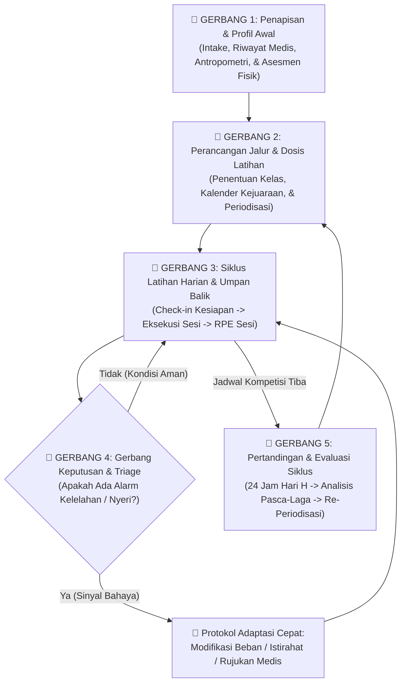
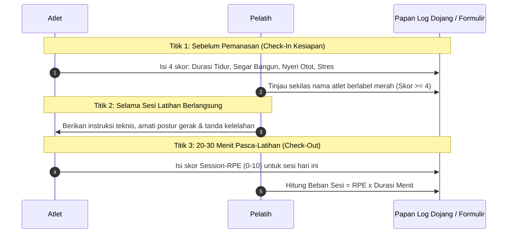
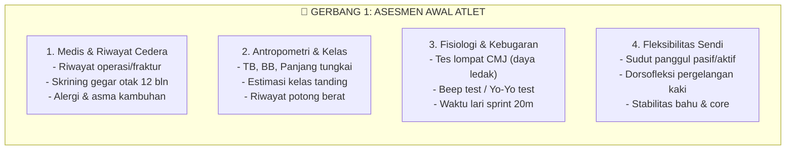
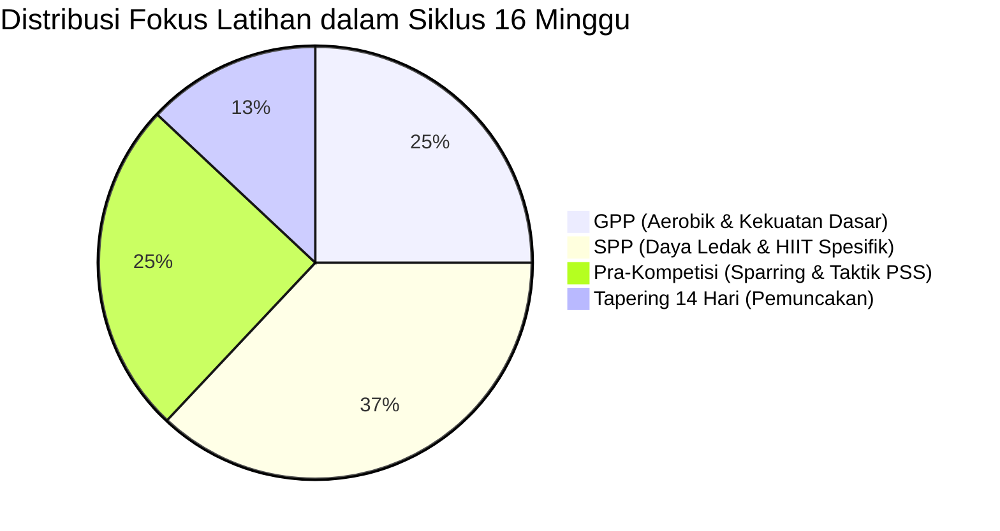
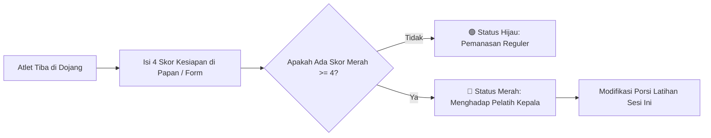
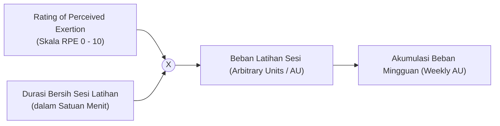
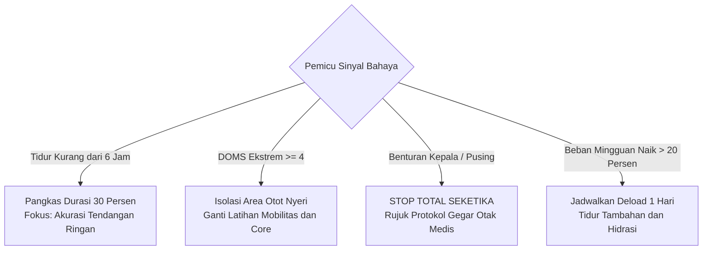
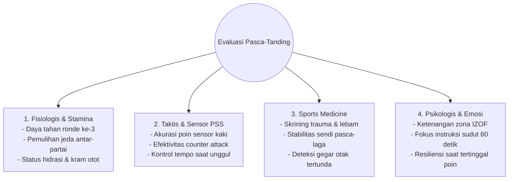

# Bab 9: Alur Kerja Pembinaan Terstruktur: Kerangka Kerja Operasional Lapangan dari Intuisi Menuju Sistem

> **Status Bab**: Selesai Divalidasi 🟢  
> **Fokus Utama**: Cetak Biru Operasional Pembinaan Atlet, Siklus Alur Kerja 5 Gerbang Dojang, Peta Titik Sentuh Data Lapangan, Format Lembar Kerja Praktis Berbasis Diagram, dan Fondasi Menuju Digitalisasi.

---

## 📌 Catatan Cara Baca & Karakter Bab Ini

Bab ini dirancang sebagai **manual operasional lapangan (*operational field manual*)**. Bab ini sepenuhnya berfokus pada **alur kerja pembinaan praktis**: tata kelola interaksi terstruktur antara pelatih kepala, asisten pelatih, atlet, orang tua, dan tenaga medis di lingkungan dojang sehari-hari.

Klaim metodologis dan protokol keselamatan mengacu pada sitasi ilmiah resmi dengan format **Numbered In-text Citation** (seperti `[[4]](#ref-4)`, `[[14]](#ref-14)`, dan `[[19]](#ref-19)`).

---

## 🧭 Pengantar: Menjembatani "Seni Rasa" dan "Sistem Kerja"

Melatih atlet sering kali disebut sebagai sebuah "seni" (*an art*). Seorang pelatih berpengalaman dapat merasakan kapan atletnya sedang kehilangan kelenturan kaki, kapan fokus mentalnya goyah, atau kapan teknik tendangannya sedang berada di puncak ketajaman.

Namun, mengandalkan "rasa" semata memiliki kelemahan fatal:
1. **Tidak Dapat Didelegasikan (*Unscalable*)**: Ketika dojang berkembang membina puluhan hingga ratusan murid, pelatih kepala kehabisan waktu untuk merasakan kondisi setiap atlet satu per satu secara intuitif.
2. **Rentan Bias Emosional**: Pelatih sering kali keliru menilai atlet yang sedang mengalami kelelahan saraf kronis sebagai atlet yang "kurang bernyali" atau "malas".
3. **Hilangnya Pengetahuan Saat Pelatih Berganti**: Jika sistem pembinaan hanya tersimpan di kepala satu sosok pelatih, kepergian pelatih tersebut akan meruntuhkan seluruh prestasi dojang.

Tujuan dari bab ini adalah **mensistematisasikan seni melatih** tersebut ke dalam sebuah **alur kerja operasional yang berulang (*repeatable*), objektif, dan terstandarisasi**. Dengan alur kerja ini, dojang dapat beroperasi dengan standar keunggulan yang konsisten—baik saat masih dikelola secara manual dengan kertas dan binder, maupun kelak ketika siap dikembangkan menjadi sistem digital mandiri.

---

## 🔬 Kotak Bukti Ilmiah Bab 9

| Prinsip&nbsp;Operasional | Landasan&nbsp;Ilmiah | Level&nbsp;Bukti | Rujukan&nbsp;Ilmiah&nbsp;Utama |
|---|---|:---:|---|
| **Standardisasi Titik Sentuh Data** | Pengumpulan data subjektif harian yang konsisten pada waktu yang sama setiap hari meningkatkan keandalan deteksi kelelahan | 🟢 Level A | Saw dkk. (2016) [[14]](#ref-14) |
| **Pemisahan Jalur Pembinaan Anak** | Penapisan bertahap atlet muda berdasarkan usia biologis mencegah sindrom *dropout* dan cedera akibat spesialisasi dini | 🟢 Level A | Jayanthi dkk. (2015) [[4]](#ref-4); Lloyd & Oliver (2012) [[5]](#ref-5) |
| **Prosedur Penghentian Medis Tanpa Veto** | Standar operasional penarikan atlet saat dugaan benturan kepala memitigasi komplikasi *Second Impact Syndrome* | 🟢 Level A | Patricios dkk. (2023) [[19]](#ref-19) |

---

## 🔄 1. Peta Induk Alur Pembinaan Atlet Dojang (The 5-Stage Pipeline)

Pembinaan atlet berprestasi bukanlah proses instan, melainkan siklus berkesinambungan yang terdiri dari **5 Gerbang Operasional Lapangan**:



---

## 🚪 2. Rincian 5 Gerbang Operasional Lapangan

Berikut adalah panduan tindakan praktis di setiap gerbang operasional dojang:

### Gerbang 1: Penapisan Awal & Profiling Atlet (Intake & Baseline)
Sebelum seorang siswa dimasukkan ke dalam tim pemusatan latihan atlet, lakukan protokol asesmen awal:
1. **Anamnesis Riwayat Medis & Cedera**:
   * Apakah atlet memiliki riwayat dislokasi sendi, patah tulang, atau cedera ligamen (lutut/pergelangan kaki)?
   * Apakah pernah mengalami pingsan atau benturan kepala bergejala gegar otak dalam 12 bulan terakhir? [[19]](#ref-19)
2. **Pengukuran Antropometri & Kategori Berat**:
   * Tinggi badan, panjang tungkai, dan berat badan saat bangun pagi dalam kondisi terhidrasi.
   * Penentuan kelas tanding realistis (menghindari penempatan kelas yang memaksa pemotongan berat badan kronis ekstrem) [[20]](#ref-20), [[21]](#ref-21).
3. **Pengujian Kebugaran Fungsional Dasar**:
   * Fleksibilitas panggul pasif dan aktif (sudut tendangan Dollyo dan Neryo Chagi).
   * Kapasitas lompatan vertikal (*Countermovement Jump*) sebagai penanda daya ledak dasar.

---

### Gerbang 2: Perancangan Jalur & Penentuan Dosis (Pathway & Periodization)
Pada tahap ini, pelatih kepala memetakan program kerja tahunan:
1. **Pemisahan Jalur Pembinaan**:
   * Siswa dibagi ke dalam dua kelompok jalur yang tegas: **Jalur Rekreasi/Kebugaran** (2–3 sesi/minggu tanpa target medali) dan **Jalur Prestasi Atlet** (4–6 sesi/minggu dengan target kompetisi) [[4]](#ref-4), [[5]](#ref-5).
2. **Penyusunan Kalender Kejuaraan Tahunan**:
   * Tentukan 1–2 kejuaraan utama (*A-Race/Peak Events*) dan 2–3 kejuaraan uji coba (*B-Race*).
3. **Penyusunan Makrosiklus 16 Minggu**:
   * Merancang alokasi blok GPP, SPP, Pra-Kompetisi, dan Tapering 14 hari sesuai panduan [Bab 7](07-menyusun-program-terpadu.md).

---

### Gerbang 3: Siklus Harian Lapangan (The Daily Training Loop)
Ini adalah rutinitas yang diulang setiap hari latihan di dojang. Dibagi menjadi 3 titik waktu (*touchpoints*):



* **Titik 1 (Pra-Latihan / Check-In)**: Dilakukan 15 menit sebelum pemanasan dimulai. Atlet mencatat kondisi tubuh di papan clipboard dojang atau formulir ponsel mandiri.
* **Titik 2 (Sesi Latihan)**: Pelatih mengamati bahasa tubuh atlet (apakah langkah kaki mulai melambat, apakah ada pincang tersembunyi).
* **Titik 3 (Pasca-Latihan / Check-Out)**: Dilakukan 20–30 menit setelah pendinginan selesai agar persepsi kelelahan tidak terdistorsi oleh lonjakan adrenalin sesaat [[10]](#ref-10), [[11]](#ref-11).

---

### Gerbang 4: Triage & Protokol Adaptasi Cepat (Decision Gateway)
Jika pada Gerbang 3 terdeteksi sinyal peringatan, pelatih menerapkan protokol penyesuaian beban:

| Sinyal&nbsp;Lapangan | Kondisi&nbsp;Fisiologis&nbsp;yang&nbsp;Dicurigai | Tindakan&nbsp;Lapangan&nbsp;Pelatih |
|---|---|---|
| **Tidur < 6 jam + Stres $\ge 4$** | Sistem saraf simpatis hiperaktif, kortisol tinggi | **Modifikasi Beban**: Batalkan sesi sparring kontak keras; alihkan atlet ke latihan taktik ringan atau pemulihan aktif. |
| **Skor DOMS Hamstring $\ge 4$** | Kerusakan mikrofibril otot belum pulih | **Larangan Gerak Ekstrem**: Larang tendangan cangkul (*Neryo Chagi*) maksimal; ganti dengan latihan pukulan atau teknik dasar langkah. |
| **Keluhan Pusing Pasca-Benturan Kepala** | Dugaan Gegar Otak Olahraga (*SRC*) | **Hentikan Latihan Seketika**: Tarik atlet dari matras, larang kembali bertanding hari itu, dan rujuk ke dokter [[19]](#ref-19). |
| **Beban Sesi Mingguan Melonjak >20%** | Risiko kelelahan akumulatif tinggi | **Deload Taktis**: Turunkan durasi sesi latihan berikutnya sebesar 30–40%. |

---

### Gerbang 5: Siklus Kompetisi & Akuntabilitas Evaluasi (Debrief & Progression)
Setelah kejuaraan usai, siklus tidak berhenti pada perayaan medali atau penyesalan kekalahan. Pelatih mengadakan sesi debrief terstruktur:
1. **Analisis Efisiensi Taktik Pertandingan**:
   * Berapa persen serangan tendangan yang berhasil mendarat di sensor PSS?
   * Apakah atlet kehabisan nafas di ronde ketiga (masalah bioenergetika aerobik Bab 1)?
   * Apakah atlet mengalami kepanikan mental saat tertinggal poin (masalah regulasi emosi IZOF Bab 5)?
2. **Tinjauan Medis Pasca-Tanding**:
   * Evaluasi lebam benturan, integritas sendi pergelangan kaki, dan tanda gegar otak tertunda.
3. **Keputusan Promosi & Siklus Baru**:
   * Atlet diberikan waktu istirahat aktif 5–7 hari sebelum masuk kembali ke Gerbang 2 untuk menyusun makrosiklus periode berikutnya.

---

## 📋 3. Format Lembar Kerja Operasional Lapangan (Worksheet Suite)

Agar alur kerja di atas dapat langsung dipraktikkan tanpa kebingungan teknis, berikut adalah **6 format lembar kerja operasional lapangan lengkap** yang disajikan dalam bentuk diagram visual interaktif dan tabel format siap pakai:

### 📑 Lembar Kerja 1: Matriks Asesmen Awal & Profiling Atlet (Gerbang 1)

Diagram alir berikut memetakan 4 domain pemeriksaan awal yang wajib diselesaikan setiap calon atlet baru:



#### Format Tabel Cetak Asesmen Baseline Atlet:

```text
========================================================================================
LEMBAR ASESMEN PROFIL ATLET DO JANG (INTAKE FORM)
========================================================================================
Nama Lengkap    : ___________________________________  Tanggal Lahir / Usia : ____ thn
Kelompok Kelas  : [ ] Pra-Kadet  [ ] Kadet  [ ] Junior  [ ] Senior    Sabuk: _________
Target Kategori : Kyorugi Kelas Under: _____ kg        Tinggi / BB Aktual  : ___ cm / ___ kg
----------------------------------------------------------------------------------------
1. PEMERIKSAAN MEDIS & CEDERA:
   - Pernah mengalami benturan kepala/pusing/pingsan?    [ ] Ya  [ ] Tidak
   - Riwayat cedera sendi (Lutut / Ankle / Bahu)?        [ ] Ya (Sebutkan: ________) [ ] Tidak
   - Status kelayakan bertanding dari dokter:            [ ] Lolos Penuh  [ ] Bersyarat
----------------------------------------------------------------------------------------
2. PENGUJIAN FISIK DASAR:
   - Countermovement Jump (CMJ) : ______ cm (Baseline Daya Ledak)
   - Fleksibilitas Panggul Kiri : ______ derajat   | Kanan: ______ derajat
   - Keseimbangan Single-Leg    : Kiri: ____ detik | Kanan: ____ detik (Target >= 45s)
----------------------------------------------------------------------------------------
Keputusan Penempatan: [ ] Masuk Tim Prestasi Reguler  [ ] Penguatan Fisik Pra-Kondisi
Tanda Tangan Pelatih: ________________________   Tanggal: ______________________________
========================================================================================
```

---

### 📑 Lembar Kerja 2: Matriks Perencanaan Blok Periodisasi & Dosis Beban (Gerbang 2)

Kerangka kerja penentuan alokasi jam latihan mingguan dan fokus adaptasi berdasarkan fase periodisasi:



#### Format Tabel Rencana Kerja Mesosiklus:

| Fase&nbsp;Latihan | Durasi | Target&nbsp;Beban&nbsp;Mingguan | Fokus&nbsp;Fisik&nbsp;Utama | Batas&nbsp;Kontak&nbsp;Sparring |
|---|:---:|:---:|---|---|
| **Fase GPP** | 4 Minggu | 2.000 – 2.400 AU | Daya tahan aerobik, hipertrofi fungsional, eksentrik hamstring | Kontak minimal (Drill pelindung) |
| **Fase SPP** | 6 Minggu | 2.500 – 3.200 AU | HIIT rasio 1:4 [[26]](#ref-26), kekuatan maksimal, PAPE [[3]](#ref-3) | Kontak sedang (Situational sparring) |
| **Pra-Kompetisi** | 4 Minggu | 2.200 – 2.600 AU | Kecepatan reaksi, simulasi ronde penuh $3 \times 2$ menit | Kontak penuh (Hentikan H-14) [[17]](#ref-17) |
| **Tapering** | 2 Minggu | 1.000 – 1.400 AU | Kecepatan dorongan konsentris, pemulihan saraf & tidur [[6]](#ref-6) | Tanpa kontak benturan keras |

---

### 📑 Lembar Kerja 3: Papan Log Kesiapan Pra-Latihan / Check-In Harian (Gerbang 3)

Diagram alur pengisian kesiapan mandiri atlet saat tiba di ruang ganti dojang:



#### Format Lembar Fisik Papan Masuk Dojang (Clipboard):

```text
TANGGAL: _________________    WAKTU SESI: [ ] Pagi (06.00)  [ ] Sore (16.00)
========================================================================================
NO | NAMA ATLET     | TIDUR (JAM) | KESEGARAN (1-5) | NYERI/DOMS (1-5) | STRES (1-5) | STATUS AWAL
========================================================================================
01 | Arya Pratama   |    7.5      |        4        |        1         |      2      | [v] Lolos
02 | Budi Santoso   |    5.0 ⚠️   |        2 ⚠️     |        4 (Hamstr)|      4 ⚠️  | [!] Waspada
03 | Cindy Wijaya   |    8.0      |        5        |        2         |      1      | [v] Lolos
04 | Dimas Rizki    |    6.5      |        3        |        3         |      2      | [v] Lolos
========================================================================================
Skala (1-5): 1 = Sangat Buruk / Sangat Sakit | 5 = Sangat Bugar / Bebas Nyeri
Tanda Peringatan: Laporkan ke Pelatih jika Jam Tidur < 6,5 ATAU Nyeri >= 4 ATAU Stres >= 4!
```

---

### 📑 Lembar Kerja 4: Log Beban Latihan Pasca-Sesi / Check-Out (Gerbang 3)

Diagram alur penghitungan beban kumulatif latihan (*Training Load Calculation*):



#### Format Lembar Fisik Papan Keluar Dojang:

```text
TANGGAL: _________________    NAMA PELATIH PENDAMPING: _________________________
========================================================================================
NO | NAMA ATLET     | DURASI (MENIT) | RPE SESI (0-10) | TOTAL BEBAN (AU) | CATATAN KELUHAN
========================================================================================
01 | Arya Pratama   |      90        |        7        |  7 x 90 = 630 AU | Stabil
02 | Budi Santoso   |      60 (Modif)|        4        |  4 x 60 = 240 AU | Tidak ada nyeri paha
03 | Cindy Wijaya   |      90        |        8        |  8 x 90 = 720 AU | Kelelahan normal
04 | Dimas Rizki    |      90        |        6        |  6 x 90 = 540 AU | Stabil
========================================================================================
Total Beban Dojang Sesi Ini: _________ AU  |  Rata-rata RPE: _________ / 10
```

---

### 📑 Lembar Kerja 5: Kartu Kendali Triage & Tindakan Modifikasi Cepat (Gerbang 4)

Diagram pohon keputusan tindakan taktis pelatih di tepi matras:



#### Format Matriks Tindakan Cepat Pelatih:

| Sinyal&nbsp;Kesiapan&nbsp;Merah | Respon&nbsp;Fisiologis&nbsp;Tubuh | Tindakan&nbsp;Modifikasi&nbsp;Pelatih |
|---|---|---|
| **Kurang Tidur Kronis** ($< 6$ jam berturut-turut) | Penurunan waktu reaksi visual & risiko cedera ligamen tinggi | Alihkan atlet dari sesi sparring kontak; berikan drill koordinasi langkah santai. |
| **DOMS Paha Belakang (*Hamstring*) $\ge 4$** | Ambang elastisitas miofibril menurun, rentan robekan *strain* | Larang tendangan cangkul (*Neryo Chagi*) dan tendangan putar berkecepatan tinggi; ganti teknik tangan (*Jireugi*). |
| **Indikasi Cedera Kepala / Pusing** | Potensi trauma otak dan *Second Impact Syndrome* | **Pemberhentian Mutlak**: Tarik dari dojang, istirahatkan di tempat tenang, larang latihan mandiri [[19]](#ref-19). |

---

### 📑 Lembar Kerja 6: Lembar Evaluasi & Debrief Kompetisi Pasca-Tanding (Gerbang 5)

Diagram siklus refleksi pasca-pertandingan 4 pilar evaluasi:



#### Format Formulir Evaluasi Kejuaraan:

```text
========================================================================================
LEMBAR DEBRIEF KEJUARAAN ATLET DO JANG
========================================================================================
Nama Atlet     : ___________________________  Nama Kejuaraan : _________________________
Kelas Tanding  : Under _____ kg              Hasil / Medali : _________________________
Jumlah Partai  : _____ Partai (Menang: ___ / Kalah: ___)
----------------------------------------------------------------------------------------
1. EVALUASI FISIK & BIOENERGETIKA:
   - Apakah kehabisan nafas di ronde penentu?          [ ] Ya  [ ] Tidak
   - Kepatuhan penimbangan berat badan (Water cut):    [ ] Terkontrol  [ ] Dehidrasi Ekstrem
----------------------------------------------------------------------------------------
2. EVALUASI TAKTIK & TEKNIK:
   - Persentase tendangan mengenai sasaran PSS:        _____ %
   - Kesalahan taktik yang paling sering berulang:     _________________________________
----------------------------------------------------------------------------------------
3. STATUS KESEHATAN PASCA-TANDING:
   - Ditemukan lebam/bengkak:                          [ ] Ya (Lokasi: ________) [ ] Nihil
   - Keluhan sakit kepala pasca-pertandingan:          [ ] Ya  [ ] Tidak
----------------------------------------------------------------------------------------
Jadwal Istirahat Aktif : _____ hari (Mulai latihan ringan kembali tanggal: ____________)
Tanda Tangan Atlet     : ____________________  Tanda Tangan Pelatih: ___________________
========================================================================================
```

---

## 🚀 4. Prinsip "Digital-Ready": Menyiapkan Fondasi untuk Masa Depan

Banyak dojang gagal saat mencoba mengadopsi aplikasi digital karena mereka mencoba mendigitalisasikan proses yang sebenarnya **belum teratur di dunia nyata**.

Jika sebuah dojang berhasil menjalankan alur kerja operasional Bab 9 ini selama 3–6 bulan secara konsisten dengan lembar kerja fisik atau spreadsheet sederhana, maka dojang tersebut telah memiliki **fondasi logika yang matang**. Kapan pun pengurus dojang memutuskan untuk:
- Mengembangkan aplikasi internal sendiri,
- Mengadopsi platform manajemen dojang komersial, atau
- Membangun integrasi sistem informasi mandiri,

mereka tidak perlu pusing memikirkan "fitur apa yang harus dibuat". Seluruh entitas dan alur data telah terdefinisi secara alami:
* **Entitas Atlet**: Terbentuk dari Lembar Kerja 1 (Biodata, riwayat cedera, kategori kelas).
* **Entitas Rencana Latihan**: Terbentuk dari Lembar Kerja 2 (Kalender, target beban mingguan).
* **Entitas Log Harian**: Terbentuk dari Lembar Kerja 3 & 4 (Check-in pagi dan RPE sesi).
* **Logika Peringatan Sistem (*Notification/Alert*)**: Terbentuk dari Lembar Kerja 5 (Pemicu skor merah tidur/DOMS).
* **Laporan Kinerja (*Analytics Report*)**: Terbentuk dari Lembar Kerja 6 (Rekapitulasi beban vs capaian medali).

---

## ❓ Batas Pengetahuan

* **Kepatuhan Tenaga Lapangan**: Keberhasilan kerangka kerja operasional ini 100% bergantung pada disiplin dan keteladanan pelatih. Jika pelatih malas membaca lembar log clipboard sebelum latihan, atlet akan segera berhenti mengisi lembar tersebut secara jujur.
* **Volume Data Kertas Jangka Panjang**: Untuk dojang besar dengan lebih dari 50 atlet, pengarsipan fisik lembar kertas selama berbulan-bulan dapat menimbulkan penumpukan dokumen, sehingga transisi ke spreadsheet bersama atau sistem digital menjadi keniscayaan alami seiring pertumbuhan dojang.

---

## ⚡ Panduan Aksi Nyata dari Bab Ini (Action Checklist)

1. [ ] **Cetak Lembar Log Fisik Hari Ini**: Pasang papan clipboard berisi lembar kesiapan harian dan lembar beban RPE di depan pintu masuk dojang [[10]](#ref-10), [[14]](#ref-14).
2. [ ] **Adakan Rapat Sosialisasi 15 Menit**: Jelaskan kepada atlet dan orang tua bahwa pencatatan ini bertujuan melindungi atlet dari cedera, bukan untuk menilai kelayakan kepribadian mereka [[28]](#ref-28).
3. [ ] **Jadikan Pemeriksaan Papan Log Sebagai Ritual Pemanasan**: Pelatih kepala wajib memindai lembar log sebelum meniup peluit pemanasan untuk menyaring atlet yang membutuhkan penyesuaian beban latihan.
4. [ ] **Tegakkan Prosedur Henti Medis**: Pastikan seluruh asisten pelatih memahami bahwa atlet yang mengalami benturan kepala wajib diistirahatkan tanpa kompromi [[19]](#ref-19).

---

## 💬 Kutipan Pilihan & Catatan Reflektif

> *"Disiplin pembinaan yang teratur bukanlah belenggu yang membatasi seni melatih, melainkan kanvas kokoh yang memungkinkan sang pelatih melukis potensi atletnya hingga mencapai mahakarya tertinggi tanpa merusak kanvas kehidupan atlet itu sendiri."*  
> — Catatan reflektif perancangan kurikulum pembinaan terstruktur

---

## 📚 <a id="daftar-pustaka-bab-9"></a>Daftar Pustaka Bab 9

<a id="ref-3"></a>
3. Blazevich AJ, Babault N. Post-activation potentiation versus post-activation performance enhancement in humans: historical perspective, underlying mechanisms, and current issues. *Front Physiol*. 2019;10:1359. doi:[10.3389/fphys.2019.01359](https://doi.org/10.3389/fphys.2019.01359). PMID: [31736781](https://pubmed.ncbi.nlm.nih.gov/31736781/)

<a id="ref-4"></a>
4. Jayanthi NA, LaBella CR, Fischer D, Pasulka J, Dugas LR. Sports-specialized intensive training and the risk of injury in young athletes: a clinical case-control study. *Am J Sports Med*. 2015;43(4):794–801. doi:[10.1177/0363546514567298](https://doi.org/10.1177/0363546514567298). PMID: [25646361](https://pubmed.ncbi.nlm.nih.gov/25646361/)

<a id="ref-5"></a>
5. Lloyd RS, Oliver JL. The Youth Physical Development Model: a new approach to long-term athletic development. *Strength Cond J*. 2012;34(3):61–72. doi:[10.1519/SSC.0b013e31825760ea](https://doi.org/10.1519/SSC.0b013e31825760ea)

<a id="ref-6"></a>
6. Bosquet L, Montpetit J, Arvisais D, Mujika I. Effects of tapering on performance: a meta-analysis. *Med Sci Sports Exerc*. 2007;39(8):1358–1365. doi:[10.1249/mss.0b013e31806010e0](https://doi.org/10.1249/mss.0b013e31806010e0). PMID: [17762369](https://pubmed.ncbi.nlm.nih.gov/17762369/)

<a id="ref-10"></a>
10. Foster C, Florhaug JA, Franklin J, et al. A new approach to monitoring exercise training. *J Strength Cond Res*. 2001;15(1):109–115. PMID: [11708692](https://pubmed.ncbi.nlm.nih.gov/11708692/)

<a id="ref-11"></a>
11. Haddad M, Chaouachi A, Castagna C, Wong DP, Behm DG, Chamari K. The construct validity of session RPE during an intensive camp in young male taekwondo athletes. *Int J Sports Physiol Perform*. 2011;6(2):252–263. doi:[10.1123/ijspp.6.2.252](https://doi.org/10.1123/ijspp.6.2.252). PMID: [21725110](https://pubmed.ncbi.nlm.nih.gov/21725110/)

<a id="ref-14"></a>
14. Saw AE, Main LC, Gastin PB. Monitoring the athlete training response: subjective self-reported measures trump commonly used objective measures: a systematic review. *Br J Sports Med*. 2016;50(5):281–291. doi:[10.1136/bjsports-2015-094758](https://doi.org/10.1136/bjsports-2015-094758). PMID: [26423706](https://pubmed.ncbi.nlm.nih.gov/26423706/)

<a id="ref-17"></a>
17. Lystad RP, Swain MS, Graham PL. Risk factors for injury in Olympic-style competition taekwondo: a systematic review. *J Sports Med Phys Fitness*. 2013;53(6):655–664. PMID: [24247189](https://pubmed.ncbi.nlm.nih.gov/24247189/)

<a id="ref-19"></a>
19. Patricios JS, Schneider KJ, Dvorak J, et al. Consensus statement on concussion in sport: the 6th International Conference on Concussion in Sport–Amsterdam, October 2022. *Br J Sports Med*. 2023;57(11):695–711. doi:[10.1136/bjsports-2023-106898](https://doi.org/10.1136/bjsports-2023-106898). PMID: [37316210](https://pubmed.ncbi.nlm.nih.gov/37316210/)

<a id="ref-20"></a>
20. Reale R, Slater G, Burke LM. Acute-weight-loss strategies for combat sports and applications to Olympic success. *Int J Sports Physiol Perform*. 2017;12(2):142–151. doi:[10.1123/ijspp.2016-0211](https://doi.org/10.1123/ijspp.2016-0211). PMID: [27347784](https://pubmed.ncbi.nlm.nih.gov/27347784/)

<a id="ref-21"></a>
21. Mountjoy M, Ackerman KE, Bailey DM, et al. 2023 International Olympic Committee’s (IOC) consensus statement on Relative Energy Deficiency in Sport (REDs). *Br J Sports Med*. 2023;57(17):1073–1097. doi:[10.1136/bjsports-2023-106994](https://doi.org/10.1136/bjsports-2023-106994). PMID: [37752011](https://pubmed.ncbi.nlm.nih.gov/37752011/)

<a id="ref-26"></a>
26. Franchini E. High-Intensity Interval Training Prescription for Combat-Sport Athletes. *Int J Sports Physiol Perform*. 2020;15(6):767–776. doi:[10.1123/ijspp.2020-0289](https://doi.org/10.1123/ijspp.2020-0289). PMID: [32502972](https://pubmed.ncbi.nlm.nih.gov/32502972/)

<a id="ref-28"></a>
28. Coventry M, Timler A, Mosler AB, et al. "I lied a little bit." A qualitative study exploring the perspectives of elite Australian athletes on self-reported data. *Phys Ther Sport*. 2023;60:91–97. doi:[10.1016/j.ptsp.2023.01.009](https://doi.org/10.1016/j.ptsp.2023.01.009). PMID: [36738670](https://pubmed.ncbi.nlm.nih.gov/36738670/)

---

## 🧭 Navigasi Bab

⬅️ **[Bab Sebelumnya: Bab 8 — Lanskap Sistem Pendamping: Ekosistem Teknologi Pemantauan & Manajemen Atlet](08-lanskap-sistem-pendamping-dan-teknologi-atlet.md)** &nbsp;&nbsp;|&nbsp;&nbsp; 📖 **[Hub Utama & Bibliografi Induk Buku](index.md)** &nbsp;&nbsp;|&nbsp;&nbsp; 📚 **[Kembali ke Katalog Lengkap Buku (CATALOG.md)](../../CATALOG.md)**
