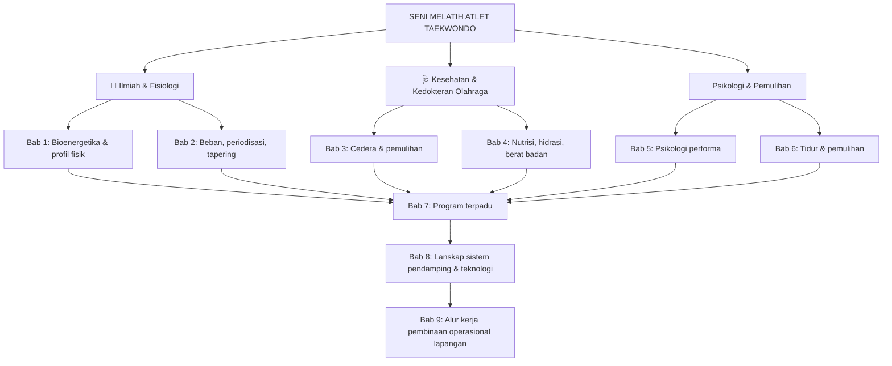

# 📖 Seni Melatih Atlet: Fondasi Ilmiah Pembinaan Atlet Taekwondo

  

> 📚 **[Kembali ke Katalog Utama (CATALOG.md)](../../CATALOG.md)**  
> **Penyusun**: Book Hubs (naskah orisinal berbasis tinjauan literatur ilmiah)  
> **Tahun Terbit**: 2026 | **Penerbit**: Book Hubs Original  
> **Genre**: Sains Olahraga, Fisiologi Latihan, Kesehatan Atlet, Psikologi Performa  
> **Status Naskah**: 🟢 Selesai — Edisi Lengkap (9 Bab Lengkap Divalidasi)  
> **Sifat Buku**: Buku acuan netral. Tidak mempromosikan produk, aplikasi, maupun merek apa pun.

---

## 🧭 Peta Eksplorasi Buku (Reading Roadmap)

Buku ini disusun sebagai **rujukan kerja bagi pelatih, atlet, orang tua, dan pengurus cabang olahraga taekwondo**. Setiap bab menjawab satu pertanyaan besar, lalu menunjukkan *seberapa kuat* bukti ilmiah di belakang jawabannya.

- ✅ 📘 **[Bab 1: Tubuh Atlet Taekwondo — Bioenergetika, Profil Fisik & Perkembangan Atlet Muda](01-bioenergetika-dan-fisiologi-taekwondo.md)**  
  *Dari mana energi satu ronde berasal, seperti apa profil fisik atlet internasional, mengapa "latihan lebih awal dan lebih banyak" belum tentu lebih baik untuk anak.*

- ✅ 📘 **[Bab 2: Beban, Periodisasi & Tapering — Seni Mengatur Dosis Latihan](02-periodisasi-beban-dan-tapering.md)**  
  *Apa yang dibuktikan (dan tidak dibuktikan) oleh sains tentang periodisasi, rasio beban akut–kronis, session-RPE, overreaching, dan menurunkan beban menjelang kejuaraan.*

- ✅ 📘 **[Bab 3: Sports Medicine — Biomekanika Cedera, Protokol Akut & Kriteria Kembali ke Matras](03-sports-medicine-dan-biomekanika-cedera.md)**  
  *Cedera khas taekwondo, mengapa R.I.C.E. ditinggalkan dan diganti P.E.A.C.E. & L.O.V.E., protokol gegar otak Amsterdam 2022, serta kriteria objektif Return-to-Play.*

- ✅ 📘 **[Bab 4: Nutrisi, Hidrasi & Manajemen Berat Badan Bertanggung Jawab](04-nutrisi-hidrasi-dan-manajemen-berat-badan.md)**  
  *Kategori berat badan, anatomi penurunan kronis vs akut (low-residue & deplesi glikogen), bahaya dehidrasi bagi bantalan otak, sindrom REDs (IOC 2023), serta protokol rehidrasi natrium pasca-timbang badan.*

- ✅ 📘 **[Bab 5: Psikologi Performa & Ketahanan Mental Matras](05-psikologi-performa-dan-ketahanan-mental.md)**  
  *Regulasi gairah emosional (IZOF Model Hanin), neurobiologi pojok matras 60 detik (physiological sigh), antisipasi visual kinematis panggul/bahu, serta restrukturisasi self-talk fungsional.*

- ✅ 📘 **[Bab 6: Fisiologi Pemulihan, Neurosains Tidur & Monitoring Kesiapan Atlet](06-fisiologi-pemulihan-dan-kualitas-tidur.md)**  
  *Arsitektur tidur gelombang lambat (SWS) & pelepasan HGH, fase REM untuk konsolidasi teknik baru, bahaya pembatasan tidur, meluruskan mitos mandi es (CWI), serta pemantauan HRV.*

- ✅ 📘 **[Bab 7: Menyusun Program Terpadu: Dari Periodisasi hingga Hari Pertandingan](07-menyusun-program-terpadu.md)**  
  *Sintesis bab 1–6: makrosiklus tahunan 16 minggu, monitoring mandiri bebas alat (kertas/spreadsheet), pohon keputusan penyesuaian beban harian, serta sinergi segitiga pelatih-medis-atlet.*

- ✅ 📘 **[Bab 8: Lanskap Sistem Pendamping: Ekosistem Teknologi Pemantauan & Manajemen Atlet](08-lanskap-sistem-pendamping-dan-teknologi-atlet.md)**  
  *Tinjauan netral 5 kategori teknologi olahraga (AMS, biometrik, analisis video, manajemen ekosistem dojang, dan spreadsheet mandiri), fenomena psikologis pelaporan atlet ("I lied a little bit"), serta batas penerapan digital.*

- ✅ 📘 **[Bab 9: Alur Kerja Pembinaan Terstruktur: Kerangka Kerja Operasional Lapangan](09-alur-kerja-pembinaan-terstruktur-non-it.md)**  
  *Cetak biru transformasi intuisi melatih menjadi sistem kerja: siklus 5 gerbang dojang (intake/profiling, periodisasi, daily loop, triage kelelahan, debrief kejuaraan), format papan fisik dojang, serta panduan menyiapkan dojang menuju digitalisasi.*

---

## 🎯 1. Tesis & Posisi Buku

> **"Atlet tidak dibentuk oleh seberapa keras ia dihancurkan, tetapi oleh seberapa tepat beban diberikan, seberapa baik ia pulih, dan seberapa jujur pelatih membedakan *yang terbukti* dari *yang diwariskan*."**

Dunia bela diri kaya akan tradisi pelatihan: sebagian bijak, sebagian lagi hanya kebiasaan yang bertahan karena tidak pernah diuji. Buku ini tidak menolak tradisi, tetapi **menanyakan buktinya**. Ketika bukti kuat, ia ditulis tegas. Ketika bukti lemah atau diperdebatkan, ia ditulis apa adanya.

Buku ini sengaja dibedakan dari dua jenis bacaan yang umum:

| Jenis&nbsp;bacaan | Kelemahan&nbsp;umum | Pendekatan&nbsp;buku&nbsp;ini |
|---|---|---|
| Buku motivasi bela diri | Klise, tanpa dasar fisiologis | Setiap klaim penting disertai sitasi yang dapat dilacak |
| Katalog teknik & silabus | Tidak menjelaskan adaptasi tubuh di baliknya | Menjelaskan *mengapa* tubuh merespons latihan tertentu |
| Artikel populer sains olahraga | Menyajikan satu studi sebagai "kebenaran" | Memisahkan temuan, interpretasi, dan batas bukti |

---

## 🔬 2. Sistem Label Bukti (Wajib di Setiap Bab)

Setiap klaim penting diberi label tingkat bukti agar pembaca tahu seberapa jauh ia boleh bersandar padanya.

| Level | Jenis sumber | Cara membacanya |
|:-:|---|---|
| 🟢 **A** | Meta-analisis, tinjauan sistematik, pernyataan konsensus resmi | Bukti terkuat. Tetap periksa apakah populasinya sama dengan atlet taekwondo. |
| 🟡 **B** | Studi observasional atau eksperimental terkontrol (kohort, kasus-kontrol, RCT) | Menunjukkan hubungan. Belum tentu menunjukkan sebab-akibat. |
| 🟠 **C** | Tinjauan naratif, model konseptual, studi kecil, survei, pendapat ahli | Berguna sebagai panduan berpikir, bukan dasar keputusan tunggal. |
| 🔴 **D** | Kebiasaan lapangan atau heuristik yang belum diuji | Boleh dicoba dengan hati-hati. Jangan disajikan sebagai fakta. |

### Aturan Penulisan

1. **Tidak ada angka tanpa sitasi.** Angka yang tidak punya sumber terverifikasi tidak ditulis.
2. **Temuan ≠ interpretasi.** Hasil studi ditulis terpisah dari tafsir penyusun. Tafsir diberi label *"Interpretasi"*.
3. **Catatan transfer populasi.** Jika data berasal dari olahraga lain (rugbi, sepak bola, lari), hal itu dinyatakan eksplisit.
4. **Kotak Bukti & Batas Pengetahuan** wajib ada di setiap bab.
5. **Sumber primer lebih dulu.** Rujukan dicek ke PubMed atau Crossref (judul, jurnal, tahun, DOI, PMID).
6. **Bukan nasihat medis.** Keputusan terkait cedera, berat badan, dan kesehatan atlet melibatkan dokter olahraga atau tenaga kesehatan berwenang.

---

## 🗺️ 3. Peta Konsep

---

## 🧪 4. Status Verifikasi Sumber

Transparansi adalah bagian dari metode. Berikut keadaan sumber pada draf ini.

### ✅ Sudah diperiksa ke basis data (PubMed/Crossref)
Seluruh rujukan yang tercantum pada bibliografi induk di bawah. Untuk beberapa di antaranya, abstrak dibaca langsung. Untuk Gabbett (2016), teks lengkap di PMC juga diperiksa karena angka zona ACWR tidak muncul di abstrak.

### ⚠️ Belum diverifikasi, jangan dikutip sebelum dicek
Klaim berikut sering beredar tetapi **belum diperiksa ke sumber primer** pada draf ini, sehingga tidak dipakai sebagai fakta:

| Klaim yang beredar | Status |
|---|---|
| Waktu reaksi atlet bela diri sekitar 180–250 ms | ⛔ Belum diverifikasi |
| Efektivitas teknik *Quiet Eye* pada taekwondo | ⛔ Belum diverifikasi |
| Ambang HRV untuk menyesuaikan latihan harian | ⛔ Belum diverifikasi |
| Laju penurunan lemak tubuh aman (% berat badan per minggu) | ⛔ Belum diverifikasi |
| Protokol *water loading* | ⛔ Belum diverifikasi |
| Validasi ACWR khusus taekwondo | ⛔ Belum ditelusuri |
| Hubungan dehidrasi dengan risiko gegar otak (besaran risiko) | ⛔ Belum diverifikasi. Bukti yang ada cenderung mekanistik dan survei. |

---

## 📚 5. Bibliografi Induk (Sumber yang Sudah Diperiksa)

Nomor `[n]` dipakai konsisten di seluruh bab. Setiap bab juga memuat daftar pustakanya sendiri.

| # | Sumber | Dipakai&nbsp;di |
|:-:|---|:-:|
| [1] | Campos FAD, Bertuzzi R, Dourado AC, Santos VG, Franchini E. Energy demands in taekwondo athletes during combat simulation. *Eur J Appl Physiol*. 2012;112(4):1221–1228. doi:10.1007/s00421-011-2071-4. PMID: 21769736 | Bab 1 |
| [2] | Bridge CA, Ferreira da Silva Santos J, Chaabène H, Pieter W, Franchini E. Physical and physiological profiles of taekwondo athletes. *Sports Med*. 2014;44(6):713–733. doi:10.1007/s40279-014-0159-9. PMID: 24549477 | Bab 1 |
| [3] | Blazevich AJ, Babault N. Post-activation potentiation versus post-activation performance enhancement in humans: historical perspective, underlying mechanisms, and current issues. *Front Physiol*. 2019;10:1359. doi:10.3389/fphys.2019.01359. PMID: 31736781 | Bab 1 |
| [4] | Jayanthi NA, LaBella CR, Fischer D, Pasulka J, Dugas LR. Sports-specialized intensive training and the risk of injury in young athletes: a clinical case-control study. *Am J Sports Med*. 2015;43(4):794–801. doi:10.1177/0363546514567298. PMID: 25646361 | Bab 1 |
| [5] | Lloyd RS, Oliver JL. The Youth Physical Development Model: a new approach to long-term athletic development. *Strength Cond J*. 2012. doi:10.1519/SSC.0b013e31825760ea (DOI diverifikasi via Crossref) | Bab 1 |
| [6] | Bosquet L, Montpetit J, Arvisais D, Mujika I. Effects of tapering on performance: a meta-analysis. *Med Sci Sports Exerc*. 2007;39(8):1358–1365. doi:10.1249/mss.0b013e31806010e0. PMID: 17762369 | Bab 2 |
| [7] | Gabbett TJ. The training–injury prevention paradox: should athletes be training smarter and harder? *Br J Sports Med*. 2016;50(5):273–280. doi:10.1136/bjsports-2015-095788. PMID: 26758673 | Bab 2 |
| [8] | Impellizzeri FM, Tenan MS, Kempton T, Novak A, Coutts AJ. Acute:chronic workload ratio: conceptual issues and fundamental pitfalls. *Int J Sports Physiol Perform*. 2020;15(6):907–913. doi:10.1123/ijspp.2019-0864. PMID: 32502973 | Bab 2 |
| [9] | Williams TD, Tolusso DV, Fedewa MV, Esco MR. Comparison of periodized and non-periodized resistance training on maximal strength: a meta-analysis. *Sports Med*. 2017;47(10):2083–2100. doi:10.1007/s40279-017-0734-y. PMID: 28497285 | Bab 2 |
| [10] | Foster C, Florhaug JA, Franklin J, et al. A new approach to monitoring exercise training. *J Strength Cond Res*. 2001;15(1):109–115. PMID: 11708692 | Bab 2 |
| [11] | Haddad M, Chaouachi A, Castagna C, Wong DP, Behm DG, Chamari K. The construct validity of session RPE during an intensive camp in young male taekwondo athletes. *Int J Sports Physiol Perform*. 2011;6(2):252–263. doi:10.1123/ijspp.6.2.252. PMID: 21725110 | Bab 2 |
| [12] | Lupo C, Capranica L, Cortis C, Guidotti F, Bianco A, Tessitore A. Session-RPE for quantifying load of different youth taekwondo training sessions. *J Sports Med Phys Fitness*. 2017;57(3):189–194. doi:10.23736/S0022-4707.16.06021-X. PMID: 26796074 | Bab 2 |
| [13] | Slimani M, Davis P, Franchini E, Moalla W. Rating of perceived exertion for quantification of training and combat loads during combat sport-specific activities: a short review. *J Strength Cond Res*. 2017;31(10):2889–2902. doi:10.1519/JSC.0000000000002047. PMID: 28933715 | Bab 2 |
| [14] | Saw AE, Main LC, Gastin PB. Monitoring the athlete training response: subjective self-reported measures trump commonly used objective measures: a systematic review. *Br J Sports Med*. 2016;50(5):281–291. doi:10.1136/bjsports-2015-094758. PMID: 26423706 | Bab 2 |
| [15] | Meeusen R, Duclos M, Foster C, et al. Prevention, diagnosis, and treatment of the overtraining syndrome: joint consensus statement of the European College of Sport Science and the American College of Sports Medicine. *Med Sci Sports Exerc*. 2013;45(1):186–205. doi:10.1249/MSS.0b013e318279a10a. PMID: 23247672 | Bab 2 |
| [16] | Vachon A, Berryman N, Mujika I, Paquet JB, Arvisais D, Bosquet L. Effects of tapering on neuromuscular and metabolic fitness in team sports: a systematic review and meta-analysis. *Eur J Sport Sci*. 2021;21(3):300–311. doi:10.1080/17461391.2020.1736183. PMID: 32172680 | Bab 2 |
| [17] | Lystad RP, Swain MS, Graham PL. Risk factors for injury in Olympic-style competition taekwondo: a systematic review. *J Sports Med Phys Fitness*. 2013;53(6):655–664. PMID: 24247189 | Bab 3 |
| [18] | Dubois B, Esculier JF. Soft-tissue injuries simply need PEACE and LOVE. *Br J Sports Med*. 2020;54(2):72–73. doi:10.1136/bjsports-2019-101253. PMID: 31377722 | Bab 3 |
| [19] | Patricios JS, Schneider KJ, Dvorak J, et al. Consensus statement on concussion in sport: the 6th International Conference on Concussion in Sport–Amsterdam, October 2022. *Br J Sports Med*. 2023;57(11):695–711. doi:10.1136/bjsports-2023-106898. PMID: 37316210 | Bab 3 |
| [20] | Reale R, Slater G, Burke LM. Acute-weight-loss strategies for combat sports and applications to Olympic success. *Int J Sports Physiol Perform*. 2017;12(2):142–151. doi:10.1123/ijspp.2016-0211. PMID: 27347784 | Bab 4 |
| [21] | Mountjoy M, Ackerman KE, Bailey DM, et al. 2023 International Olympic Committee’s (IOC) consensus statement on Relative Energy Deficiency in Sport (REDs). *Br J Sports Med*. 2023;57(17):1073–1097. doi:10.1136/bjsports-2023-106994. PMID: 37752011 | Bab 4 |
| [22] | Robazza C, Bertollo M, Filho E, Hanin Y, Bortoli L. Perceived control and hedonic tone dynamics during performance in elite shooters. *Res Q Exerc Sport*. 2016;87(3):284–294. doi:10.1080/02701367.2016.1185081. PMID: 27253427 | Bab 5 |
| [23] | Robazza C, Pellizzari M, Bertollo M, Hanin YL. Functional impact of emotions on athletic performance: comparing the IZOF model and the directional perception approach. *J Sports Sci*. 2008;26(10):1033–1047. doi:10.1080/02640410802027352. PMID: 18608828 | Bab 5 |
| [24] | Halson SL. Monitoring training load to understand fatigue in athletes. *Sports Med*. 2014;44 Suppl 2(Suppl 2):S139–S147. doi:10.1007/s40279-014-0253-z. PMID: 25200666 | Bab 6, Bab 7, Bab 8 |
| [25] | Roberts LA, Raastad T, Markworth JF, et al. Post-exercise cold water immersion attenuates acute anabolic signalling and long-term adaptations in muscle to strength training. *J Physiol*. 2015;593(18):4285–4301. doi:10.1113/JP270570. PMID: 26174323 | Bab 6, Bab 7 |
| [26] | Franchini E. High-Intensity Interval Training Prescription for Combat-Sport Athletes. *Int J Sports Physiol Perform*. 2020;15(6):767–776. doi:10.1123/ijspp.2020-0289. PMID: 32502972 | Bab 7 |
| [27] | Bromley S, Drew M, Talpey S, McIntosh A, Finch C. Collecting Health and Exposure Data in Australian Olympic Combat Sports: Feasibility Study Utilizing an Electronic System. *JMIR Hum Factors*. 2018;5(4):e27. doi:10.2196/humanfactors.9541. PMID: 30305257 | Bab 8 |
| [28] | Coventry M, Timler A, Mosler AB, et al. "I lied a little bit." A qualitative study exploring the perspectives of elite Australian athletes on self-reported data. *Phys Ther Sport*. 2023;60:91–97. doi:10.1016/j.ptsp.2023.01.009. PMID: 36738670 | Bab 8, Bab 9 |

> Bibliografi induk ini merangkum 28 literatur ilmiah rujukan berbobot tinggi (Level A & B) yang telah diverifikasi melalui basis data PubMed dan Crossref.

---

## ⚡ 6. Cara Memakai Buku Ini

### Fase 1: Hari Ini
- [ ] Baca Bab 1 dan 2, lalu catat tiga kebiasaan latihan yang selama ini dijalankan tanpa dasar bukti.
- [ ] Mulai mencatat durasi dan tingkat kelelahan (skala 0–10) setiap sesi di kertas atau spreadsheet.

### Fase 2: 30 Hari Pertama
- [ ] Bandingkan catatan beban mingguan dengan kondisi atlet (tidur, nyeri, suasana hati).
- [ ] Diskusikan kebijakan beban latihan dengan tenaga kesehatan atau dokter olahraga setempat.

### Fase 3: Jangka Panjang
- [ ] Susun siklus latihan tahunan berbasis prinsip bab 1–2, lalu evaluasi setelah tiap kejuaraan.
- [ ] Perbarui kebiasaan lapangan setiap kali bukti baru muncul.

---

## ⚖️ 7. Evaluasi Kritis & Keterbatasan Buku

- **Kekuatan Terbesar**: Transparansi bukti. Pembaca selalu tahu apakah sebuah klaim berdiri di atas meta-analisis atau hanya kebiasaan lapangan.
- **Keterbatasan Utama**: Literatur khusus taekwondo jauh lebih sedikit daripada sepak bola atau lari. Banyak prinsip harus dipinjam dari olahraga lain, dan itu selalu ditandai.
- **Keterbatasan Naskah**: Draf ini disusun dari penelusuran basis data. Naskah belum melalui telaah sejawat (*peer review*) atau telaah dokter olahraga. Sebelum dipakai sebagai pedoman resmi sebuah perguruan atau federasi, konsultasikan dengan ahli.
- **Profil Pembaca Ideal**: Pelatih yang ingin mengganti "katanya" dengan "buktinya", atlet dan orang tua yang ingin memahami proses di balik program latihan, serta pengurus cabang yang menyusun pembinaan jangka panjang.

---

*(Buku ini bersifat edukatif dan netral. Tidak ada afiliasi komersial dengan produk, perangkat lunak, atau layanan apa pun.)*
