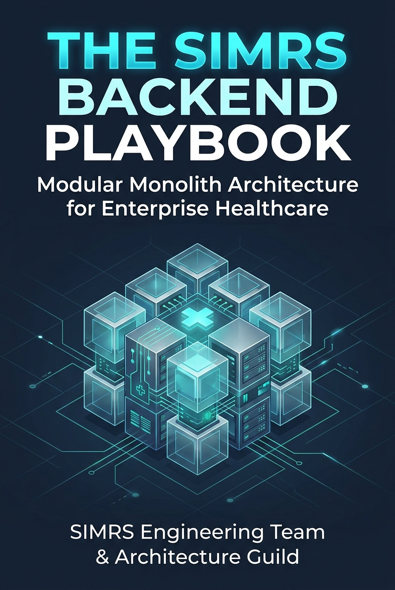

# 📖 The SIMRS Backend Playbook: Cetak Biru Arsitektur Modular Monolith Berbasis Node.js, Hono, dan Sequelize

> 📚 **[Kembali ke Katalog Utama (CATALOG.md)](../../CATALOG.md)**  
> **Penulis**: SIMRS Engineering Team & Architecture Guild  
> **Tahun Terbit**: 2026 | **Penerbit**: Modern Healthcare Engineering Press  
> **Genre**: Rekayasa Perangkat Lunak, Enterprise Architecture & Healthcare Systems | **Estimasi Waktu Baca Keseluruhan**: ~80–100 Menit (6 Modul Lengkap)  
> **Rating Rekomendasi**: ⭐⭐⭐⭐⭐ (5.0 / 5.0)  

---

<div align="center">
  
</div>

---

## 🧭 Peta Eksplorasi Buku (Reading Roadmap)

Buku ini disusun secara sistematis ke dalam 6 modul komprehensif yang memandu tim rekayasa perangkat lunak bertransformasi dari arsitektur monolit klasik berlapis (*layer-first MVC*) menuju arsitektur modular berbasis domain (*domain-driven modular monolith*) yang tangguh, patuh regulasi, dan siap diekstrak menjadi microservices:

- [x] 📘 **[Part 1: Anatomi Kompleksitas SIMRS & Jebakan Arsitektur Klasik](01-anatomi-simrs-dan-jebakan-arsitektur.md)** — *Membongkar mengapa pola MVC teknis (handlers/models/routes) menjadi anti-pattern mematikan di rumah sakit. Analisis fat handlers, database coupling, semantik HTTP response yang cacat, hingga krisis connection pool exhaustion di AWS Lambda saat peak hour poliklinik.*
- [x] 📘 **[Part 2: Paradigma Modular Monolith & Bounded Contexts](02-prinsip-modular-monolith-dan-bounded-context.md)** — *Mendefinisikan batas domain medis (Admission, EMR, Pharmacy, Billing, Bridging). Menegakkan "The Golden Rules" isolasi modul: larangan cross-module SQL joins/imports, relasi berbasis foreign ID tanpa eager loading, dan penegakan batas via ESLint guardrails.*
- [x] 📘 **[Part 3: Clean Implementation: Delivery, Domain, dan Data Layer](03-standar-kode-clean-architecture-hono-sequelize.md)** — *Praktek terbaik implementasi kode bersih menggunakan Hono dan Sequelize. Memisahkan handler tipis (skinny handlers) dari pure business logic di service layer, isolasi query di repository, penanganan error terpusat (`AppError`), serta validasi fail-fast dengan Zod.*
- [x] 📘 **[Part 4: Dual-Runtime Architecture: Menjinakkan Docker & AWS Lambda](04-dual-runtime-docker-dan-aws-lambda.md)** — *Satu basis kode untuk dua lingkungan runtime yang bertolak belakang. Konfigurasi connection pooling adaptif di Sequelize (persistent pool Docker vs dynamic min/max di Lambda dengan AWS RDS Proxy), graceful shutdown, dan distributed tracing via Pino.*
- [x] 📘 **[Part 5: Compliance Kesehatan: Audit Trail RME, BPJS, & SATUSEHAT FHIR](05-audit-trail-rme-dan-bridging-eksternal.md)** — *Memenuhi mandat hukum Permenkes 24/2022 tentang Rekam Medis Elektronik (RME). Merancang audit trail transparan dan immutable (siapa, kapan, sebelum vs sesudah). Mengisolasi integrasi BPJS VClaim/Antrol dan Kemenkes SATUSEHAT dengan Retry, Circuit Breaker, dan Outbox Pattern.*
- [x] 📘 **[Part 6: Migration Playbook, Team Governance, & Living ADR](06-migration-playbook-dan-team-governance.md)** — *Strategi migrasi inkremental menggunakan Strangler Fig Pattern tanpa melakukan rewrite total yang berisiko. Standarisasi Architecture Decision Records (ADR), checklist onboarding engineer baru, dan otomatisasi CI/CD guardrails.*

---

## 🎯 1. Inti Filosofis & Tesis Utama

Di dunia industri perangkat lunak, hanya sedikit sistem yang memiliki tingkat kekritisan setinggi **Sistem Informasi Manajemen Rumah Sakit (SIMRS)**. Keterlambatan respon antrean admisi di pagi hari dapat memicu kepanikan di lobi rawat jalan; bug transaksi kasir dapat melumpuhkan kepulangan ratusan pasien; dan kegagalan integritas data rekam medis (*Electronic Medical Record / EMR*) dapat berakibat fatal secara hukum maupun klinis.

Ironisnya, banyak sistem SIMRS modern dibangun di atas pondasi arsitektur yang rapuh: **pola Layer-First MVC klasik (`handlers/`, `models/`, `routes/`)**.

Ketika proyek SIMRS dimulai oleh 2-3 orang programmer, pengelompokan file berdasarkan fungsi teknis terasa mudah dan cepat. Namun ketika skala sistem membengkak—mencakup pendaftaran rawat jalan, rawat inap, instalasi gawat darurat (IGD), resep elektronik farmasi, kasir split-bill, hingga bridging BPJS dan SATUSEHAT—pola ini berubah menjadi mimpi buruk arsitektural:

> *"Jebakan terbesar dalam arsitektur software bukanlah salah memilih framework atau bahasa pemrograman, melainkan mencampuradukkan domain bisnis di bawah folder teknis yang sama, membiarkan query database melintasi batas domain tanpa kontrak, dan mengikat logika klinis secara langsung pada protokol HTTP."*

Tesis utama dari playbook ini adalah: **Modular Monolith adalah titik temu optimal (sweet spot) antara kecepatan pengembangan monolit dan independensi jangka panjang microservices.**

Dengan menstrukturkan kode berdasarkan **Bounded Contexts** (Domain-First), setiap modul SIMRS diperlakukan seolah-olah microservice independen yang berada dalam satu repositori (*monorepo/modular codebase*). Komunikasi antar modul hanya diizinkan melalui kontrak antarmuka resmi (*public service API*), bukan dengan tembakan SQL query langsung atau cross-import models. Dengan pendekatan ini, organisasi mendapatkan kemudahan deployment dan operasi di fase awal, namun memiliki jaminan bebas sakit kepala ketika sewaktu-waktu modul Billing atau Bridging harus dipisahkan menjadi microservice mandiri.

---

## 💡 2. Peta Konsep & Kerangka Berpikir Utama (Core Frameworks)

```text
                             ARSITEKTUR MODULAR MONOLITH SIMRS
                                             │
      ┌──────────────────────────────────────┼──────────────────────────────────────┐
      ▼                                      ▼                                      ▼
[ SHARED KERNEL ]                    [ BOUNDED CONTEXTS ]                   [ DUAL RUNTIME ]
(src/core/)                          (src/modules/)                         (Entrypoints)
• Database Singleton & Transaction   • master-data (ICD, Poli, Nakes)       • server.js (Docker / VM)
• Standard HTTP Response & AppError  • admission (IGD, Rajal, Ranap)        • lambda.js (AWS Lambda)
• Centralized Error Middleware       • emr (CPPT, SOAP, Asesmen)            • @hono/node-server
• RBAC & Request Audit Trail         • pharmacy (E-Resep, Depo, Racikan)    • hono/aws-lambda
• Pino Structured Logger             • billing (Kasir, Split Bill, Klaim)   • Connection Pool Adaptif
                                     • bridging (BPJS & SATUSEHAT FHIR)
```

### Empat Pilar Fondasi Arsitektur

1. **Domain-First Bounded Isolation**: Menghentikan penyebaran logika domain ke folder teknis yang terpisah. Seluruh delivery, logic, data access, dan model milik satu domain disatukan di dalam folder modul masing-masing (`src/modules/<domain>/`).
2. **Protocol-Agnostic Core Logic**: Logika medis di dalam Service Layer sama sekali tidak mengenal objek `c` (Hono Context). Service hanya menerima Plain JavaScript Objects (POJO) dan mengembalikan hasil murni, sehingga dapat dipanggil secara identik dari HTTP handler, background cron job, message queue, maupun modul internal lain.
3. **Strict Database Sovereignty**: Modul A dilarang melakukan JOIN atau memodifikasi tabel milik Modul B. Semua ketergantungan relasional diselesaikan melalui pemanggilan Public Service Contract pada transaksi yang sama atau melalui pertukaran event.
4. **Dual-Runtime Cloud Readiness**: Memanfaatkan Hono yang berakar pada Web Standard Fetch API dan konfigurasi adaptif koneksi Sequelize, sistem dapat dijalankan di container Docker berumur panjang maupun AWS Lambda serverless tanpa perlu mengubah satu baris pun kode aplikasi.

---

## ⚡ 3. Playbook Praktis: Rencana Implementasi

Langkah operasional yang siap dieksekusi oleh tim engineering:

### Fase 1: Hari Ini (Quick Wins & Stop the Bleeding)
- [ ] Pasang aturan linting ESLint `no-restricted-imports` untuk mencegah impor lintas folder `models/` dan `repositories/` antar modul.
- [ ] Terapkan wrapper response terpusat (`sendSuccess`) dan kelas error tunggal (`AppError`) di seluruh endpoint baru.
- [ ] Pisahkan parameter protokol `c` (Hono Context) dari fungsi business logic di service; pastikan service hanya menerima data murni (*pure payload*).

### Fase 2: 30 Hari Pertama (Membangun Batas Domain)
- [ ] Lakukan refactoring modul per modul ke struktur `src/modules/<nama-modul>/` (mulai dari modul berisiko rendah seperti `master-data` dan `admission`).
- [ ] Buat file `index.js` sebagai pintu gerbang (*public contract*) untuk setiap modul.
- [ ] Implementasikan dynamic connection pool Sequelize untuk mencegah lonjakan koneksi database saat berjalan di lingkungan serverless Lambda.
- [ ] Pasang `@hono/zod-validator` pada seluruh skema request rawat jalan dan pendaftaran.

### Fase 3: Jangka Panjang (Audit Trail & Kesiapan Microservices)
- [ ] Bangun modul `bridging/` terisolasi dengan pola Outbox / Queue untuk transaksi BPJS VClaim dan SATUSEHAT FHIR.
- [ ] Pasang Sequelize Global Hooks untuk audit logging otomatis sesuai mandat Permenkes RME No. 24/2022.
- [ ] Lakukan uji beban (*stress test*) simulasi peak hour poliklinik jam 07:00–09:00 pagi pada runtime Docker dan AWS Lambda (dengan RDS Proxy).

---

## ⚖️ 4. Evaluasi Kritis & Ulasan Objektif

* **Kekuatan Terbesar**: Memberikan kejelasan batas tanggung jawab (*clear cognitive load*) bagi tim engineer. Mencegah timbunan utang teknis (*architectural technical debt*) sejak hari pertama tanpa perlu membayar ongkos operasional microservices yang rumit (service mesh, network latency, distributed consensus).
* **Kritik & Titik Buta (Blind Spots)**: Memerlukan disiplin tim yang ketat. Tanpa komitmen pada aturan isolasi dan linting otomatis, modular monolith dapat dengan mudah terdegradasi kembali menjadi *distributed spaghetti*. Selain itu, transaksi basis data yang melintasi dua modul masih berbagi koneksi database fisik yang sama; ketika nanti benar-benar dipisah menjadi microservice, transaksi terdistribusi (*Saga Pattern*) harus diperkenalkan.
* **Profil Pembaca Ideal**: Software Architect, Backend Engineering Lead, Senior Full-stack Developer, dan DevOps Engineer yang sedang merancang atau memigrasikan sistem rumah sakit, sistem klinik multi-cabang, atau aplikasi enterprise monolitik berskala besar.
