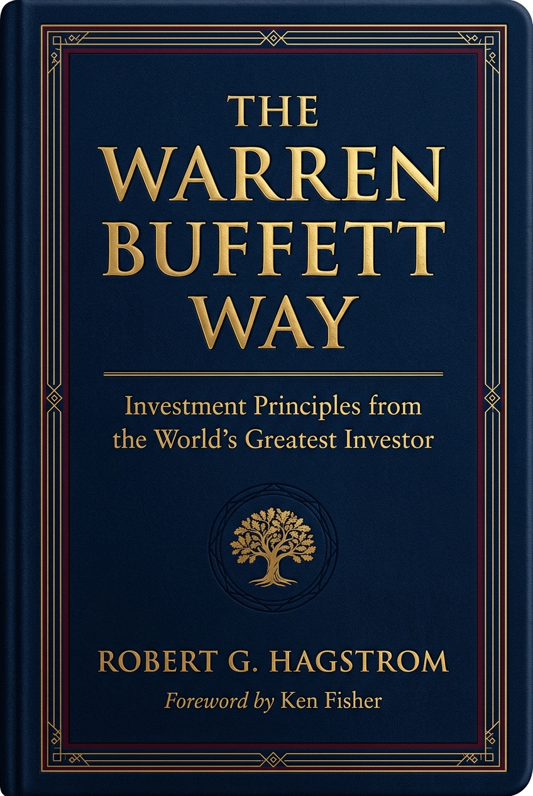

# 📖 The Warren Buffett Way: Strategi dan Metode Investasi Investor Terhebat Dunia

> 📚 **[Kembali ke Katalog Utama (CATALOG.md)](../../CATALOG.md)**  
> **Penulis**: Robert G. Hagstrom (Kata Pengantar: Peter S. Lynch & Kenneth L. Fisher)  
> **Tahun Terbit**: 1994 (Edisi Ketiga Diperbarui: 2013) | **Penerbit**: John Wiley & Sons  
> **Genre**: Finansial & Investasi | **Estimasi Waktu Baca Keseluruhan**: ~60–75 Menit (4 Modul Lengkap)  
> **Rating Rekomendasi**: ⭐⭐⭐⭐⭐ (5.0 / 5.0)  

---

<div align="center">
  
  <br/>
  <sub><i>"Saham bukanlah secarik kertas lotre fluktuatif, melainkan klaim kepemilikan proporsional atas bisnis riil."</i></sub>
</div>

---

## 🧭 Peta Eksplorasi Buku (Reading Roadmap)

Buku ini dibedah secara mendalam ke dalam 4 modul naratif komprehensif untuk menjaga kenyamanan membaca, kedalaman materi analitis, dan studi kasus riil:

- [x] 📘 **[Part 1: Fondasi Filosofis & Evolusi Pemikiran Buffett (Graham, Fisher, dan Munger)](01-fondasi-dan-evolusi-pemikiran.md)** — *Melacak pergeseran paradigma dari 'puntung cerutu' murah ala Graham menuju bisnis luar biasa berparit ekonomi lebar ala Munger dan Fisher.*
- [x] 📘 **[Part 2: Dua Belas Prinsip Investasi Abadi (12 Tenets)](02-dua-belas-prinsip-investasi-buffett.md)** — *Membongkar cetak biru 12 saringan investasi Buffett: 3 Prinsip Bisnis, 3 Prinsip Manajemen, 4 Prinsip Finansial, dan 2 Prinsip Pasar.*
- [x] 📘 **[Part 3: Bedah Kasus Pembelian Ikonik (Dari Washington Post, GEICO, Coca-Cola, hingga Apple)](03-studi-kasus-investasi-ikonik.md)** — *Rekonstruksi keputusan riil: menghitung nilai wajar, mendayagunakan float asuransi, dan membeli waralaba konsumen raksasa di tengah krisis bursa.*
- [x] 📘 **[Part 4: Focus Investing, Matematika Probabilitas, dan Disiplin Emosional Mengalahkan Mr. Market](04-focus-investing-dan-psikologi-pasar.md)** — *Mendobrak dogma diversifikasi berlebihan, disiplin zona manis Ted Williams, formula Expected Value, dan mengatasi bias psikologi perilaku.*

---

## 🎯 1. Inti Filosofis & Tesis Utama

Karier investasi Warren Buffett selama lebih dari enam dekade di pucuk pimpinan Berkshire Hathaway bukanlah hasil dari keajaiban mistis, ramalan astrologi makroekonomi, atau kecepatan komputer perdagangan Wall Street. Dalam *The Warren Buffett Way*, Robert G. Hagstrom membuktikan bahwa rekor pengembalian modal majemuk (*compound annual return*) sekitar 20% per tahun—yang mengubah beberapa ribu dolar menjadi ratusan miliar dolar—merupakan hasil dari penerapan disiplin tanpa kompromi atas sebuah metodologi yang konsisten, rasional, dan dapat dipelajari oleh siapa pun.

Tesis utama buku ini menegaskan bahwa **investasi yang sukses adalah investasi yang dijalankan layaknya mengelola dan memiliki bisnis itu sendiri**. Kebanyakan pelaku pasar saham terjebak dalam delusi bahwa mereka sedang memperdagangkan simbol tiga huruf (*ticker*) yang bergerak secara acak. Sebaliknya, pendekatan Buffett menuntut investor untuk melepaskan diri dari histeria harian Mr. Market, mendefinisikan lingkaran kompetensi mereka dengan jujur, mencari perusahaan dengan parit pertahanan ekonomi (*economic moat*) yang tak tertembus, dan hanya membeli ketika harga yang ditawarkan memberikan batas pengaman (*margin of safety*) yang memadai.

Hagstrom juga memperlihatkan evolusi krusial dalam pemikiran Buffett: perpaduan antara kehati-hatian matematis Benjamin Graham (*kuantitatif*), ketajaman prospek jangka panjang Philip Fisher (*kualitatif*), serta keberanian model mental Charlie Munger untuk mengalokasikan modal besar pada *"perusahaan luar biasa di harga wajar"*. Hasil akhirnya adalah sebuah metodologi terpadu bernama **Focus Investing**—strategi memusatkan modal pada ide-ide terbaik dengan probabilitas kemenangan tertinggi, kemudian bersabar membiarkan bunga majemuk bekerja tanpa henti.

---

## 💡 2. Peta Konsep & Kerangka Berpikir Utama (Core Frameworks)

```text
┌────────────────────────────────────────────────────────────────────────┐
│               ARSITEKTUR LENGKAP THE WARREN BUFFETT WAY                │
└────────────────────────────────────────────────────────────────────────┘

    [ EVOLUSI INTELEKTUAL ]
    Graham (Margin of Safety) + Fisher (Growth & Quality) + Munger (Moat & Rationality)
                                   │
                                   ▼
    [ SARINGAN 12 TENETS ]
    ┌───────────────────────┬───────────────────────┐
    │ 1. Bisnis             │ 2. Manajemen          │
    │   • Sederhana         │   • Alokasi Rasional  │
    │   • Konsisten         │   • Keterbukaan/Jujur │
    │   • Parit Moat        │   • Anti-Imperatif    │
    ├───────────────────────┼───────────────────────┤
    │ 3. Finansial          │ 4. Pasar              │
    │   • Fokus ROE         │   • Nilai Intrinsik   │
    │   • Owner Earnings    │   • Margin of Safety  │
    │   • $1 Premise        │     (Beli Diskon)     │
    └───────────────────────┴───────────────────────┘
                                   │
                                   ▼
    [ EKSEKUSI FOCUS INVESTING ]
    • Konsentrasi 5–10 Ide Terbaik (Probabilitas Tinggi)
    • Model Ted Williams (Sabar Menunggu di Titik Manis)
    • Horison Kepemilikan Jangka Panjang (Holding Period = Forever)
```

- **Pilar 1: Circle of Competence & Economic Moat**: Menolak bisnis yang tidak dipahami, dan mengunci bisnis monopoli konsumen (*franchise*) yang memiliki kekuatan penetapan harga (*pricing power*) serta keunggulan biaya bertahan lama.
- **Pilar 2: Owner Earnings & The One-Dollar Premise**: Menilai laba dari kas riil yang bisa ditarik pemilik (setelah dikurangi belanja modal pemeliharaan), dan memastikan setiap \$1 laba yang ditahan manajemen mampu menciptakan minimal \$1 nilai kapitalisasi pasar.
- **Pilar 3: Focus Investing & Emotional Fortitude**: Mengabaikan kebisingan pasar harian; memegang sedikit saham berkualitas luar biasa, dan memiliki ketenangan batin untuk tidak menjual saat pasar mengalami penurunan siklikal sementara.

---

## ⚡ 3. Playbook Praktis: Rencana Implementasi

Langkah operasional yang siap dieksekusi oleh investor cerdas di dunia nyata:

### Fase 1: Hari Ini (Quick Wins & Pembersihan Mental)
- [ ] **Definisikan Lingkaran Kompetensi Pribadi**: Tuliskan di selembar kertas industri atau bisnis apa saja yang benar-benar Anda pahami cara kerjanya (misal: barang konsumsi, ritel, software), dan tandai bisnis yang wajib Anda hindari (*Too Hard*).
- [ ] **Hentikan Trading Harian Berbasis Emosi**: Hapus aplikasi grafik perdagangan jangka pendek atau matikan notifikasi fluktuasi harga harian yang memicu sisa perhatian dan kecemasan irasional.
- [ ] **Ganti Lensa Saham**: Pilih 1 saham di portofolio Anda saat ini, lalu anggap bursa saham akan tutup selama 5 tahun ke depan. Apakah Anda tetap nyaman memiliki bisnis tersebut?

### Fase 2: 30 Hari Pertama (Membangun Sistem Analisis Fundamental)
- [ ] **Terapkan Rumus Owner Earnings**: Unduh Laporan Keuangan Tahunan (*Annual Report*) dari satu perusahaan incaran. Hitung Arus Kas Operasi dikurangi Belanja Modal Pemeliharaan (*Maintenance Capex*) untuk mengetahui laba kas hakiki.
- [ ] **Uji Keterbukaan Manajemen (*Candor Test*)**: Baca Surat Pemegang Saham (*Shareholder Letter*) dari CEO perusahaan tersebut selama 3 tahun berturut-turut. Periksa apakah CEO berani mengakui kesalahan strategi mereka atau hanya membual tentang prestasi.
- [ ] **Evaluasi Return on Equity (ROE)**: Pastikan perusahaan target mampu mencatatkan ROE stabil di atas 15%–20% selama minimal 5–10 tahun berturut-turut dengan tingkat utang berbunga yang terkendali (*rendah rasio Debt-to-Equity*).

### Fase 3: Jangka Panjang (Focus Investing & Disiplin Eksekusi)
- [ ] **Konsolidasi Menuju 5–10 Portofolio Terbaik**: Secara bertahap alihkan modal dari saham-saham medioker spekulatif menuju segelintir perusahaan luar biasa yang telah lolos saringan 12 Tenets.
- [ ] **Siapkan Likuiditas Cadangan (Cash Buffer)**: Pertahankan cadangan kas/instrumen likuid agar siap mengayunkan tongkat pemukul saat pasar saham mengalami kepanikan massal (*crash*) dan menawarkan diskon harga yang besar.
- [ ] **Evaluasi Kinerja Tahunan Berbasis Operasi Bisnis**: Nilai perkembangan kekayaan Anda bukan dari fluktuasi indeks harga saham, melainkan dari pertumbuhan laba bersih, dividen tunai yang diterima, dan akumulasi nilai intrinsik portofolio Anda.

---

## ⚖️ 4. Evaluasi Kritis & Ulasan Objektif

- **Kekuatan Terbesar**: Robert G. Hagstrom berhasil mendemistifikasi figur Warren Buffett yang sering dianggap genius tak terjangkau menjadi seperangkat prinsip deduktif (12 Tenets) yang sangat terstruktur, logis, dan dapat diaplikasikan oleh investor perorangan maupun pengelola dana profesional. Studi kasus investasinya disajikan dengan data matematis dan latar belakang historis yang sangat kaya.
- **Kritik & Titik Buta (Blind Spots)**:
  - *Skala Modal dan Akses Khusus*: Sebagian keberhasilan Berkshire Hathaway disokong oleh modal *float* asuransi berbiaya nol (GEICO/General Re) dan transaksi tertutup (*preferential deal*) yang hanya ditawarkan kepada Buffett karena nama besarnya, yang tidak dapat direplikasi persis oleh investor ritel.
  - *Tantangan di Era Disrupsi Teknologi Cepat*: Model bisnis berbasis parit ekonomi statis (*economic moat*) tradisional kini lebih rentan terdisrupsi oleh lompatan teknologi AI dan inovasi digital agresif yang bergerak dalam hitungan bulan, bukan dekade.
- **Profil Pembaca Ideal**: Investor saham individu, manajer portofolio, pendiri bisnis/wirausahawan yang ingin memahami alokasi modal rasional, serta siapa pun yang ingin membangun kekayaan jangka panjang bebas stres dari histeria pasar.

---

## 🧭 Navigasi Modul Lengkap

📘 **[Mulai Baca Part 1: Fondasi Filosofis & Evolusi Pemikiran Buffett](01-fondasi-dan-evolusi-pemikiran.md)** &nbsp;|&nbsp; 📘 **[Part 2: 12 Prinsip Investasi Abadi](02-dua-belas-prinsip-investasi-buffett.md)** &nbsp;|&nbsp; 📘 **[Part 3: Bedah Kasus Pembelian Ikonik](03-studi-kasus-investasi-ikonik.md)** &nbsp;|&nbsp; 📘 **[Part 4: Focus Investing & Disiplin Emosional](04-focus-investing-dan-psikologi-pasar.md)**

