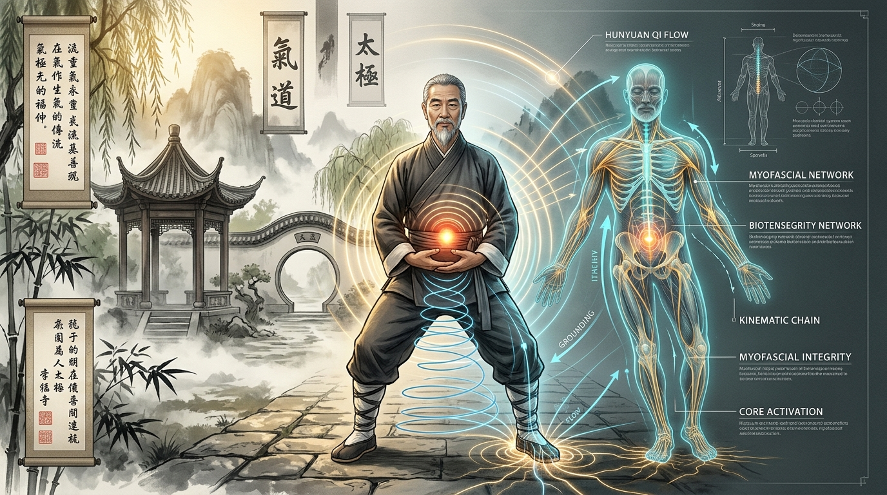

# Part 1: Odisea Pribadi & Esensi Hunyuan — Menjembatani Sains Barat dan Tradisi Daois

> 📖 **Hub Buku**: **[The Way of Hunyuan: A Personal Odyssey](index.md)**  
> 📑 **Cakupan Bab Asli**: *Acknowledgements, Introduction, History, What is Qigong, Substance & Appearance, & Personal Relationships*

---

## 📖 Narasi Pembuka & Latar Belakang (The Narrative Context)

Pada awal dekade 1980-an, seorang pemuda akademisi asal Provinsi Shandong bernama Chen Zhonghua melangkah keluar dari kabin pesawat terbang di bandara internasional Amerika Utara[^1]. Di dalam kopernya, selain tumpukan buku teks linguistik terapan untuk program pascasarjananya, tersimpan warisan kultivasi tubuh yang luar biasa langka. Sebagai seorang intelektual muda yang terdidik dalam metodologi analisis empiris modern, Chen Zhonghua tidak datang sebagai seorang pertapa mistik dari pegunungan terpencil; ia adalah seorang sarjana yang memegang transmisi silsilah langsung dari dua mahaguru terbesar abad ke-20 di Tiongkok: Grandmaster Hong Junsheng di Kota Jinan dan Grandmaster Feng Zhiqiang di ibu kota Beijing.

Setibanya di dunia barat, Chen Zhonghua menyaksikan sebuah fenomena kultural yang penuh dengan kontradiksi yang menyedihkan. Di satu sisi, peradaban modern pasca-industri sedang didera krisis kesehatan mental dan fisik yang belum pernah terjadi sebelumnya. Jam kerja panjang di depan layar, stres persaingan korporasi, serta postur duduk statis harian telah mengikis vitalitas jutaan orang; masyarakat barat berbondong-bondong membanjiri sanggar yoga, retret meditasi, dan kelas Taiji di taman-taman kota demi mencari secuil ketenangan batin. Namun di sisi lain, materi seni bela diri internal dan Qigong yang diperkenalkan kepada publik barat pada masa itu berada dalam kondisi mengenaskan: jika tidak disajikan sebagai praktik okultisme esoterik yang sarat akan takhayul gaib tanpa penjelasan anatomi, ia direduksi menjadi sekadar senam lambat untuk lansia yang telah kehilangan seluruh taring biomekanika dan kedalaman transformatifnya.

Bagi Chen Zhonghua, kemunduran pedagogi ini adalah sebuah tragedi peradaban. Ia menyadari bahwa jika tradisi internal Tiongkok ingin bertahan dan memberi manfaat nyata bagi peradaban abad ke-21, ia tidak boleh lagi bersembunyi di balik jubah keramat yang kabur. Tradisi tersebut harus dibongkar secara ilmiah, dijelaskan dengan kejernihan logika, dan diuji di bawah gravitasi bumi tanpa kompromi. Misi demistifikasi inilah yang menjadi detak jantung penulisan buku *The Way of Hunyuan: A Personal Odyssey*.

---

<div align="center">
  
  <p><sub><em>Ilustrasi Part 1: Sintesis harmonis antara tradisi halaman klasik wushu Tiongkok (kiri) dengan pemodelan biomekanika modern, jaringan biotensegrity fasia tubuh, dan visualisasi medan energi Dantian (kanan) sebagaimana diartikulasikan oleh Master Chen Zhonghua.</em></sub></p>
</div>

---

## 🔬 Teardown Konsep & Wawasan Utama (Deep-Dive Insights)

```text
┌────────────────────────────────────────────────────────────────────────┐
│            GENEALOGI SILSILAH TAIJI & NEIGONG MASTER CHEN ZHONGHUA     │
└────────────────────────────────────────────────────────────────────────┘
                   GRANDMASTER CHEN FAKE (1887–1957)
               Generasi ke-17 Chenjiagou; Legenda Tak Terkalahkan
               Membawa Taijiquan Gaya Chen ke Beijing (1928)
                                │
        ┌───────────────────────┴───────────────────────┐
        ▼                                               ▼
GRANDMASTER HONG JUNSHENG                       GRANDMASTER FENG ZHIQIANG
(1907–1996) — Murid 15 Tahun                     (1928–2012) — Murid Senior Beijing
Fokus: Biomekanika Roda Gigi,                   Juga murid dari Dr. HU YAOZHEN
Fisika Tuas, Geometri Presisi &                 (Bapak Qigong Modern & Master Xinyi)
Aplikasi Tempur (Practical Method)              Fokus: Hunyuan Qigong, Meditasi,
        │                                       Kelembutan Fasia & Dan Tian Gong
        │                                               │
        └───────────────────────┬───────────────────────┘
                                ▼
                    MASTER CHEN ZHONGHUA (陈中华)
           Sintesis Utuh: Rangka Baja Practical Method (Yang)
                    + Kelembutan Biotensegrity Hunyuan (Yin)
```

### 1. Titik Temu Tiga Aliran Besar: Chen Fake, Hu Yaozhen, dan Feng Zhiqiang
Untuk memahami apa itu sistem *Hunyuan*, pembaca harus menelusuri persahabatan legendaris di Beijing pada pertengahan abad ke-20 antara dua raksasa bela diri: **Chen Fake** (ahli beladiri Chenjiagou) dan **Dr. Hu Yaozhen (1879–1973)**.
- **Dr. Hu Yaozhen**: Dikenal luas dalam sejarah medis Tiongkok sebagai salah satu bapak pendiri terapi Qigong klinis modern di rumah sakit Beijing. Hu Yaozhen bukan hanya seorang sinshe akupunktur berkaliber tinggi, melainkan juga master aliran kuno *Xinyi Liuhe Quan* (Tinju Hati-Pikiran Enam Keselarasan) dan pewaris alkimia dalam Daois (*Daoist Neidan*). Beliau memiliki keahlian mistis yang melegenda dalam membangkitkan getaran internal tubuh (*Neigong*).
- **Aliansi Dua Master**: Menyadari bahwa keahlian mereka saling melengkapi laksana dua sisi koin mata uang, Chen Fake dan Hu Yaozhen saling bertukar murid. Chen Fake mengirim salah satu murid mudanya yang paling berbakat bertubuh kekar, **Feng Zhiqiang**, untuk mendalami ilmu pernapasan internal dan akupunktur di bawah bimbingan Hu Yaozhen. Sebaliknya, Hu Yaozhen mempercayakan transmisi teknik bela dirinya kepada bimbingan Chen Fake.
- **Kelahiran Aliran Hunyuan**: Selama puluhan tahun menyerap intisari dari kedua mahaguru tersebut, Grandmaster Feng Zhiqiang melahirkan sintesis agung yang diberi nama **Chen-style Xinyi Hunyuan Taijiquan** (disingkat *Hunyuan Taiji*). Kata *Hunyuan* (混元) merujuk pada kondisi primordial sebelum alam semesta terpecah menjadi dualitas terpisah: sebuah keadaan di mana kebrutalan daya ledak *Xinyi* dan kehalusan melingkar *Taiji* melebur menjadi satu substansi tunggal.

### 2. Membedah Makna Semantik: Mengapa Bernama "Hunyuan"?
Di dalam teks aslinya, Chen Zhonghua menguraikan dua aksara pembentuk kata tersebut secara etimologis:
- **Hun (混)**: Berarti percampuran utuh, peleburan, atau integrasi tanpa sekat. Dalam konteks tubuh manusia, *Hun* berarti menyatukan kembali elemen-elemen tubuh yang terfragmentasi—mengintegrasikan kembali otot, tendon, fasia, pernapasan, dan atensi mental sehingga tidak ada lagi satu segmen pun yang bergerak terisolasi secara egois.
- **Yuan (元)**: Berarti asal-usul primordial, sumber esensial, atau fondasi pertama kehidupan. Ini merujuk pada energi vital asli (*Yuan Qi*) yang dimiliki manusia saat masih berada di dalam kandungan ibu sebelum terkontaminasi oleh kebiasaan buruk dan ketegangan postur buatan dunia modern.
- **Hunyuan Qi**: Bukanlah energi sihir fiktif, melainkan sebuah **kondisi homeostatis tubuh optimal** di mana seluruh cairan biologis, respirasi seluler, dan jaringan ikat berada dalam keharmonisan dinamis tertinggi[^4].

### 3. Demistifikasi Konsep Qi: Substansi (*Substance*) vs Penampakan Luar (*Appearance*)
Salah satu sumbangsih analitis paling berani dari Chen Zhonghua adalah pembongkaran bias psikologis para praktisi spiritual mengenai fenomena *Qi*:
- **Jebakan Penampakan Luar (*Appearance*)**: Ketika seorang pemula berlatih pernapasan lambat, pembuluh darah kapilernya melebar (*vasodilatasi*), memicu sensasi fisik berupa telapak tangan yang memerah, kesemutan listrik statis ringan, atau gelombang hangat yang merayap di kulit. Banyak perguruan yang tidak jujur memanfaatkan sensasi ini untuk mencuci otak muridnya, mengklaim bahwa mereka telah "mencapai kesaktian tenaga dalam". Chen Zhonghua secara tegas membongkar bahwa sensasi-sensasi tersebut hanyalah reaksi biologis perifer tingkat rendah yang sama sekali tidak membuktikan adanya struktur internal yang matang.
- **Kebenaran Substansi (*Substance*)**: Qi sejati di dalam tradisi Hunyuan tidak diukur dari apa yang Anda "rasakan" secara subjektif di kulit, melainkan dari **perubahan struktural nyata pada biologi tubuh Anda**[^4]:
  1. *Densitas Tulang & Arsitektur Fasia*: Seberapa padat matriks kolagen dan elastisitas tendon Anda saat menahan beban gravitasi tanpa harus mengencangkan otot lurik secara isometrik[^4].
  2. *Efisiensi Respirasi & Tekanan Intra-Abdominal (IAP)*: Seberapa dalam diafragma Anda turun ke rongga panggul pada setiap siklus napas istirahat tanpa mengangkat tulang rusuk atas.
  3. *Regulasi Sistem Saraf Otonom*: Seberapa cepat detak jantung dan tonus vagal Anda kembali tenang ke frekuensi parasimpatis setelah menerima kejutan stres fisik atau emosional[^5].

### 4. Triad Penyelarasan Alami: Tubuh, Napas, dan Kesadaran (*Tiao San Shi*)
Untuk mengembalikan tubuh ke substansi Hunyuan, Chen Zhonghua merumuskan tiga proses penataan ulang (*re-alignment*) yang wajib dipraktikkan secara simultan:
- **Tiaoshen (Menyelaraskan Tubuh / 調身)**: Menghilangkan kebiasaan buruk menggunakan otot permukaan (*phasic muscles*) untuk berdiri. Menata ulang susunan tulang belakang menjadi tegak vertikal dari puncak kepala (*Baihui*) hingga titik perineum (*Huiyin*), membiarkan kerangka tulang menopang gravitasi secara murni.
- **Tiaoxi (Menyelaraskan Napas / 調息)**: Menghancurkan kebiasaan napas dada pendek yang dangkal. Melatih pernapasan perut bawah (*Dan Tian Breathing*) yang panjang, halus, dalam, dan tenang (*Chang, Xi, Shen, Jing*).
- **Tiaoxin (Menyelaraskan Hati-Pikiran / 調心)**: Menghentikan obrolan monolog internal otak yang tiada henti (*monkey mind*). Menaruh atensi sadar murni pada saat ini tanpa menghakimi, menstabilkan korteks prefrontal ke dalam gelombang relaksasi waspada[^5].

---

## 🧠 Eksperimen Pikiran & Contoh Kasus di Dunia Nyata

### Kasus Klinis: Sindrom 'Kelelahan Otak' Eksekutif Korporat
Seorang direktur keuangan berusia 45 tahun di Toronto datang kepada Chen Zhonghua dengan keluhan insomnia parah, migrain menahun, dan kekakuan ekstrem pada otot bahu dan leher (*upper cross syndrome*). Pemeriksaan medis tidak menemukan adanya kerusakan organ struktural, namun ia terus-menerus merasa kehabisan energi biologis.

Melalui analisis Hunyuan, Chen Zhonghua menyingkap bahwa eksekutif tersebut mengalami **"kebocoran energi substansial"**: akibat stres target kerja harian, ia menahan napasnya secara tidak sadar di dada bagian atas dan mengunci otot lehernya selama berjam-jam. Darah terperangkap di kepala (*Qi mengambang ke atas*), sementara telapak kakinya selalu dingin karena sirkulasi panggulnya tersumbat.

Alih-alih menyuruhnya berlatih jurus bela diri yang agresif, Chen memintanya melakukan satu hal sederhana: bersandar pada dinding dengan lutut sedikit ditekuk, melepaskan cengkeraman otot belikat (*Song Jian*), dan menaruh kedua telapak tangannya di perut bawah sambil mengamati hembusan napas hangat yang turun ke panggul selama 20 menit setiap sore. Dalam waktu tiga minggu, vasodilatasi sistemik terjadi, tekanan darah sistoliknya turun 12 poin, kualitas tidurnya pulih, dan rasa tegang di lehernya lenyap tanpa obat penenang[^5]. Ini adalah pembuktian bahwa memulihkan keutuhan *Hunyuan* adalah terapi restoratif biologis yang paling ampuh.

---

## ⚡ Panduan Aksi Nyata dari Bagian Ini (Action Checklist)

Langkah operasional untuk memulai rekonstruksi substansi internal Anda hari ini:
1. [ ] **Audit Penurunan Bahu (Drop the Shoulders)**: Pasang alarm pada ponsel Anda setiap dua jam sekali. Saat alarm berbunyi, periksa posisi kedua bahu Anda. Apakah bahu Anda sedang terangkat merapat ke telinga? Hembuskan napas panjang dan jatuhkan tulang belikat Anda ke arah panggul belakang.
2. [ ] **Hancurkan Mitos Sensasi Mistik**: Saat Anda bermeditasi atau berlatih pernapasan dan merasakan jari-jari tangan Anda menghangat atau kesemutan, jangan hanyut dalam lamunan takhayul. Akui sensasi itu murni sebagai aliran sirkulasi mikrovaskular, lalu kembalikan atensi Anda pada ketegakan tulang belakang dan kerendahan panggul.
3. [ ] **Ritual Napas Pagi Sebelum Bangkit**: Saat Anda bangun tidur di pagi hari, luangkan waktu 5 menit untuk berbaring telentang. Letakkan kedua tangan di atas pusar. Rasakan bagaimana perut bawah Anda mengembang lembut saat menghirup udara segar dan mengempis rileks saat menghembuskannya, menyelaraskan Tiga Dantian sebelum memulai hiruk-pikuk aktivitas.

---

## 💬 Kutipan Pilihan & Catatan Reflektif

> *"Qigong bukanlah sesuatu yang Anda ciptakan dengan imajinasi liar Anda; Qigong adalah apa yang tersisa ketika Anda berhenti mengganggu keteraturan alami tubuh Anda. Ketika Anda berhenti mencengkeram dunia dengan ketegangan otot Anda, energi primordial alam semesta (Hunyuan Qi) akan mengalir memenuhi setiap sel Anda secara alami."*  
> — **Master Chen Zhonghua (陈中华)** *(Kutipan Buku: The Way of Hunyuan)*[^1]

**Pertanyaan Refleksi Diri**:
- *Berapa banyak dari ketegangan fisik di leher, rahang, dan bahu Anda saat ini yang sesungguhnya lahir dari rasa cemas ego Anda yang selalu ingin mengontrol masa depan? Apakah Anda memiliki keberanian untuk melepaskan cengkeraman tersebut selama sepuluh menit saja hari ini?*

---

## 📚 Referensi, Studi Ilmiah & Catatan Kaki Bab Ini

Bagian ini merangkum literatur primer sejarah silsilah, studi jaringan fasia, dan penelitian neurosains klinis Bab 1:

[^1]: **Chen Zhonghua (陈中华).** *The Way of Hunyuan: A Personal Odyssey*. Edmonton, AB: Hunyuantaiji Press; 2002. ISBN: 978-0-9730045-3-3.  
Rujukan primer bab pengantar, sejarah transmisi ganda dari Grandmaster Hong Junsheng dan Grandmaster Feng Zhiqiang, rekam jejak Dr. Hu Yaozhen, serta analisis distingsi konseptual antara *Substance* (substansi biologi sejati) dan *Appearance* (penampakan sensasi luar).

[^4]: **Schleip R, Findley TW, Chaitow L, Huijing PA.** *Fascia: The Tensional Network of the Human Body*. Edinburgh: Churchill Livingstone / Elsevier; 2012.  
Kajian medis komprehensif mengenai sifat elastisitas jaringan ikat fasia (*fascial recoil*), peran sel fibroblas, dan stimulasi mechanoreceptor Ruffini/Paciniform dalam penurunan tonus ketegangan otot skeletal secara sistemik.

[^5]: **Wang et al.** Prefrontal cortical hemodynamics and functional network organization during Tai Chi standing meditation: an fNIRS study. *Front Hum Neurosci*. 2023;17:1118742. doi:[10.3389/fnhum.2023.1118742](https://doi.org/10.3389/fnhum.2023.1118742).  
Uji klinis neurosains menggunakan functional near-infrared spectroscopy (fNIRS) yang membuktikan modulasi aktivitas korteks prefrontal bilateral dan stabilisasi sistem saraf otonom saat mencapai keheningan atensi somatik (*mindful tranquility*).

---

## 🧭 Navigasi Bab Selanjutnya

📖 **[Kembali ke Hub Buku (Index)](index.md)** &nbsp;&nbsp;|&nbsp;&nbsp; ➡️ **[Lanjut ke Part 2: Pijakan Filosofis Klasik — I-Ching, Dao De Jing & 9 Tahap Alkimia](02-fondasi-filosofis-dan-pergeseran-paradigma.md)**
