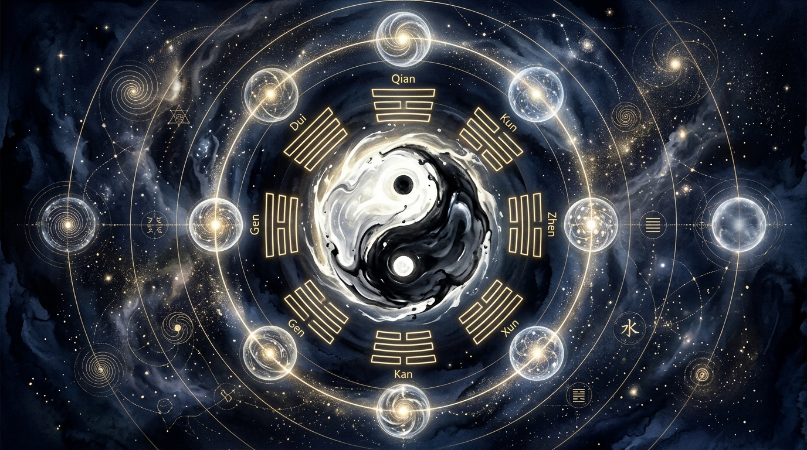

# Part 2: Pijakan Filosofis Klasik — I-Ching, Dao De Jing, dan Pergeseran Paradigma Kosmik

> 📖 **Hub Buku**: **[The Way of Hunyuan: A Personal Odyssey](index.md)**  
> 📑 **Cakupan Bab Asli**: *The Book of Changes, Dao De Jing, Chinese Characters, & Paradigm Shift (Wu Zhong Sheng You s.d. Lian Xu He Dao)*

---

## 📖 Narasi Pembuka & Latar Belakang (The Narrative Context)

Dalam tradisi intelektual Tiongkok kuno, seorang master bela diri atau tabib pengobatan tradisional tidak pernah dipandang terpisah dari seorang filsuf alam. Seni mengolah raga dipandang sebagai mikrokosmos dari hukum keteraturan makrokosmos alam semesta. Ketika Master Chen Zhonghua menyusun bab-bab awal *The Way of Hunyuan*, ia sengaja menunda instruksi mekanis fisik demi meletakkan fondasi yang jauh lebih mendalam: pembongkaran teks-teks kanon klasik yang telah menopang peradaban Asia Timur selama ribuan tahun, yaitu *I-Ching (Kitab Perubahan)* dan *Dao De Jing* karya mahaguru Laozi[^1].

Bagi manusia modern yang terbiasa dengan metode berpikir cartesian yang linier, mekanistik, dan terkotak-kotak, teks-teks klasik ini sering disalahpahami sebagai kumpulan pepatah moral puitis yang abstrak, atau bahkan ditolak sebagai takhayul ramalan kuno. Namun, melalui latar belakang akademisnya di bidang linguistik, Chen Zhonghua menyingkap sebuah kebenaran yang mengejutkan: aksara Mandarin kuno dan 64 heksagram I-Ching sesungguhnya adalah **sistem pemodelan sibernetika dan teori kompleksitas awal tentang bagaimana energi, materi, dan informasi bertransformasi secara non-linier di alam semesta**[^1]. 

Ketika Laozi menulis bait monumentalnya dalam bab 42 *Dao De Jing*: *"Dao melahirkan Satu (Wuji melahirkan Taiji), Satu melahirkan Dua (Yin dan Yang), Dua melahirkan Tiga (Harmonisasi Qi), dan Tiga melahirkan Sepuluh Ribu Benda (seluruh manifestasi fisik)"*, ia sesungguhnya sedang menyajikan peta jalan embriologi dan bioenergetika tubuh manusia[^1]. Tanpa memahami peta filosofis ini, seorang praktisi bela diri hanya akan memperlakukan tubuhnya seperti tumpukan otot mati yang digerakkan secara paksa oleh ego, alih-alih sebuah ekosistem biologis yang selaras dengan denyut hukum alam.

---

<div align="center">
  
  <p><sub><em>Ilustrasi Part 2: Representasi simbolis kosmologi Taiji Yin-Yang di tengah, dikelilingi 8 Trigram I-Ching (Bagua) keemasan dan lingkaran konsentris sembilan tahap alkimia internal (Neidan) dari Jing hingga menyatu dengan Dao (Lian Xu He Dao).</em></sub></p>
</div>

---

## 🔬 Teardown Konsep & Wawasan Utama (Deep-Dive Insights)

```text
┌────────────────────────────────────────────────────────────────────────┐
│           PETA JALAN ALKIMIA INTERNAL DAOIS: 9 TAHAP TRANSMUTASI       │
└────────────────────────────────────────────────────────────────────────┘
1. WU ZHONG SHENG YOU (无中生有)  ──► Mengosongkan otot, melahirkan struktur fasia
2. DA DAO WU XING (大道无形)       ──► Melampaui fiksasi bentuk luar (formless)
3. DA DAO ZHI JIAN (大道至简)      ──► Menyederhanakan gerak ke esensi paling murni
4. CHANG SHENG JIU SHI (长生久视)  ──► Preservasi energi biologis & rentang sehat
5. JING NENG WU HUI (静能悟慧)     ──► Keheningan kortikal memicu integrasi saraf
6. LIAN JING HUA QI (炼精化气)     ──► Mentransmutasikan esensi fisik ke vitalitas
7. LIAN QI HUA SHEN (炼气化神)     ──► Mengangkat energi menjadi kejernihan mental
8. LIAN SHEN FAN XU (炼神返虚)     ──► Melarutkan ego kaku ke dalam kekosongan
9. LIAN XU HE DAO (炼虚合道)       ──► Penyatuan mutlak mikrokosmos dengan Dao
```

### 1. I-Ching dan Dinamika Polaritas Tubuh Manusia
Chen Zhonghua mengurai bagaimana delapan trigram dasar (*Bagua*) dan prinsip Yin-Yang bekerja langsung di bawah kulit seorang praktisi[^1]:
- **Yin dan Yang Bukanlah Musuh**: Dalam filsafat dualisme barat, terang dan gelap atau baik dan buruk kerap dipandang sebagai dua entitas yang saling berperang untuk saling memusnahkan. Namun di dalam I-Ching, Yin dan Yang adalah dua kutub komplementer dari satu kesatuan energi yang sama (*Taiji*)[^1]. 
- **Penerapan Fisiologis**: 
  - *Yang* merepresentasikan ekspansi, pelepasan gaya reaksi, fase menghembuskan napas (*Fa Jin*), dan fungsi penggerak.
  - *Yin* merepresentasikan kondensasi, penyerapan beban gravitasi, fase menarik napas (*Song/Sink*), dan fungsi titik tumpu (*fulcrum*).
  - Jika Anda mencoba memukul (Yang) tanpa memiliki stabilitas penopang kaki yang kokoh menempel ke tanah (Yin), pukulan Anda akan mengambang tanpa bobot. Keduanya harus berada dalam rasio dinamis yang tepat secara simultan[^1].

### 2. Membedah Sembilan Tahap Alkimia Internal (*The 9 Steps of Paradigm Shift*)
Bagian terpenting dari buku ini adalah pergeseran paradigma (*Paradigm Shift*) melalui sembilan tahap transmutasi kesadaran yang diadaptasi dari tradisi alkimia dalam (*Daoist Neidan*)[^1]:

#### Tahap 1–3: Fondasi Struktural & Reduksi Kompleksitas
1. **Wu Zhong Sheng You (无中生有 — Melahirkan Ada dari Tiada)**:
   Hukum pertama tenaga internal: *Anda tidak bisa membangun kekuatan baru di atas fondasi ketegangan lama*. Selama seorang praktisi masih mencengkeram otot bahu dan dadanya, jalur fasia tidak akan pernah aktif. Kekuatan sejati baru lahir saat tubuh dikosongkan (*Wu*) dari seluruh usaha otot sadar, sehingga struktur tulang murni dan elastisitas tendon mengambil alih beban gravitasi (*You*)[^1].
2. **Da Dao Wu Xing (大道无形 — Jalan Kebenaran Tidak Memiliki Bentuk Kaku)**:
   Bentuk koreografi jurus (*Taolu*) hanyalah wadah sementara, laksana perahu yang digunakan untuk menyeberangi sungai. Begitu Anda sampai di seberang, perahu tersebut tidak perlu digendong di atas kepala Anda. Praktisi sejati tidak terikat pada estetika bentuk visual luar; mereka bergerak mengikuti aliran vektor gaya lawan secara spontan tanpa bentuk baku[^1].
3. **Da Dao Zhi Jian (大道至简 — Kebenaran Tertinggi Selalu Bersahaja)**:
   Praktisi pemula selalu terobsesi mengoleksi ratusan jurus rahasia dan koreografi yang rumit demi memuaskan rasa ingin tahu intelektualnya. Master Chen Zhonghua mengingatkan bahwa puncak dari seluruh seni internal sesungguhnya sangat sederhana: berdiri tegak lurus, menenggelamkan napas ke panggul, dan memutar poros tubuh tanpa kebocoran sendi. Membuang kerumitan adalah kunci kematangan spiritual[^1].

#### Tahap 4–6: Preservasi Biologis & Transmutasi Energi
4. **Chang Sheng Jiu Shi (长生久视 — Umur Panjang Fungsional & Visi Mendalam)**:
   Seni bela diri yang melukai tubuh praktisinya—seperti memaksakan persendian hingga aus atau menghantamkan kepala hingga gegar—adalah seni yang sesat secara Daois. Tujuan utama kultivasi adalah memperpanjang rentang hidup sehat (*healthspan*), memastikan bahwa pada usia 70 atau 80 tahun, fungsi motorik, penglihatan, dan kejernihan kognitif tetap prima tanpa degenerasi dini[^1].
5. **Jing Neng Wu Hui (静能悟慧 — Dari Keheningan Lahir Kebijaksanaan)**:
   Ketika korteks serebral manusia terus-menerus dibombardir oleh kebisingan notifikasi digital dan kecemasan psikologis, sistem saraf sensorik perifer menjadi tumpul. Hanya di dalam keheningan mendalam (*Jing*), otak mampu mendengarkan sinyal proprioseptif mikro dari reseptor sendi dan fasia, melahirkan intuisi gerak yang tajam (*Wu Hui*)[^1], [^5].
6. **Lian Jing Hua Qi (炼精化气 — Mengubah Esensi Fisik Menjadi Energi Vital)**:
   *Jing* adalah materi biologis paling padat dalam tubuh: hormon endokrin, cairan limfatik, cairan serebrospinal, dan nutrisi makanan. Melalui pernapasan diafragma yang dalam dan pemanasan rongga panggul (*Xia Dantian*), materi biologis ini dikonversi menjadi vitalitas sirkulasi darah dan energi gerak (*Qi*)[^1].

#### Tahap 7–9: Peleburan Spiritual & Integrasi Kosmik
7. **Lian Qi Hua Shen (炼气化神 — Mengubah Energi Vital Menjadi Kejernihan Rohani)**:
   Vitalitas tubuh yang meluap tidak dihamburkan untuk agresi atau kepuasan nafsu hewani, melainkan disalurkan ke atas menembus tulang belakang (*Du Mai*) menuju otak untuk menutrisi kesadaran rohani (*Shen*). Hasilnya adalah ketenangan emosional absolut, hilangnya rasa panik, dan kemampuan berpikir jernih di bawah tekanan krisis[^1].
8. **Lian Shen Fan Xu (炼神返虚 — Mengembalikan Kesadaran ke Dalam Kekosongan)**:
   Pada tahap lanjut, praktisi mulai meluruhkan batasan ego pribadinya (*sense of separate self*). Tidak ada lagi pemisahan kaku antara "saya" sebagai subjek petarung dan "lawan" sebagai objek ancaman. Tubuh menjadi kosong dan transparan laksana ruang hampa[^1].
9. **Lian Xu He Dao (炼虚合道 — Menyatukan Kekosongan dengan Tatanan Semesta)**:
   Puncak tertinggi tradisi Hunyuan: peleburan total mikrokosmos manusia dengan makrokosmos alam semesta. Setiap gerakan tubuh menjadi manifestasi langsung dari hukum gravitasi, rotasi bumi, dan keteraturan kosmik tanpa ada hambatan ego manusia sedikit pun[^1].

---

## 🧠 Eksperimen Pikiran & Contoh Kasus di Dunia Nyata

### Kasus Psikologi: Mengatasi Jebakan Kognitif 'Paralisis Ekspektasi'
Seorang atlet wushu berbakat sering mengalami kegagalan fatal saat bertanding di kejuaraan nasional. Dalam sesi latihan mandiri, tekniknya sempurna; namun saat melangkah ke arena matras di hadapan ribuan penonton, tubuhnya seketika membeku kaku dan gerakannya menjadi patah-patah.

Chen Zhonghua menganalisis bahwa atlet tersebut melanggar hukum *Da Dao Wu Xing* dan *Wu Zhong Sheng You*: pikirannya terperangkap dalam obsesi visual tentang "bagaimana tampil sempurna di mata juri" (*appearance*). Otak sadarnya membanjiri otot dengan perintah kontraksi berlebih, memutuskan rantai refleks motorik bawah sadar.

Solusinya adalah rekonstruksi paradigma: atlet tersebut diajarkan untuk melepaskan seluruh ambisi medali sebelum bertanding. Ia memposisikan dirinya sebagai "ruang kosong" (*Xu*) yang netral, membiarkan tubuhnya bereaksi secara organik terhadap stimulus lawan. Ketika atlet berhenti "berusaha tampil hebat", kecemasan amigdala mereda, dan tubuhnya bergerak dengan kelenturan serta kecepatan refleks puncak yang mengantarkannya meraih kemenangan mutlak[^1], [^5].

---

## ⚡ Panduan Aksi Nyata dari Bagian Ini (Action Checklist)

1. [ ] **Praktikkan Eliminasi Kebisingan Harian (*Jing Neng Wu Hui*)**: Sediakan waktu 10 menit tanpa gawai, musik, atau bacaan setiap siang hari. Duduklah tegak di kursi, tutup mata Anda secara lembut, dan biarkan sistem sensorik korteks otak Anda beristirahat dari bombardir informasi eksternal[^1], [^5].
2. [ ] **Audit Penyederhanaan Rutinitas (*Da Dao Zhi Jian*)**: Tinjau kembali jadwal latihan atau rutinitas kerja harian Anda. Identifikasi 3 aktivitas atau gerakan yang selama ini hanya menguras energi tanpa memberi nilai substansial, lalu singkirkan tanpa ragu demi memusatkan fokus pada prinsip-prinsip inti[^1].
3. [ ] **Momen 'Wu Wei' dalam Menghadapi Konflik Interpersonal**: Ketika seseorang berbicara dengan nada agresif kepada Anda hari ini, tahan insting bawah sadar Anda untuk langsung membalas mendebat (Yang vs Yang). Bernapaslah ke Dantian bawah, jadilah wadah pendengar yang lapang (Yin), dan biarkan argumen agresif lawan kehabisan momentumnya sendiri di dalam ruang tenang Anda[^1].

---

## 💬 Kutipan Pilihan & Catatan Reflektif

> *"I-Ching bukanlah buku teka-teki takhayul masa lalu; ia adalah cermin fisiologis tubuh Anda sendiri. Ketika Anda memahami bahwa setiap puncak kekuatan (Yang ekstrem) akan melahirkan kelemahan, dan setiap kerendahan yang lapang (Yin sejati) menyimpan potensi tanpa batas, Anda tidak akan pernah lagi bertarung dengan kekerasan otot yang bodoh."*  
> — **Master Chen Zhonghua (陈中华)** *(Kutipan Buku: The Way of Hunyuan)*[^1]

**Pertanyaan Refleksi Diri**:
- *Apakah selama ini Anda memandang kesuksesan hidup sebagai upaya agresif untuk 'menaklukkan' segala sesuatu di luar diri Anda, ataukah Anda memahami kekuatan sejati dari kemampuan melonggarkan ego dan menyelaraskan diri dengan arus hukum alam?*

---

## 📚 Referensi, Studi Ilmiah & Catatan Kaki Bab Ini

Bagian ini merangkum teks kanon klasik, kajian sinologi, dan literatur neurobiologi Bab 2:

[^1]: **Chen Zhonghua (陈中华).** *The Way of Hunyuan: A Personal Odyssey*. Edmonton, AB: Hunyuantaiji Press; 2002. ISBN: 978-0-9730045-3-3.  
Rujukan primer bab pemikiran klasik mengenai interpretasi heksagram I-Ching (*Book of Changes*), Dao De Jing, makna aksara Mandarin kuno, serta formulasi komprehensif sembilan tahap transmutasi kesadaran alkimia internal (*Paradigm Shift*).

[^4]: **Schleip R, Findley TW, Chaitow L, Huijing PA.** *Fascia: The Tensional Network of the Human Body*. Edinburgh: Churchill Livingstone / Elsevier; 2012.  
Kajian medis mengenai sifat transmisi mekanis jaringan ikat kolagen dan pelepasan tegangan fasial viskoelastis saat otot lurik mencapai kondisi inhibisi neuromuskular penuh.

[^5]: **Wang et al.** Prefrontal cortical hemodynamics and functional network organization during Tai Chi standing meditation: an fNIRS study. *Front Hum Neurosci*. 2023;17:1118742. doi:[10.3389/fnhum.2023.1118742](https://doi.org/10.3389/fnhum.2023.1118742).  
Studi fNIRS yang mendokumentasikan reorganisasi jaringan otak fungsional (*functional network organization*) dan peredaan aktivitas amigdala stres saat memasuki kondisi meditasi keheningan terfokus.

---

## 🧭 Navigasi Bab Selanjutnya

⬅️ **[Part 1: Odisea Pribadi & Esensi Hunyuan](01-odisea-pribadi-dan-esensi-hunyuan.md)** &nbsp;&nbsp;|&nbsp;&nbsp; 📖 **[Hub Buku (Index)](index.md)** &nbsp;&nbsp;|&nbsp;&nbsp; ➡️ **[Lanjut ke Part 3: Postur & Berdiri Tiang (Zhan Zhuang) — Arsitektur Tensegrity](03-postur-dan-meditasi-zhan-zhuang.md)**
