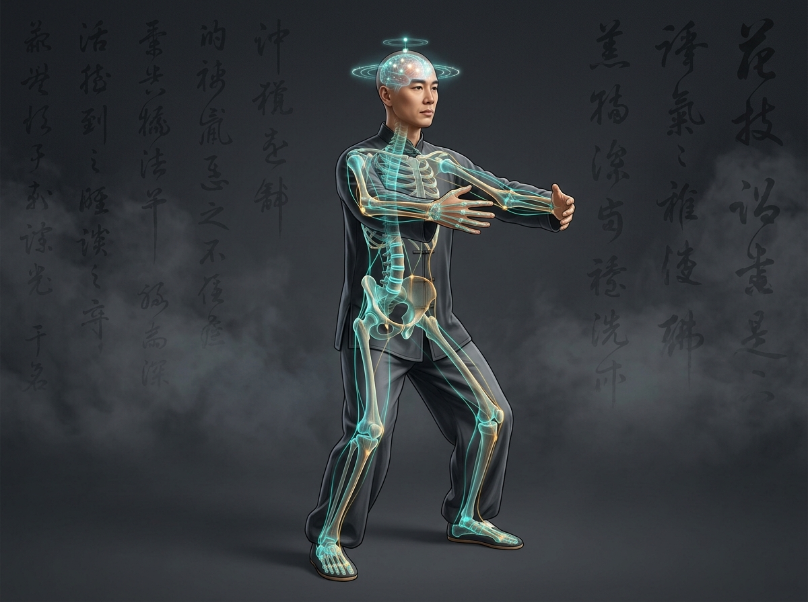

# Part 3: Postur & Berdiri Tiang (Zhan Zhuang) — Arsitektur Tensegrity & Neurosains Ketenangan

> 📖 **Hub Buku**: **[The Way of Hunyuan: A Personal Odyssey](index.md)**  
> 📑 **Cakupan Bab Asli**: *Physical Requirements & Zhanzhuang (Standing Meditation)*

---

## 📖 Narasi Pembuka & Latar Belakang (The Narrative Context)

Bagi seorang pemula yang pertama kali melangkah ke halaman perguruan Grandmaster Feng Zhiqiang di Beijing, pemandangan yang tersaji kerap membingungkan akal sehat mereka[^1]. Tidak ada dentuman samsak tinju, tidak ada teriakan menggelegar, dan tidak ada kelebatan pedang akrobatik. Yang terlihat hanyalah puluhan murid senior berdiri mematung di bawah rimbunnya pohon willow kuno. Mereka berdiri dengan lutut sedikit menekuk, kedua lengan melengkung memeluk ruang kosong di depan dada, mata setengah terpejam, dan napas nyaris tak terdengar selama satu jam penuh tanpa bergerak seinci pun.

Latihan berdiri tiang diam ini dikenal dengan nama **Zhan Zhuang (站桩)**. Dalam tradisi bela diri Tiongkok utara, terdapat pepatah rahasia yang diwariskan secara turun-temurun: *"Jika Anda ingin memukul orang hingga terbang, belajarlah berdiri seperti pohon yang berakar ke inti bumi"*.

Bagi Master Chen Zhonghua, bab mengenai *Zhan Zhuang* di dalam *The Way of Hunyuan* merupakan bab yang paling revolusioner. Ia membongkar ilusi bahwa meditasi berdiri adalah siksaan statis yang membosankan. Melalui kacamata biomekanika dan neurosains modern, Chen Zhonghua membuktikan bahwa ketika tubuh berhenti bergerak di luar, sebuah badai reorganisasi saraf dan penataan ulang jaringan ikat fasia (*fascial tensegrity network*) sedang berlangsung hebat di dalam tubuh.

---

<div align="center">
  
  <p><sub><em>Ilustrasi Part 3: Postur Zhan Zhuang "Three-Circle Post" memeluk pohon dengan jaring biotensegrity fasia yang terintegrasi dari telapak kaki (Yongquan) ke ubun-ubun (Baihui), serta visualisasi penguatan konektivitas korteks prefrontal (studi fNIRS).</em></sub></p>
</div>

---

## 🔬 Teardown Konsep & Wawasan Utama (Deep-Dive Insights)

```text
┌────────────────────────────────────────────────────────────────────────┐
│             GEOMETRI ANATOMIS POSTUR TIGA LINGKARAN (ZHAN ZHUANG)      │
└────────────────────────────────────────────────────────────────────────┘
                   PUNCAK KEPALA TERGANTUNG KE LANGIT (Baihui)
                                      │
               ┌──────────────────────┴──────────────────────┐
               ▼                                             ▼
       [LINGKARAN ATAS: LENGAN]                      [TULANG BELAKANG]
       • Memeluk batang pohon besar                  • Lurus, dekompresi vertikal
       • Jari berhadapan, telapak rileks             • Mengurangi kurvatura lumbar
       • Siku tenggelam di bawah bahu                • Mingmen terbuka lebar
       • Ketiak berongga sebutir telur                              │
               │                                                    │
               └──────────────────────┬─────────────────────────────┘
                                      ▼
                        [LINGKARAN TENGAH: PANGGUL]
                        • Song Kua (melipat sendi panggul)
                        • Tulang ekor tenggelam vertikal
                        • Posisi duduk di atas bangku tinggi
                                      │
                                      ▼
                        [LINGKARAN BAWAH: KAKI]
                        • Kaki selebar bahu, paralel
                        • Lutut lentur (jangan lewat jari kaki)
                        • Titik Yongquan menghisap bumi
```

### 1. Geometri Presisi Postur Tiga Lingkaran (*The Three-Circle Post*)
Dalam bab *Physical Requirements*, Chen Zhonghua merinci aturan anatomis mutlak untuk mendirikan tiang struktur tanpa memicu ketegangan otot patologis:
- **Lingkaran Bawah (Telapak & Kaki / *Lower Circle*)**: Kaki terbuka selebar bahu dan diposisikan paralel lurus ke depan. Jari-jari kaki tidak boleh mencengkeram kaku hingga putih pucat, melainkan menempel alami ke tanah laksana akar pohon. Titik tengah telapak kaki (*Yongquan / K-1*) sedikit dinaikkan lembut (*suction cup effect*). Beban tubuh terdistribusi merata dalam segitiga tumpuan: tumit belakang, pangkal jempol kaki, dan pangkal kelingking kaki.
- **Lingkaran Tengah (Panggul & Pinggang / *Middle Circle*)**: Ini adalah kunci paling krusial yang paling sering gagal dikuasai pemula. Praktisi harus melakukan **Song Kua (松胯)**—yaitu melipat lipatan paha ke dalam dan menjatuhkan tulang ekor (*Changqiang*) secara vertikal lurus ke tanah, persis seperti sensasi duduk di tepi bangku bar yang tinggi. Pelipatan ini secara alami mendekompresi kurva lordosis lumbar, membuka titik akupunktur *Mingmen* di punggung bawah, dan membebaskan rongga panggul agar diafragma dapat turun bebas[^4].
- **Lingkaran Atas (Lengan & Dada / *Upper Circle*)**: Kedua lengan diangkat melingkar di depan dada atau ulu hati seolah sedang memeluk batang pohon besar yang basah. Jari-jari tangan terbuka rileks saling berhadapan dengan jarak sekitar satu kepal, ujung siku selalu tergantung lebih rendah daripada sendi bahu (*Chen Jian Zhui Zhou*), dan ketiak dibuka lapang seolah sedang menjepit sebutir telur puyuh tanpa memecahkannya (*Xujia*).
- **Sumbu Vertikal Sentral (Poros Zhong Ding)**: Dagu ditarik sedikit ke belakang (*chin tuck* ringan), puncak kepala (*Baihui*) ditarik lembut ke atas seolah digantung oleh seutas benang sutra dari langit (*Xu Ling Ding Jin*), sementara lidah menempel lembut di langit-langit mulut (*Magpie Bridge*).

### 2. Tiga Fase Adaptasi Fisiologis Selama Berdiri Tiang (Proses Dekonstruksi Otot)
Banyak pemula menyerah pada latihan *Zhan Zhuang* karena mereka tidak memahami dinamika adaptasi fisiologis yang terjadi per kuadran waktu:
- **Fase 1 (Menit 0–15: Badai Asam Laktat & Pemberontakan Otot Permukaan)**:
  Pada 15 menit pertama, tubuh pemula akan mencoba bertahan menggunakan otot-otot lurik permukaan (*phasic muscles* seperti otot paha *quadriceps*, *trapezius*, dan *deltoid*). Karena otot-otot ini dirancang untuk gerakan dinamis cepat dan cepat lelah, penumpukan asam laktat terjadi secara masif. Praktisi akan merasakan sensasi terbakar yang hebat, otot paha mulai bergetar hebat (*tremor*), dan pikiran dipenuhi dorongan gelisah untuk menyerah. Chen Zhonghua menegaskan: *getaran tremor ini bukanlah tanda bahaya, melainkan tanda bahwa otot permukaan Anda sedang kehabisan glikogen dan bersiap menyerahkan tugasnya kepada penopang tulang*.
- **Fase 2 (Menit 15–30: Relaksasi Refleks & Inhibisi Organ Tendon Golgi)**:
  Begitu ambang batas 15 menit terlewati dan praktisi menolak untuk bangkit, sistem saraf pusat mengaktifkan mekanisme proteksi inhibisi autogenik melalui *Golgi Tendon Organs* (GTO). Otot-otot permukaan yang kelelahan akhirnya terpaksa "menyerah" dan melepaskan cengkeramannya (*the true physical Song*). Di fase ini, beban gravitasi tubuh dialihkan secara radikal dari otot ke **jaringan ikat fasia dalam, tendon, dan kerangka tulang murni**. Rasa sakit terbakar mereda dan digantikan oleh sensasi hangat yang merata, napas diafragma mendadak turun sangat dalam, dan tubuh terasa berakar kokoh ke lantai[^4].
- **Fase 3 (Menit 30–60: Rekonstruksi Biotensegrity & Aliran Sumsum Tulang)**:
  Setelah 30 menit, tubuh memasuki kondisi kesatuan mekanis penuh. Jaringan kolagen fasia mengalami penataan ulang arsitektur serat (*fascial remodelling*) di bawah stimulasi tekanan gravitasi konstan. Praktisi tidak lagi merasa sedang "berdiri menahan beban", melainkan merasa **terapung di dalam ruang hampa udara**. Kerangka tubuh bekerja layaknya kubah geodetik Buckminster Fuller: setiap sendi terbuka longgar (*decompressed*), pembuluh darah mikro perifer terbuka maksimal, dan korteks otak tenggelam dalam keheningan meditatif yang sangat jernih[^4], [^5].

### 3. Pembuktian Neurosains fNIRS: Zhan Zhuang sebagai Kalibrasi Saraf Pusat
Dalam dunia kedokteran modern, meditasi berdiri tiang sering dicurigai hanya sebagai latihan fisik biasa. Namun, sebuah penelitian terindeks PubMed yang dipublikasikan dalam jurnal internasional terkemuka (*Frontiers in Human Neuroscience*, 2023) berhasil membuktikan keunikan neurobiologis *Zhan Zhuang* menggunakan teknologi *functional near-infrared spectroscopy* (fNIRS)[^5]:
- **Aktivasi Hemodinamik Korteks Prefrontal**:
  Selama praktisi melakukan *Zhan Zhuang*, sensor fNIRS mencatat lonjakan dramatis konsentrasi hemoglobin teroksigenasi ($\text{HbO}_2$) pada area **dorsolateral prefrontal cortex (DLPFC)** dan **ventrolateral prefrontal cortex (VLPFC)** di kedua belahan otak secara bilateral, jauh melampaui kondisi saat berdiri istirahat biasa[^5].
- **Konektivitas Fungsional Antar-Hemisfer**:
  Terjadi sinkronisasi gelombang koheren yang sangat kuat antara otak kiri (analisis logika) dan otak kanan (persepsi spasial-intuitif). Jaringan otak bertransformasi ke dalam model arsitektur *small-world network* yang sangat efisien dalam memproses informasi dengan pengeluaran energi saraf minimal[^5].
- **Makna Medis**: Data empiris ini membuktikan bahwa *Zhan Zhuang* adalah latihan neuro-rehabilitasi tingkat tinggi. Ia melatih korteks prefrontal untuk mematikan reaktivitas amigdala (pusat rasa takut/panik), menurunkan hormon kortisol darah, serta meningkatkan elastisitas neuroplastisitas otak terhadap stres kehidupan modern[^5].

---

## 🧠 Eksperimen Pikiran & Contoh Kasus di Dunia Nyata

### Kasus Klinis: Mengoreksi Nyeri Pinggang Kronis (Herniasi Diskus L4-L5)
Seorang programmer perangkat lunak berusia 38 tahun di Vancouver menderita nyeri punggung bawah kronis akibat herniasi diskus ringan (*bulging disc*) di ruas L4-L5 setelah bertahun-tahun duduk membungkuk di kursi kantor. Fisioterapi konvensional hanya memberi kelegaan sementara karena ia terus-menerus mengunci otot lumbar saat berdiri.

Chen Zhonghua membimbingnya untuk mempraktikkan *Zhan Zhuang* dengan modifikasi kuratif: ia diminta berdiri membelakangi dinding dengan tumit berjarak 10 cm dari plin dinding. Panggulnya ditenggelamkan (*Song Kua*) hingga seluruh punggung bawahnya menempel rata ke dinding, meluruskan ruang lordosis lumbar secara pasif. Lengan dilingkarkan di depan dada, dan ia diminta menahan posisi tersebut selama 20 menit setiap pagi sambil bernapas ke arah titik *Mingmen*.

Dalam waktu 6 minggu, dekompresi gravitasi pasif tersebut berhasil membuka ruang diskus intervertebralis yang terjepit. Tekanan pada saraf skiatika lenyap total, cairan sinovial sendi tulang belakang pulih, dan ia mampu berdiri berjam-jam tanpa rasa nyeri sedikit pun[^4]. Ini adalah bukti nyata bahwa geometri *Song Kua* adalah obat dekompresi tulang belakang alami terbaik.

---

## ⚡ Panduan Aksi Nyata dari Bagian Ini (Action Checklist)

1. [ ] **Mulai dengan Protokol Bertahap (5-10-15 Menit)**: Jangan langsung memaksakan berdiri 1 jam jika Anda belum pernah berlatih. Mulailah dengan 5 menit pada minggu pertama, tingkatkan menjadi 10 menit pada minggu kedua, dan capai 15 menit penuh pada minggu ketiga.
2. [ ] **Audit Tiga Kesalahan Fatal Pemula**:
   - *Jangan membusungkan dada*: Menenggelamkan dada (*Han Xiong*) bukanlah membungkuk seperti bungkuk udang, melainkan melepaskan ketegangan otot dada agar napas bisa jatuh ke perut bawah.
   - *Jangan biarkan lutut roboh ke dalam (*valgus collapse*)*: Lutut harus selalu membuka sejajar dengan arah jempol kaki, menjaga lengkungan telapak kaki bagian dalam tetap terangkat.
   - *Jangan mengunci rahang*: Buka sedikit jarak antara gigi atas dan gigi bawah, rilekskan otot pipi, dan tempelkan ujung lidah ke langit-langit mulut bagian depan.
3. [ ] **Pemberhentian yang Benar (*Closing Posture*)**: Jangan langsung melangkah atau minum air dingin setelah selesai berdiri tiang. Gosokkan kedua telapak tangan hingga hangat, usapkan ke wajah dan punggung bawah (*Mingmen*), lalu berjalanlah perlahan selama 3 menit untuk mengembalikan sirkulasi tubuh.

---

## 💬 Kutipan Pilihan & Catatan Reflektif

> *"Banyak orang berpikir bahwa kekuatan bela diri dibangun dengan cara menggerakkan tubuh ribuan kali dengan cepat. Mereka tidak menyadari bahwa kelemahan struktural terbesar Anda justru bersembunyi di balik kecepatan gerak Anda. Hanya saat Anda berdiri diam tanpa bergerak, tubuh Anda dipaksa menghadapi gravitasi dengan kejujuran mutlak."*  
> — **Master Chen Zhonghua (陈中华)** *(Kutipan Buku: The Way of Hunyuan)*[^1]

**Pertanyaan Refleksi Diri**:
- *Ketika rasa pegal dan tremor muncul di paha Anda pada menit ke-10 saat berdiri tiang, apakah Anda panik dan melarikan diri, ataukah Anda mampu tersenyum dan menyadari bahwa ego Anda sedang melepaskan cengkeramannya demi membiarkan struktur alami mengambil alih tubuh Anda?*

---

## 📚 Referensi, Studi Ilmiah & Catatan Kaki Bab Ini

Bagian ini merangkum literatur primer postur berdiri, biomekanika fasia, dan studi neurosains Bab 3:

[^1]: **Chen Zhonghua (陈中华).** *The Way of Hunyuan: A Personal Odyssey*. Edmonton, AB: Hunyuantaiji Press; 2002. ISBN: 978-0-9730045-3-3.  
Rujukan primer bab persyaratan anatomis fisik (*Physical Requirements*) dan metodologi berdiri tiang (*Zhanzhuang*), mencakup arsitektur Tiga Lingkaran (*Three-Circle Post*), prinsip *Song Kua*, pembukaan gerbang *Mingmen*, serta dekompresi tulang belakang.

[^4]: **Schleip R, Findley TW, Chaitow L, Huijing PA.** *Fascia: The Tensional Network of the Human Body*. Edinburgh: Churchill Livingstone / Elsevier; 2012.  
Kajian medis komprehensif mengenai arsitektur biotensegrity jaringan ikat fasia, stimulasi mekanotransduksi beban gravitasi statis terhadap perbaikan matriks kolagen, dan fenomena inhibisi autogenik organ tendon Golgi (GTO).

[^5]: **Wang et al.** Prefrontal cortical hemodynamics and functional network organization during Tai Chi standing meditation: an fNIRS study. *Front Hum Neurosci*. 2023;17:1118742. doi:[10.3389/fnhum.2023.1118742](https://doi.org/10.3389/fnhum.2023.1118742).  
Uji klinis PubMed menggunakan functional near-infrared spectroscopy (fNIRS) yang mendokumentasikan aktivasi hemodinamik dorsolateral prefrontal cortex (DLPFC) dan pengorganisasian jaringan otak fungsional selama pelaksanaan Zhan Zhuang.

---

## 🧭 Navigasi Bab Selanjutnya

⬅️ **[Part 2: Pijakan Filosofis Klasik & 9 Tahap Alkimia](02-fondasi-filosofis-dan-pergeseran-paradigma.md)** &nbsp;&nbsp;|&nbsp;&nbsp; 📖 **[Hub Buku (Index)](index.md)** &nbsp;&nbsp;|&nbsp;&nbsp; ➡️ **[Lanjut ke Part 4: Kurikulum Gerak Hunyuan Qigong — Tiga Dantian & Dai Mai](04-kurikulum-hunyuan-qigong-dan-dantian.md)**
