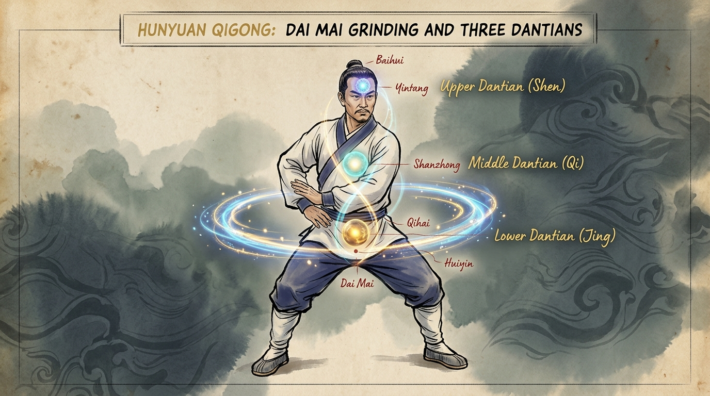

# Part 4: Kurikulum Gerak Hunyuan Qigong — Tiga Dantian, Belt Meridian, dan Langit-Bumi

> 📖 **Hub Buku**: **[The Way of Hunyuan: A Personal Odyssey](index.md)**  
> 📑 **Cakupan Bab Asli**: *Hunyuan Qigong, Gather the Qi to Three Dantian, Three-Dantian Open & Close, Belt Meridian Grinding (Dai Mai), & Heaven and Earth Open/Close*

---

## 📖 Narasi Pembuka & Latar Belakang (The Narrative Context)

Setelah seorang praktisi berhasil menata arsitektur diamnya melalui *Zhan Zhuang*, tahap berikutnya dalam kurikulum Grandmaster Feng Zhiqiang adalah melatih tubuh agar mampu bergerak dinamis tanpa kehilangan kesatuan struktural tersebut. Di sinilah **Sistem Latihan Gerak Hunyuan Qigong (*Hunyuan Dynamic Qigong*)** mulai diajarkan[^1].

Berbeda dari senam peregangan barat yang mengisolasi otot tertentu (seperti latihan *bicep curls* atau peregangan paha terpisah), gerakan-gerakan di dalam Hunyuan Qigong selalu melibatkan koordinasi seluruh rantai tubuh secara bersamaan. Di dalam buku *The Way of Hunyuan*, Master Chen Zhonghua membedah empat pilar latihan dinamis paling fundamental yang menjadi inti kultivasi energi vital: menghimpun energi ke Tiga Dantian, membuka-menutup Tiga Dantian, memutar meridian sabuk panggul (*Belt Meridian / Dai Mai*), dan menyelaraskan keterbukaan Langit dan Bumi.

Keempat latihan ini dirancang bukan sekadar untuk melancarkan peredaran darah, melainkan untuk membangun sebuah **pompa hidrolik internal (*internal hydraulic pump*)**: mengintegrasikan tekanan rongga perut (*Intra-Abdominal Pressure*), elastisitas diafragma, dan rotasi sendi panggul menjadi satu aliran tenaga yang melingkar tak berujung.

---

<div align="center">
  
  <p><sub><em>Ilustrasi Part 4: Eksekusi Belt Meridian Grinding (Dai Mai) dengan orbit horizontal mengelilingi pinggang dan panggul, serta keselarasan vertikal Tiga Dantian (Atas: Shen, Tengah: Qi, dan Bawah: Jing).</em></sub></p>
</div>

---

## 🔬 Teardown Konsep & Wawasan Utama (Deep-Dive Insights)

```text
┌────────────────────────────────────────────────────────────────────────┐
│             ARSITEKTUR ENERGETIK & ANATOMIS TIGA DANTIAN               │
└────────────────────────────────────────────────────────────────────────┘
          [SHANG DANTIAN / DANTIAN ATAS] (Area Yintang / Kelenjar Pineal)
          • Pusat Rohaniah & Kognisi (Shen / 神)
          • Fokus: Kejernihan mental, persepsi visual & propriosepsi
                                   │
                                   ▼
          [ZHONG DANTIAN / DANTIAN TENGAH] (Area Ulu Hati / Shanzhong)
          • Pusat Respirasi & Emosi (Qi / 气)
          • Fokus: Ekspansi kardiopulmonal, ritme napas diafragma
                                   │
                                   ▼
          [XIA DANTIAN / DANTIAN BAWAH] (Rongga Panggul / Qihai - Mingmen)
          • Pusat Esensi Biologis & Gravitasi (Jing / 精)
          • Fokus: Pompa hidrolik IAP, penyimpanan vitalitas biologis
                                   │
                 ┌─────────────────┴─────────────────┐
                 ▼                                   ▼
       [MERIDIAN SABUK (DAI MAI)]          [AKAR BUMI (YONGQUAN)]
       • Satu-satunya meridian horizontal  • Tumpuan gravitasi telapak kaki
       • Mengunci & memutar panggul        • Menyalurkan reaksi tanah
```

### 1. Menghimpun Qi ke Tiga Dantian (*Gather the Qi to the Three Dantian*)
- **Tiga Medan Resonansi Tubuh**:
  - **Dantian Bawah (*Xia Dantian*)**: Terletak di dalam rongga panggul bagian bawah (sekitar tiga jari di bawah pusar dan masuk ke kedalaman rongga panggul, di antara titik *Qihai* di depan dan *Mingmen* di belakang). Merupakan pusat penyimpanan esensi fisik (*Jing*), pusat gravitasi massa tubuh (*Center of Mass*), dan fondasi pembentukan tekanan intra-abdominal (IAP).
  - **Dantian Tengah (*Zhong Dantian*)**: Terletak di tengah rongga dada setinggi puting susu (area titik akupunktur *Shanzhong* / pleksus jantung). Merupakan pusat pengolahan energi respirasi (*Qi*) dan regulasi sistem sirkulasi kardiopulmonal serta emosi interpersonal.
  - **Dantian Atas (*Shang Dantian*)**: Terletak di dalam rongga tengkorak di antara kedua alis (area titik *Yintang*, berdekatan dengan kelenjar pineal dan pituitari). Merupakan pusat kesadaran kognitif tingkat tinggi, persepsi intensional (*Yi*), dan roh spiritual (*Shen*).
- **Langkah Teknis Eksekusi (Step-by-Step Cueing)**:
  1. *Posisi Awal*: Berdiri dalam postur dasar Hunyuan, kaki selebar bahu, panggul rileks menenggelamkan tulang ekor.
  2. *Gerakan Mengembang*: Kedua tangan diangkat perlahan ke samping luar tubuh setinggi bahu dengan telapak tangan menghadap ke atas, membuka rongga dada secara alami saat menarik napas dalam dan halus.
  3. *Pengumpulan & Penurunan*: Telapak tangan ditekuk melingkar ke arah atas kepala, lalu diturunkan perlahan di sepanjang garis tengah tubuh (*Chong Mai / Sumbu Sentral*).
  4. *Fokus Atensi*: Saat telapak tangan melewati Dantian Atas, bayangkan kejernihan pikiran menenangkan otak; saat melewati Dantian Tengah, rasakan kelapangan dada melepaskan stres emosi; dan saat tangan berlabuh di Dantian Bawah, rasakan seluruh kehangatan energi memadat di dasar panggul.

### 2. Membuka dan Menutup Tiga Dantian (*Three-Dantian Open and Close*)
- **Hukum Denyut Kosmik: Kai (Buka) & He (Tutup)**:
  Di dalam sains Daois, tidak ada materi yang statis; seluruh kehidupan bernapas melalui ritme denyut. Latihan *Kai He* melatih seluruh jaringan tubuh untuk bertindak sebagai satu kesatuan sel raksasa:
  - **Fase Kai (Membuka / Ekspansi)**: Kedua tangan diletakkan di depan masing-masing Dantian (secara bergiliran atau serentak), lalu dibuka perlahan ke samping luar. Bersamaan dengan itu, praktisi merasakan seluruh persendian (jari, pergelangan, siku, bahu, panggul, lutut) meregang terbuka secara mikroskopis (*whole-body fascial expansion*)[^4].
  - **Fase He (Menutup / Kondensasi)**: Kedua tangan ditutup kembali mendekati garis tengah tubuh tanpa bersentuhan. Praktisi merasakan seluruh energi dan tegangan fasia memadat kembali ke sumbu inti tulang belakang (*condensation*)[^4].
- **Manfaat Klinis**: Latihan ini merangsang mikrosirkulasi limfatik di seluruh tubuh. Jaringan fasia yang mengalami siklus regangan-relaksasi ritmis (*viscoelastic pumping*) membuang sisa metabolit seluler dan mempercepat hidrasi cairan sinovial sendi[^4].

### 3. Menggiling Meridian Sabuk Panggul (*Belt Meridian Grinding / Dai Mai*)
- **Anatomi Unik Meridian Dai Mai**:
  Di antara 14 jalur meridian akupunktur utama di tubuh manusia (12 meridian organ + Ren Mai dan Du Mai), 13 di antaranya mengalir secara vertikal lurus ke atas atau ke bawah. Hanya ada **satu-satunya meridian yang melingkar secara horizontal melintang di pinggang**: yaitu **Dai Mai (Meridian Sabuk)**.
  - Dai Mai bertindak laksana tali pengikat yang mengikat seluruh meridian vertikal agar tidak tercerai-berai.
  - Jika Dai Mai lemah atau kaku, seorang praktisi akan mengalami "pemutusan komunikasi" antara tubuh bagian atas dan tubuh bagian bawah: kaki terasa berat namun kepala terasa tegang dan pusing.
- **Mekanika Gilingan (Grinding Step-by-Step)**:
  1. Letakkan kedua telapak tangan di sisi pinggang kiri.
  2. Gerakkan kedua tangan melingkari pinggang ke arah depan pusar, lalu menyusuri pinggang kanan, memutar ke punggung belakang melewati titik *Mingmen*, dan kembali ke sisi kiri dalam satu lintasan elips horizontal sempurna.
  3. **Koreksi Kunci**: Gerakan ini digerakkan oleh **rotasi sendi panggul (*Kua*)**, bukan oleh liukan tulang belakang lumbar. Bayangkan pinggang Anda sedang memutar batu gilingan kedelai tradisional di pabrik tahu kuno.
  4. Lakukan 36 putaran searah jarum jam, lalu balikkan 36 putaran berlawanan arah jarum jam.

### 4. Buka-Tutup Langit dan Bumi (*Heaven and Earth Open and Close*)
- **Integrasi Kutub Makrokosmos & Mikrokosmos**:
  - *Langit (Tian / Yang)* diwakili oleh ubun-ubun kepala (*Baihui*) dan udara atmosfer.
  - *Bumi (Di / Yin)* diwakili oleh titik tengah telapak kaki (*Yongquan*) dan daya tarik gravitasi bumi.
- **Mekanisme Pompa Gravitasi**:
  Dalam gerakan ini, satu tangan mendorong lembut ke arah langit dengan telapak tangan mendatar menghadap ke atas, sementara tangan lainnya menekan lembut ke arah bumi dengan telapak tangan menghadap ke bawah. Kedua arah saling menarik berlawanan secara serentak (*Dui La vertikal*). Ini menciptakan regangan dekompresi aksial (*axial decompression*) pada seluruh ruas tulang belakang dari leher hingga tulang ekor, seketika membebaskan diskus intervertebralis yang tertekan oleh beban gravitasi harian[^4].

---

## 🧠 Eksperimen Pikiran & Contoh Kasus di Dunia Nyata

### Kasus Klinis: Mengatasi Konstipasi Fungsional & Disfungsi Pencernaan
Seorang wanita berusia 52 tahun mengalami gangguan motilitas usus kronis (*chronic constipation*) selama lebih dari 7 tahun, yang memaksanya rutin mengonsumsi obat pencahar kimiawi setiap minggu. Pemeriksaan kolonoskopi menunjukkan tidak ada kelainan anatomis, namun peristaltik ususnya sangat lambat akibat gaya hidup minim mobilitas panggul.

Chen Zhonghua memberinya resep latihan tunggal: melakukan gerakan **Belt Meridian Grinding (Dai Mai)** sebanyak 72 putaran setiap pagi setelah meminum segelas air hangat, diikuti oleh 5 menit *Gather Qi to Three Dantian*.

Rotasi horizontal panggul tersebut bertindak sebagai pijatan mekanis ritmis (*visceral manipulation*) yang langsung menstimulasi serabut saraf enterik di dinding usus besar dan meningkatkan sirkulasi darah arteri mesenterika. Dalam waktu 10 hari, peristaltik alaminya pulih sempurna, ketergantungan pada obat pencahar terhenti total, dan lingkar pinggangnya berkurang 4 cm akibat berkurangnya retensi gas dan cairan di rongga perut[^4].

---

## ⚡ Panduan Aksi Nyata dari Bagian Ini (Action Checklist)

1. [ ] **Protokol 5 Menit Dai Mai Pagi Hari**: Setelah bangun tidur dan minum segelas air putih hangat, luangkan waktu 5 menit untuk melakukan 36 putaran *Belt Meridian Grinding* ke arah kiri dan 36 putaran ke arah kanan. Rasakan kehangatan yang menjalar di punggung bawah Anda (*Mingmen*).
2. [ ] **Jaga Poros Kepala Tetap Diam**: Saat melakukan putaran tangan dan panggul, pastikan puncak kepala Anda (*Baihui*) tidak ikut bergoyang oleng ke kiri dan ke kanan seperti pohon tertiup angin. Kepala tetap menjadi kompas vertikal yang diam, sementara pinggul berputar di bawahnya.
3. [ ] **Harmonisasi Napas (Inhale pada Kai, Exhale pada He)**: Jangan pernah menahan napas saat melakukan latihan membuka dan menutup Tiga Dantian. Biarkan udara masuk lembut melalui hidung saat tangan membuka, dan hembuskan perlahan saat tangan menutup ke arah pusat tubuh.

---

## 💬 Kutipan Pilihan & Catatan Reflektif

> *"Tiga Dantian bukanlah organ daging yang dapat Anda temukan dengan pisau bedah anatomi; mereka adalah medan koordinasi fungsional. Ketika Dantian Bawah Anda kokoh berakar, Dantian Tengah Anda lapang berbelas kasih, dan Dantian Atas Anda jernih tak berprasangka, seluruh eksistensi Anda menjadi jembatan hidup yang menghubungkan Langit dan Bumi."*  
> — **Master Chen Zhonghua (陈中华)** *(Kutipan Buku: The Way of Hunyuan)*[^1]

**Pertanyaan Refleksi Diri**:
- *Apakah saat Anda bergerak sehari-hari, tubuh Anda terasa terputus antara bagian atas dan bagian bawah, ataukah Anda dapat merasakan kehadiran sabuk panggul (Dai Mai) yang menyatukan setiap langkah kaki Anda dengan ayunan tangan Anda?*

---

## 📚 Referensi, Studi Ilmiah & Catatan Kaki Bab Ini

Bagian ini merangkum literatur primer kurikulum gerak dinamis, fisiologi viscera, dan kajian biomekanika Bab 4:

[^1]: **Chen Zhonghua (陈中华).** *The Way of Hunyuan: A Personal Odyssey*. Edmonton, AB: Hunyuantaiji Press; 2002. ISBN: 978-0-9730045-3-3.  
Rujukan primer bab kurikulum gerak Hunyuan Qigong, memuat instruksi langkah demi langkah menghimpun energi ke Tiga Dantian, buka-tutup Tiga Dantian (*Kai He*), pemutaran meridian sabuk (*Belt Meridian Grinding / Dai Mai*), dan penyelarasan Langit-Bumi (*Heaven and Earth*).

[^4]: **Schleip R, Findley TW, Chaitow L, Huijing PA.** *Fascia: The Tensional Network of the Human Body*. Edinburgh: Churchill Livingstone / Elsevier; 2012.  
Kajian medis mengenai mekanisme transmisi geser jaringan ikat fasia torakolumbal, stimulasi mekanotransduksi terhadap motilitas organ viscera intra-abdominal, dan dinamika pemompaan cairan interstitial (*viscoelastic pumping*).

[^5]: **Wang et al.** Prefrontal cortical hemodynamics and functional network organization during Tai Chi standing meditation: an fNIRS study. *Front Hum Neurosci*. 2023;17:1118742. doi:[10.3389/fnhum.2023.1118742](https://doi.org/10.3389/fnhum.2023.1118742).  
Dokumentasi ilmiah mengenai regulasi sistem saraf otonom parasimpatis, penurunan denyut jantung istirahat, dan peningkatan variabilitas denyut jantung (*Heart Rate Variability* / HRV) melalui latihan somatik ritmis berkesinambungan.

---

## 🧭 Navigasi Bab Selanjutnya

⬅️ **[Part 3: Postur & Berdiri Tiang (Zhan Zhuang)](03-postur-dan-meditasi-zhan-zhuang.md)** &nbsp;&nbsp;|&nbsp;&nbsp; 📖 **[Hub Buku (Index)](index.md)** &nbsp;&nbsp;|&nbsp;&nbsp; ➡️ **[Lanjut ke Part 5: Fisiologi Internal, Meridian & Rahasia Kamar Dalam](05-fisiologi-meridian-dan-rahasia-kamar-dalam.md)**
