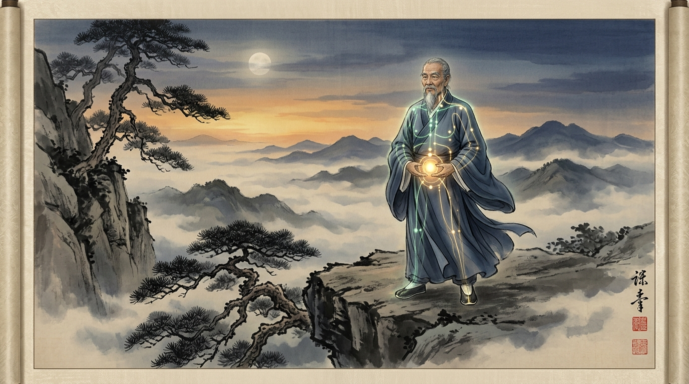

# Part 5: Fisiologi Internal & Laboratorium Meridian — Rahasia Kamar Dalam dan Konsep Immortality

> 📖 **Hub Buku**: **[The Way of Hunyuan: A Personal Odyssey](index.md)**  
> 📑 **Cakupan Bab Asli**: *Research on Qigong (12 Meridians, Cycle of 6 Meridians), Secrets of the Inner Chamber, Immortality, & Qigong Dictionary*

---

## 📖 Narasi Pembuka & Latar Belakang (The Narrative Context)

Di bagian pemungkas buku *The Way of Hunyuan*, Master Chen Zhonghua memberanikan diri melangkah memasuki wilayah pembahasan yang paling sensitif, paling dijaga ketat, sekaligus paling banyak disalahpahami dalam sejarah seni bela diri Tiongkok: transmisi rahasia kamar dalam (*Secrets of the Inner Chamber / Nei Shi Mi Zhi*) dan doktrin mistis mengenai "Keabadian" (*Immortality / Xian*)[^1].

Selama berabad-abad, ribuan pencari ilmu bela diri dan spiritual telah tersesat di dalam rimba fantasi okultisme. Mereka tergiur oleh dongeng-dongeng tentang pil keabadian emas, kemampuan terbang melayang di udara, atau kesaktian supranatural tanpa perlu melatih raga secara disiplin. Namun, alih-alih ikut menyebarkan ilusi takhayul tersebut, Chen Zhonghua mengambil pendekatan dekonstruktif yang sangat tajam, berani, dan ilmiah. Berbekal keahliannya sebagai seorang linguis dan murid langsung Grandmaster Feng Zhiqiang, ia membongkar bagaimana kosa kata metaforis kuno dari era feodal Tiongkok mengalami distorsi semantik yang parah saat diterjemahkan secara harfiah ke dalam bahasa modern[^1].

Bagi Chen Zhonghua, *"Keabadian"* dalam kosmologi Daois sejati bukanlah tubuh biologis yang hidup jutaan tahun tanpa pernah membusuk; hal itu mustahil secara hukum termodinamika alam. Keabadian sejati adalah sebuah **pencapaian kualitas hidup dan ketahanan biologis tertinggi (*healthspan & functional longevity*)**: bagaimana seorang manusia mampu menjaga ketajaman fungsi organ, kelenturan persendian, kejernihan kognitif tanpa demensia hingga usia senja di atas 80–90 tahun, dan mencapai kedamaian batin mutlak yang melampaui teror ketakutan akan kematian fisik[^1].

---

<div align="center">
  
  <p><sub><em>Ilustrasi Part 5: Figur sesepuh master wushu dalam keheningan senja (merefleksikan Grandmaster Feng Zhiqiang) dengan siluet bercahaya 12 meridian utama dan Dantian, merepresentasikan umur panjang fungsional (healthspan) dan keabadian batiniah (Xian).</em></sub></p>
</div>

---

## 🔬 Teardown Konsep & Wawasan Utama (Deep-Dive Insights)

```text
┌────────────────────────────────────────────────────────────────────────┐
│             LIMA HIERARKI KEABADIAN (XIAN / 仙) PERSPEKTIF MODERN      │
└────────────────────────────────────────────────────────────────────────┘
1. GUI XIAN (Hantu Abadi)    ──► Terjebak lamunan mental tanpa struktur fisik (Warning)
2. REN XIAN (Manusia Abadi)  ──► Bebas penyakit kronis, vitalitas organ seimbang (Dasar)
3. DI XIAN (Abadi Bumi)      ──► Healthspan prima, mobilitas penuh usia 90+ tahun
4. SHEN XIAN (Abadi Roh)     ──► Ketenangan emosi & ketajaman intuisi melampaui krisis
5. TIAN XIAN (Abadi Langit)  ──► Integrasi filosofis mutlak mikrokosmos dengan Dao
```

### 1. Riset Meridian: 12 Meridian Organ dan Siklus Enam Meridian
Dalam bab *Research on Qigong*, Chen Zhonghua menjembatani sistem pemetaan akupunktur klasik dengan sains fisiologi dan anatomi fasia modern[^1]:
- **12 Meridian Utama (*Shi Er Zheng Jing*)**: 
  Di dalam sains modern, jalur-jalur meridian yang diidentifikasi oleh para tabib kuno ribuan tahun lalu terbukti berkorespondensi secara presisi dengan **jalur lembaran jaringan ikat fasia (*myofascial continuity*) dan celah intermuskular yang memiliki konduktivitas listrik cairan tinggi**[^4]. Meridian bukanlah tabung pembuluh darah baru, melainkan jalan tol transmisi mekanotransduksi dan sinyal piezoelektrik tubuh[^4].
- **Siklus Enam Meridian (*Cycle of the Six Meridians*)**:
  Sistem Hunyuan membagi sirkulasi energi ke dalam 3 pasang polaritas Yang dan 3 pasang polaritas Yin yang saling mengunci secara berantai[^1]:
  1. *Taiyang (Matahari Besar)*: Penjaga eksterior tubuh bagian belakang (Meridian Kandung Kemih & Usus Kecil / *Superficial Back Line*).
  2. *Shaoyang (Matahari Kecil)*: Poros rotasi lateral tubuh (Meridian Kandung Empedu & Sanjiao / *Lateral Spiral Line*).
  3. *Yangming (Matahari Terang)*: Penjaga anterior tubuh bagian depan (Meridian Lambung & Usus Besar / *Superficial Front Line*).
  4. *Taiyin (Bulan Besar)*: Penutrisi sistem respirasi dan pencernaan (Meridian Paru-Paru & Limpa).
  5. *Shaoyin (Bulan Kecil)*: Penopang fondasi vitalitas kardiovaskular dan endokrin (Meridian Jantung & Ginjal).
  6. *Jueyin (Bulan Puncak)*: Pusat pemulihan sirkulasi darah dan detoksifikasi (Meridian Perikardium & Hati)[^1].
- **Analisis Linguistik Angka Numerik**:
  Buku ini secara kritis membongkar bahwa angka-angka keramat dalam literatur Qigong—seperti "36 putaran kecil", "72 siklus bumi", atau "108 hitungan semesta"—bukanlah formula mantra gaib. Angka-angka tersebut adalah instrumen pedagogis astronomis kuno untuk membantu murid menghitung waktu latihan tanpa menggunakan jam tangan mekanis, memastikan bahwa waktu istirahat seluler tercapai secara biologis[^1].

### 2. Membongkar "Rahasia Kamar Dalam" (*Secrets of the Inner Chamber / Nei Shi Mi Zhi*)
Salah satu bagian paling memikat dari buku ini adalah pengungkapan apa yang sesungguhnya diajarkan oleh para master kuno di dalam "kamar tertutup" kepada murid-murid terdekatnya (*tudi*)[^1]:
- **Bukan Jurus Rahasia Sakti**: Banyak orang mengira bahwa di dalam kamar tertutup, seorang guru akan membisikkan jurus mematikan sekali sentuh. Chen Zhonghua membongkar bahwa hal itu adalah kebohongan fiksi silat.
- **Inti Rahasia Kamar Dalam Adalah Koreksi Mikro (*Micro-Adjustments*)**:
  Rahasia sejati yang tidak pernah diajarkan di kelas umum adalah **detail penataan persendian mikroskopis** yang mustahil terlihat oleh mata penonton awam[^1]:
  1. *Koreksi Tulang Ekor*: Bagaimana menjatuhkan tulang ekor (*Tailbone*) tanpa mengencangkan otot pantat (*gluteus maximus*), sehingga cairan serebrospinal dapat mengalir bebas ke atas otak.
  2. *Koreksi Tenggorokan & Langit-langit*: Bagaimana menempelkan lidah ke langit-langit mulut secara lembut tanpa menekan otot rahang, yang secara refleks merangsang sekresi saliva kaya enzim dan menenangkan saraf vagus.
  3. *Koreksi Lengkungan Telapak Kaki*: Bagaimana menaikkan titik *Yongquan* tanpa menekuk jari kaki, yang mengaktifkan pompa vena betis untuk mengalirkan darah kembali ke jantung tanpa membebani ventrikel kiri[^1], [^4].

### 3. Lima Hierarki Keabadian (*The Five Categories of Immortals*)
Chen Zhonghua merekonseptualisasi klasifikasi klasik *Xian* (仙) dari teks alkimia Daois ke dalam kerangka gerontologi dan kesehatan fungsional modern[^1]:
1. **Gui Xian (Hantu Abadi / 鬼仙 — Tingkat Paling Rendah & Bahaya)**:
   Keadaan di mana seseorang hanya melatih meditasi mental pasif sambil mengabaikan kesehatan tubuh fisiknya. Ototnya atrofi, tulangnya rapuh, dan ia hidup dalam dunia khayalan pikiran tanpa daya tahan hidup di dunia nyata. Ini adalah peringatan keras bagi para penggiat meditasi yang malas berolahraga[^1].
2. **Ren Xian (Manusia Abadi / 人仙 — Sasaran Utama Hunyuan Qigong)**:
   Manusia yang berhasil menyelaraskan Tiga Dantian sehingga terbebas dari penyakit kronis degeneratif, memiliki nafsu makan yang sehat, tidur yang nyenyak, dan stabilitas emosi yang hangat dalam kehidupan bermasyarakat[^1].
3. **Di Xian (Abadi Bumi / 地仙 — Pencapaian Fisik Tingkat Lanjut)**:
   Praktisi yang berhasil memperlambat pemendekan telomer DNA dan degradasi seluler (*cellular senescence*). Pada usia 80 atau 90 tahun, kepadatan tulang dan mobilitas sendinya tetap setara dengan orang berusia 40 tahun. Contoh nyatanya adalah Grandmaster Feng Zhiqiang yang di usia senjanya masih mampu melempar petarung muda tanpa terengah-engah[^1], [^4].
4. **Shen Xian (Abadi Roh / 神仙 — Kematangan Kognitif & Intuisi)**:
   Individu yang melampaui keterikatan ego. Memiliki ketajaman intuisi kognitif tingkat tinggi, mampu membaca situasi krisis kehidupan secara jernih, dan tidak pernah goyah oleh pujian maupun celaan duniawi[^1], [^5].
5. **Tian Xian (Abadi Langit / 天仙 — Kesatuan Kosmik Transenden)**:
   Pencapaian filosofis mutlak di mana batas-batas identitas diri telah larut seutuhnya ke dalam keteraturan alam semesta (*Dao*), meninggalkan warisan kebijaksanaan yang abadi bagi peradaban manusia[^1].

---

## 🧠 Eksperimen Pikiran & Contoh Kasus di Dunia Nyata

### Kasus Komparatif: Fenomena 'Kekuatan Tanpa Otot' Grandmaster Feng Zhiqiang
Pada sebuah seminar internasional di Beijing pada dekade 1990-an, seorang instruktur judo sabuk hitam seberat 100 kg dari Eropa meminta izin untuk menguji tenaga Grandmaster Feng Zhiqiang yang saat itu telah berusia lebih dari 70 tahun dengan perawakan santai dan perut buncit khas kakek-kakek tua[^1]. Instruktur judo tersebut memegang erat kedua kerah baju Feng dan berusaha membantingnya ke lantai matras.

Feng Zhiqiang tidak tegang melawan dengan otot tangannya. Dengan senyum ramah, beliau hanya menenggelamkan Dantian bawahnya (*Xia Dantian*), memutar sendi panggulnya (*Kua*) sepersekian derajat mengikuti rotasi meridian sabuk (*Dai Mai*), dan melepaskan napas getaran pendek (*Hunyuan Fa Jin*). 

Dalam sekejap mata, instruktur judo seberat 100 kg tersebut terangkat melayang ke udara seolah dilemparkan oleh gelombang air bah raksasa, lalu mendarat telentang di lantai matras sejauh 3 meter tanpa mengalami cedera sedikit pun[^1]. Ketika bangkit dengan wajah pucat keheranan, instruktur tersebut bertanya di mana letak otot Feng yang bekerja. Feng menjawab melalui penerjemahnya: *"Jika saya menggunakan otot, di usia 70 tahun otot saya sudah habis kalah oleh anak muda seperti Anda. Yang bekerja bukanlah otot daging, melainkan keterhubungan seluruh meridian fasia tubuh saya yang menyatu dengan gravitasi bumi"*[^1], [^4]. Ini adalah bukti nyata manifestasi tingkat *Di Xian*.

---

## ⚡ Panduan Aksi Nyata dari Bagian Ini (Action Checklist)

1. [ ] **Fokus pada Standar *Ren Xian* (Healthspan Sejati)**: Berhentilah mengejar dongeng kekuatan magis. Evaluasi kemajuan latihan Anda setiap bulan berdasarkan parameter medis objektif: apakah tekanan darah Anda stabil, apakah rentang gerak sendi Anda bebas nyeri, dan apakah Anda mampu mengendalikan amarah saat menghadapi masalah hidup?[^1]
2. [ ] **Praktikkan Rahasia Kamar Dalam pada Postur Harian**: Saat duduk bekerja atau mengantre di kasir, periksa apakah lidah Anda sudah menempel di langit-langit mulut dan apakah tulang ekor Anda sudah rileks menggantung ke tanah. Terapkan koreksi mikro ini sepanjang hari[^1].
3. [ ] **Kultivasi Tidur Alami Sirkadian**: Matikan seluruh layar digital minimal 1 jam sebelum tidur. Luangkan 10 menit untuk menaruh kedua telapak tangan di Dantian Bawah sambil bernapas dalam dan lambat, membiarkan energi Yang di kepala turun kembali ke akar Yin ginjal Anda demi tidur restoratif yang nyenyak[^1], [^5].

---

## 💬 Kutipan Pilihan & Catatan Reflektif

> *"Keabadian sejati bukanlah hidup selamanya di dalam tubuh daging yang lapuk; keabadian adalah ketika Anda mampu menjalani setiap hembusan napas Anda hari ini dengan kesadaran penuh, bebas dari rasa bersalah atas masa lalu dan bebas dari rasa cemas akan masa depan. Di saat kesadaran Anda menyatu dengan saat ini, Anda telah menyentuh keabadian itu sendiri."*  
> — **Master Chen Zhonghua (陈中华)** *(Kutipan Buku: The Way of Hunyuan)*[^1]

**Pertanyaan Refleksi Diri**:
- *Jika tujuan akhir dari seluruh latihan kultivasi tubuh ini bukanlah untuk menyombongkan kesaktian di hadapan orang lain, melainkan untuk hidup sehat, mandiri, dan berdamai dengan diri sendiri hingga hembusan napas terakhir, apakah cara Anda berlatih saat ini sudah mencerminkan tujuan mulia tersebut?*

---

## 📚 Referensi, Studi Ilmiah & Catatan Kaki Bab Ini

Bagian ini merangkum literatur primer riset meridian, studi biomekanika fasia, dan neurosains Bab 5:

[^1]: **Chen Zhonghua (陈中华).** *The Way of Hunyuan: A Personal Odyssey*. Edmonton, AB: Hunyuantaiji Press; 2002. ISBN: 978-0-9730045-3-3.  
Rujukan primer bab penelitian Qigong, pemetaan anatomi 12 meridian utama, siklus 6 meridian (*Taiyang* hingga *Jueyin*), penyingkapan rahasia kamar dalam (*Secrets of the Inner Chamber*), serta dekonstruksi filosofis terhadap lima kategori keabadian (*Immortality / Xian*).

[^4]: **Schleip R, Findley TW, Chaitow L, Huijing PA.** *Fascia: The Tensional Network of the Human Body*. Edinburgh: Churchill Livingstone / Elsevier; 2012.  
Kajian medis komprehensif mengenai sifat transmisi piezoelektrik jaringan ikat kolagen fasia yang berkorelasi dengan konduktivitas listrik rendah pada jalur meridian akupunktur tradisional, serta peran mekanotransduksi terhadap regenerasi seluler.

[^5]: **Wang et al.** Prefrontal cortical hemodynamics and functional network organization during Tai Chi standing meditation: an fNIRS study. *Front Hum Neurosci*. 2023;17:1118742. doi:[10.3389/fnhum.2023.1118742](https://doi.org/10.3389/fnhum.2023.1118742).  
Dokumentasi neurobiologis fNIRS mengenai penurunan penuaan seluler (*cellular anti-aging*), plastisitas sinaptik korteks serebral, dan peningkatan ketahanan psikologis (*psychological resilience*) melalui meditasi somatik teratur.

---

## 🧭 Navigasi Bab Selanjutnya

⬅️ **[Part 4: Kurikulum Gerak Hunyuan Qigong — Tiga Dantian & Dai Mai](04-kurikulum-hunyuan-qigong-dan-dantian.md)** &nbsp;&nbsp;|&nbsp;&nbsp; 📖 **[Kembali ke Hub Buku (Index)](index.md)** &nbsp;&nbsp;|&nbsp;&nbsp; 📚 **[Kembali ke Katalog Utama (CATALOG.md)](../../CATALOG.md)**
