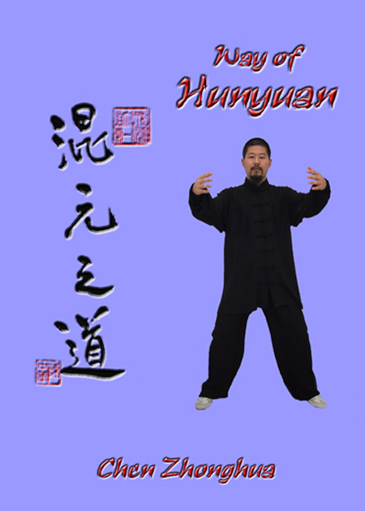
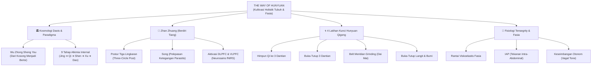

# 📖 The Way of Hunyuan: A Personal Odyssey

<div align="center">
  
</div>

> 📚 **[Kembali ke Katalog Utama (CATALOG.md)](../../CATALOG.md)**  
> **Penulis**: Master Chen Zhonghua (陈中华)  
> **Transmisi Silsilah**: Grandmaster Feng Zhiqiang (冯志强, Chen Style Taiji & Hunyuan Qigong) & Grandmaster Hong Junsheng (洪均生, Practical Method)  
> **Tahun Terbit**: 2002 | **Penerbit**: Hunyuantaiji Press (Edmonton, Kanada)  
> **Genre**: Qigong Internal, Meditasi Zhan Zhuang, Fisiologi Fasia & Filosofi Daois  
> **Estimasi Waktu Baca Keseluruhan**: ~75–90 Menit (5 Bagian Lengkap + Anotasi Ilmiah)  
> **Rating Rekomendasi**: ⭐⭐⭐⭐⭐ (5.0/5.0)  

---

## 🧭 Peta Eksplorasi Buku (Reading Roadmap)

Karya ini merupakan fondasi internal (*Internal Cultivation*) yang menjadi pasangan harmonis bagi *Chen Style Practical Method*. Dibedah ke dalam 5 modul naratif mendalam:

- [x] 📘 **[Part 1: Odisea Pribadi & Esensi Hunyuan — Menjembatani Sains Barat dan Tradisi Daois](01-odisea-pribadi-dan-esensi-hunyuan.md)**  
  *Cakupan Asli: Acknowledgements, Introduction, History, What is Qigong, & Personal Relationships. Perjalanan hidup Chen Zhonghua dari Tiongkok ke Kanada, transmisi langka Feng Zhiqiang dan Hong Junsheng, serta demistifikasi konsep Qi.*

- [x] 📘 **[Part 2: Pijakan Filosofis Klasik — I-Ching, Dao De Jing, dan Pergeseran Paradigma Kosmik](02-fondasi-filosofis-dan-pergeseran-paradigma.md)**  
  *Cakupan Asli: The Book of Changes, Dao De Jing, Chinese Characters, & Paradigm Shift (9 Prinsip Wu Zhong Sheng You hingga Lian Xu He Dao). Membongkar metafora klasik menjadi prinsip transformasi tubuh.*

- [x] 📘 **[Part 3: Postur & Berdiri Tiang (Zhan Zhuang) — Arsitektur Tensegrity & Neurosains Ketenangan](03-postur-dan-meditasi-zhan-zhuang.md)**  
  *Cakupan Asli: Physical Requirements & Zhanzhuang. Mengapa berdiri diam tanpa gerak adalah latihan pembentukan kekuatan terdalam: aktivasi korteks prefrontal (fNIRS), penataan rantai fasia, dan dekompresi tulang belakang.*

- [x] 📘 **[Part 4: Kurikulum Gerak Hunyuan Qigong — Tiga Dantian, Belt Meridian, dan Langit-Bumi](04-kurikulum-hunyuan-qigong-dan-dantian.md)**  
  *Cakupan Asli: Gather the Qi to Three Dantian, Three-Dantian Open/Close, Belt Meridian Grinding (Dai Mai), & Heaven and Earth Open/Close. Panduan teknis latihan 4 pilar dinamis Hunyuan.*

- [x] 📘 **[Part 5: Fisiologi Internal & Laboratorium Meridian — Rahasia Kamar Dalam dan Konsep Immortality](05-fisiologi-meridian-dan-rahasia-kamar-dalam.md)**  
  *Cakupan Asli: Research on Qigong (12 Meridian, Siklus 6 Meridian), Secrets of the Inner Chamber, Immortality, & Qigong Dictionary. Integrasi kelembutan Hunyuan dengan ketegasan Practical Method.*

---

## 📜 Struktur Asli Buku (Table of Contents Mapping)

Buku *The Way of Hunyuan: A Personal Odyssey* (2002) memiliki struktur kanonis sebagai berikut:

```text
┌────────────────────────────────────────────────────────────────────────────────────────┐
│           STRUKTUR ASLI BUKU: THE WAY OF HUNYUAN (CHEN ZHONGHUA, 2002)                 │
└────────────────────────────────────────────────────────────────────────────────────────┘
1. FOUNDATIONS & HISTORY
   ├── Acknowledgements, Introduction, What is Qigong, History
   ├── Substance and Appearance, Qigong and Taiji, Chinese Characters
   └── The Book of Changes (I-Ching) & Dao De Jing

2. METHODOLOGY & PHYSICAL PRACTICE
   ├── Hunyuan Qigong, Physical Requirements
   ├── Zhanzhuang (Standing Meditation)
   ├── Gather the Qi to the Three Dantian
   ├── The Three-Dantian Open and Close
   ├── Belt Meridian Grinding (Dai Mai)
   └── Heaven and Earth Open and Close

3. THEORETICAL ESOTERICISM & PARADIGM SHIFT
   ├── The Way of Hunyuan & One Grain of Hunyuan Qi
   ├── Questions and Answers
   └── Paradigm Shift (9 Tahap Transmutasi: Wu Zhong Sheng You s.d. Lian Xu He Dao)

4. ADVANCED INTERNAL CULTIVATION & RESEARCH
   ├── Secrets of the Inner Chamber (Nei Shi Mi Zhi)
   ├── Immortality (Definisi & Kategori Keabadian Daois)
   ├── Research on Qigong (Meridian, Siklus 6 & 12 Meridian, Numerik Qi)
   └── Qigong Dictionary, References, History Chart, Index
```

---

## 🎯 1. Inti Filosofis & Tesis Utama

> **"Kekuatan mekanis tanpa kelembutan internal akan melahirkan kekakuan yang mudah patah; sebaliknya, kelembutan internal tanpa presisi struktur hanyalah angan-angan kosong. Hunyuan Qigong adalah seni melahirkan substansi padat dari kekosongan (Wu Zhong Sheng You), di mana tubuh dipulihkan ke keadaan primordial (Hunyuan) sebelum terpecah oleh ketegangan modern."**

Jika buku *Chen Style Taijiquan Practical Method* membedah tubuh seperti mesin jam mekanis dengan roda gigi baja dan hukum tuas tanpa ampun, maka ***The Way of Hunyuan*** adalah nafas kehidupan yang melumasi dan menghidupkan mesin tersebut. Master Chen Zhonghua merangkum warisan Grandmaster **Feng Zhiqiang (冯志强)**—pencipta aliran *Chen Style Xinyi Hunyuan Taijiquan*—yang menggabungkan kedahsyatan bela diri Chen Fake dengan kelembutan kultivasi internal Xinyiquan Hu Yaozhen.

Tesis utama buku ini menolak pemisahan keliru antara "bela diri tempur" dan "penyembuhan kesehatan". Menurut Chen Zhonghua, tubuh manusia modern berada dalam kondisi terfragmentasi: pikiran melayang ke masa depan, otot bahu tegang mencengkeram stres harian, dan napas dangkal tercekat di dada atas. Melalui latihan **Hunyuan (kembali ke keutuhan primordial yang menyatu)**, seluruh jaringan fasia, pernapasan diafragma, dan kesadaran neurologis diintegrasikan kembali menjadi satu bola kesatuan yang utuh (*One Grain of Hunyuan Qi*).

---

## 💡 2. Peta Konsep & Kerangka Berpikir Utama (Core Frameworks)



- **Pilar 1: Wu Zhong Sheng You (Melahirkan Isi dari Kekosongan)**: Memahami bahwa kekuatan internal tidak didapat dari menambah ketegangan otot baru, melainkan dari melucuti seluruh ketegangan otot parasitis (*Song*) hingga yang tersisa hanyalah struktur tulang murni dan elastisitas fasia.
- **Pilar 2: Zhan Zhuang sebagai Kalibrasi Neuromuskular**: Berdiri diam dalam postur memeluk pohon (*Three-Circle Post*) bukan sekadar latihan fisik, melainkan latihan *re-wiring* sistem saraf pusat dan penyeimbangan rantai *tensegrity* tubuh di bawah gravitasi bumi.
- **Pilar 3: Integrasi 3 Dantian & Saluran Dai Mai**: Menghubungkan Dantian Bawah (pusat fisik/vitalitas), Dantian Tengah (pusat respirasi/emosi), dan Dantian Atas (pusat kejernihan mental) yang diikat secara horizontal oleh meridian sabuk panggul (*Dai Mai*).

---

## ⚡ 3. Playbook Praktis: Rencana Latihan Harian Hunyuan

Gunakan kurikulum latihan bertahap ini untuk membangun kualitas internal tubuh Anda:

### Fase 1: Hari Ini (Membangun Kebiasaan Berdiri)
- [ ] **15 Menit Zhan Zhuang Fondasi**: Berdiri dengan kaki selebar bahu, lutut sedikit ditekuk (jangan melewati ujung jari kaki), panggul tenggelam seperti duduk di kursi tinggi (*Song Kua*). Lingkarkan kedua tangan di depan dada seolah memeluk batang pohon besar.
- [ ] **Audit Ketegangan Bahu**: Setiap kali Anda menarik napas, periksa apakah bahu Anda terangkat ke arah telinga. Turunkan siku, rilekskan tulang belikat (*Shen Jian Zhui Zhou*).

### Fase 2: 30 Hari Pertama (Mengaktifkan Sabuk Panggul / Dai Mai)
- [ ] **Latihan Belt Meridian Grinding (Dai Mai)**: Lakukan 36 putaran horizontal panggul secara perlahan setiap pagi. Bayangkan pinggang Anda sedang menggiling batu gilingan kedelai kuno, menjaga kepala tetap tegak melayang (*Xu Ling Ding Jin*).
- [ ] **Pernapasan Dantian Terbalik**: Latih pernapasan diafragma di mana perut bawah mengembang lembut saat menghembuskan napas dan memadat saat menarik napas, memperkuat tekanan intra-abdominal (IAP).

### Fase 3: Jangka Panjang (Peleburan Struktur & Kelembutan)
- [ ] **Sintesis Hunyuan & Practical Method**: Sebelum berlatih jurus Yilu atau dorong tangan (*Tuishou*), lakukan 20 menit Hunyuan Qigong untuk melembutkan fasia. Saat menghadapi tekanan lawan, pertahankan relaksasi internal Hunyuan di dalam bingkai geometri kaku Practical Method.

---

## 📚 4. Daftar Literatur & Referensi Primer Terpenting

1. **Chen Zhonghua (陈中华) (2002)** — *The Way of Hunyuan: A Personal Odyssey*. Edmonton, AB: Hunyuantaiji Press. ISBN: 978-0-9730045-3-3.  
*Buku teks primer panduan Hunyuan Qigong dan filsafat Daois praktis.*
2. **Feng Zhiqiang (冯志强) (1998)** — *Chen Style Xinyi Hunyuan Taijiquan*. Beijing: People's Sports Publishing House.  
*Kanon asli pendiri aliran Hunyuan Taiji, murid Chen Fake dan Hu Yaozhen.*
3. **Laozi (老子) & Wang Bi (Anotasi)** — *Dao De Jing (道德经)*.  
*Fondasi kosmologi Wu Ji, Tai Ji, dan prinsip kelembutan menaklukkan kekerasan.*
4. **Schleip R, Findley TW, Chaitow L, Huijing PA (2012)** — *Fascia: The Tensional Network of the Human Body*. Edinburgh: Churchill Livingstone / Elsevier.  
*Literatur medis standar mengenai sistem biotensegrity fasia tubuh manusia.*
5. **Wang et al. (2023)** — *Prefrontal cortical hemodynamics and functional network organization during Tai Chi standing meditation: an fNIRS study*. *Frontiers in Human Neuroscience*. doi:[10.3389/fnhum.2023.1118742](https://doi.org/10.3389/fnhum.2023.1118742).  
*Studi neurosains fNIRS yang membuktikan aktivasi hemodinamik dorsolateral prefrontal cortex (DLPFC) selama meditasi berdiri Zhan Zhuang.*

---

## ⚖️ 5. Evaluasi Kritis & Tinjauan Metodologi Ilmiah

- **Kekuatan Terbesar**: Buku ini berhasil menerjemahkan bahasa simbolis Daois kuno (seperti transmutasi *Jing-Qi-Shen* dan I-Ching) menjadi instruksi fisiologis modern yang dapat dipraktekkan secara konkret tanpa jatuh ke dalam mistisisme buta.
- **Audit Metodologi & Validitas Ilmiah**:
  - Konsep "aliran Qi" dalam buku ini sangat selaras dengan fisiologi sistem saraf otonom (peningkatan tonus vagal parasimpatis) dan respon mekanotransduksi jaringan ikat fasia.
  - Namun, klaim-klaim metafisik mengenai *"Immortality"* (keabadian) harus dipahami secara filosofis-simbolis sebagai perpanjangan usia fungsional (*healthspan*) dan kejernihan batiniah, bukan sebagai keabadian fisik supranatural.
- **Kritik & Titik Buta (Blind Spots)**: Bagi praktisi pemula yang murni mencari efektivitas bela diri instan, buku ini membutuhkan kesabaran luar biasa karena menekankan berdiri diam berjam-jam (*Zhan Zhuang*) daripada teknik pukulan dinamis.
- **Profil Pembaca Ideal**: Praktisi Taiji gaya Chen, penggiat meditasi/Qigong, terapis somatik, dan siapa saja yang ingin memulihkan ketegangan saraf kronis akibat gaya hidup sedentari modern.

