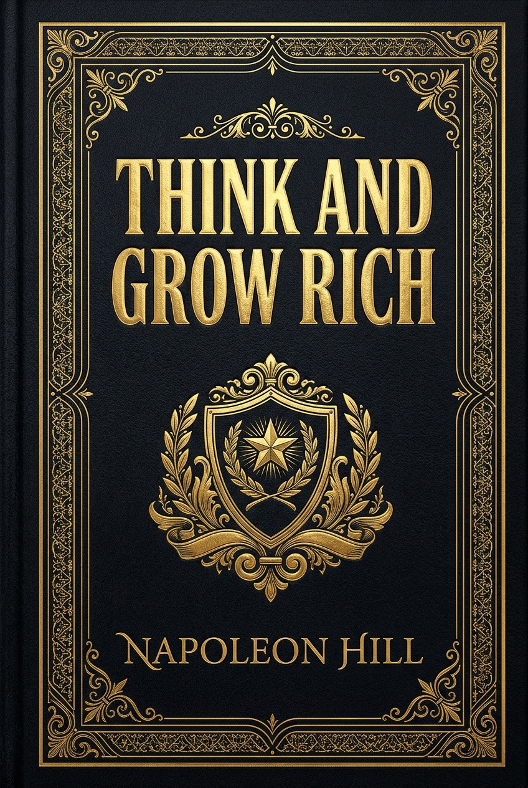

# 📖 Think and Grow Rich: Master Hub & Panduan Teardown Naratif

<div align="center">
  
</div>

> 📚 **[Kembali ke Katalog Buku (CATALOG.md)](../../CATALOG.md)**  
> **Penulis**: Napoleon Hill  
> **Tahun Terbit**: 1937 | **Penerbit Asli**: The Ralston Society  
> **Genre / Kategori**: Pengembangan Diri, Filosofi Sukses, Psikologi Finansial  
> **Estimasi Total Membaca Hub Ini**: 60 - 75 menit (Mendalam per modul)  
> **Rating Rekomendasi**: ⭐⭐⭐⭐⭐ (5.0/5) — *Magnum Opus Filosofi Prestasi Pribadi Sepanjang Masa*  

---

## 🧭 Peta Eksplorasi Buku (Reading Roadmap)

Buku ini dibedah ke dalam 4 modul teardown naratif mendalam untuk mempertahankan kekuatan kisah nyata, dialog sejarah, analogi klasik, dan penerapan praktis 13 Prinsip Prestasi Napoleon Hill:

- 📘 **[Part 1: Fondasi Mental & Hasrat Membara (Desire, Faith, Auto-Suggestion)](01-fondasi-mental-dan-hasrat-membara.md)**  
  *Kisah Edwin C. Barnes bermitra dengan Edison, membakar jembatan mundur ('Burn the ships'), tragedi R.U. Darby (tiga kaki dari urat emas), 6 langkah konversi hasrat menjadi uang tunai, dan seni memprogram alam bawah sadar.*

- 📘 **[Part 2: Bengkel Pikiran & Strategi Eksekusi (Specialized Knowledge, Imagination, Organized Planning)](02-bengkel-pikiran-dan-strategi-eksekusi.md)**  
  *Sanggahan Henry Ford di hadapan pengadilan, rahasia formula Coca-Cola, pidato Charles M. Schwab bernilai \$600 juta yang melahirkan U.S. Steel, 11 sifat pemimpin sejati, serta 28 kuesioner inventarisasi diri (QQS).*

- 📘 **[Part 3: Daya Penggerak & Pengganda Kekuatan (Decision, Persistence, Master Mind, Sex Transmutation)](03-penggerak-tindakan-dan-pengganda-kekuatan.md)**  
  *Keberanian 56 penandatangan Deklarasi Kemerdekaan Amerika Serikat, ketekunan 10.000 kegagalan Edison, aliansi baterai otak (Master Mind), serta misteri transmutasi energi biologis menjadi dorongan karya jenius.*

- 📘 **[Part 4: Fisika Mental & Menaklukkan Enam Hantu Ketakutan (Subconscious Mind, Brain, Sixth Sense, The 6 Ghosts of Fear)](04-fisika-mental-dan-menaklukkan-ketakutan.md)**  
  *Kisah inspiratif Blair Hill yang menaklukkan ketunarunguan, dewan penasihat tak kasatmata (The Invisible Counselors), antena pemancar otak, indra keenam, serta diagnosis dan pembasmian 6 hantu ketakutan penjarah potensi hidup.*

---

## 🎯 1. Inti Filosofis & Tesis Utama

Pada tahun 1908, seorang pemuda wartawan miskin bernama Napoleon Hill diutus mewawancarai Andrew Carnegie—raja baja terkaya di dunia pada masanya. Wawancara tiga jam itu berubah menjadi maraton diskusi tiga hari tiga malam. Di akhir pertemuan, Carnegie melemparkan sebuah tantangan yang mengubah arah hidup Hill:

> *"Maukah Anda mendedikasikan 20 tahun hidup Anda ke depan, tanpa bayaran sepeser pun dari saya selain surat pengantar, untuk mewawancarai lebih dari 500 orang paling sukses di Amerika dan menyaring formula kesuksesan mereka menjadi satu filosofi praktis yang dapat dipelajari oleh setiap orang biasa?"*

Hill menjawab ya hanya dalam hitungan 29 detik. Selama seperempat abad berikutnya, Hill membedah pola pikir Thomas Edison, Henry Ford, Alexander Graham Bell, John D. Rockefeller, Charles M. Schwab, hingga Theodore Roosevelt. Hasil akhirnya adalah buku legendaris ini: **Think and Grow Rich (1937)**.

Tesis sentral buku ini mematahkan dogma bahwa kekayaan adalah hasil dari hak istimewa keturunan, modal awal yang masif, atau keberuntungan buta semata:

> **"Kekayaan dan pencapaian bermula dari sebuah keadaan pikiran (*state of mind*)—sebuah hasrat yang definitif dan membara, yang diubah menjadi ekuivalen fisiknya melalui visualisasi keyakinan, perencanaan terorganisir, aliansi pikiran, dan ketekunan pantang mundur."**

Pikiran adalah energi magnetis. Pikiran yang didominasi oleh ketakutan dan keraguan akan menarik kemiskinan dan kemunduran; sebaliknya, pikiran yang diikat kuat pada tujuan tunggal (*Definite Major Purpose*) dengan keyakinan tanpa syarat akan mengarahkan semua daya kreatif, koneksi sosial, dan peluang menuju pencapaian nyata.

```text
    ┌────────────────────────────────────────────────────────┐
    │       ALUR TRANSMUTASI DARI PIKIRAN MENJADI REALITAS   │
    ├────────────────────────────────────────────────────────┤
    │                                                        │
    │   [ HASRAT MEMBARA ]  (Definite Major Purpose)         │
    │           ↓                                            │
    │   [ KEYAKINAN & SUGESTI ] (Faith & Auto-Suggestion)    │
    │           ↓                                            │
    │   [ IMAJINASI & PENGETAHUAN ] (Creative Workshop)      │
    │           ↓                                            │
    │   [ RENCANA TERORGANISIR & KEPUTUSAN ] (Action Blue)   │
    │           ↓                                            │
    │   [ KETEKUNAN & MASTER MIND ] (Endurance & Synergies)  │
    │           ↓                                            │
    │   [ HASIL FISIK & FINANSIAL NYATA ] (Tangible Riches)  │
    │                                                        │
    └────────────────────────────────────────────────────────┘
```

---

## 💡 2. Peta Konsep & Kerangka Berpikir Utama (Core Frameworks)

13 Prinsip Hill bukan kumpulan teori terpisah, melainkan sebuah mesin terpadu dengan empat pilar pondasi:

### A. Pilar Fondasi Kognitif (The Mental Engine)
- **Desire (Hasrat)**: Bukan sekadar keinginan (*wishing*), melainkan obsesi yang membara (*burning obsession*) yang tidak menyisakan ruang untuk mundur.
- **Faith (Keyakinan)**: Keadaan emosional yang diinduksi secara sadar lewat visualisasi bahwa apa yang diinginkan telah menjadi milik kita.
- **Auto-suggestion (Sugesti Diri)**: Pintu gerbang dan bahasa pemrograman untuk menyuntikkan instruksi hasrat ke dalam alam bawah sadar.

### B. Pilar Rekayasa & Strategi (The Creative Workshop)
- **Specialized Knowledge (Pengetahuan Khusus)**: Pengetahuan bukanlah kekuatan (*knowledge is not power*); pengetahuan hanyalah potensi kekuatan sampai ia diorganisasikan ke dalam rencana tindakan nyata.
- **Imagination (Imajinasi)**: Bengkel tempat semua rencana dicetak. Kombinasi *Imajinasi Sintetis* (meracik konsep lama) dan *Imajinasi Kreatif* (menangkap kilatan inspirasi dari *Infinite Intelligence*).
- **Organized Planning (Perencanaan Terorganisir)**: Membentuk rencana kerja yang tahan banting, siap merevisi kegagalan sementara tanpa pernah mengubah tujuan akhir.

### C. Pilar Eksekusi & Ketahanan (The Action Multipliers)
- **Decision (Keputusan)**: Mengambil keputusan seketika dengan tegas, dan mengubahnya secara sangat lambat jika ada bukti baru. Mengakhiri penundaan (*procrastination*).
- **Persistence (Ketekunan)**: Bahan bakar yang menjaga api aksi tetap menyala saat badai penolakan dan kekalahan sementara menghadang.
- **Master Mind (Aliansi Pikiran)**: Menghubungkan dua atau lebih pikiran yang harmonis untuk menciptakan 'otak ketiga' yang jauh lebih bertenaga daripada gabungan individu.
- **Sex Transmutation (Transmutasi Seksual)**: Mengarahkan energi vital biologis terkuat manusia menuju kreativitas seni, kepemimpinan, dan keberanian profesional.

### D. Pilar Transendental & Proteksi (The Deep Mind & Shield)
- **The Subconscious Mind (Pikiran Bawah Sadar)**: Media perantara yang bekerja 24/7 menghubungkan manusia dengan sumber daya alam semesta.
- **The Brain (Stasiun Pemancar)**: Pemancar dan penerima getaran pikiran manusia.
- **The Sixth Sense (Indra Keenam)**: Puncak pencapaian mental; firasat, intuisi, dan lampu pemandu bahaya.
- **Conquering The 6 Ghosts of Fear**: Membasmi parasit ketakutan (Kemiskinan, Kritik, Sakit, Hilang Cinta, Tua, Mati) yang dapat meracuni seluruh sistem pencapaian.

---

## ⚡ 3. Playbook Praktis: Rencana Implementasi

Bagaimana menerapkan ajaran 1937 Napoleon Hill di abad ke-21 yang serba digital:

### Fase 1: Hari Ini (Definite Major Purpose & Deklarasi Diri)
- [ ] **Tuliskan 'Definite Major Purpose' Anda**: Tentukan jumlah nominal uang atau wujud pencapaian spesifik yang ingin Anda wujudkan secara presisi (bukan sekadar "ingin kaya").
- [ ] **Tentukan Kompensasi yang Anda Berikan**: Catat dengan jujur apa nilai, keahlian, atau pengorbanan nyata yang akan Anda berikan sebagai ganti dari kekayaan tersebut (karena tidak ada hasil tanpa nilai).
- [ ] **Tentukan Tenggat Waktu Pasti**: Tetapkan tanggal, bulan, dan tahun target pencapaian harus terealisasi.
- [ ] **Tuliskan Rencana Tindakan Pertama**: Rancang draf rencana awal dan segera mulai langkah pertama hari ini juga, terlepas dari apakah Anda merasa sudah siap atau belum.
- [ ] **Mulai Ritual Sugesti Pagi & Malam**: Bacakan pernyataan tertulis tersebut dengan suara lantang dan penuh perasaan dua kali sehari (sebelum tidur dan sesaat setelah bangun).

### Fase 2: 30 Hari Pertama (Membangun Aliansi & Sistem Ketekunan)
- [ ] **Bentuk Kelompok Master Mind**: Identifikasi 2 hingga 4 orang yang memiliki visi sejalan, saling melengkapi keterampilan, dan menjunjung keharmonisan total. Jadwalkan pertemuan rutin mingguan.
- [ ] **Audit Pengetahuan Khusus (Specialized Knowledge)**: Petakan kesenjangan pengetahuan teknis atau pasar yang Anda butuhkan. Rancang kurikulum belajar mandiri atau rekrut ahli yang menguasainya.
- [ ] **Praktikkan 4 Langkah Ketekunan**: (1) Tujuan definitif, (2) Rencana konkret, (3) Pikiran kedap terhadap kritik negatif keluarga/teman terdekat, (4) Aliansi Master Mind penyemangat.
- [ ] **Hilangkan Keragu-raguan Harian**: Latih mengambil keputusan kecil dalam waktu di bawah 60 detik untuk memotong kebiasaan overthinking.

### Fase 3: Jangka Panjang (Sanitasi Mental & Ketahanan Karakter)
- [ ] **Audit 'Enam Hantu Ketakutan'**: Evaluasi secara berkala ketakutan terbesar mana yang sedang menghambat Anda—apakah takut kritik (*apa kata orang*), takut kemiskinan (*kehilangan rasa aman*), atau takut penolakan.
- [ ] **Terapkan 'Dewan Penasihat Tak Kasatmata' (Invisible Counselors)**: Sebelum tidur, lakukan latihan visualisasi meja bundar bersama tokoh-tokoh panutan sejarah/profesional untuk meminta arahan moral dan kebijaksanaan etis mereka.
- [ ] **Transmutasikan Energi & Emosi Negatif**: Setiap kali rasa frustrasi, marah, atau dorongan impulsif muncul, alihkan seketika ke dalam sesi kerja mendalam (*deep work*), olahraga berat, atau karya kreatif.

---

## ⚖️ 4. Evaluasi Kritis & Ulasan Objektif

### Kekuatan Terbesar
- **Kekuatan Psikologis & Motivasi Abadi**: Hill adalah pionir yang pertama kali merumuskan hubungan langsung antara keyakinan batin (*internal belief system*) dengan hasil eksternal, mendahului gelombang neurosains modern dan psikologi kognitif.
- **Konsep Master Mind yang Brilian**: Gagasan bahwa kecerdasan kolektif yang harmonis melipatgandakan peluang kesuksesan telah menjadi fondasi inkubator bisnis modern, dewan penasihat startup, dan peer-group eksekutif global.
- **Etos Nilai Tambah**: Hill secara tegas menolak gagasan "sesuatu tanpa imbalan" (*something for nothing*). Uang hanyalah cerminan dari nilai dan pelayanan yang diberikan kepada masyarakat luas.

### Kritik & Titik Buta (Blind Spots)
- **Bias Kesintasan (Survivorship Bias)**: Hill mewawancarai para pemenang terbesar era industrialis Amerika (yang juga diuntungkan oleh ketiadaan regulasi antimonopoli dan ekspansi ekonomi pascaperang), tanpa membedah mereka yang memiliki hasrat sama membara namun gagal karena faktor struktural.
- **Elemen Mistis & Pseudains**: Bab mengenai *The Brain* dan *The Sixth Sense* kerap menggunakan terminologi "ether", "getaran kosmik", dan "transmutasi seksual" dengan pendekatan esoterik era 1930-an yang tidak memiliki landasan empiris ilmiah modern yang ketat (meski prinsip psikologis di baliknya tetap valid).
- **Kritik Sosio-Ekonomi**: Pendekatan Hill terkadang mengabaikan faktor ketimpangan sosial, modal awal sistemik, dan diskriminasi rasial/gender yang nyata terjadi pada awal abad ke-20.

### Profil Pembaca Ideal
- **Wirausahawan, Kreator, dan Eksekutif**: Yang sedang merintis proyek berisiko tinggi dan membutuhkan ketahanan mental luar biasa melawan kegagalan sementara.
- **Profesional yang Sedang Terjebak Stagnasi**: Yang membutuhkan pergeseran paradigma dari sekadar "bekerja keras" menjadi "mengorganisasi rencana dan pengaruh aliansi".
- **Penikmat Literatur Finansial & Klasik Pengembangan Diri**: Yang ingin memahami sumber hulu (*fountainhead*) dari hampir seluruh buku pengembangan diri modern yang beredar hari ini.

